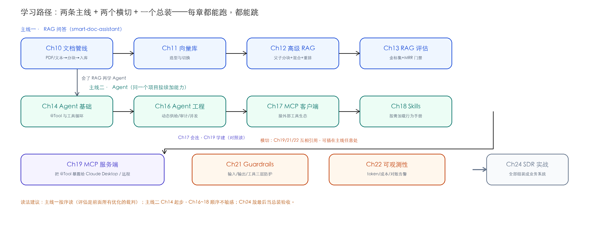

# Ch00 前置速查——环境、路径与全系列约定

> **本章基线**：LangChain4j `1.22.0` + 实验模块 `1.22.0-beta32` ｜ JDK `21` ｜ Maven `3.9+` ｜ 最后验证 `2026-10-28`

> 本章目标：
>
> 1. 15 分钟内把两个项目跑起来，或者明确知道哪一章可以先跳过
> 2. 一张图看懂 12 章 + 2 项目的依赖关系，自己安排阅读顺序
> 3. 认识全系列的写作约定（基线块 / 实测标记 / 坑点表），知道哪些数字可以直接信
> 4. 预先踩掉环境层面的高频坑——JDK 版本、API key 欠费、Redis 缺失，本章一次说清

---

## 0.1 这套教程给你什么

教程围绕两个可运行的 Spring Boot 项目展开，所有章节的代码都来自它们：

| 项目 | 端口 | 是什么 | 服务哪些章 |
|---|---|---|---|
| `smart-doc-assistant` | 8090 | 智能文档问答（RAG + Agent，多租户） | Ch10~Ch19、Ch21、Ch22 |
| `sdr-ai-assistant` | 8091 | B2B 外贸 SDR 自动化（FSM + 多 Agent + 自迭代） | Ch24 |

内容分两条主线。**RAG 主线**（Ch10→13）从文档进库讲到评估门禁，解决"怎么让 AI 答得准、并且知道它到底准不准"；**Agent 主线**（Ch14→18）从单个工具调用讲到工程化治理和外部生态，解决"怎么让 AI 自己干活、并且干得可控"。Ch19 是 MCP 的服务端视角（与 Ch17 客户端对照读），Ch21/22 是横切能力（防护与可观测），Ch24 把前面所有能力组装成一个完整业务系统。

版本口径全系列统一：LangChain4j 用 `1.22.0` 正式线 + `1.22.0-beta32` 实验线（Guardrails、Skills、MCP Server SDK 在实验线里），JDK 锁 `21`。

---

## 0.2 环境前置

### 0.2.1 必装

| 组件 | 版本要求 | 说明 |
|---|---|---|
| JDK | **21**（硬约束） | 父 pom 的 enforcer 强制 `[21,22)`；更高版本会让 Lombok 注解处理器失效 |
| Maven | 3.9+ | 两个项目都是标准单模块结构 |
| LLM API Key | 任选一家 | 放 `application-local.yml`（已被 .gitignore 排除，绝不进仓库） |

JDK 这条是**会直接报错拦你**的。今天用 JDK 25 构建时 enforcer 的原话：

```
Rule 0: RequireJavaVersion failed with message:
请用 JDK 21 构建（本仓库在 21.0.10 验证通过）。更高版本会让 Lombok 失效。
```

机器上装了多个 JDK 时，让 `JAVA_HOME` 指向 21 再跑 Maven（macOS：
`export JAVA_HOME=$(/usr/libexec/java_home -v 21)`）。

### 0.2.2 按章可选

| 组件 | 哪章需要 | 不装会怎样 |
|---|---|---|
| Node.js ≥ 18 | Ch17、Ch19 | MCP demo 服务器起不来；`demo-server.mjs` 零 npm 依赖，装 Node 即可 |
| MySQL 8 | Ch24（sdr 项目） | sdr 起不来；smart-doc 默认进程内存储，不需要 |
| Redis 8 | Ch24 必需；Ch11 的 Redis 向量库、Ch5 分布式记忆可选 | smart-doc 用 `--chat.memory.backend=memory` 参数可完全绕开 |
| Claude Desktop | Ch19.9.2（可选验证） | 不装也能用 curl 完成 stdio 模式自测 |

### 0.2.3 API Key 放哪

两个项目都从 `application-local.yml` 读真实 key（模板见 `application.yml` 的 `${XXX:默认值}` 占位）。这个文件**已在 .gitignore 里**，clone 下来需要自己创建。全系列实测用过两家：

- DeepSeek（`deepseek-v4-flash`）：¥1.0/M 输入 + ¥2.0/M 输出，Ch22 有完整成本实测；
- DashScope qwen（`qwen3.7-flash`）：走 OpenAI 兼容端点。

key 欠费时的报错长这样，见到就该去充值而不是改代码：
`Access denied, please make sure your account is in good standing`。

---

## 0.3 五分钟跑通 smart-doc-assistant

```bash
git clone <仓库地址> && cd langchain4j-tutorial
# 先创建 smart-doc-assistant/src/main/resources/application-local.yml，填入你的 key

cd smart-doc-assistant
mvn spring-boot:run
# 首次启动会下载本地 ONNX 嵌入模型（All-MiniLM-L6-v2，384 维），并自动入库 classpath:docs/ 下的文档
```

本机没有 Redis 时加一个参数即可（教学默认就是进程内记忆）：

```bash
mvn spring-boot:run \
  -Dspring-boot.run.arguments="--chat.memory.backend=memory"
```

验证（端口 8090）：

```bash
curl -s -X POST http://localhost:8090/api/chat \
  -H "Content-Type: application/json" \
  -d '{"sessionId":"first","message":"七天无理由退货的条件是什么？"}'
# → {"answer":"...","inputTokens":...,"outputTokens":...,"totalTokens":...}
```

sdr 项目（Ch24）需要 MySQL + Redis 先就位，启动与 E2E 验证见 Ch24 的 24.10 节，那里有完整实测记录。

---

## 0.4 章节地图与学习路径



| 章 | 主题 | 前置 | 外部服务 |
|---|---|---|---|
| Ch10 | 文档管线（解析/分块/入库） | — | 无（本地嵌入模型） |
| Ch11 | 向量库（选型与切换） | Ch10 | 可选 Redis |
| Ch12 | 高级 RAG（父子分块 + 混合检索 + 重排） | Ch10、Ch11 | LLM key |
| Ch13 | RAG 评估（金标集 + MRR 门禁） | Ch12 | LLM key |
| Ch14 | Agent 基础（@Tool 与工具循环） | Ch02 | LLM key |
| Ch16 | Agent 工程（动态供给/审计/并发/护栏） | Ch14 | LLM key |
| Ch17 | MCP 客户端（接外部工具生态） | Ch14 | Node ≥ 18 |
| Ch18 | Skills（按需加载行为手册） | Ch14、Ch17 更佳 | 无 |
| Ch19 | MCP 服务端（stdio + Streamable HTTP） | Ch17 | Node、可选 Claude Desktop |
| Ch21 | Guardrails（输入/输出/工具三层防护） | Ch14 | 无（护栏单测不需要 Spring） |
| Ch22 | 可观测性（token 计量 + 成本对账 + 告警阈值） | Ch02 | LLM key |
| Ch24 | 企业级实战：SDR 自动化全链路 | 全部 | MySQL + Redis |

两个"顺序不敏感"的地方：Ch16~18 可以互换顺序（都只依赖 Ch14）；Ch21/22 是横切能力，插在主线任意位置读都成立。只有 Ch13 建议放在 Ch12 之后立刻读——**评估是前面所有优化的裁判**，没有它的 MRR 数字，Ch12 里"父子分块更好"就只是一句主张。

---

## 0.5 全系列约定

每章开头有一块**基线**（项目 / 端口 / LangChain4j 版本 / JDK / 最后验证日期），先看它再读正文——版本对不上，某些 API 可能已经变了。

正文里的数字分两档，处理方式不同：

- **实测数字**（MRR 0.652、单次成本 ¥0.000285、误杀率 10%）：都是标注了日期的真实运行结果，环境是"本项目 + 指定模型"。你换模型、换语料后数字会变，**结论的方向通常不变，数值请自己重测**；
- **演示数字**（单价表、吞吐估算）：来自厂商官网或公开资料，只用于演示公式，用前自己核对。

每章末尾的**坑点表**来自真实踩坑（源码核实、javap 反编译、当天报错），不是"可能遇到的问题"清单；**练习题**分动手和思考两档，动手题都验证过可行。代码块遵守一个硬约束：单行不超过 94 个显示宽度（汉字算 2），保证不横向滚动——这也是你读代码时不用左右拖动的原因。

教学版与生产版的边界在每章单独声明（内存存储、mock 工具、演示单价等）。**教学版只证明机制成立**，上生产前要按各章"生产建议"逐条补齐。

---

## 0.6 常见环境问题速查

| 症状 | 原因 | 处理 |
|---|---|---|
| 构建报 `RequireJavaVersion failed` | JDK 不是 21 | `JAVA_HOME` 指向 21（0.2.1 有原文） |
| 启动报 `JedisConnectionException` | 没装 Redis 但配置要连 | 加 `--chat.memory.backend=memory`，或装 Redis |
| 调模型报 `Access denied ... good standing` | API key 欠费 | 去厂商控制台充值；或换另一家 key |
| 启动报 `Conflict: multiple HTTP clients` | MCP 依赖引入了第二个 HTTP SPI 实现 | pom 已排除 `langchain4j-http-client-jdk`，不要删那个 exclusion |
| `POST /api/chat` 返回 500 | 请求体缺 `sessionId`（`@MemoryId` 不接受 null） | 请求体带上 `sessionId` 字段 |
| 8090/8091 端口被占 | 上一个实例没退 | `lsof -ti:8090 \| xargs kill` 后重启 |

---

## 本章参考

- LangChain4j 版本发布页：https://github.com/langchain4j/langchain4j/releases
- 两个项目的 `application.yml`（全部配置项带注释，是配置的单一真相源）
- 各章"本章基线"块——环境口径以它为准

---

**下一站**：从 Ch10 文档管线开始，或者直接跳到你需要的章节——每章都是自包含的，缺的前置在"章节地图"里。
