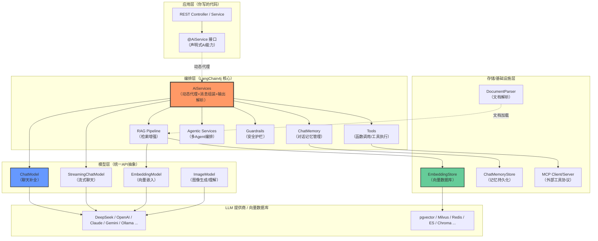
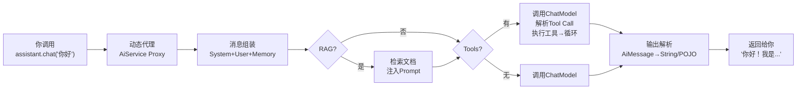
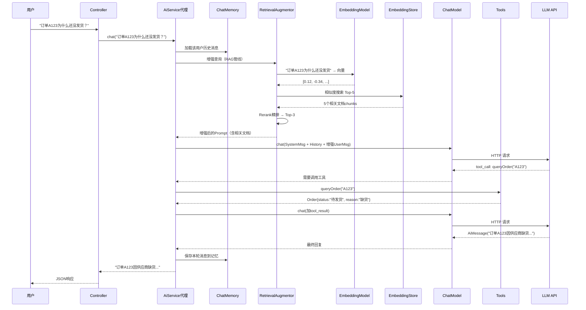

# Ch01 环境搭建与 Hello World——理解框架设计，5分钟跑通第一个AI接口

> 本章目标：
> 1. 理解为什么需要 LangChain4j（直接调 LLM API 的痛点）
> 2. 搞清楚核心组件（ChatModel / AiService / ChatMemory / Tool / EmbeddingStore 等）的设计哲学和分工
> 3. 从零搭建 Spring Boot 项目，实现最简聊天接口
> 4. 学会切换模型厂商，了解生产环境必须改的几个默认配置

---

## 1.1 先想清楚：为什么需要 LangChain4j？

### 1.1.1 直接调用 LLM API 会遇到什么？

假设你要做一个最简单的"AI聊天"功能，直接用 RestTemplate 调 OpenAI 兼容接口，代码大概是这样的：

```java
// 直接调 API 的"裸写"方式
@RestController
public class ChatController {

    @PostMapping("/chat")
    public String chat(@RequestBody String message) {
        // 1. 手动拼 JSON 请求体
        Map<String, Object> request = Map.of(
            "model", "deepseek-chat",
            "messages", List.of(
                Map.of("role", "system", "content", "你是友好的AI助手"),
                Map.of("role", "user", "content", message)
            ),
            "temperature", 0.7
        );

        // 2. 手动设 HTTP Header、认证
        HttpHeaders headers = new HttpHeaders();
        headers.setContentType(MediaType.APPLICATION_JSON);
        headers.setBearerAuth(System.getenv("DEEPSEEK_API_KEY"));

        // 3. 手动发请求、处理超时重试
        RestTemplate restTemplate = new RestTemplate();
        ResponseEntity<Map> response = restTemplate.postForEntity(
            "https://api.deepseek.com/v1/chat/completions",
            new HttpEntity<>(request, headers),
            Map.class
        );

        // 4. 手动解析嵌套 JSON 拿文本
        var choices = (List<Map>) response.getBody().get("choices");
        var msg = (Map<String, String>) ((Map) choices.get(0)).get("message");
        return msg.get("content");
    }
}
```

这还只是最简单的单轮对话。当你的需求逐步演进——

| 需求演进 | 需要额外写的代码量 | 复杂度 |
|---------|------------------|--------|
| 多轮对话（带上下文记忆） | 手动维护消息历史、Token计数、窗口截断 | ★★ |
| 流式输出（打字机效果） | SSE 或 WebSocket、chunk 解析、背压控制 | ★★★ |
| 让 AI 调工具/查数据库 | 函数调用协议解析、参数JSON反序列化、结果回传、循环判断 | ★★★★ |
| 基于私有文档问答（RAG） | 文档解析→分块→Embedding→向量库→检索→注入Prompt | ★★★★★ |
| 结构化输出（返回POJO） | JSON Schema约束、解析失败重试、类型转换 | ★★★ |
| 多模型切换（OpenAI/DeepSeek/本地） | 每个厂商API格式不同，要么抽象一层要么改一堆代码 | ★★★★ |
| 生产级（重试/限流/监控/审计） | 每处调用都要包一层，代码膨胀 | ★★★★ |

一个人月不到，你的代码就会变成一堆拼接 HTTP 请求、解析 JSON、管理状态的**样板代码泥潭**——而你真正想写的业务逻辑只占 20%。

### 1.1.2 LangChain4j 解决什么问题？

LangChain4j 的核心价值一句话：**把 LLM 应用开发中 80% 的通用脏活封装成可组合的组件，让你只写业务逻辑。**

它不是 Python LangChain 的简单移植——它从零设计，遵循 Java 开发者的直觉：
- **类型安全**：接口、POJO、泛型，不用拼 Map<String,Object>
- **声明式**：像 Spring Data JPA 一样，你声明接口，框架给实现
- **组件化**：每个能力一个独立组件，按需组合，不强加全栈
- **不绑定框架**：可以纯 Java 用，也可以和 Spring Boot/Quarkus/Micronaut 集成
- **统一抽象**：换模型厂商只改配置，代码不动

刚才那个"裸写"的例子，用 LangChain4j 写是什么样？

```java
@AiService
interface ChatAssistant {
    @SystemMessage("你是友好的AI助手")
    String chat(String message);
}

@RestController
@RequiredArgsConstructor
class ChatController {
    private final ChatAssistant chatAssistant;

    @PostMapping("/chat")
    public String chat(@RequestBody String message) {
        return chatAssistant.chat(message);  // 就这一行
    }
}
```

HTTP 请求、JSON 解析、认证、重试、消息组装——**全部由框架代理完成**。这还只是最简单的场景，后面记忆、工具、RAG、流式输出加上去，差距会指数级拉大。

---

## 1.2 LangChain4j 核心组件全景

在写代码之前，必须先建立组件的心智模型。LangChain4j 的设计是**严格分层**的：



这张图就是你写 LangChain4j 代码时的"地图"——任何功能出问题，你都能定位到是哪一层的哪个组件。

---

### 1.2.1 各核心组件的设计哲学

下面逐个讲清楚每个组件**解决什么问题、为什么要这么设计、什么时候用**。

---

#### ChatModel / StreamingChatModel——最底层的模型抽象

**解决的问题：** 不同 LLM 厂商的 API 格式、参数名、认证方式、返回结构都不一样。OpenAI 是 `messages` 数组，Anthropic 又加了 `system` 字段，Ollama 又是另一个格式。直接写代码的话，换个模型等于重写。

**设计思路：** `ChatModel` 是 LangChain4j 最核心的接口，定义了统一的聊天补全契约：

```java
public interface ChatModel {
    ChatResponse chat(ChatRequest request);
}
```

- 输入统一是 `ChatRequest`（包含 `List<ChatMessage>` + 模型参数）
- 输出统一是 `ChatResponse`（包含 `AiMessage` + `TokenUsage` + `FinishReason`）
- 每个厂商（OpenAI/DeepSeek/Ollama/Anthropic...）提供各自的实现类，但你面向接口编程

`StreamingChatModel` 是流式版本，返回 `TokenStream` 用于打字机效果，原理一样。

**关键理解：** ChatModel 是**无状态的单次调用**——它只负责"发消息→拿回复"，不维护对话历史、不管理工具、不管 RAG。它就是个纯粹的"LLM HTTP客户端封装"。

**类比：** ChatModel 就像 JDBC 的 `Connection`——它是你和数据库之间的管道，但你不会直接在业务代码里到处写 JDBC SQL。后面的 AiService 才是你日常打交道的"JdbcTemplate"。

---

#### ChatMemory——对话状态管理

**解决的问题：** LLM 本身是**无状态**的——每次调用都必须把完整的对话历史传过去，它才"记得"之前说了什么。手动管理消息列表有几个麻烦：

1. **Token 预算限制**：上下文窗口有限（比如 DeepSeek-V3 是 64K），历史消息不能无限追加
2. **窗口裁剪**：超了怎么办？丢掉最早的消息？还是先做摘要再保留？
3. **多用户隔离**：1000 个用户同时聊天，不能让他们共享一个消息列表
4. **持久化**：重启服务不能丢记忆

**设计思路：** `ChatMemory` 抽象了"一个对话会话的消息历史"：

```java
public interface ChatMemory {
    Object id();                           // 会话ID（用于多用户隔离）
    void add(ChatMessage message);         // 添加一条消息
    List<ChatMessage> messages();          // 获取当前应发送给LLM的消息列表
    void clear();                          // 清空记忆
}
```

它的实现类负责**窗口策略**：
- `MessageWindowChatMemory`：保留最近 N 条消息
- `TokenWindowChatMemory`：保留最近 N 个 Token（更精准，推荐生产用）

持久化通过 `ChatMemoryStore` 接口做——你可以用内存（开发）、Redis（生产）、JDBC 等。

**关键理解：** ChatMemory 只管"一个会话的消息"，不管"跨会话的长期知识"。长期知识是 RAG 和 EmbeddingStore 的事。两者是互补的：
- ChatMemory = 短期记忆（当前对话上下文）
- EmbeddingStore = 长期记忆（外部知识库）

---

#### AiServices——你天天用的声明式门面（最重要的组件）

**解决的问题：** ChatModel 太底层，每次都手动拼 `List<ChatMessage>`、传 ChatMemory、挂工具、解析输出——这些事每个接口都要做一遍，重复且易错。

**设计思路：** AiServices 的灵感来自 **Spring Data JPA** 和 **Retrofit**——你声明一个 Java 接口，用注解描述"我要什么"，框架在运行时通过**动态代理**生成实现类：

```java
@AiService
interface ChatAssistant {
    @SystemMessage("你是一个翻译官，将中文翻译成英文")
    @UserMessage("{{it}}")
    String translateToEnglish(String chineseText);
}
```

代理对象在背后做了所有脏活：
1. **消息组装**：把 `@SystemMessage` + `@UserMessage` 的模板和参数值拼成 `SystemMessage` + `UserMessage`
2. **记忆管理**：如果配置了 ChatMemory，自动加载历史消息、追加新消息、裁剪窗口
3. **工具调度**：如果挂了 `@Tool`，自动解析函数调用、执行Java方法、把结果传回LLM
4. **RAG 注入**：如果配置了 RetrievalAugmentor，自动检索相关文档塞到 Prompt 里
5. **输出解析**：把 AiMessage 转成方法声明的返回类型（String / POJO / Enum / TokenStream / Result<T>）
6. **异常处理**：统一处理超时、重试、模型错误



**关键理解：** AiService 不是一个具体类，它是**你和 LangChain4j 所有能力打交道的统一入口**。记忆、工具、RAG、结构化输出、流式——全部通过给 AiService 挂组件来启用。你写的是接口，框架在背后编排所有组件。这就是为什么 Ch01 的 Hello World 看起来只有一个接口+一个注解就能跑。

---

#### Tools（@Tool）——让 LLM 操作真实世界

**解决的问题：** LLM 本质是"文本进、文本出"，它自己不能查数据库、不能调 API、不能发邮件。要让 AI 真正"做事"，就需要工具调用（Function Calling）机制。

**设计思路：** 用 `@Tool` 注解标记一个普通 Java 方法，框架自动：
1. 把方法名、参数列表、JavaDoc/描述生成 JSON Schema 发给 LLM
2. LLM 判断需要调用时返回一个 `tool_call` 结构
3. 框架自动执行对应的 Java 方法，把返回值序列化成 `tool_result` 消息
4. 把结果发回 LLM，LLM 继续推理（可能再调其他工具，也可能生成最终答案）

```java
class OrderTools {
    @Tool("根据订单号查询订单详情")
    public Order queryOrder(@P("订单号") String orderId) {
        return orderRepository.findById(orderId);
    }
}
```

**关键理解：** Tool 机制是 Agent 的基础——单个工具是"函数调用"，多个工具+LLM 自主决策调用顺序 = Agent。

---

#### Document + EmbeddingModel + EmbeddingStore——RAG 三件套

**解决的问题：** LLM 的知识截止到训练时间，且不知道你的私有数据（公司文档、产品手册、用户上传的文件）。RAG（检索增强生成）= 先搜相关文档，再把内容塞给 LLM 当参考。

三个组件各司其职：

| 组件 | 职责 | 类比 |
|------|------|------|
| **Document** | 统一的文档数据模型（text + metadata），不管源是PDF/Word/网页/DB | 统一的数据行 |
| **EmbeddingModel** | 把文本转成高维向量（float[]），语义相近的文本向量距离近 | 翻译官：人类语言→机器理解的坐标 |
| **EmbeddingStore** | 存向量+相似度检索。对接 pgvector/Milvus/Redis/Chroma 等 30+ 向量库 | 向量界的 JdbcTemplate |

**关键理解：** 这三个是解耦的——你可以用 OpenAI 的 EmbeddingModel 把向量化好的文本存到 pgvector，后面换 BGE-M3 向量模型时只改 EmbeddingModel Bean，存储层不用动。

---

#### RetrievalAugmentor——RAG 的智能编排器

**解决的问题：** 基础 RAG（用户问题→向量检索→塞Prompt）效果有限，实际生产需要：查询改写、多路检索、Rerank重排、上下文压缩等一整套管线。

**设计思路：** `RetrievalAugmentor` 是一个可插拔的管线编排器，把 RAG 的每个环节拆成独立组件：

```
用户Query
  → QueryTransformer（查询改写/扩展/压缩）
  → QueryRouter（路由到不同检索器）
  → Retriever（向量/关键词/混合检索）
  → ContentAggregator（多路结果合并去重）
  → Reranker（精排打分）
  → ContentInjector（注入到 Prompt 的哪个位置）
  → 最终发给 ChatModel 的 augmented UserMessage
```

每个环节都可以替换自定义实现，组装自由度极高。

**关键理解：** 你不用每次都搭全套管线——简单场景用默认配置一行搞定；要效果时逐个环节优化。

---

#### AgenticServices——多 Agent 编排（进阶）

**解决的问题：** 复杂任务需要多个 AI 协作（比如"先搜索资料→分析数据→写报告→审核润色"），单个 Agent 做不好所有事。

**设计思路：** 提供声明式的多 Agent 编排模式（Sequence顺序 / Loop循环 / Parallel并行 / Supervisor主管 / BDI信念-愿望-意图），Agent 间通过 `AgenticScope` 共享状态。

这部分是 Ch14-16 的内容，第一章知道有这一层就行。

---

#### Guardrails——安全护栏

**解决的问题：** AI 应用的安全风险——Prompt 注入越狱、敏感数据泄露、危险工具调用、有害内容输出。

**设计思路：** 在输入（进 LLM 前）和输出（给用户前）两个位置插入 Guardrail，检测到风险就拦截/重写/拒绝。1.18 新增了 `PromptInjectionGuardrail`。

---

### 1.2.2 组件协作：一次 RAG + 工具调用的完整流程

把上面的组件串起来，看一次真实请求经过了什么：



**这就是为什么你只写一个接口就能完成这么复杂的事**——代理对象按顺序调度了记忆、RAG、模型、工具。每一步都是可替换的组件，你可以换掉向量库、加 Reranker、换工具实现，但 AiService 接口不变。

---

### 1.2.3 和 Spring AI 的核心设计差异

你用过 Spring AI，这里简单对比帮助你理解 LangChain4j 的设计取舍：

| 维度 | LangChain4j | Spring AI |
|------|------------|-----------|
| **核心抽象** | `AiServices`（声明式接口+动态代理） | `ChatClient`（链式DSL） |
| **设计哲学** | 乐高积木——组件完全独立，你自己组装 | Opinionated——框架给你推荐组合方式 |
| **框架绑定** | 不绑定任何框架，纯Java库，Spring/Quarkus都能用 | 强绑定 Spring 生态（Advisors、Bean 生命周期） |
| **RAG 编排** | `RetrievalAugmentor`，高度可插拔管线 | `Advisor` 链机制，类似 Servlet Filter |
| **工具调用** | `@Tool` + ToolProvider 动态工具 + ToolSearch 按需发现 | `@Tool` + FunctionCallback 注册 |
| **Agent 编排** | AgenticServices 原生支持5种编排模式+BDI | 2026年仍以 Advisor + 手动编排为主 |
| **MCP 支持** | 原生支持 Client/Server | 原生支持（作为Spring生态优势） |
| **向量库集成** | 30+（最丰富） | 20+ |
| **适合谁** | 想自己掌控架构细节、非Spring团队、需要Agent编排 | Spring Boot 团队、追求快速上手、微服务生态 |

**选型建议：** 不是二选一——你的 KnowBase 可以在 Spring Boot 里同时引入两个框架，数据层用 Spring AI 的 Repository 抽象，复杂 Agent 编排用 LangChain4j 的 AgenticServices。D 附录有更详细的共存方案。

---

## 1.3 前置条件

看完了理论，现在开始动手。

| 工具 | 最低版本 | 推荐版本 | 说明 |
|------|---------|---------|------|
| JDK | 17 | **21** | LangChain4j 1.x 核心模块支持 JDK 8+，但 Spring Boot 3.x 要求 17+，本项目统一 Java 21 |
| Maven | 3.8 | 3.9+ | Gradle 也可以，教程统一用 Maven |
| IDE | - | IntelliJ IDEA | 装了 Lombok 插件即可 |
| API Key | - | OpenAI / DeepSeek / Ollama 任选 | 国内推荐 DeepSeek（便宜、中文好）或 Ollama（本地免费） |

### 获取 API Key

**方案 A：DeepSeek（推荐入门，成本低）**
1. 访问 https://platform.deepseek.com/ 注册
2. 充值 10 元即可开始（DeepSeek-V3 输入 ¥1/M tokens，输出 ¥2/M tokens）
3. 在 API Keys 页面创建 Key

**方案 B：OpenAI（生态最全，但需科学上网）**
1. 访问 https://platform.openai.com/api-keys
2. 注意 GPT-4o 等模型费用较高，新手建议先用 `gpt-4o-mini`

**方案 C：Ollama（完全免费本地运行，无需 API Key）**
1. 访问 https://ollama.com/ 下载安装
2. 执行 `ollama pull qwen2.5:7b` 拉取通义千问开源模型（中文效果好）
3. 执行 `ollama serve` 启动服务（默认 http://localhost:11434）

> 💡 **成本提示**：调试阶段强烈建议用 Ollama 本地模型或 DeepSeek，别用 GPT-4 跑 Hello World，一次请求几毛钱，但写错代码循环调 100 次就是几十块——这种冤枉钱作者自己花过。

---

## 1.4 创建 Spring Boot 项目

### 方式一：Spring Initializr（推荐）

访问 https://start.spring.io/ ，填写：

- **Project**: Maven
- **Language**: Java
- **Spring Boot**: 3.5.x（或最新稳定版）
- **Group**: `com.example`
- **Artifact**: `smart-doc-assistant`
- **Java**: 21
- **Dependencies**: 只选 `Spring Web`（其他我们手动加）

生成 zip 下载解压。

### 方式二：IDEA 直接创建

New Project → Spring Initializr，填写同上。

---

## 1.5 添加 LangChain4j 依赖

打开 `pom.xml`，在 `<properties>` 中添加 LangChain4j 版本号，在 `<dependencies>` 中添加 starter：

```xml
<properties>
    <java.version>21</java.version>
    <!-- 稳定模块（langchain4j / langchain4j-core / langchain4j-open-ai / http-client） -->
    <langchain4j.version>1.22.0</langchain4j.version>
    <!-- 实验模块（所有 *-spring-boot-starter / agentic / mcp / skills...）只发 beta 版本线 -->
    <langchain4j.beta.version>1.22.0-beta32</langchain4j.beta.version>
</properties>

<!--
  稳定模块不是直接依赖，而是由 starter 传递带进来的。
  这里显式钉住版本，让 langchain4j.version 真正生效，也防止传递依赖跟着 starter 漂移。
-->
<dependencyManagement>
    <dependencies>
        <dependency>
            <groupId>dev.langchain4j</groupId>
            <artifactId>langchain4j</artifactId>
            <version>${langchain4j.version}</version>
        </dependency>
        <dependency>
            <groupId>dev.langchain4j</groupId>
            <artifactId>langchain4j-core</artifactId>
            <version>${langchain4j.version}</version>
        </dependency>
        <dependency>
            <groupId>dev.langchain4j</groupId>
            <artifactId>langchain4j-open-ai</artifactId>
            <version>${langchain4j.version}</version>
        </dependency>
    </dependencies>
</dependencyManagement>

<dependencies>
    <!-- Spring Web -->
    <dependency>
        <groupId>org.springframework.boot</groupId>
        <artifactId>spring-boot-starter-web</artifactId>
    </dependency>

    <!--
      langchain4j-spring-boot-starter = 核心自动配置
      作用：扫描 @AiService 注解、自动装配 ChatModel/EmbeddingModel 等 Bean、
           把 application.yml 的配置绑定到模型 Bean。
      类比：相当于 spring-boot-starter-data-jpa 的角色
    -->
    <dependency>
        <groupId>dev.langchain4j</groupId>
        <artifactId>langchain4j-spring-boot-starter</artifactId>
        <version>${langchain4j.beta.version}</version>
    </dependency>

    <!--
      langchain4j-open-ai-spring-boot-starter = OpenAI 协议兼容模型
      DeepSeek/Ollama/通义千问/智谱/Moonshot 等都兼容 OpenAI 协议，
      只要改 base-url 就能用同一个 starter 接入，不需要每个厂商单独引依赖。
      不兼容 OpenAI 协议的（Anthropic Claude、Google Gemini 等）才需要单独 starter。
    -->
    <dependency>
        <groupId>dev.langchain4j</groupId>
        <artifactId>langchain4j-open-ai-spring-boot-starter</artifactId>
        <version>${langchain4j.beta.version}</version>
    </dependency>

    <!-- Lombok（可选但推荐） -->
    <dependency>
        <groupId>org.projectlombok</groupId>
        <artifactId>lombok</artifactId>
        <optional>true</optional>
    </dependency>

    <!-- Test -->
    <dependency>
        <groupId>org.springframework.boot</groupId>
        <artifactId>spring-boot-starter-test</artifactId>
        <scope>test</scope>
    </dependency>
</dependencies>
```

> ⚠️ **版本说明**：LangChain4j 迭代非常快，而且**稳定模块和实验模块是两条发布线**。`langchain4j-spring-boot-starter` 这类 starter 只发 beta 版本（`1.22.0-beta32`），写 `1.22.0` 会 404；它传递带进来的 `langchain4j` / `langchain4j-core` / `langchain4j-open-ai` 才是稳定线（`1.22.0`）。所以上面才有两个属性：beta 属性给 starter 用，`dependencyManagement` 用稳定属性钉住核心，避免将来 starter 升级时把核心悄悄带到别的 minor。实际使用时去 [Maven Central](https://mvnrepository.com/artifact/dev.langchain4j/langchain4j-spring-boot-starter) 查最新发布版替换，两条线要成对升。

---

## 1.6 配置 application.yml

在 `src/main/resources/application.yml` 中写入：

```yaml
server:
  port: 8090

langchain4j:
  open-ai:
    chat-model:
      # ========== 方案1：DeepSeek（国内推荐，默认启用） ==========
      api-key: ${DEEPSEEK_API_KEY:sk-replace-me}  # 从环境变量读取，避免硬编码
      model-name: deepseek-chat                   # DeepSeek-V3
      base-url: https://api.deepseek.com/v1       # 关键：DeepSeek 的 API 端点

      # ========== 方案2：OpenAI ==========
      # api-key: ${OPENAI_API_KEY:sk-replace-me}
      # model-name: gpt-4o-mini
      # base-url: https://api.openai.com/v1

      # ========== 方案3：Ollama 本地模型（完全免费） ==========
      # api-key: dummy             # Ollama 不需要 key，但 starter 校验非空，随便写
      # model-name: qwen2.5:7b
      # base-url: http://localhost:11434/v1
      # log-requests: true
      # log-responses: true

      # ===== 通用参数（对应 ChatRequestParameters） =====
      temperature: 0.7             # 0=确定性输出，1=创造性，0.7 是通用平衡点
      timeout: PT60S               # ⚠️ 默认 10 秒根本不够用！必须改大
      max-retries: 3               # 网络抖动自动重试
      log-requests: false          # 生产环境关掉，调试时开（会打印完整请求/响应JSON）
      log-responses: false         # 同上

logging:
  level:
    dev.langchain4j: INFO          # 调试验证问题时改为 DEBUG
```

> ⚠️ **绝对不要把 API Key 硬编码在 yml 里提交到 Git！** 用环境变量 `${DEEPSEEK_API_KEY}` 读取。IDEA 里在 Run Configuration → Environment variables 设置；终端里 `export DEEPSEEK_API_KEY=sk-xxx`。

---

## 1.7 第一个 AiService 接口

现在你已经理解了 AiService 的原理，来写第一个：

在 `com.example.assistant.assistant` 包下创建：

```java
package com.example.assistant.assistant;

import dev.langchain4j.service.SystemMessage;
import dev.langchain4j.service.UserMessage;
import dev.langchain4j.service.spring.AiService;

/**
 * 最简聊天助手（v0.1）
 *
 * @AiService 注解 = 告诉 LangChain4j 的 Spring Boot Starter：
 *   1. 扫描到这个接口
 *   2. 用 JDK 动态代理生成实现类
 *   3. 把实现类注册成 Spring Bean（默认 Bean 名是类名首字母小写：chatAssistant）
 *
 * 代理背后做的事：
 *   - 读取 @SystemMessage 作为系统提示词
 *   - 解析 @UserMessage 模板，把方法参数绑定到 {{it}} 占位符
 *   - 调用 ChatModel Bean（根据 application.yml 自动配置的）
 *   - 把 AiMessage 转成 String 返回
 */
@AiService
public interface ChatAssistant {

    /**
     * 单轮对话（当前版本 v0.1 无记忆，每次调用互相独立）
     *
     * @SystemMessage 定义 AI 的角色/人设/行为规则，每次对话都会自动拼到消息最前面
     * @UserMessage 用户消息模板，{{it}} 是单参数时的默认占位符
     * @param userMessage 用户输入的文本
     * @return AI 生成的回复文本
     */
    @SystemMessage("你是一个友好的AI助手，请用简洁的中文回答用户的问题。")
    @UserMessage("{{it}}")
    String chat(String userMessage);
}
```

> 💡 **为什么只有接口没有实现类？** 回顾 1.2.1 节：AiServices 在运行时生成代理实现类。这跟你写 Spring Data JPA 的 `Repository` 接口是一样的体验——你只声明"要什么"，不写"怎么做"。

---

## 1.8 写 REST Controller 暴露接口

在 `com.example.assistant.controller` 包下创建：

```java
package com.example.assistant.controller;

import com.example.assistant.assistant.ChatAssistant;
import lombok.RequiredArgsConstructor;
import org.springframework.web.bind.annotation.PostMapping;
import org.springframework.web.bind.annotation.RequestBody;
import org.springframework.web.bind.annotation.RequestMapping;
import org.springframework.web.bind.annotation.RestController;

@RestController
@RequestMapping("/api/chat")
@RequiredArgsConstructor  // Lombok：为所有 final 字段生成构造函数，推荐的 Spring 注入方式
public class ChatController {

    private final ChatAssistant chatAssistant;  // 注入 AiService 代理 Bean

    /**
     * 单轮对话接口
     * POST /api/chat
     * Body: {"message": "你好，介绍一下你自己"}
     */
    @PostMapping
    public ChatResponse chat(@RequestBody ChatRequest request) {
        String answer = chatAssistant.chat(request.message());
        return new ChatResponse(answer);
    }

    // Java 16+ record：不可变数据类，自动生成构造函数/getter/equals/toString
    public record ChatRequest(String message) {}
    public record ChatResponse(String answer) {}
}
```

---

## 1.9 启动类

```java
package com.example.assistant;

import org.springframework.boot.SpringApplication;
import org.springframework.boot.autoconfigure.SpringBootApplication;

@SpringBootApplication
public class AssistantApplication {
    public static void main(String[] args) {
        SpringApplication.run(AssistantApplication.class, args);
    }
}
```

---

## 1.10 运行测试

启动应用（IDEA 里直接运行 main 方法，或 `mvn spring-boot:run`），然后：

```bash
curl -X POST http://localhost:8090/api/chat \
  -H "Content-Type: application/json" \
  -d '{"message":"你好，用一句话介绍一下Java"}'
```

正常返回：
```json
{"answer":"Java是一种广泛使用的面向对象编程语言，以'一次编写，到处运行'的跨平台特性著称。"}
```

恭喜，你已经有了一个能工作的 AI 对话接口。

现在再回看 1.2.2 节的流程图，你应该能完全理解这次请求背后发生了什么。

---

## 1.11 切换模型厂商：改配置不改代码

这是 ChatModel 统一抽象的核心价值——换模型只改 yml，Java 代码**一行不动**。

### 从 DeepSeek 切到 Ollama 本地模型

```yaml
langchain4j:
  open-ai:
    chat-model:
      api-key: dummy
      model-name: qwen2.5:7b
      base-url: http://localhost:11434/v1
      temperature: 0.7
      timeout: PT120S    # 本地模型CPU推理慢，超时要设更大
```

### 从 DeepSeek 切到通义千问（DashScope 兼容模式）

```yaml
langchain4j:
  open-ai:
    chat-model:
      api-key: ${DASHSCOPE_API_KEY}
      model-name: qwen-plus
      base-url: https://dashscope.aliyuncs.com/compatible-mode/v1
```

### 不同模型适合不同场景

| 模型 | 适用场景 | 成本（输入/输出 每百万tokens） | 速度 | 中文能力 |
|------|---------|---------------------------|------|---------|
| DeepSeek-V3 | 通用对话、代码、性价比首选 | ¥1 / ¥2 | 快 | ★★★★★ |
| GPT-4o-mini | 英文任务、简单分类 | $0.15 / $0.60 | 快 | ★★★★ |
| GPT-4o | 复杂推理、多模态 | $2.5 / $10 | 中等 | ★★★★ |
| Claude Sonnet | 长文本、写作 | $3 / $15 | 中等 | ★★★★ |
| Qwen2.5-7B (本地) | 开发调试、离线场景 | 免费 | 看GPU | ★★★★ |

> **最佳实践**：生产项目中通常配置多个 ChatModel Bean（`@Bean("cheapModel")` 用于简单分类/提取，`@Bean("smartModel")` 用于复杂推理），不同 AiService 注入不同模型，成本可以差 10-50 倍。多模型 Bean 的完整拆法在 Ch03 详解。

---

## 1.12 新手必踩的 7 个坑

### 坑 1：base-url 末尾少了 `/v1` 或多了斜杠

```yaml
# ❌ 404 错误
base-url: https://api.deepseek.com         # 缺 /v1
base-url: https://api.deepseek.com/v1/     # 末尾斜杠部分starter版本会拼接双斜杠

# ✅ 正确
base-url: https://api.deepseek.com/v1
```

### 坑 2：默认超时 10 秒根本不够

LangChain4j 某些旧版本默认超时是 10 秒，复杂问题或者本地模型很容易 `SocketTimeoutException`。**显式配 `timeout: PT60S` 是必须的。**

### 坑 3：启动报错 Bean 冲突或 No qualifying bean

- 是否同时引了多个厂商 starter 但没配对应 api-key？
- Spring Boot 3.x 要求 JDK 17+，检查 IDE 项目 SDK 设置
- Maven 下载慢？配阿里云镜像：`~/.m2/settings.xml` 加 mirror

### 坑 4：log-requests 在生产环境打爆磁盘

`log-requests: true` 打印完整请求/响应 JSON，调试神器，但高并发下日志量巨大。**上线前务必关掉**。

### 坑 5：API Key 硬编码提交到 Git

别人 clone 你的代码就能盗刷你的 API 额度。**永远用环境变量**，`.gitignore` 加上 `.env`、`application-local.yml`。

### 坑 6：@UserMessage 忘了写占位符

```java
// ❌ 编译不报错，但运行时参数传不进模板，AI永远收到空消息
@UserMessage("请回答问题")
String chat(String message);

// ✅ 正确：单参数用 {{it}}，多参数用 @V("name")
@UserMessage("{{it}}")
String chat(String message);
```

### 坑 7：以为 @AiService 是 Spring 的 @Service

`@AiService` 是 LangChain4j 的注解，不是 Spring 的。它由 LangChain4j 的 starter 扫描并生成代理 Bean。如果你的启动类在根包、AiService 接口在子包下，自动扫描能覆盖；否则需要用 `@ComponentScan` 指定包路径或手动用 `@Bean` 配置。

---

## 1.13 调试技巧：看到底发了什么、收了什么

### 开启请求/响应日志

```yaml
langchain4j:
  open-ai:
    chat-model:
      log-requests: true
      log-responses: true
```

开启后控制台会打印完整的 HTTP 请求/响应 JSON：
- 请求里的 `messages` 数组（检查 SystemMessage 是否拼对、历史是否带了）
- 模型返回的 `choices[0].message.content`
- `usage` 字段（prompt_tokens / completion_tokens / total_tokens）——**成本控制全靠它**

看到真实发出去的 JSON，90% 的 Prompt 问题能直接定位。

### 用 curl 先验证 API Key 有效性

怀疑代码问题前，先用 curl 确认 Key 和网络：

```bash
curl https://api.deepseek.com/v1/chat/completions \
  -H "Authorization: Bearer sk-你的key" \
  -H "Content-Type: application/json" \
  -d '{"model":"deepseek-chat","messages":[{"role":"user","content":"hi"}]}'
```

curl 都不通 → 问题在 Key/网络/代理，不在 Java 代码。

### 打开 DEBUG 日志看框架内部

```yaml
logging:
  level:
    dev.langchain4j: DEBUG
```

能看到 AiService 代理的装配过程、消息列表内容、工具调用决策等细节。

---

## 1.14 本章小结

| 维度 | 要点 |
|------|------|
| **为什么需要框架** | 直接调API：消息拼装/JSON解析/重试/记忆/工具/RAG全是样板代码 |
| **核心组件** | ChatModel（模型调用）、ChatMemory（短期记忆）、AiService（声明式门面）、Tools（工具调用）、Embedding+Store（长期记忆/RAG）、RetrievalAugmentor（RAG管线）、AgenticServices（多Agent）、Guardrails（安全） |
| **组件协作** | AiService是核心入口，代理自动调度ChatModel+Memory+Tools+RAG |
| **项目搭建** | Spring Boot 3.x + JDK21 + langchain4j-spring-boot-starter + open-ai starter |
| **配置** | api-key/model-name/base-url/temperature/timeout（五要素） |
| **声明式编程** | @AiService + @SystemMessage + @UserMessage → 框架生成代理 |
| **统一抽象价值** | 换模型厂商只改yml，Java代码不动 |
| **避坑** | 别硬编码Key、别忘/v1、超时设60s+、生产关日志、占位符别漏 |

---

## 1.15 本章项目代码状态（v0.1）

```
smart-doc-assistant/
├── pom.xml
├── .gitignore
└── src/main/
    ├── java/com/example/assistant/
    │   ├── AssistantApplication.java      # 启动类
    │   ├── assistant/
    │   │   └── ChatAssistant.java         # @AiService 接口（核心）
    │   └── controller/
    │       └── ChatController.java        # REST 接口
    └── resources/
        └── application.yml                # 模型配置
```

**验证清单**：
- [ ] 理解了为什么需要框架（1.1节）
- [ ] 能说清楚 ChatModel / AiService / ChatMemory / Tools / EmbeddingStore 各自解决什么问题（1.2节）
- [ ] 项目能正常启动
- [ ] 调用 `POST /api/chat` 返回 AI 回复
- [ ] 切换 DeepSeek/Ollama 至少跑通 2 个
- [ ] 开启 log-requests 看到真实 HTTP 请求 JSON
