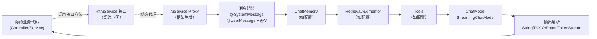

# Ch02 AI Services 声明式编程——掌握框架最核心的抽象

> 本章目标：
> 1. 理解 AiServices 的底层工作机制（动态代理、消息组装流水线）
> 2. 精通 `@SystemMessage` / `@UserMessage` / `@V` / `@MemoryId` / `@UserName` 等全部注解
> 3. 掌握返回类型体系：String / POJO / Enum / Result\<T\> / TokenStream
> 4. 学会外部 Prompt 模板、动态系统消息、每次调用参数覆盖
> 5. 理解非 Spring 环境下如何手动组装 AiServices
> 6. 把 smart-doc-assistant 升级到 v0.2：多角色助手 + Prompt 外部化

---

## 2.1 回顾：AiService 在整体架构中的位置

Ch01 中我们用 3 行接口就跑通了一个 AI 对话接口，背后是 LangChain4j 自动生成的代理对象。在深入每个能力之前，再看一眼它的位置——**AiService 是你日常写代码打交道最多的抽象，是编排层的唯一入口**：



你和框架之间就隔了一个**接口契约**——接口方法签名、注解、返回类型定义了"你要什么"，框架负责"怎么实现"。这和 Spring Data JPA 的思路一模一样：你只写 `interface UserRepository extends JpaRepository<User, Long>` 框架就给你 CRUD、分页、Specification 查询的实现。

---

## 2.2 动态代理机制：AiServices 是怎么"凭空"变出实现类的？

### 2.2.1 JDK 动态代理原理

LangChain4j 用的是标准 **JDK 动态代理**（`java.lang.reflect.Proxy`），不是 CGLIB。这意味着：
- AiService **必须是接口，不能是抽象类或具体类**
- 代理对象和你的接口实现同一个接口类型，可以直接注入
- 每次调用接口方法，都会进入 `InvocationHandler`，由它编排后续流程

### 2.2.2 AiService Proxy 的 InvocationHandler 流水线

当你调用 `chatAssistant.chat("你好")` 时，代理的 `InvocationHandler` 内部执行下面的流水线（伪代码）：

```
invoke(proxy, method, args):
    1. 读取方法上的注解:
       - @SystemMessage → 解析系统提示词（支持模板+fromResource+provider动态）
       - @UserMessage → 解析用户提示词模板
       
    2. 解析方法参数:
       - @V("xxx")          → 绑定到模板变量 {{xxx}}
       - @MemoryId          → 作为 ChatMemory 的隔离key
       - @UserName          → 注入用户名
       - ChatRequestParameters → 本次调用覆盖的模型参数
       - Content/ImageContent/List<Content> → 多模态内容
       - 无注解的 String    → 默认绑定给 {{it}}（单参数场景）
       
    3. 组装 UserMessage:
       - 把参数值填进 @UserMessage 模板
       - 多模态内容作为 Content 附加
       
    4. 加载 ChatMemory（如配置）:
       - 用 @MemoryId 参数值找到对应的 ChatMemory
       - 取出历史消息列表
       
    5. RAG 增强（如配置 RetrievalAugmentor）:
       - 用当前 query 检索相关文档
       - 把文档内容注入到 UserMessage 或 SystemMessage
       
    6. 合并消息列表:
       [SystemMessage] + [历史消息...] + [当前UserMessage]
       
    7. 构建 ChatRequest:
       - 合并全局参数 + ChatRequestParameters（如果有）
       - 附加 Tools 规格（如果配置了@Tool或ToolProvider）
       
    8. 调用 ChatModel / StreamingChatModel:
       - 可能发生多轮：Tool Call → 执行Tool → 回传结果 → 再次调用LLM
       
    9. 输出解析:
       - 返回类型是 String → 直接取 AiMessage.text()
       - 返回类型是 POJO/Enum/Boolean → 用 OutputParser 解析为对应类型
       - 返回类型是 TokenStream → 返回流式句柄
       - 返回类型是 Result<T> → 包装 T + TokenUsage + Sources + ToolExecutions
       
    10. 更新 ChatMemory:
        - 把当前 UserMessage + AiMessage 追加到记忆
        - 按窗口策略裁剪
       
    11. 返回结果给调用方
```

**关键理解：** 流水线的每一步都是**可选的**——不配 ChatMemory 就跳过第4步，不配 RAG 就跳过第5步，不配 Tools 第8步就只调用一次。这就是为什么 Hello World 只需一个接口方法就能跑：你只触发了步骤1-3、6、7、8（单次）、9（String解析）、11。

### 2.2.3 Spring Boot Starter 做了什么？

`langchain4j-spring-boot-starter` 在 Spring 容器启动时：

1. **扫描所有被 `@AiService` 标注的接口**（在 `@SpringBootApplication` 扫描的包及其子包下）
2. 读取 `application.yml` 中的 `langchain4j.*` 配置，自动装配对应的 Bean：
   - `ChatModel` / `StreamingChatModel` / `EmbeddingModel`
   - `ChatMemory`（如果配置了 chat-memory）
   - `ToolProvider`（如MCP等）
   - `RetrievalAugmentor`（如配置了rag）
3. 对每个 `@AiService` 接口，调用 `AiServices.builder(iface).chatModel(...)...build()` 创建代理对象
4. 把代理对象注册为 Spring Bean，你可以在任意地方 `@Autowired`/构造函数注入

所以**在 Spring Boot 中你几乎不需要手动调 `AiServices.create()` 或 `AiServices.builder()`**——除非你需要手动控制装配过程（后面2.9节会讲）。

> 💡 **如果你用过 Retrofit/Feign**：LangChain4j 的 AiService 跟它们设计思路完全一致——都是"声明接口+注解→框架生成HTTP调用代理"。只不过 Retrofit 代理的是 REST 调用，AiService 代理的是 LLM 调用+一整套编排逻辑。

---

## 2.3 @SystemMessage：定义 AI 的角色与行为

`@SystemMessage` 是最高优先级的指令，用来设定 AI 的身份、行为规则、输出格式、边界约束。它每次请求都会被拼到消息列表的最前面。

### 2.3.1 基本用法：直接写在注解里

```java
@AiService
public interface ChatAssistant {

    @SystemMessage("""
        你是一名资深Java技术专家，名叫"Java老王"。
        回答要求：
        1. 用中文回答，专业但通俗
        2. 给出代码示例时使用Java 21语法
        3. 对于不确定的内容，明确说明"我不确定"
        4. 不要胡编不存在的API或框架
        """)
    @UserMessage("{{it}}")
    String chat(String question);
}
```

### 2.3.2 外部模板文件（生产推荐）

把 Prompt 硬编码在注解里不利于版本管理和A/B测试。LangChain4j 支持**从classpath资源文件加载模板**：

在 `src/main/resources/prompts/customer-service-system.txt` 中：

```text
你是"SmartDoc"智能客服，代表{{company}}公司回答用户问题。
回答规则：
- 如果用户问题在以下常见问题中，直接按FAQ回答：
  {{faq}}
- 如果涉及订单/退款等个人账户问题，礼貌地请用户提供订单号
- 回答结尾加上"如有其他问题请继续咨询~"
- 今天的日期是{{current_date}}
```

接口里引用：

```java
@SystemMessage(fromResource = "prompts/customer-service-system.txt")
@UserMessage("{{it}}")
String answerCustomerQuestion(@V("company") String company,
                              @V("faq") String faqSnippet,
                              String userQuestion);
```

**优势**：
- Prompt 由产品/运营同学改了不需要重新编译Java代码
- 可以根据环境/客户加载不同模板
- 模板里同样支持 `{{变量}}` 占位，用 `@V` 传参

> ⚠️ **路径注意**：`fromResource` 路径是相对于 classpath 的，Maven/Gradle 项目 `src/main/resources/` 就是 classpath 根，所以上面能找到 `prompts/customer-service-system.txt`。

### 2.3.3 动态系统消息：SystemMessageProvider

有些场景下系统消息需要**每次调用动态决定**——比如不同租户用不同人设、或要注入每次请求的上下文（当前时间、用户权限等）。这时候用 `systemMessageProvider`（编程式）：

Spring Boot 环境下通过配置类：

```java
@Configuration
public class AiServiceConfig {

    @Bean
    public Assistant customerServiceAssistant(ChatModel chatModel,
                                               ChatMemoryProvider memoryProvider,
                                               TenantService tenantService) {
        return AiServices.builder(Assistant.class)
                .chatModel(chatModel)
                .chatMemoryProvider(memoryProvider)
                // 根据 memoryId（用户/会话ID）动态返回不同系统消息
                .systemMessageProvider(memoryId -> {
                    TenantConfig tenant = tenantService.getByUserId(memoryId.toString());
                    return """
                        你是%s公司的客服，请使用%s语气回答客户问题。
                        公司服务条款链接：%s
                        """.formatted(tenant.getCompanyName(),
                                    tenant.getTone(),      // "专业" 或 "亲切"
                                    tenant.getTermsUrl());
                })
                .build();
    }
}
```

> ⚠️ **注意**：一旦你手动 `@Bean` 了一个 AiService，Spring Boot 就不会再自动扫描创建同名的代理——两者只能选其一。需要混合使用时注意命名。

### 2.3.4 SystemMessageTransformer：在系统消息上追加信息

如果系统消息整体是固定的（比如从注解或fromResource加载），但每次调用要**追加**一些运行时信息（日期、请求ID、租户ID等），用 `systemMessageTransformer` 比 Provider 更方便：

```java
@Bean
public Assistant assistant(ChatModel chatModel) {
    return AiServices.builder(Assistant.class)
            .chatModel(chatModel)
            .systemMessageTransformer((systemMessage, context) -> {
                // 在原系统消息末尾自动追加当前日期
                return systemMessage
                    + "\n\n当前时间：" + LocalDateTime.now().format(DateTimeFormatter.ofPattern("yyyy-MM-dd HH:mm"));
            })
            .build();
}
```

两参数重载可以拿到 `InvocationContext`，访问本次调用的方法名和参数。

**Provider vs Transformer 怎么选？**
- Provider = 完全由你决定系统消息内容（注解/fromResource 失效）
- Transformer = 保留注解/fromResource 加载的内容，你只做追加/修改

### 2.3.5 系统消息 vs 用户消息放指令

新手常问："我把指令写在 SystemMessage 里还是 UserMessage 里？"

原则：
- **角色/人设/全局规则**永远在 SystemMessage（如"你是医生""不要回答编程以外的问题"）
- **单次任务的具体指令**放在 UserMessage（如"把下面这段话翻译成英文：xxx"）
- 某些模型（尤其本地小模型）对 SystemMessage 支持不好，此时可以改用 @UserMessage 写指令（见2.4.3）

---

## 2.4 @UserMessage：构造用户输入

### 2.4.1 三种形态

**形态1：默认单参数 `{{it}}`**

```java
// 最简单：单参数自动绑定到 {{it}}
@UserMessage("{{it}}")
String chat(String message);
```

**形态2：命名变量 `{{var}}` + @V**

```java
// 多参数时用 @V 显式命名
@UserMessage("把下面的文本从{{sourceLang}}翻译成{{targetLang}}：\n{{text}}")
String translate(@V("sourceLang") String source,
                 @V("targetLang") String target,
                 @V("text") String text);
```

**形态3：无参+硬编码消息（用于固定任务）**

```java
// 方法不需要参数，UserMessage 里写死
@SystemMessage("你是一个技术文章大纲生成器")
@UserMessage("生成一篇关于 Java 21 新特性的文章大纲，用中文输出，分5个章节")
List<String> generateJava21Outline();
```

### 2.4.2 编译参数名：为什么有时不需要 @V？

在 **Spring Boot 和 Quarkus** 应用中，如果编译器启用了 `-parameters` 选项（Spring Boot Maven Plugin 默认开启），框架可以通过反射读取方法参数名，所以可以省略 `@V`：

```java
// Spring Boot 中可以直接这样写，{{question}} 自动匹配参数名 question
@UserMessage("请回答以下问题：{{question}}")
String chat(String question);

// 但为了可读性和重构安全，教程统一用 @V 显式标注
```

> **最佳实践**：教程所有代码都用 `@V` 显式标注变量名，避免因为 IDE/构建配置差异导致参数绑定失败——**这是一种"显式优于隐式"的防御式编程。**

### 2.4.3 没有 SystemMessage 支持的模型

有些旧模型或本地小模型不支持独立的 system role，此时可以把指令都写在 @UserMessage 里：

```java
// 适用于不支持 system message 的模型
@UserMessage("你是一个友好的助手，请用中文回答：{{it}}")
String chat(String message);
```

### 2.4.4 从外部文件加载 UserMessage 模板

和 SystemMessage 一样，UserMessage 也支持 `fromResource`：

```java
@UserMessage(fromResource = "prompts/summarize-user.txt")
String summarize(@V("document") String doc, @V("maxWords") int maxWords);
```

`prompts/summarize-user.txt`：

```text
请对以下文档做摘要，要求：
- 不超过{{maxWords}}字
- 保留关键数据和结论
- 用中文输出

文档内容：
{{document}}
```

> **Prompt 版本管理最佳实践**：所有 Prompt 模板统一放 `resources/prompts/` 目录下，用清晰的命名规范：`{业务}-{场景}-{role}.txt`。比如 `kbaas-answer-system.txt`、`kbaas-answer-user.txt`、`kbaas-extract-fields-user.txt`。这样改Prompt时不用搜代码。

---

## 2.5 参数绑定大全

AiService 方法的参数分为几大类，LangChain4j 按**参数类型+注解**自动识别：

| 参数类型/注解 | 作用 | 示例 |
|-------------|------|------|
| `@V("name")` | 绑定到模板变量 `{{name}}` | `@V("topic") String topic` |
| `@MemoryId` | 记忆隔离 key，决定用哪个 ChatMemory | `@MemoryId String sessionId` |
| `@UserName` | 注入用户名（部分模型支持） | `@UserName String username` |
| `ChatRequestParameters` | 每次调用动态覆盖模型参数 | `ChatRequestParameters params` |
| `ImageContent` / `AudioContent` / `PdfFileContent` | 多模态内容（自动加到 UserMessage） | `ImageContent image` |
| `List<Content>` | 混合多模态内容 | `List<Content> contents` |
| 无注解 String（单参数） | 默认绑定给 `{{it}}` | `String message` |
| 无注解 POJO（多参场景） | 配合 `-parameters` 自动按参数名绑定 | `String name, Integer age` |

### 2.5.1 @MemoryId：多用户/多会话记忆隔离

当你配置了 ChatMemory，必须告诉框架"这次调用属于哪个会话"，否则所有用户共享一个记忆池。用 `@MemoryId` 标注：

```java
@AiService
public interface ChatAssistant {

    @SystemMessage("你是友好的AI助手，用中文回答")
    @UserMessage("{{it}}")
    String chat(@MemoryId String sessionId, @V("it") String message);
}
```

调用方式：

```java
// 用户A的会话（记忆独立）
assistant.chat("user-001", "我叫张三");
assistant.chat("user-001", "我叫什么？");  // 能记住"张三"

// 用户B的会话
assistant.chat("user-002", "我叫什么？");  // 不受用户A影响，会回答不知道
```

`@MemoryId` 的参数类型可以是 `String`/`Object`/`Integer` 等，会作为 key 传给 `ChatMemoryProvider.apply(id)`。

### 2.5.2 @UserName：让AI知道用户是谁

部分模型支持在消息中附带用户名（用于多用户场景的身份识别）：

```java
String chat(@MemoryId String sessionId,
            @UserName String username,
            @V("it") String message);
```

使用场景：企业内部助手，让AI知道"正在和部门经理张三对话"，可以据此调整回答风格或权限。

### 2.5.3 ChatRequestParameters：每次调用动态参数

同一个 AiService 方法，不同场景可能需要不同 temperature（比如代码生成要0、头脑风暴要0.9），可以在方法参数里加 `ChatRequestParameters`：

```java
@SystemMessage("你是一个创意文案助手")
@UserMessage("为产品【{{product}}】写一句广告语，风格：{{style}}")
String writeSlogan(@V("product") String product,
                   @V("style") String style,
                   ChatRequestParameters params);  // 每次调用可覆盖temperature等
```

调用：

```java
// 头脑风暴：高temperature
String slogan1 = assistant.writeSlogan("智能手表", "活泼",
    ChatRequestParameters.builder()
        .temperature(0.9)
        .maxOutputTokens(200)
        .build());

// 正式输出：低temperature
String slogan2 = assistant.writeSlogan("智能手表", "稳重",
    ChatRequestParameters.builder()
        .temperature(0.2)
        .build());
```

提供商特定参数：可以用具体子类如 `OpenAiChatRequestParameters` 获得厂商专属字段（如 topP、frequencyPenalty、user等）。

> ⚠️ **注意**：ChatRequestParameters 里的 `toolSpecifications` 和 `responseFormat` 会**覆盖** AiService 自动生成的配置，普通场景不要手动设置。

---

## 2.6 返回类型体系

返回类型决定了 AiService 如何解析 LLM 的输出。LangChain4j 支持一套完整的返回类型体系：

```
返回类型
├── 文本类
│   ├── String                    → 原始文本（最常用）
│   ├── AiMessage                 → 带元数据的消息对象
│   └── TokenStream               → 流式输出（Ch04讲）
│
├── 结构化输出（Ch07深入）
│   ├── boolean / Boolean         → 是/否判断
│   ├── Enum                      → 枚举分类
│   ├── POJO                      → 自定义JavaBean
│   ├── List<T> / Set<T>          → 集合
│   └── Map<K,V>                  → 键值对
│
├── 包装类（生产必备）
│   └── Result<T>                 → T + TokenUsage + Sources + ToolExecutions + FinishReason
│
└── 流式
    └── TokenStream / Flux<T>     → 逐Token流式（Ch04讲）
```

### 2.6.1 String：最直接的返回

```java
@UserMessage("{{it}}")
String chat(String message);
```

最简单，返回AI的完整文本。缺点：你拿不到Token用量、引用来源等元信息。

### 2.6.2 Result\<T\>：生产环境强烈推荐

`Result<T>` 包装了AI调用的全部元信息，**生产环境一定要用**，否则你没法做成本统计、引用溯源、工具审计。

```java
@UserMessage("根据以下主题生成文章大纲：{{topic}}")
Result<List<String>> generateOutline(@V("topic") String topic);

// 调用
Result<List<String>> result = assistant.generateOutline("Java 21 新特性");

List<String> outline = result.content();              // 实际内容
TokenUsage usage = result.tokenUsage();               // Token用量
// usage.inputTokenCount() / outputTokenCount() / totalTokenCount()

List<Content> sources = result.sources();             // RAG检索到的来源文档
List<ToolExecution> toolExecs = result.toolExecutions(); // 执行过的工具列表
FinishReason reason = result.finishReason();          // 结束原因（STOP/LENGTH/TOOL_EXECUTION）
ChatResponse resp = result.chatResponse();            // 原始ChatResponse
```

**为什么生产必用？**
- **成本核算**：通过 `tokenUsage()` 精确记录每次调用费用，是Ch22成本控制的基础
- **引用溯源**：RAG场景通过 `sources()` 拿到检索到的文档，可以在前端展示"答案来自《xxx手册》第3章"
- **工具审计**：Agent场景通过 `toolExecutions()` 审计AI调了哪些工具、传了什么参数、返回什么
- **调试**：`finishReason()` 告诉你是正常结束还是被截断了（`LENGTH`表示maxTokens不够）

### 2.6.3 boolean / Enum：极简分类任务

结构化输出的最简单形式，适合二元判断和分类场景：

```java
// 情感判断
@UserMessage("以下评论是否表达了正面情绪？只回答true或false：\n{{it}}")
boolean isPositiveSentiment(String comment);

// 优先级分类
enum Priority { CRITICAL, HIGH, MEDIUM, LOW }

@UserMessage("分析以下工单的优先级，只返回枚举名称不要其他内容：\n{{it}}")
Priority analyzePriority(String issueDescription);

// 使用
boolean positive = assistant.isPositiveSentiment("这个产品太棒了！");  // true
Priority p = assistant.analyzePriority("支付系统完全挂了，用户无法付款"); // CRITICAL
```

> 💡 原理：AiService 的 OutputParser 会把 LLM 返回的文本尝试解析为目标类型。解析失败会抛异常，建议开发阶段开启JSON Schema严格模式提高成功率（Ch07详解）。

### 2.6.4 POJO 结构化输出

最强大的能力——让AI直接返回Java对象：

```java
// 定义POJO
@Description("客户评论分析结果")
record ReviewAnalysis(
    @Description("情感倾向：POSITIVE/NEGATIVE/NEUTRAL")
    Sentiment sentiment,
    
    @Description("评论提到的核心问题列表，如果没有则返回空列表")
    List<String> issues,
    
    @Description("评论提到的产品优点，没有则返回空列表")
    List<String> strengths,
    
    @Description("评论给出的评分，1-5星")
    Integer rating
) {}

enum Sentiment { POSITIVE, NEGATIVE, NEUTRAL }

// AiService
@UserMessage("""
    分析以下客户评论，严格按schema返回JSON：
    {{review}}
    """)
ReviewAnalysis analyzeReview(String review);
```

注意：
- `@Description` 注解给字段/类补充语义描述，**LLM 能看到这些描述**，显著提升字段识别准确率
- 嵌套对象、List、枚举都支持
- 建议开启 JSON Schema 严格模式（见 Ch07），避免模型返回不合规 JSON

> Ch07 会用一整章深入讲结构化输出的配置、错误处理、各厂商JSON模式开启方式。

### 2.6.5 返回类型是 void

1.18+ 版本支持 AiService 方法返回 `void`，适用于"AI执行操作但不需要返回文本"的场景（比如AI给你发一封邮件、存一条记录）：

```java
@SystemMessage("你是通知助手，根据信息发送通知邮件")
@UserMessage("给{{recipient}}发邮件，主题：{{subject}}，内容：{{content}}")
void sendNotification(@V("recipient") String to,
                      @V("subject") String subject,
                      @V("content") String content);
```

---

## 2.7 多模态输入：让 AI 看图/听音/读 PDF

AiService 方法参数支持直接接收多模态内容，框架会自动把它们组装进 UserMessage：

```java
@SystemMessage("你是一个图片理解助手，详细描述用户上传的图片内容")
@UserMessage("请描述这张图片：")
String describeImage(@UserMessage ImageContent image);

// 图文混合
@UserMessage("图片中的商品价格是多少？图片：")
String queryPrice(@UserMessage ImageContent image, @UserMessage TextContent question);

// 一次多张图
@UserMessage("对比这两张图片的差异")
String compareImages(@UserMessage List<ImageContent> images);

// PDF文件理解
@UserMessage("总结这份PDF文档的核心结论")
String summarizePdf(@UserMessage PdfFileContent pdf);
```

ImageContent 的构造方式：

```java
// 从URL
ImageContent image = ImageContent.from("https://example.com/photo.jpg");

// 从Base64字节
byte[] bytes = Files.readAllBytes(Path.of("/path/to/photo.jpg"));
ImageContent image = ImageContent.from(bytes, "image/jpeg");

// detail level控制精度（OpenAI/Gemini支持：low/high/auto）
ImageContent image = ImageContent.from(url, DetailLevel.HIGH);
```

> ⚠️ **成本提醒**：图片按"图块"计费，一张 1024x1024 的 high detail 图片消耗约 765 tokens，相当于几百字。批量处理图片时务必注意成本控制。多模态的完整用法见 Ch09。

---

## 2.8 chatRequestTransformer：底层改请求的最后一道关卡

如果注解、Provider、Transformer 都满足不了你的需求（比如你要往每个请求里加一个自定义 header、统一往 Prompt 里追加安全提示、或者根据某些条件动态加几个 Few-shot 示例），可以用 `chatRequestTransformer` 直接在请求发出前改写 `ChatRequest`：

```java
@Bean
public Assistant safeAssistant(ChatModel chatModel) {
    return AiServices.builder(Assistant.class)
            .chatModel(chatModel)
            // 单参数版本：拿到 ChatRequest，返回改写后的
            .chatRequestTransformer(request -> {
                // 例：统一给所有用户消息追加安全提示
                List<ChatMessage> messages = new ArrayList<>(request.messages());
                // 追加一条不可见指令（真实场景应该放在 SystemMessage 里，此处仅演示）
                return ChatRequest.builder()
                        .messages(messages)
                        .parameters(request.parameters())
                        .build();
            })
            // 双参数版本：第二个参数是 memoryId，可根据会话做不同处理
            // .chatRequestTransformer((request, memoryId) -> { ... })
            .build();
}
```

**使用场景**：
- 全链路埋点：往请求里塞一个自定义 attribute 作为 TraceId
- 动态工具：根据某些条件增删 ToolSpecification
- A/B测试：按用户分组切换模型参数

---

## 2.9 非 Spring 环境：手动用 AiServices Builder

虽然本教程以 Spring Boot 为主线，但你必须知道怎么在纯 Java 程序里手动组装 AiService——这能帮你彻底理解"starter自动装配帮你做了什么"，也方便写单元测试。

### 2.9.1 最简方式：AiServices.create()

```java
// 1. 构建底层 ChatModel
ChatModel model = OpenAiChatModel.builder()
        .apiKey(System.getenv("DEEPSEEK_API_KEY"))
        .modelName("deepseek-chat")
        .baseUrl("https://api.deepseek.com/v1")
        .temperature(0.7)
        .timeout(Duration.ofSeconds(60))
        .build();

// 2. 一次性创建代理
ChatAssistant assistant = AiServices.create(ChatAssistant.class, model);

// 3. 直接用
String answer = assistant.chat("你好");
```

`AiServices.create(iface, chatModel)` 是简化版，只挂 ChatModel，不带记忆/工具/RAG。

### 2.9.2 Builder 方式：完整组装

```java
ChatModel model = OpenAiChatModel.builder()
        .apiKey(System.getenv("DEEPSEEK_API_KEY"))
        .modelName("deepseek-chat")
        .baseUrl("https://api.deepseek.com/v1")
        .build();

ChatMemory chatMemory = MessageWindowChatMemory.withMaxMessages(20);

CustomerTools customerTools = new CustomerTools();  // 带@Tool的类

ChatAssistant assistant = AiServices.builder(ChatAssistant.class)
        .chatModel(model)                    // 聊天模型
        // .streamingChatModel(streamingModel)  // 流式模型（可选）
        .chatMemory(chatMemory)              // 对话记忆
        // .chatMemoryProvider(memoryId -> ...)  // 按会话提供记忆
        .tools(customerTools)                // 工具
        // .toolProvider(dynamicProvider)        // 动态工具
        // .retrievalAugmentor(augmentor)        // RAG
        .systemMessageProvider(memoryId -> "你是客服...")  // 动态系统消息
        .systemMessageTransformer((msg, ctx) -> msg + "\n日期：" + LocalDate.now())
        // .chatRequestTransformer(req -> req)
        .build();
```

### 2.9.3 单测里用 AiServices

写单元测试时你不想真的调LLM（烧钱+不稳定），可以用 Mock 或 Stub 模型：

```java
@Test
void testChatAssistant() {
    // 构造一个假的 ChatModel，直接返回固定答案
    ChatModel stubModel = new ChatModel() {
        @Override
        public ChatResponse chat(ChatRequest request) {
            return ChatResponse.builder()
                    .aiMessage(AiMessage.from("你好，我是测试助手"))
                    .tokenUsage(TokenUsage.builder().build())
                    .build();
        }
    };

    ChatAssistant assistant = AiServices.create(ChatAssistant.class, stubModel);
    String result = assistant.chat("hello");
    assertEquals("你好，我是测试助手", result);
}
```

测试结构化输出、Tool调用、RAG时也可以用同样的 stub 技巧；RAG 一侧的评估与回归策略在 Ch13 展开。

---

## 2.10 Spring Boot 实战：多角色助手 v0.2

把本章所有知识点串起来，升级 smart-doc-assistant 到 v0.2，实现3个不同角色的助手，展示AiService的各种能力。

### 2.10.1 配置多个AiService

新增 `TranslationAssistant`（翻译）和 `ReviewAnalysisAssistant`（评论分析），同时保留 `ChatAssistant`。

先准备外部Prompt模板：

**`src/main/resources/prompts/translator-system.txt`**：
```text
你是一名专业翻译官，精通{{sourceLang}}和{{targetLang}}。
翻译要求：
1. 准确传达原意，不要意译过度
2. 技术术语保留原文或给出行业通用译法
3. 输出只包含翻译结果，不要额外解释
```

**`src/main/resources/prompts/review-analysis-user.txt`**：
```text
请严格按要求分析以下客户评论，返回JSON格式：
{{review}}

要求：
- sentiment: POSITIVE/NEGATIVE/NEUTRAL
- rating: 1-5 星
- key_points: 评论提到的关键要点列表
- suggestions: 如果是负面评论，给出改进建议（没有则空数组）
```

### 2.10.2 新建 AiService 接口

```java
package com.example.assistant.assistant;

import dev.langchain4j.service.SystemMessage;
import dev.langchain4j.service.UserMessage;
import dev.langchain4j.service.V;
import dev.langchain4j.service.spring.AiService;

// 翻译助手
@AiService
public interface TranslationAssistant {

    @SystemMessage(fromResource = "prompts/translator-system.txt")
    @UserMessage("翻译以下文本：\n{{text}}")
    String translate(@V("sourceLang") String sourceLang,
                     @V("targetLang") String targetLang,
                     @V("text") String text);
}
```

```java
package com.example.assistant.assistant;

import dev.langchain4j.service.UserMessage;
import dev.langchain4j.service.spring.AiService;
import java.util.List;

// 评论分析助手（结构化输出）
@AiService
public interface ReviewAnalysisAssistant {

    @UserMessage(fromResource = "prompts/review-analysis-user.txt")
    ReviewAnalysis analyze(String review);

    // --- 结构化返回类型 ---
    enum Sentiment { POSITIVE, NEGATIVE, NEUTRAL }

    record ReviewAnalysis(
            Sentiment sentiment,
            Integer rating,
            List<String> keyPoints,
            List<String> suggestions
    ) {}
}
```

### 2.10.3 ChatAssistant 增强：@MemoryId 多会话

把 Ch01 的 ChatAssistant 升级支持多会话 + Result\<T\> 拿 Token 用量：

```java
package com.example.assistant.assistant;

import dev.langchain4j.service.MemoryId;
import dev.langchain4j.service.Result;
import dev.langchain4j.service.SystemMessage;
import dev.langchain4j.service.UserMessage;
import dev.langchain4j.service.V;
import dev.langchain4j.service.spring.AiService;

@AiService
public interface ChatAssistant {

    /**
     * v0.2 升级版：带会话记忆，返回 Result 元数据
     *
     * 使用方式：
     * Result<String> r = assistant.chat("user-001", "你好");
     * String answer = r.content();
     * TokenUsage usage = r.tokenUsage();  // 可以记成本
     */
    @SystemMessage("你是一个友好的AI助手，请用简洁的中文回答用户的问题。")
    @UserMessage("{{it}}")
    Result<String> chat(@MemoryId String sessionId, @V("it") String message);
}
```

### 2.10.4 配置 ChatMemory（用内存版先跑通）

新增配置类：

```java
package com.example.assistant.config;

import dev.langchain4j.memory.ChatMemory;
import dev.langchain4j.memory.chat.MessageWindowChatMemory;
import org.springframework.context.annotation.Bean;
import org.springframework.context.annotation.Configuration;

import java.util.Map;
import java.util.concurrent.ConcurrentHashMap;

@Configuration
public class AiServiceConfig {

    /**
     * 每个会话独立的 ChatMemory（v0.2 用内存版，v0.3 上 Redis 持久化）
     * ChatMemoryProvider 接收 @MemoryId 参数，返回对应会话的记忆
     */
    @Bean
    public dev.langchain4j.memory.chat.ChatMemoryProvider chatMemoryProvider() {
        Map<String, ChatMemory> memories = new ConcurrentHashMap<>();
        return memoryId -> memories.computeIfAbsent(
                (String) memoryId,
                id -> MessageWindowChatMemory.withMaxMessages(20)
        );
    }
}
```

> ⚠️ **注意**：这个内存版在重启后记忆丢失，且单机场景可用。生产环境用 Redis 持久化（Ch05）。

### 2.10.5 application.yml 升级支持 JSON 模式

在 `langchain4j.open-ai.chat-model` 下追加：

```yaml
langchain4j:
  open-ai:
    chat-model:
      api-key: ${DEEPSEEK_API_KEY:sk-replace-me}
      model-name: deepseek-chat
      base-url: https://api.deepseek.com/v1
      temperature: 0.7
      timeout: PT60S
      max-retries: 3
      log-requests: false
      log-responses: false
      # v0.2 新增：为结构化输出开启 JSON 响应格式
      response-format: json_object   # DeepSeek 兼容；OpenAI 新模型建议用 supported-capabilities
```

> 💡 DeepSeek 目前支持 `response-format: json_object` 模式，但对 `strictJsonSchema` 支持还在完善中。Ch07会详细讲解各厂商 JSON 模式的配置差异。

### 2.10.6 Controller 扩展三个接口

```java
package com.example.assistant.controller;

import com.example.assistant.assistant.ChatAssistant;
import com.example.assistant.assistant.ReviewAnalysisAssistant;
import com.example.assistant.assistant.TranslationAssistant;
import dev.langchain4j.service.Result;
import lombok.RequiredArgsConstructor;
import org.springframework.web.bind.annotation.*;

import java.util.Map;

@RestController
@RequiredArgsConstructor
public class AssistantController {

    private final ChatAssistant chatAssistant;
    private final TranslationAssistant translationAssistant;
    private final ReviewAnalysisAssistant reviewAssistant;

    // v0.2 升级版：带sessionId，返回Token用量
    @PostMapping("/api/chat")
    public Map<String, Object> chat(@RequestBody ChatRequest req) {
        Result<String> result = chatAssistant.chat(req.sessionId(), req.message());
        return Map.of(
            "answer", result.content(),
            "inputTokens", result.tokenUsage().inputTokenCount(),
            "outputTokens", result.tokenUsage().outputTokenCount()
        );
    }

    // 翻译接口
    @PostMapping("/api/translate")
    public Map<String, String> translate(@RequestBody TranslateRequest req) {
        String translated = translationAssistant.translate(
            req.sourceLang(), req.targetLang(), req.text()
        );
        return Map.of("translated", translated);
    }

    // 评论分析接口（返回结构化JSON）
    @PostMapping("/api/review/analyze")
    public ReviewAnalysisAssistant.ReviewAnalysis analyze(@RequestBody ReviewRequest req) {
        return reviewAssistant.analyze(req.review());
    }

    // --- DTOs ---
    public record ChatRequest(String sessionId, String message) {}
    public record TranslateRequest(String sourceLang, String targetLang, String text) {}
    public record ReviewRequest(String review) {}
}
```

### 2.10.7 测试验证

启动应用后：

```bash
# 1. 多轮对话（记忆生效）
curl -X POST http://localhost:8090/api/chat \
  -H "Content-Type: application/json" \
  -d '{"sessionId":"user-001","message":"我叫张三，记住我"}'

curl -X POST http://localhost:8090/api/chat \
  -H "Content-Type: application/json" \
  -d '{"sessionId":"user-001","message":"我叫什么"}'
# 期望: 能回答"张三"

curl -X POST http://localhost:8090/api/chat \
  -H "Content-Type: application/json" \
  -d '{"sessionId":"user-002","message":"我叫什么"}'
# 期望: 不知道（不同session）

# 2. 翻译
curl -X POST http://localhost:8090/api/translate \
  -H "Content-Type: application/json" \
  -d '{"sourceLang":"中文","targetLang":"英文","text":"人工智能正在改变世界"}'

# 3. 评论分析（返回结构化JSON）
curl -X POST http://localhost:8090/api/review/analyze \
  -H "Content-Type: application/json" \
  -d '{"review":"这个智能手表续航太差了，一天就没电，但屏幕显示效果不错"}'
# 期望返回: {"sentiment":"NEGATIVE","rating":2,"keyPoints":["续航差","屏幕好"],"suggestions":["提升电池容量"]}
```

---

## 2.11 高频坑点与最佳实践

### 坑1：Prompt 模板里的变量名和 @V 对不上

```java
// ❌ 模板里是 {{text}}，但参数绑定为 "content"
@UserMessage("翻译：{{text}}")
String translate(@V("content") String text);  // 运行时变量未替换，AI收到"翻译：{{text}}"

// ✅ 名称必须严格一致
@UserMessage("翻译：{{text}}")
String translate(@V("text") String text);
```

### 坑2：多个AiService方法名/Bean名冲突

Spring Boot 自动扫描时，代理Bean的默认名是接口名首字母小写。如果你有 `ChatAssistant` 和 `ChatAssistantV2` 不冲突，但如果你在配置类里手动 @Bean 了一个同名Bean，会报冲突。**解决**：@Bean 时指定名字，或者用 `@Primary`。

### 坑3：把SystemMessage/UserMessage写反

SystemMessage 里塞问题，UserMessage 里塞人设——模型会混乱。记住：**System=人设/规则/全局约束；User=本次任务/具体问题**。

### 坑4：fromResource 路径找不到

- 路径是 classpath 相对路径，`src/main/resources/` 是根
- 开头不要加 `/`，不要加 `classpath:`
- 最稳妥是复制 target/classes 下看文件是否真的被打包了

### 坑5：@MemoryId 类型不匹配

`ChatMemoryProvider.apply(memoryId)` 接收到的就是你 @MemoryId 标注的参数值。如果参数是 Long/UUID，Provider 里也要按那个类型做 key，别强转 String 导致 NPE。

### 坑6：返回POJO但模型返回非JSON

没开 JSON 模式时，模型可能返回 "好的，这是结果：{...}" 这种带前缀的文本，解析直接失败。**生产必做**：
- 开启 JSON 模式（Ch07）
- Prompt 里明确要求"只返回JSON，不要其他文字"
- temperature 设低（0~0.3）
- 准备降级策略（解析失败重试或返回错误）

### 坑7：AiService接口被final/private修饰

JDK动态代理要求接口是 public、方法是 public abstract。接口写 `public interface Xxx`，方法不要写 `final`/`private`/`static`。

### 最佳实践汇总

- ✅ **Prompt 外部化**：所有业务 Prompt 放 `resources/prompts/` 下，用 `fromResource` 加载
- ✅ **显式 @V 注解**：不依赖 `-parameters` 编译选项
- ✅ **返回 Result\<T\>**：生产环境不要只用 String，拿到TokenUsage和Sources
- ✅ **@MemoryId 必加**：只要有记忆能力就必须加，否则多用户串台
- ✅ **SystemMessage 用 Transformer 注入动态信息**：日期、租户、版本号等
- ✅ **ChatMemoryProvider 而不是 ChatMemory**：多会话场景用Provider按会话分配记忆
- ❌ 不要在SystemMessage里塞具体任务问题
- ❌ 不要把密钥、数据库连接串放进Prompt里
- ❌ 不要在生产环境开 log-requests/responses（除非临时调试）

---

## 2.12 本章小结

| 知识点 | 关键 |
|-------|------|
| **底层原理** | JDK动态代理→InvocationHandler→消息组装→模型调用→输出解析流水线 |
| **@SystemMessage** | 角色/规则，支持直接写/fromResource/Provider动态/Transformer追加 |
| **@UserMessage** | 本次任务内容，支持{{it}}/{{var}}/fromResource/无参固定任务 |
| **@V** | 显式绑定模板变量，多参数必用 |
| **@MemoryId** | 会话隔离key，多用户记忆必备 |
| **@UserName** | 注入用户名 |
| **ChatRequestParameters** | 每次调用动态覆盖temperature/maxTokens等 |
| **返回类型** | String / POJO / Enum / boolean / Result\<T\>(生产必用) |
| **多模态** | ImageContent/AudioContent/PdfFileContent 直接作参数 |
| **chatRequestTransformer** | 最终改写ChatRequest的钩子 |
| **手动Builder** | 非Spring环境或单测用AiServices.builder()手动组装 |
| **Spring Boot** | @AiService注解自动扫描生成代理Bean，配置文件驱动模型装配 |

---

## 2.13 本章项目代码状态（v0.2）

```
smart-doc-assistant/
├── pom.xml                                     (版本: 1.22.0 + 实验模块 1.22.0-beta32)
└── src/main/
    ├── java/com/example/assistant/
    │   ├── AssistantApplication.java
    │   ├── config/
    │   │   └── AiServiceConfig.java           ← 新增：ChatMemoryProvider
    │   ├── assistant/
    │   │   ├── ChatAssistant.java             ← 升级：@MemoryId + Result<String>
    │   │   ├── TranslationAssistant.java      ← 新增
    │   │   └── ReviewAnalysisAssistant.java   ← 新增（结构化输出）
    │   └── controller/
    │       └── AssistantController.java       ← 扩展：3个接口
    └── resources/
        ├── application.yml                    ← 加 response-format
        └── prompts/                           ← 新增
            ├── translator-system.txt
            └── review-analysis-user.txt
```

**验证清单**：
- [ ] 理解 AiService 代理的11步流水线
- [ ] 能区分什么时候用 Provider 什么时候用 Transformer
- [ ] 3 个 AiService 接口都能正常调用
- [ ] ChatAssistant 的记忆生效（同session记住名字，不同session隔离）
- [ ] TranslationAssistant 外部 Prompt 模板加载成功
- [ ] ReviewAnalysisAssistant 返回结构化 JSON POJO
- [ ] 返回的 TokenUsage 能看到 inputTokens/outputTokens
