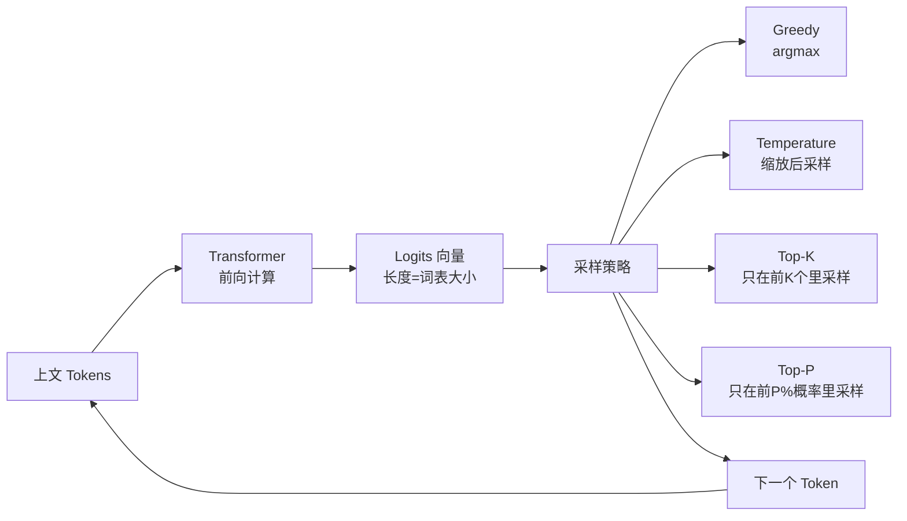
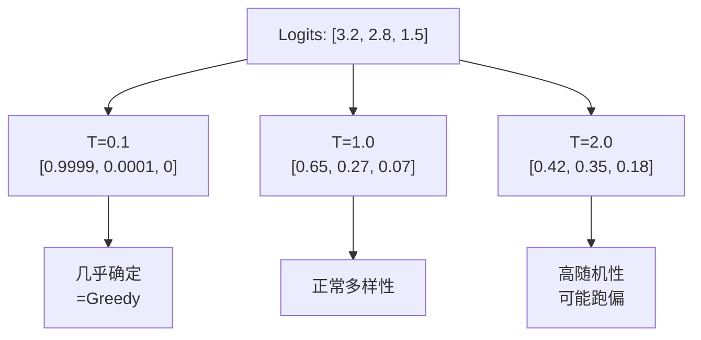

# Ch03 模型参数与 Prompt Engineering——让 LLM 听你指挥

> 本章目标：
> 1. 理解 LLM 生成的概率采样本质，搞懂每个参数到底在改什么
> 2. 掌握 Spring Boot 全局配置 + `ChatRequestParameters` 单次覆盖
> 3. 系统学习 8 大 Prompt 工程模式，能针对场景选型
> 4. 理解中文 Prompt 的特殊性与成本控制技巧
> 5. 把 smart-doc-assistant 升级到 v0.2.x：参数调优 + Prompt 模式库

---

## 3.1 为什么这章比"调参数"重要得多？

很多人把模型参数当成"魔法旋钮"——temperature 调高调低试几次看效果，但这其实是把 LLM 当黑盒在用。**真正稳定的 AI 应用必须建立在对生成原理的理解上**，否则：
- 同样的 prompt 在 temperature=0.7 和 0.2 之间的表现差异，**不是玄学**，是采样策略不同
- 为什么 ChatGPT 的代码生成比 Qwen 强？不是模型，是它 RLHF 阶段喂的 Few-shot 示例质量更高
- 为什么 DeepSeek 写中文小说比 GPT-4o 顺？因为它的预训练语料里中文比例更大，中文 Prompt 的提示词响应模式不同

这一章先带你拆开 LLM 的"黑盒"，看清每个参数在数学层面到底干了什么。

---

## 3.2 LLM 生成的底层流程——从 Token 到概率分布

### 3.2.1 自回归生成的本质

所有现代 LLM（GPT、DeepSeek、Qwen、Claude）都是**自回归（autoregressive）模型**——一次生成一个 token，每个新 token 都基于前面所有 token 重新算一遍概率分布：

```
输入: "今天天气"
模型输出概率分布（仅示意）:
  "不错"  → 0.35
  "真好"  → 0.28
  "很热"  → 0.12
  "晴朗"  → 0.08
  "下雨"  → 0.05
  ... (其他数万 token)

采样后选出 "不错"，再喂回去 → "今天天气不错"
模型再算下一个 token 概率分布 → ...
```

**核心事实**：LLM 不会"思考"，它只做一件事——**给定上文，预测下一个最可能出现的 token**。你看到的"推理""理解"都是这个过程的涌现效果。

### 3.2.2 Logits → Softmax → 采样

模型最后一层输出的不是概率，而是**对数几率（logits）**，一个长度为词表大小的向量：

```
logits = [3.2, 2.8, 1.5, 0.3, -1.2, ...]   (长度=词表大小, 通常10万+)

softmax(logits) = [0.65, 0.27, 0.07, 0.01, 0.00, ...]   (变成0~1概率)
```

**采样（sampling）** 就是从这个概率分布里选 token。**关键来了**——怎么"选"，决定了输出是稳定还是发散：



**Greedy（贪心）** 永远选概率最高的 token——输出稳定但**重复、无聊**。
**Sampling（采样）** 允许按概率分布选——输出更多样，但可能"胡说八道"。

---

## 3.3 模型参数详解——每个旋钮到底在改什么？

LangChain4j 把这些参数统一封装在 `ChatRequestParameters`（也用于 `OpenAiChatRequestParameters` 等子类）。下表是**完整参数清单 + 作用机理 + 推荐值**：

| 参数 | 取值范围 | 作用 | 推荐值 | 适用场景 |
|------|---------|------|--------|---------|
| `temperature` | [0, 2] | 采样温度，越高越发散 | 0.0~0.3 | 事实性/代码/JSON |
| | | | 0.7~1.0 | 创意/营销文案 |
| | | | 1.0+ | 几乎不用 |
| `topP` (nucleus) | [0, 1] | 累积概率阈值，只在前 P 概率里采样 | 0.9~0.95 | 和 temperature 二选一微调 |
| `topK` | [1, ∞) | 只在前 K 个 token 里采样 | 20~50 | Ollama/开源模型常需要 |
| `maxTokens` | [1, ∞) | 单次响应最多生成多少 token | 500~2000 | 控制成本必设 |
| `frequencyPenalty` | [-2, 2] | 已出现 token 的概率惩罚 | 0~0.6 | 减少重复用词 |
| `presencePenalty` | [-2, 2] | 是否出现过的惩罚（不按频次） | 0~0.6 | 鼓励新话题 |
| `seed` | 整数 | 采样种子，配合 temperature=0 可复现 | 任意固定值 | 测试/AB |
| `stopSequences` | String[] | 遇到这些字符串立刻停止 | 业务相关 | 多轮/角色扮演 |
| `responseFormat` | 枚举/JSON Schema | 强制输出格式 | JSON | 结构化输出 |

### 3.3.1 Temperature：放大 vs 压缩概率分布

**这是最容易误用的参数**。它的真实作用是**对 logits 做缩放后再 softmax**：

```
temperature = 1.0:  softmax([3.2, 2.8, 1.5]) → [0.65, 0.27, 0.07]   (原始分布)
temperature = 0.1:  softmax([32, 28, 15])    → [0.9999, 0.0001, 0] (趋向 greedy)
temperature = 2.0:  softmax([1.6, 1.4, 0.75]) → [0.42, 0.35, 0.18] (更平均)
```



**最佳实践**：
- ✅ **JSON 输出、代码、SQL、数学题**：用 `temperature = 0.0` 或极低（0~0.2）
- ✅ **写作、营销、翻译**：用 `0.7~1.0`
- ❌ **不要用 1.5+**：纯粹在烧钱，输出基本不可控
- 💡 **`temperature = 0` ≠ 完全确定**：底层采样仍有浮点差异，DeepSeek/OpenAI 通常稳定但理论上不保证

### 3.3.2 Top-P (Nucleus Sampling) 和 Top-K

这两个参数是**对采样范围的二次裁剪**：

```
logits 排序后: [token_A:0.35, token_B:0.28, token_C:0.12, token_D:0.08, token_E:0.05, ...]

topK=2:  只在 [token_A, token_B] 里采样  (前K个)
topP=0.7: 在累积概率到 0.7 的 token 里采样 = [token_A, token_B, token_C] (0.35+0.28+0.12=0.75≈0.7)
```

**Top-K 缺点**：词表大小不固定时效果不稳定。GPT-2 时代流行，现在 OpenAI/Anthropic 都不推荐。
**Top-P 推荐**：和 temperature 二选一调优即可（OpenAI 官方建议），DeepSeek 默认 0.9~0.95。

### 3.3.3 Frequency / Presence Penalty：抗重复

LLM 训练目标的最大副作用是**复读机**——模型倾向于重复上文。惩罚项就是在 logits 上扣分：

```
原始 logits: [..., "的":2.5, "了":2.3, ...]
已经出现过的 token 累积次数: "的"x5, "了"x3
frequency_penalty=0.6:
  logits["的"] -= 0.6 * 5 = 3.0  → 变成 -0.5
  logits["了"] -= 0.6 * 3 = 1.8  → 变成 0.5
```

- **frequency_penalty**：和出现次数成比例，越重复越罚
- **presence_penalty**：只要出现过就罚一次，**鼓励新话题**

**实操**：写营销文案、生成多样示例、客服长对话——开 `frequency_penalty=0.5`。SQL 生成、代码补全——关掉（=0）。

### 3.3.4 Max Tokens：成本控制的命门

```
输出 token 数 × 单价 = 你这一次的费用
```

DeepSeek-V3 输出价格约 ¥1/M tokens，200 token 的回答成本 0.0002 元，看起来不多，但**QPS 一上来就是真金白银**。生产环境必做：
- ✅ 全局 `maxTokens` 上限（防恶意刷输出）
- ✅ 估算 prompt+预期输出长度，分场景配置
- ✅ 流式输出时设置合理的 maxTokens，避免客户端断连后还在生成

### 3.3.5 Seed：让输出可复现

设了 `seed=42` 且 `temperature=0` 时，**同样的输入永远输出同样的内容**——这是测试用例设计的基础：

```java
ChatRequestParameters.builder()
    .seed(42)
    .temperature(0.0)
    .build();
```

⚠️ 注意：seed 只保证"在同样的参数下"输出稳定。如果你改了 temperature 或 prompt，输出又会变。

### 3.3.6 Stop Sequences：精确控制终止

模型默认按"自然结束"停，但有时你需要它在某个特定 token 处停：

```java
.stopSequences(new String[]{"\n\n---", "###END###", "<|endoftext|>"})
```

典型场景：
- **多角色对话**：用 `<|end|>` 作为单个角色发言的结束标记
- **结构化生成**：用 `\n\n` 防止生成多段无关内容
- **流式输出**：让前端能在特定位置插入动画/换行

### 3.3.7 Response Format：JSON 模式开关

```java
// 方式1：JSON Object（通用）
.responseFormat(ResponseFormatType.JSON)

// 方式2：严格 JSON Schema（OpenAI 新模型/部分国产模型）
.responseFormat(JsonSchema.builder()
    .jsonSchema("""
        {
          "type": "object",
          "properties": {
            "sentiment": {"type": "string", "enum": ["POSITIVE", "NEGATIVE", "NEUTRAL"]},
            "score": {"type": "number"}
          },
          "required": ["sentiment", "score"]
        }
        """)
        .build())
```

**生产建议**：结构化输出场景必须配合 `temperature=0` + `responseFormat=JSON`。详见 Ch07。

---

## 3.4 Spring Boot 全局配置——application.yml 一处生效

### 3.4.1 langchain4j-spring-boot-starter 的参数映射

启动器会自动把 application.yml 的配置映射到 ChatModel Bean。

> ⚠️ **重要：配置路径分两层**：
> - **`langchain4j.chat-model.*`** 是**通用抽象路径**，不绑定具体提供商，但**支持的参数有限**
> - **`langchain4j.open-ai.chat-model.*`** 是 **OpenAI 兼容协议专用**（覆盖 DeepSeek、通义、智谱、Kimi 等），**支持全部参数**（response-format、seed 等）
>
> 实际项目推荐用 **`open-ai.chat-model`** 路径——兼容性最好。本教程项目代码也用这个。

```yaml
langchain4j:
  open-ai:                              # ← OpenAI 兼容协议专用路径
    chat-model:
      base-url: https://api.deepseek.com/v1
      api-key: ${DEEPSEEK_API_KEY}
      model-name: deepseek-chat
      temperature: 0.7                  # 全局默认 temperature
      top-p: 0.9
      max-tokens: 2000
      frequency-penalty: 0.0
      presence-penalty: 0.0
      seed: 42
      stop-sequences: []                # 全局停用词
      timeout: 60s                      # 请求超时
      log-requests: false               # 生产关掉
      log-responses: false
```

**支持的全局参数**（具体看 OpenAiChatRequestParameters / AnthropicChatRequestParameters）：
- `temperature`, `top-p`, `top-k`（部分模型）
- `max-tokens`, `max-completion-tokens`（OpenAI 新版）
- `frequency-penalty`, `presence-penalty`
- `seed`, `stop-sequences`
- `response-format`, `reasoning-effort`（o1/o3）
- `timeout`, `log-requests`, `log-responses`

### 3.4.2 多模型配置：不同场景用不同参数

> **v0.2.x 项目暂未启用多模型 Bean**——FlexibleAssistant 用 ChatRequestParameters 单次覆盖参数，效果类似但更灵活。
> 如果你有强需求（比如要按用户/租户切换不同厂商模型），可以按下面方式扩展。

```yaml
langchain4j:
  open-ai:                              # 默认模型：通用对话
    chat-model:
      base-url: https://api.deepseek.com/v1
      api-key: ${DEEPSEEK_API_KEY}
      model-name: deepseek-chat
      temperature: 0.7
      max-tokens: 2000

  open-ai-chat-models:                  # 多个备选模型（注意命名规则：<provider>-chat-models）
    json-model:                         # JSON 专用：低温度 + JSON 模式
      base-url: https://api.deepseek.com/v1
      api-key: ${DEEPSEEK_API_KEY}
      model-name: deepseek-chat
      temperature: 0.0
      max-tokens: 1000
      response-format: json_object      # 强制 JSON 输出

    creative-model:                     # 创意文案：高温度
      base-url: https://api.deepseek.com/v1
      api-key: ${DEEPSEEK_API_KEY}
      model-name: deepseek-chat
      temperature: 1.0
      top-p: 0.95
      frequency-penalty: 0.5
      max-tokens: 4000
```

注入时按 Bean 名选择：

```java
@AiService(
    wiringMode = EXPLICIT,
    chatModel = "jsonModel"             // 用 JSON 专用 Bean
)
public interface JsonAssistant {
    @UserMessage("{{it}}")
    ReviewResult analyze(String review);
}
```

> **注意**：Spring Boot 3 + LangChain4j 1.x 的多模型 Bean 命名规则是 `<provider>-chat-models`，例如：
> - `open-ai-chat-models.json-model` → Bean 名 `jsonModel`
> - `anthropic-chat-models.claude-sonnet` → Bean 名 `claudeSonnet`
>
> 不熟悉这个规则的话，建议先用 3.5 节的 ChatRequestParameters 方案，复杂度低 90%。

### 3.4.3 配置类里的手动注入（更灵活）

如果你想按租户/按用户动态切换模型：

```java
@Configuration
public class ModelConfig {

    @Bean
    @Primary
    public ChatModel chatModel(@Value("${langchain4j.chat-model.api-key}") String apiKey) {
        return OpenAiChatModel.builder()
            .baseUrl("https://api.deepseek.com/v1")
            .apiKey(apiKey)
            .modelName("deepseek-chat")
            .temperature(0.7)
            .maxTokens(2000)
            .build();
    }
}
```---

## 3.5 单次调用覆盖——ChatRequestParameters 动态传参

### 3.5.1 为什么需要单次覆盖？

全局配置是"基线"，但同一个模型在不同场景下的最优参数不一样：

```
对话场景:    temperature=0.8, max_tokens=2000
翻译场景:    temperature=0.3, max_tokens=500
JSON 抽取:   temperature=0.0, response_format=JSON
创意营销:    temperature=1.0, frequency_penalty=0.5, max_tokens=4000
```

把基线设成"中间值"再按场景覆盖，比每个场景配一份 yml 更可维护。

### 3.5.2 AiService 接口里覆盖参数（最优雅）

在 AiService 方法参数里直接声明 `ChatRequestParameters`，**该参数会被框架自动识别并合并到请求**：

```java
@AiService
public interface FlexibleAssistant {

    /**
     * 基础对话：使用全局默认参数
     */
    String chat(@MemoryId Long userId, @UserMessage String message);

    /**
     * 翻译场景：低温度保证准确
     */
    @SystemMessage("你是一名专业翻译，只输出译文，不要任何解释。")
    String translate(@UserMessage String text, ChatRequestParameters params);

    /**
     * JSON 结构化输出：temperature=0 + JSON 模式
     */
    ReviewResult analyze(@UserMessage String review, ChatRequestParameters params);
}
```

**关键**：参数必须紧跟在 `@UserMessage` 模板变量之后，命名随意但类型必须是 `ChatRequestParameters`（或其子类，如 `OpenAiChatRequestParameters`）。

Controller 里组装参数：

```java
@RestController
@RequiredArgsConstructor
public class AssistantController {

    private final FlexibleAssistant assistant;

    @PostMapping("/api/translate")
    public String translate(@RequestBody TranslateRequest req) {
        ChatRequestParameters params = ChatRequestParameters.builder()
            .temperature(0.3)
            .maxTokens(500)
            .build();

        return assistant.translate(req.getText(), params);
    }

    @PostMapping("/api/review/analyze-v2")
    public ReviewResult analyzeReview(@RequestBody ReviewRequest req) {
        ChatRequestParameters params = ChatRequestParameters.builder()
            .temperature(0.0)
            .maxTokens(500)
            .responseFormat(ResponseFormatType.JSON)
            .seed(42)
            .build();

        return assistant.analyze(req.getReview(), params);
    }
}
```

### 3.5.3 直接调用 ChatModel（不用 AiService）

有时你需要更细粒度控制——比如同一段代码里既调 LLM 又调 EmbeddingModel，或者想完全掌控 messages 列表：

```java
@Service
@RequiredArgsConstructor
public class DirectChatService {

    private final ChatModel chatModel;

    public String summarize(String text) {
        ChatRequest request = ChatRequest.builder()
            .messages(UserMessage.from("请用一句话总结：\n" + text))
            .parameters(ChatRequestParameters.builder()
                .temperature(0.3)
                .maxTokens(100)
                .build())
            .build();

        ChatResponse response = chatModel.chat(request);
        return response.aiMessage().text();
    }
}
```

**关键点**：
- `ChatRequest` 是完整请求（消息列表 + 参数）
- `ChatResponse` 包含 `AiMessage`（模型回复）和 `tokenUsage()`（消耗统计）
- 通过 `ChatModel.chat(request)` 同步调用
- 用 `StreamingChatModel.chat(request, handler)` 流式调用（详见 Ch04）

### 3.5.4 合并优先级：单次覆盖 > 全局配置

```
最终参数 = 全局 yml 配置 + ChatRequestParameters（运行时）
```

如果两者有冲突，**单次覆盖的值会赢**。这意味着你可以在 yml 里设"基线"，在 Controller 里按业务微调——既保持配置的整洁，又不失灵活性。

---

## 3.6 Prompt 工程 8 大模式——不只是"会写 prompt"

很多开发者以为 Prompt Engineering 就是"把要求写清楚"。其实它是一套**经过大量实验验证的技术模式**，每种模式对应特定的输出场景。下面是生产环境最常用的 8 种。

### 3.6.1 Zero-shot：直接给任务

```java
@SystemMessage("你是资深 Java 工程师，回答必须严谨、有代码示例。")
String explain(@UserMessage String topic);
```

**适用**：简单事实问答、定义解释、基础翻译。
**局限**：复杂推理容易出错，比如数学题、逻辑题。

### 3.6.2 Few-shot：给 2~5 个示范

让模型从示例中"悟"出回答格式——这是从 GPT-3 时代就被验证的**最强大**的模式。

```java
@SystemMessage("""
    你是商品评价情感分析助手。下面是 3 个示例：
    
    评价: "质量差到爆，再也不买了"
    输出: {"sentiment":"NEGATIVE","score":1,"keyPoints":["质量差"]}
    
    评价: "还不错，性价比高"
    输出: {"sentiment":"POSITIVE","score":4,"keyPoints":["性价比高"]}
    
    评价: "一般般吧，没什么特别"
    输出: {"sentiment":"NEUTRAL","score":3,"keyPoints":["无特别感受"]}
    
    现在分析用户的评价，严格按示例的 JSON 格式输出。
    """)
@UserMessage("评价：{{review}}")
ReviewResult analyze(@V("review") String review);
```

**关键技巧**：
- ✅ 示例要有**多样性**（覆盖正面/负面/中性）
- ✅ 示例要**真实且完整**（不要简化到脱离实际）
- ❌ 示例不要太多（3~5 个最佳，再多就浪费 token）
- ❌ 示例不要带"答案之外的废话"（模型会学）

### 3.6.3 Chain-of-Thought (CoT)：让模型"一步步想"

**核心**：在 Prompt 里加一句"let's think step by step"，让模型输出推理过程再给答案。

```java
@SystemMessage("""
    你是一名数学老师。学生会问数学问题，你需要：
    1. 先把解题步骤列清楚（一步一步推理）
    2. 最后给出明确答案
    
    用中文回答。
    """)
@UserMessage("""
    题目：{{question}}
    
    让我们一步步思考。
    """)
String solve(@V("question") String question);
```

**效果**：在 GSM8K、Math 等基准上，**CoT 让准确率从 30%+ 提升到 70%+**。DeepSeek-R1 的推理模型就是把这个模式做到了极致。

**变种**：
- **Zero-shot CoT**：只加"let's think step by step"，无示范
- **Few-shot CoT**：给几个带推理过程的示范
- **Self-Consistency**：多次 CoT 取多数答案（详见下节）

### 3.6.4 Self-Consistency：多次采样取多数

CoT 有时会"想错"。Self-Consistency 是**多次用 CoT 采样，对最终答案投票**：

```java
@Service
@RequiredArgsConstructor
public class MathSolver {

    private final ChatModel chatModel;

    public String solve(String question) {
        // 并发跑 5 次 CoT
        List<String> answers = IntStream.range(0, 5)
            .mapToObj(i -> chatModel.chat(ChatRequest.builder()
                .messages(UserMessage.from("一步步思考：\n" + question))
                .parameters(ChatRequestParameters.builder()
                    .temperature(0.7)        // 必须开温度才有差异
                    .maxTokens(500)
                    .build())
                .build()))
            .map(r -> extractFinalAnswer(r.aiMessage().text()))
            .toList();

        // 取出现次数最多的答案
        return answers.stream()
            .collect(Collectors.groupingBy(Function.identity(), Collectors.counting()))
            .entrySet().stream()
            .max(Map.Entry.comparingByValue())
            .map(Map.Entry::getKey)
            .orElseThrow();
    }
}
```

**适用**：数学、代码生成、多答案归一化场景。
**代价**：N 倍费用 + N 倍延迟。生产环境慎用，仅用于"必须保证准确"的核心场景。

### 3.6.5 ReAct：推理 + 工具调用

**ReAct（Reason + Act）** 是一种让 LLM 在**思考和行动之间交替**的模式：

```
Thought: 用户问天气，我需要查询 API
Action: get_weather(city="上海")
Observation: {"temp": 28, "condition": "晴"}
Thought: 数据拿到了，可以回答用户了
Answer: 上海今天晴，28°C。
```

LangChain4j 的 `Agent` 就是 ReAct 模式的产品化实现（详见 Ch14）。这里只展示用 Prompt 模拟：

```java
@SystemMessage("""
    你可以使用以下工具：
    - get_weather(city): 查询城市天气
    
    按以下格式回答：
    Thought: <你的思考>
    Action: <工具调用>
    Observation: <工具结果>
    ... (循环)
    Answer: <最终回答>
    """)
```

**最佳实践**：实际项目别手写 ReAct 循环，直接用 `Agent` API。

### 3.6.6 Role Prompting（角色扮演）

给模型一个**具体身份**，让回答风格/深度/用词更聚焦。

```java
// ❌ 弱效果
@SystemMessage("写一段关于 Spring Boot 的介绍")

// ✅ 强效果
@SystemMessage("""
    你是一位有 10 年 Java 经验的后端架构师，曾主导过 3 个亿级用户的产品。
    你写技术文章的特点是：
    - 一定要有生产环境的真实案例
    - 善于用类比让小白理解
    - 不夸大、不回避坑点
    - 文章开头有 hook，结尾有总结
    
    现在写一篇关于 Spring Boot 自动配置的深度文章。
    """)
```

**原理**：模型的 RLHF 阶段被训练成"对角色敏感"——给它身份会触发对应的"知识子集"和"风格模式"。

### 3.6.7 Structured Output Prompting

在 Prompt 里**显式约束**输出格式（即使模型支持 JSON 模式，也要写清楚）：

```java
@SystemMessage("""
    你从用户评论中抽取结构化信息。
    
    输出 JSON 格式，严格遵守：
    {
      "sentiment": "POSITIVE" | "NEGATIVE" | "NEUTRAL",
      "score": 1-5 之间的整数,
      "keyPoints": ["要点1", "要点2"],
      "suggestions": ["改进建议1"]
    }
    
    不要输出 JSON 之外的任何文字。不要使用 Markdown 代码块包裹。
    """)
@UserMessage("评价：{{review}}")
ReviewResult analyze(@V("review") String review);
```

**结合**：`temperature=0` + `responseFormat=JSON` + 上面这种 Prompt = 99%+ 解析成功率。

### 3.6.8 Template Reuse（模板复用）

把可复用的 Prompt 块做成**外部模板**，用 `{{variable}}` 占位：

```properties
# resources/prompts/code-review-system.txt
你是一位资深 {{language}} 工程师，正在做 Code Review。
请重点关注：
1. Bug 风险（边界条件、空指针、并发问题）
2. 性能瓶颈（算法复杂度、I/O）
3. 安全漏洞（注入、越权、敏感信息）
4. 可维护性（命名、注释、复杂度）

按以下格式输出：
- 问题位置（行号或函数名）
- 问题类型（Bug/性能/安全/可维护）
- 严重程度（高/中/低）
- 修改建议

如果代码整体没问题，明确说"无问题"。
```

加载使用：

```java
@AiService
public interface CodeReviewAssistant {

    @SystemMessage(fromResource = "prompts/code-review-system.txt")
    String review(@V("language") String language, @V("code") String code);
}
```

**好处**：
- ✅ Prompt 修改不需要重编译
- ✅ 运营/产品可以直接调 prompt（不打扰开发）
- ✅ 多语言版本 prompt 可以独立维护

---

## 3.7 中文 Prompt 的特殊性——你以为只是翻译？

很多人写中文 Prompt 直接照搬英文的最佳实践，但**中文 LLM（DeepSeek、通义、智谱）和英文 LLM（GPT-4、Claude）对同一句 Prompt 的响应模式不一样**。

### 3.7.1 标点和分词差异

中文没有空格分隔 token，BPE 分词器和英文完全不同：

```
英文分词: "Hello World" → ["Hello", " World"]
中文分词(DeepSeek): "你好世界" → ["你", "好", "世", "界"]
中文分词(GPT-4):   "你好世界" → ["你好", "世界"]
```

这意味着：
- 同一个中文 Prompt 在不同模型上 token 消耗可能差 20~30%
- 中文 Prompt 中的"专业术语"如果模型词表里没有，会被拆成多个 token，**浪费成本**

**实践建议**：中文场景优先用 DeepSeek/Qwen，token 效率更高。

### 3.7.2 思维链触发的差异

英文里加 "let's think step by step" 触发 CoT 效果显著，中文里:

```
✅ "请一步步思考"
✅ "让我们逐步分析"
✅ "请详细推理后给出答案"
❌ "思考一下"（太模糊，效果差）
❌ "推理"（太短，可能跳过）
```

**经验值**：中文 CoT 触发词至少要有"逐步""一步步""推理""分析"中至少两个。

### 3.7.3 Few-shot 示例的语言一致性

```java
// ❌ 混合语言示例（效果最差）
@SystemMessage("""
    示例：
    Q: What is 2+2?
    A: 4
    
    Q: 中国的首都是什么？
    A: 北京
    """)

// ✅ 全中文示例
@SystemMessage("""
    示例：
    问题：2+2 等于几？
    答案：4
    
    问题：中国的首都是什么？
    答案：北京
    """)
```

**原理**：模型看到输入语言和示例语言不一致时，会降低对示例格式的"信任度"，Few-shot 效果打折。

### 3.7.4 中文角色设定更具体才有效

```java
// ❌ 太抽象
@SystemMessage("你是一个专家")

// ✅ 具体身份
@SystemMessage("你是一位三甲医院的主治医师，擅长心血管疾病诊断")
```

中文 LLM 对泛泛的"专家"响应不如英文模型，因为：
1. 中文 RLHF 数据里"专家"角色被过度使用，模式趋同
2. 中文场景下"具体身份 + 具体场景"才能激活对应领域的微调模式

---

## 3.8 Prompt 缓存与成本控制——降本 70% 的关键

### 3.8.1 费用结构

主流 LLM 按 **input token** 和 **output token** 分别计价：

| 模型 | Input ¥/M | Output ¥/M |
|------|-----------|-----------|
| DeepSeek-V3 | 1 | 2 |
| GPT-4o-mini | 0.15 USD | 0.60 USD |
| Claude-3.5-Sonnet | 3 USD | 15 USD |
| Qwen2.5-72B | 4 | 12 |

**关键洞察**：output 通常比 input 贵 3~10 倍。所以**控制输出长度比压缩 Prompt 更重要**。

### 3.8.2 DeepSeek 缓存机制（Prompt Caching）

DeepSeek-V3 对**相同前缀的 prompt 自动命中缓存**，价格直降 50%~90%：

```
首次调用: prompt=2000 tokens, response=500 tokens
            → 2000 input ¥1 + 500 output ¥2 = ¥3/次

第二次相同 prompt 调用: 前 1500 tokens 命中缓存
            → 1500 缓存价 ¥0.5 + 500 未命中 ¥0.5 + 500 output ¥2 = ¥3/次（差不多）

优化：把 SystemMessage 和 Few-shot 示例做稳定前缀，业务参数做后缀
            → 命中率 > 90%，input 成本直接砍半
```

**实现技巧**：固定前缀 + 动态后缀：

```java
@SystemMessage(fromResource = "prompts/fixed-system.txt")  // 不变
@UserMessage("用户问题：{{question}}\n\n参考资料：{{context}}")  // 后缀变化
```

**注意**：DeepSeek 缓存窗口是几小时；OpenAI Prompt Cache 是 5~10 分钟但命中更激进。

### 3.8.3 业务层缓存

对**同样的 query + 同样的上下文**直接返回历史结果，连 LLM 都不调：

```java
@Service
@RequiredArgsConstructor
public class CachedAssistantService {

    private final ChatModel chatModel;
    private final Cache<String, String> cache = Caffeine.newBuilder()
        .maximumSize(10_000)
        .expireAfterWrite(Duration.ofMinutes(10))
        .build();

    public String answer(String query, String context) {
        String key = DigestUtils.sha256Hex(query + "::" + context);
        return cache.get(key, k -> 
            chatModel.chat(ChatRequest.builder()
                .messages(UserMessage.from(buildPrompt(query, context)))
                .build())
                .aiMessage().text()
        );
    }
}
```

**适用**：FAQ、文档问答、客服标准回答。
**不适用**：强个性化、时事相关、需要多轮上下文的场景。

### 3.8.4 成本核算示例

假设你的 AI 客服系统每天 10 万次调用：
- 平均 input: 500 tokens（system + 历史 + question）
- 平均 output: 200 tokens（回答）

**DeepSeek-V3**：
- input 成本: 100k × 500 × ¥1/M = ¥50
- output 成本: 100k × 200 × ¥2/M = ¥40
- 总: ¥90/天 = ¥2700/月

**优化后**（缓存命中 + 压缩 output）：
- input 成本: ¥25（缓存命中 50%）
- output 成本: ¥20（max_tokens=300 限制）
- 总: ¥45/天 = ¥1350/月

**节省 50%**，对中小项目一年差出一台服务器的钱。

---

## 3.9 ⚠️ 高频坑点与最佳实践

### 坑1：maxTokens 不设，被恶意刷输出

```
攻击: 发送"请写一篇
100 万字的小说"
结果: 模型一直生成到 token 上限或超时
账单: 单次可能产生几百元费用
```

✅ 永远设 maxTokens 上限，且远小于账户余额能承受的最大输出

### 坑2：temperature=0 在 OpenAI 也不完全稳定

OpenAI 官方文档明确说 `temperature=0` 不保证完全确定性——后端基础设施变化（负载、模型版本）会影响 token 选择。
生产环境如果需要**强一致性**，必须用 seed + temperature=0 双重保险。

```java
ChatRequestParameters.builder()
    .seed(42)
    .temperature(0.0)
    .build();
```

### 坑3：responseFormat=JSON 时 Prompt 重复要求 JSON

很多教程说"responseFormat=JSON 会让模型自动输出 JSON，不用在 Prompt 里写"。这是错的——
**Prompt 里的格式要求和模型层的 JSON 约束必须同时存在**。前者决定"内容结构"，后者只保证"语法合法"。

```java
// ❌ 只设 responseFormat，Prompt 不要求
.responseFormat(ResponseFormatType.JSON)
@UserMessage("分析这条评论")
// 模型可能输出: {"sentiment": "positive", "extra": "...随机加的字段..."}

// ✅ Prompt + responseFormat 双重约束
.responseFormat(ResponseFormatType.JSON)
@SystemMessage("""
    只输出 sentiment / score / keyPoints 三个字段，不要其他字段。
    不要 Markdown，不要解释。
    """)
```

### 坑4：topP 和 temperature 同时调大

```
temperature=1.0 + topP=0.99 = 输出基本完全随机
```

**经验**：temperature 和 topP 二选一调节就行，两个都开大=失控。两个都设 1.0=纯随机采样。

### 坑5：Few-shot 示例太多

```java
// ❌ 塞了 10 个示例，prompt 涨到 3000 tokens，每次调用多花 ¥0.003
@SystemMessage("""示例1...示例2...示例3...""" )

// ✅ 精选 3-5 个，覆盖目标场景即可
@SystemMessage("""示例1...示例2...示例3...""" )
```

### 坑6：SystemMessage 里塞业务参数

```java
// ❌ SystemMessage 每次都会重传，浪费 token 和缓存命中率
@SystemMessage("用户当前问题: {{question}}")
```

**SystemMessage 是稳定前缀**——缓存机制靠它命中。动态内容必须放 @UserMessage。

### 最佳实践汇总

- ✅ **JSON/代码/事实场景**：temperature=0 + maxTokens 上限 + responseFormat=JSON
- ✅ **创意场景**：temperature=0.7~1.0 + frequency_penalty=0.5
- ✅ **多场景复用模型**：yml 设基线 + Controller 用 ChatRequestParameters 单次覆盖
- ✅ **Prompt 缓存**：SystemMessage 做稳定前缀，业务参数放 UserMessage
- ✅ **Prompt 外部化**：所有业务 Prompt 放 resources/prompts/ 下，fromResource 加载
- ✅ **Few-shot 示例**：3~5 个，覆盖目标场景的多样性
- ✅ **CoT 触发词**：中文用"请一步步思考""详细推理后给出答案"
- ✅ **中文角色设定**：具体到科室/职级/年限，不要只说"专家"
- ❌ **不要 maxTokens 不设上限**
- ❌ **不要 temperature=1.5+**
- ❌ **不要在 SystemMessage 里塞动态参数**
- ❌ **不要 Few-shot 超过 10 个示例**
- ❌ **不要混语言 Few-shot 示例**

---

## 3.10 💡 Spring AI 对比：参数和 Prompt 的处理方式

Spring AI 的设计哲学和 LangChain4j 有差异，下面是核心对比：

| 能力 | LangChain4j | Spring AI |
|------|-------------|-----------|
| 参数对象 | `ChatRequestParameters` 统一抽象 | `ChatOptions` 每个模型子类（OpenAiChatOptions/AnthropicChatOptions） |
| 单次覆盖 | 方法参数声明，框架自动识别 | Builder 模式构造，传给 ChatClient |
| 外部 Prompt | `fromResource` 一行搞定 | `@Value("classpath:...")` + SpEL |
| 模板引擎 | 自带 `{{var}}` 简单模板 | 集成 StringTemplate / Pebble |
| JSON 模式 | `ResponseFormatType.JSON` | `.withResponseFormat(...).json()` |
| Token 统计 | `ChatResponse.tokenUsage()` | `ChatResponse.getMetadata().getUsage()` |

**Spring AI 写法**（仅做对比参考）：

```java
ChatClient chatClient = ChatClient.builder(chatModel)
    .build();

String result = chatClient.prompt()
    .system("你是一个翻译助手")
    .user(text)
    .options(OpenAiChatOptions.builder()
        .withTemperature(0.3)
        .withMaxTokens(500)
        .build())
    .call()
    .content();
```

**主要差异**：
-1. **Spring AI 用 Fluent API**，LangChain4j 用注解声明
-2. **Spring AI 模板集成更丰富**（支持自定义模板引擎），LangChain4j 自带模板够用但扩展性稍弱
-3. **LangChain4j 的 ChatRequestParameters 是统一抽象**，跨模型更方便；Spring AI 每个模型有自己的 Options 类
-4. **Spring AI 生态更"Spring"**（与 Spring 生态无缝集成），LangChain4j 更"中立"（不绑定 Spring）

我们的教程以 LangChain4j 为主线，所以 ChatRequestParameters 用得更多。

---

## 3.11 本章小结

| 知识点 | 关键 |
|-------|------|
| **采样原理** | Logits → Temperature 缩放 → Top-K/Top-P 裁剪 → Softmax → 采样 |
| **temperature** | 0=贪婪稳定，1=原始分布，2=发散；JSON/代码用 0，创作用 0.7~1 |
| **topP / topK** | 累积概率阈值，建议和 temperature 二选一微调 |
| **frequencyPenalty** | 抗重复，营销文案开 0.5，代码/SQL 关掉 |
| **presencePenalty** | 鼓励新话题，多轮对话可用 |
| **maxTokens** | 成本控制命门，**永远设上限** |
| **seed + temperature=0** | 唯一能复现输出的组合 |
| **stopSequences** | 精确控制终止点 |
| **responseFormat=JSON** | 结构化输出必备，配合 temperature=0 |
| **全局配置** | yml 设基线，多模型按 `langchain4j.chat-models.<name>` 配置 |
| **单次覆盖** | AiService 方法参数声明 `ChatRequestParameters`，Controller 动态构造 |
| **Prompt 8 模式** | Zero-shot / Few-shot / CoT / Self-Consistency / ReAct / Role / Structured / Template |
| **中文特殊性** | 分词差异、CoT 触发词、全中文示例、角色具体化 |
| **成本控制** | DeepSeek 缓存 + 业务层 Caffeine + maxTokens 限制 = 节省 50%

---

## 3.12 本章项目代码状态（v0.2.x）

本节把 smart-doc-assistant 升级到 **v0.2.x**——主要新增参数调优能力 + 几个 Prompt 模式示例。

```
smart-doc-assistant/
├── pom.xml                                     (版本: 1.22.0 + 实验模块 1.22.0-beta32)
└── src/main/
    ├── java/com/example/assistant/
    │   ├── AssistantApplication.java
    │   ├── config/
    │   │   └── AiServiceConfig.java           (ChatMemoryProvider)
    │   ├── assistant/
    │   │   ├── ChatAssistant.java             (基础对话)
    │   │   ├── TranslationAssistant.java      (翻译：低温度)
    │   │   ├── ReviewAnalysisAssistant.java   (JSON 结构化输出)
    │   │   └── FlexibleAssistant.java         ← 新增：参数动态覆盖
    │   └── controller/
    │       └── AssistantController.java       (新增 /api/translate-v2, /api/review/analyze-v2)
    └── resources/
        ├── application.yml                    (加多模型配置)
        └── prompts/
            ├── translator-system.txt
            ├── review-analysis-user.txt
            ├── code-review-system.txt         ← 新增：Few-shot + Role
            └── cot-math-user.txt              ← 新增：CoT 触发
```

**新增代码：FlexibleAssistant.java**

```java
package com.example.assistant.assistant;

import com.example.assistant.dto.ReviewResult;
import dev.langchain4j.model.chat.request.ChatRequestParameters;
import dev.langchain4j.service.SystemMessage;
import dev.langchain4j.service.UserMessage;
import dev.langchain4j.service.V;
import dev.langchain4j.service.spring.AiService;

@AiService
public interface FlexibleAssistant {

    /**
     * 创意写作：高温度 + frequency_penalty 抗重复
     */
    @SystemMessage("你是一位资深文案，擅长写有温度的品牌故事。")
    String creativeWrite(@UserMessage String topic, ChatRequestParameters params);

    /**
     * 翻译：低温度保证准确
     */
    @SystemMessage("你是一名专业翻译，只输出译文，不要任何解释。")
    String translate(@UserMessage String text, ChatRequestParameters params);

    /**
     * JSON 结构化输出
     */
    ReviewResult analyze(@UserMessage String review, ChatRequestParameters params);

    /**
     * 代码评审：Few-shot 示例
     */
    @SystemMessage(fromResource = "prompts/code-review-system.txt")
    String reviewCode(@V("language") String language, @V("code") String code);

    /**
     * 数学题：CoT 触发
     */
    @SystemMessage("你是一名数学老师，先一步步推理再给答案。")
    @UserMessage("题目：{{question}}\\n\\n请一步步思考后给出答案。")
    String solveMath(@V("question") String question);
}
```

**新增代码：application.yml（多模型配置）**

```yaml
langchain4j:
  chat-model:
    provider: openai
    base-url: https://api.deepseek.com/v1
    api-key: ${DEEPSEEK_API_KEY}
    model-name: deepseek-chat
    temperature: 0.7          # 默认基线
    max-tokens: 2000

  chat-models:
    json-model:                # JSON 专用：低温度 + JSON 模式
      provider: openai
      base-url: https://api.deepseek.com/v1
      api-key: ${DEEPSEEK_API_KEY}
      model-name: deepseek-chat
      temperature: 0.0
      max-tokens: 1000
      response-format: json_object
```

**新增代码：AssistantController.java（参数组装）**

```java
@PostMapping("/api/creative")
public String creative(@RequestBody CreativeRequest req) {
    ChatRequestParameters params = ChatRequestParameters.builder()
        .temperature(1.0)
        .topP(0.95)
        .frequencyPenalty(0.5)
        .maxTokens(2000)
        .build();

    return flexibleAssistant.creativeWrite(req.getTopic(), params);
}

@PostMapping("/api/translate-v2")
public String translateV2(@RequestBody TranslateRequest req) {
    ChatRequestParameters params = ChatRequestParameters.builder()
        .temperature(0.3)
        .maxTokens(500)
        .seed(42)
        .build();

    return flexibleAssistant.translate(req.getText(), params);
}

@PostMapping("/api/review/analyze-v3")
public ReviewResult analyzeV3(@RequestBody ReviewRequest req) {
    ChatRequestParameters params = ChatRequestParameters.builder()
        .temperature(0.0)
        .maxTokens(500)
        .responseFormat(ResponseFormatType.JSON)
        .build();

    return flexibleAssistant.analyze(req.getReview(), params);
}
```

**新增代码：prompts/code-review-system.txt**

```
你是资深 {{language}} 工程师，正在 Code Review。

请按以下格式输出（只输出问题列表，没有问题就说"无问题"）：
【问题1】
位置: <行号或函数名>
类型: Bug / 性能 / 安全 / 可维护
严重: 高 / 中 / 低
建议: <具体修改方法>

【问题2】
...
```

**验证清单**：
- [ ] 理解 temperature/topP/frequencyPenalty 在数学层面的作用
- [ ] 能在 application.yml 里配置多模型 Bean
- [ ] 能用 ChatRequestParameters 单次覆盖参数
- [ ] 理解 8 种 Prompt 模式的应用场景
- [ ] 能写出 Few-shot + CoT + Role Prompting 组合的优质 Prompt
- [ ] 理解中文 Prompt 的特殊性
- [ ] 知道 DeepSeek 缓存命中率和成本控制方法
- [ ] smart-doc-assistant v0.2.x 跑起来，4 个新接口都正常

---

**下一章预告：Ch04 流式输出与 SSE 实时对话**——用户等不了 10 秒才看到第一个字。这一章讲 StreamingChatModel、SSE、Spring MVC 的 `ResponseBodyEmitter` / `SseEmitter`，以及流式场景下的中断、取消、成本结算。
