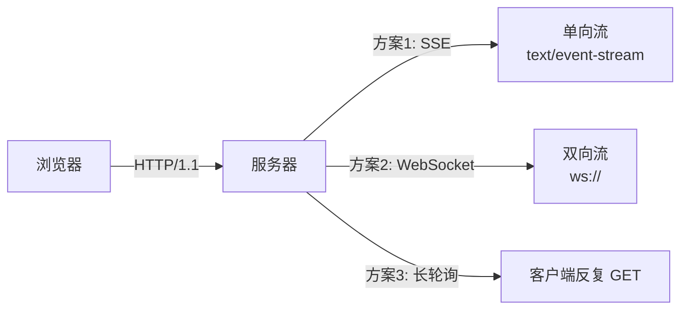

# Ch04 流式输出与 SSE 实时对话——用户等不了 10 秒

> 本章目标：
> 1. 理解为什么必须流式：首字延迟 vs 整体延迟的本质差异
> 2. 掌握 StreamingChatModel 与 TokenStream 两套流式 API
> 3. 把 AiService 方法改造成返回 `TokenStream<T>`
> 4. 用 Spring MVC 的 `SseEmitter` 把流式响应推到前端
> 5. 处理流式场景的 ChatMemory 增量更新、中断、Token 统计
> 6. 选学：WebFlux 响应式流式（高并发场景）
> 7. 把 smart-doc-assistant 升级到 v0.3：完整流式对话能力

---

## 4.1 为什么必须流式？——首字延迟才是真体验

### 4.1.1 同步模式的痛点

Ch01~Ch03 我们一直用的是同步模式：

```
客户端发请求 ─────────────────────► 服务端收齐全部 tokens ─────────────────► 返回 JSON
              网络往返 + 模型生成 1000 tokens                              ↑
                              ↓                                          用户看到第一个字
                              ~8-15 秒
```

**实际数据**（DeepSeek-V3，500 token 输出）：
- 网络往返：~200ms
- 模型生成：~8s
- 总延迟：~8.2s
- **用户看到第一行字的时间 = 8.2s**

8 秒是什么概念？Google 研究显示：
- **< 1s**：用户感觉"即时"
- **1~3s**：可接受，但开始走神
- **3~10s**：会去看手机
- **> 10s**：直接关页面

这就是为什么 ChatGPT、Claude、文心一言**全都在用流式输出**。

### 4.1.2 流式模式的本质

流式输出不是"加速"了 LLM，而是**降低首字延迟（Time To First Token, TTFT）**：

```
客户端发请求 ─► 服务端开始 streaming
   ↓            每个 token 增量推送
   ↓            ┌─token 1─┬─token 2─┬─token 3─┬─...─┬─token 500─┐
   ↓            ↓          ↓          ↓              ↓
   ↓            50ms       100ms      150ms          8000ms
   ↓            ↑
   ↓            用户看到第一个字：~250ms（流式模式下）
   ↓
用户体验：从"等了 8 秒看到完整回答"变成"等了 0.25 秒开始打字"
```

**关键洞察**：流式下整体生成时间反而略长（多了传输开销），但**TTFT 从 8s 降到 250ms = 32 倍提升**。这就是为什么"流式 = UX 革命"。

### 4.1.3 什么时候不该用流式？

流式不是万能药，有几个**不适合**的场景：

| 场景 | 不适合的原因 | 替代方案 |
|------|------------|---------|
| 结构化 JSON 输出 | 用户看不到完整 JSON 就没法解析 | 同步 + responseFormat=JSON |
| 短回答 (< 50 token) | 流式开销 > 节省的时间 | 同步 |
| 批处理（一次跑 1 万条） | 流式连接管理开销巨大 | 异步 + 批量 API |
| 服务端内部调用 | 没有"用户等"这个概念 | 同步 |

**判断原则**：输出长度 > 100 token 且有"用户等"的环节 → 用流式。

---

## 4.2 流式输出底层：SSE vs WebSocket vs 长轮询

### 4.2.1 三种实时推送方案对比



| 方案 | 协议 | 方向 | 复杂度 | 适用 |
|------|------|------|--------|------|
| **SSE** | HTTP | 服务端→客户端 | 低 | 99% 的 LLM 流式场景 |
| **WebSocket** | WS | 双向 | 高 | 协作编辑/实时游戏 |
| **长轮询** | HTTP | 双向 | 中 | SSE 不可用时的兜底 |

**对 LLM 流式输出的判断**：客户端只需要"接收"，不需要"发送中间消息打断"（Tool Call 是另一回事，框架处理）→ **SSE 是最优选择**。

### 4.2.2 SSE 协议格式

服务端推的每个 chunk 长这样：

```
HTTP/1.1 200 OK
Content-Type: text/event-stream
Cache-Control: no-cache
Connection: keep-alive

data: {"content":"你"}

data: {"content":"好"}

data: {"content":"，"}

event: done
data: {"finishReason":"STOP"}
```

**关键**：
- 每个 `data:` 是独立的事件
- 空行表示一个事件结束
- 客户端的 `EventSource` API 自动解析
- 服务端在响应完成后**不要关闭连接**，让客户端持续接收

### 4.2.3 为什么不用 WebSocket？

| 维度 | SSE | WebSocket |
|------|-----|-----------|
| 协议升级 | HTTP 原生 | 需握手升级 |
| 反向代理支持 | 全部支持 | 部分不支持（如 Nginx 需特殊配置） |
| 自动重连 | 浏览器原生 | 自己实现 |
| 鉴权 | 走 HTTP Header | 需在握手时处理 |
| 双向通信 | ❌ | ✅ |

**LLM 流式只需要单向通信**，SSE 完胜。WebSocket 留给"AI 协作编辑器""实时语音"等真正需要双向的场景。
---

## 4.3 StreamingChatModel 基础——chat(request, handler)

LangChain4j 提供 `StreamingChatModel` 接口，与 `ChatModel` 平级：

```java
public interface StreamingChatModel {
    void chat(ChatRequest request, StreamingChatResponseHandler handler);
}
```

### 4.3.1 最小可运行代码

```java
@RestController
@RequiredArgsConstructor
public class SimpleStreamController {

    private final StreamingChatModel streamingChatModel;

    @PostMapping(value = "/api/chat-stream",
                 produces = MediaType.TEXT_EVENT_STREAM_VALUE)
    public SseEmitter streamChat(@RequestBody ChatRequest req) {
        SseEmitter emitter = new SseEmitter(60_000L);  // 60s 超时

        streamingChatModel.chat(
            ChatRequest.builder()
                .messages(UserMessage.from(req.message()))
                .build(),
            new StreamingChatResponseHandler() {
                @Override
                public void onPartialResponse(String partial) {
                    try {
                        emitter.send(SseEmitter.event()
                            .name("message")
                            .data(Map.of("content", partial)));
                    } catch (IOException e) {
                        emitter.completeWithError(e);
                    }
                }

                @Override
                public void onCompleteResponse(ChatResponse response) {
                    emitter.send(SseEmitter.event()
                        .name("done")
                        .data(Map.of(
                            "finishReason", response.finishReason().name(),
                            "totalTokens", response.tokenUsage().totalTokenCount()
                        )));
                    emitter.complete();
                }

                @Override
                public void onError(Throwable error) {
                    emitter.completeWithError(error);
                }
            }
        );

        return emitter;
    }
}
```

**关键点**：
- `onPartialResponse` 每次 token 增量回调一次
- `onCompleteResponse` 全部生成完成时回调（含 token 用量）
- `onError` 异常时回调
- SSE 用 `SseEmitter.event().name().data()` 推送

### 4.3.2 流式响应 vs 同步响应的差异

| 维度 | 同步 (`ChatModel.chat()`) | 流式 (`StreamingChatModel.chat()`) |
|------|--------------------------|----------------------------------|
| 返回类型 | `ChatResponse` | 无返回值，通过 handler 回调 |
| AiMessage | 一次性返回完整 | 需要自己拼接 partial |
| TokenUsage | 立即可用 | 只在 `onCompleteResponse` 时才有 |
| Tool Call | 框架自动多轮 | 需要自己实现循环（详见 4.7） |
| ChatMemory | 框架自动追加 | 需要手动增量追加 |

**重要结论**：流式模式下，框架替你做的事变少了——记忆管理、多轮 Tool Call 都需要你显式处理。这也是为什么 LangChain4j 1.x 推出了 `TokenStream` 这个更高层的抽象。

---

## 4.4 TokenStream API——流式的"懒人模式"

### 4.4.1 为什么需要 TokenStream？

直接用 `StreamingChatModel.chat()` 的痛点：

```
1. onPartialResponse 里要手动处理 SseEmitter 异常
2. ChatMemory 增量更新要自己写
3. Tool Call 多轮要自己实现循环
4. TokenUsage 要等 onCompleteResponse 才拿得到
```

LangChain4j 1.x 推出的 `TokenStream<T>` 把这些问题打包成一个**响应式风格的回调链**：

```java
public interface TokenStream<T> {
    TokenStream<T> onPartialResponse(Consumer<String> partialResponseHandler);
    TokenStream<T> onPartialThinking(Consumer<String> partialThinkingHandler);  // 推理模型
    TokenStream<T> onIntermediateResponse(Consumer<ChatResponse> intermediateResponseHandler);
    TokenStream<T> onCompleteResponse(Consumer<ChatResponse> completeResponseHandler);
    TokenStream<T> onError(Consumer<Throwable> errorHandler);
    TokenStream<T> ignoreErrors();  // Ch15 Agentic 用
    void start();  // 启动流
}
```

### 4.4.2 TokenStream 的最小示例

```java
@RestController
@RequiredArgsConstructor
public class TokenStreamController {

    private final ChatModel chatModel;

    @PostMapping(value = "/api/chat-token-stream",
                 produces = MediaType.TEXT_EVENT_STREAM_VALUE)
    public SseEmitter stream(@RequestBody ChatRequest req) {
        SseEmitter emitter = new SseEmitter(60_000L);

        ChatRequest request = ChatRequest.builder()
            .messages(UserMessage.from(req.message()))
            .parameters(ChatRequestParameters.builder()
                .temperature(0.7)
                .build())
            .build();

        // 用 chatModel.stream() 拿到 TokenStream<AiMessage>
        chatModel.stream(request)
            .onPartialResponse(partial -> {
                try {
                    emitter.send(SseEmitter.event()
                        .name("message")
                        .data(Map.of("content", partial)));
                } catch (IOException e) {
                    throw new RuntimeException(e);
                }
            })
            .onCompleteResponse(response -> {
                try {
                    emitter.send(SseEmitter.event()
                        .name("done")
                        .data(Map.of(
                            "totalTokens", response.tokenUsage().totalTokenCount(),
                            "finishReason", response.finishReason().name()
                        )));
                    emitter.complete();
                } catch (IOException e) {
                    emitter.completeWithError(e);
                }
            })
            .onError(err -> {
                log.error("Stream error", err);
                emitter.completeWithError(err);
            })
            .start();  // ← 必须显式 start() 才执行

        return emitter;
    }
}
```

**对比 `StreamingChatModel.chat()`**：
- ✅ 链式 API，逻辑更清晰
- ✅ `start()` 显式触发，避免遗漏
- ✅ 后续扩展（如 Tool Call 多轮）只需多加 `.onIntermediateResponse()` 钩子
- ⚠️ 但本质上还是同一套回调，复杂场景没有本质差异

### 4.4.3 AiService 返回 TokenStream（最优雅）

Ch02 的 AiService 默认返回 `String`/`POJO`/`Result<T>`——但 LangChain4j 1.x **支持直接返回 `TokenStream<T>`**，框架自动帮你组装：

```java
@AiService
public interface StreamingAssistant {

    /**
     * 直接返回 TokenStream，框架处理所有流式细节
     */
    TokenStream<String> chatStream(@MemoryId Long userId, @UserMessage String message);

    /**
     * 流式 + 结构化：先流式返回完整文本，最后一次性解析为 POJO
     * 注意：返回类型是 ReviewAnalysis，但流的中间状态是 String
     */
    // TokenStream<ReviewAnalysis> analyzeStream(String review);  // 不行，见下文
}
```

**重要约束**：当方法返回 `TokenStream<T>` 时：
- `T` 必须是 `String` / `AiMessage` 之一（其他类型不支持流式解析）
- 如果要流式 + 结构化，要么用 `String` 然后自己解析，要么用同步版

### 4.4.4 AiService TokenStream 的完整回调

```java
@PostMapping(value = "/api/chat-ai-stream",
             produces = MediaType.TEXT_EVENT_STREAM_VALUE)
public SseEmitter aiStream(@RequestBody ChatRequest req) {
    SseEmitter emitter = new SseEmitter(60_000L);

    streamingAssistant.chatStream(req.sessionId(), req.message())
        .onPartialResponse(partial -> {
            try {
                emitter.send(SseEmitter.event()
                    .name("message")
                    .data(Map.of("content", partial)));
            } catch (IOException e) {
                throw new RuntimeException(e);
            }
        })
        .onCompleteResponse(response -> {
            // 这里 response 是 ChatResponse 对象，包含 aiMessage() 和 tokenUsage()
            try {
                emitter.send(SseEmitter.event()
                    .name("done")
                    .data(Map.of(
                        "totalTokens", response.tokenUsage().totalTokenCount(),
                        "finishReason", response.finishReason().name()
                    )));
                emitter.complete();
            } catch (IOException e) {
                emitter.completeWithError(e);
            }
        })
        .onError(err -> {
            log.error("Stream error", err);
            emitter.completeWithError(err);
        })
        .start();

    return emitter;
}
```

**这才是生产推荐写法**——AiService 处理 ChatMemory / Tool Call / Message 组装，你只关心怎么把 TokenStream 推到客户端。

---

## 4.5 Spring MVC 集成：SseEmitter 实战

### 4.5.1 SseEmitter vs ResponseBodyEmitter

Spring MVC 提供两种流式响应：

```java
// 1. SseEmitter：明确按 SSE 格式（Content-Type: text/event-stream）
public class SseEmitter extends ResponseBodyEmitter { ... }

// 2. ResponseBodyEmitter：通用流式，自己控制输出格式
public class ResponseBodyEmitter { ... }
```

**选择**：
- **LLM 流式输出** → 用 `SseEmitter`（浏览器原生 EventSource 支持）
- **自定义协议（如 NDJSON）** → 用 `ResponseBodyEmitter`

### 4.5.2 完整实战：流式聊天接口

```java
@RestController
@RequestMapping("/api")
@RequiredArgsConstructor
public class ChatStreamController {

    private final StreamingAssistant streamingAssistant;  // 返回 TokenStream<String> 的 AiService

    @PostMapping(value = "/chat/stream",
                 produces = MediaType.TEXT_EVENT_STREAM_VALUE)
    public SseEmitter chat(@RequestBody ChatRequest req) {
        // 1. 设置合理超时（流式不能太短也不能太长）
        SseEmitter emitter = new SseEmitter(120_000L);  // 120s

        // 2. 设置心跳（防止代理服务器超时断开）
        ScheduledFuture<?> heartbeat = startHeartbeat(emitter);

        // 3. 错误和完成时清理心跳
        emitter.onCompletion(heartbeat::cancel);
        emitter.onTimeout(heartbeat::cancel);
        emitter.onError(e -> heartbeat.cancel());

        // 4. 启动流
        try {
            streamingAssistant.chatStream(req.sessionId(), req.message())
                .onPartialResponse(partial -> sendSafely(emitter, "message",
                    Map.of("content", partial)))
                .onCompleteResponse(chatResponse -> {
                    sendSafely(emitter, "done", Map.of(
                        "sessionId", req.sessionId(),
                        "totalTokens", chatResponse.tokenUsage().totalTokenCount()
                    ));
                    emitter.complete();
                })
                .onError(err -> {
                    log.error("Stream error for session {}", req.sessionId(), err);
                    sendSafely(emitter, "error", Map.of(
                        "message", "生成失败，请重试"
                    ));
                    emitter.completeWithError(err);
                })
                .start();
        } catch (Exception e) {
            log.error("Failed to start stream", e);
            emitter.completeWithError(e);
        }

        return emitter;
    }

    /**
     * SSE 心跳：每 15s 推一个注释行（: ping），让 Nginx/ALB 不超时断开
     */
    private ScheduledFuture<?> startHeartbeat(SseEmitter emitter) {
        ScheduledExecutorService scheduler = Executors.newSingleThreadScheduledExecutor();
        return scheduler.scheduleAtFixedRate(() -> {
            try {
                emitter.send(SseEmitter.event()
                    .comment("ping"));  // 注释行，浏览器忽略
            } catch (Exception e) {
                emitter.complete();
            }
        }, 15, 15, TimeUnit.SECONDS);
    }

    /**
     * 安全的 SSE 推送：客户端断开时不能再 send
     */
    private void sendSafely(SseEmitter emitter, String eventName, Object data) {
        try {
            emitter.send(SseEmitter.event().name(eventName).data(data));
        } catch (IOException | IllegalStateException e) {
            // 客户端已经断开，没必要抛出去打断流程
            log.debug("SSE send failed (client disconnected?): {}", e.getMessage());
        }
    }
}
```

### 4.5.3 前端调用：fetch + ReadableStream（推荐，绕过 EventSource 的 POST 限制）

```javascript
// SSE 在浏览器原生 EventSource 只支持 GET，但 LLM 接口通常需要 POST body 传参
// 解决方案：用 fetch + ReadableStream 手动解析 SSE

async function chatStream(sessionId, message, onMessage, onDone, onError) {
    const response = await fetch('/api/chat/stream', {
        method: 'POST',
        headers: { 'Content-Type': 'application/json' },
        body: JSON.stringify({ sessionId, message })
    });

    if (!response.ok) {
        throw new Error(`HTTP ${response.status}`);
    }

    const reader = response.body.getReader();
    const decoder = new TextDecoder();
    let buffer = '';

    while (true) {
        const { done, value } = await reader.read();
        if (done) break;

        buffer += decoder.decode(value, { stream: true });

        // SSE 格式: "event: message\ndata: {...}\n\n"
        const events = buffer.split('\n\n');
        buffer = events.pop();  // 最后一个可能不完整，留给下次

        for (const event of events) {
            if (event.startsWith(':')) continue;  // 注释行（心跳）

            const lines = event.split('\n');
            let eventName = 'message';
            let data = '';

            for (const line of lines) {
                if (line.startsWith('event:')) eventName = line.slice(6).trim();
                else if (line.startsWith('data:')) data += line.slice(5).trim();
            }

            if (!data) continue;
            const payload = JSON.parse(data);

            if (eventName === 'message' && payload.content) {
                onMessage(payload.content);
            } else if (eventName === 'done') {
                onDone(payload);
            } else if (eventName === 'error') {
                onError(payload);
            }
        }
    }
}

// 使用示例
chatStream(
    'session-123',
    '用 100 字介绍 Spring Boot',
    (chunk) => document.getElementById('output').innerText += chunk,
    (done) => console.log('完成', done),
    (err) => console.error('错误', err)
);
```

### 4.5.4 axios 浏览器方案（注意环境限制）

> ⚠️ **浏览器和 Node.js 的 axios 用法不同**，下面的代码**仅在 Node.js 环境**（如 Next.js Server Component、Express 后端代理）下能跑通。
> **浏览器环境请用 4.5.3 的 fetch 方案**，下面方案在浏览器里会因 CORS 和流式读取限制报错。

**Node.js 端**（Next.js / Express 代理场景）：

```javascript
import axios from 'axios';

async function chatStreamNode(sessionId, message, onChunk) {
    const response = await axios.post('/api/chat/stream',
        { sessionId, message },
        {
            responseType: 'stream',     // Node 端 axios 才有意义
            adapter: 'fetch'            // 用 fetch 适配器（axios v1+ 默认）
        }
    );

    const reader = response.data.getReader();
    const decoder = new TextDecoder();
    let buffer = '';

    while (true) {
        const { done, value } = await reader.read();
        if (done) break;
        buffer += decoder.decode(value, { stream: true });
        // 同 4.5.3 的解析逻辑 ...
    }
}
```

**浏览器端 axios + XHR 替代方案**（用 onDownloadProgress 边下边解析）：

```javascript
import axios from 'axios';

async function chatStreamBrowser(sessionId, message, onChunk) {
    return new Promise((resolve, reject) => {
        axios.post('/api/chat/stream',
            { sessionId, message },
            {
                // 关键：让 axios 不要尝试 JSON.parse 整个响应
                responseType: 'blob',
                onDownloadProgress: (progressEvent) => {
                    // XHR 的 progressEvent 没有流式 API，
                    // 这里只能拿到累积的字节数，不能增量解析
                    // 因此浏览器端推荐用 4.5.3 的 fetch 方案
                }
            }
        ).then(res => resolve(res.data))
         .catch(reject);
    });
}
```

**结论**：浏览器里 axios 没有"真流式"——`onDownloadProgress` 只能告诉你"下载了多少字节"，拿不到增量内容。**浏览器用 fetch + ReadableStream 是唯一正路**。

### 4.5.5 中间件超时配置

Nginx 反向代理默认 60s 超时，**流式 SSE 必须配置超时**：

```nginx
# /etc/nginx/conf.d/llm.conf
location /api/chat/stream {
    proxy_pass http://backend;
    proxy_http_version 1.1;
    proxy_buffering off;             # 关键：不缓冲，立刻推
    proxy_read_timeout 300s;         # 5 分钟读超时
    proxy_send_timeout 300s;
    proxy_set_header Connection '';  # 不让上游判定连接关闭
}
```

**阿里云 SLB / AWS ALB**：在控制台把"空闲超时"设到 300s+。


---

## 4.6 流式与 ChatMemory 的配合——增量更新的艺术

### 4.6.1 同步模式：框架自动管记忆

同步模式下，AiService 自动处理：

```
chat("user-1", "你好")  →  ChatMemory 追加 [UserMessage("你好"), AiMessage("你好！")]
chat("user-1", "我叫什么？")  →  ChatMemory 拼成 4 条消息发给模型
```

### 4.6.2 流式模式：手动管理记忆

流式模式下，**AiService TokenStream 不会自动追加记忆**——因为它不知道什么时候结束。所以有两条路：

#### 方案1：在 `onCompleteResponse` 里追加（推荐）

```java
@AiService
public interface StreamingAssistant {
    TokenStream<String> chatStream(@MemoryId Long userId, @UserMessage String message);
}
```

框架在流式返回时会自动完成以下事情（这是 LangChain4j 1.x 的默认行为）：

```
chatStream("user-1", "你好")
   ↓ 框架内部
   1. 加载 ChatMemory[user-1] 历史消息
   2. 把当前 UserMessage 加入
   3. 调用 StreamingChatModel.chat()
   4. 在 onCompleteResponse 时，框架把 AiMessage 追加到 ChatMemory
   5. 返回 TokenStream 给调用方
```

✅ **是的，框架帮你做了**——这是 TokenStream 的核心价值。但**只在 `onCompleteResponse` 完整返回时**才会追加；如果中途断开（客户端取消/网络异常），**记忆会不完整**。

#### 方案2：手动管理（彻底掌控）

如果需要更精细的控制（比如流式取消时清理记忆），可以用 `ChatMemory` API 直接操作：

```java
@Service
@RequiredArgsConstructor
public class ManualStreamService {

    private final StreamingChatModel streamingChatModel;
    private final ChatMemoryStore memoryStore;  // 自定义存储

    public void streamWithMemory(Long userId, String message, SseEmitter emitter) {
        // 1. 手动加载历史
        ChatMemory memory = memoryStore.getOrCreate(userId);
        memory.add(UserMessage.from(message));

        StringBuilder fullAnswer = new StringBuilder();

        streamingChatModel.chat(
            ChatRequest.builder()
                .messages(memory.messages())  // 完整消息列表
                .build(),
            new StreamingChatResponseHandler() {
                @Override
                public void onPartialResponse(String partial) {
                    fullAnswer.append(partial);
                    sendSafely(emitter, "message", Map.of("content", partial));
                }

                @Override
                public void onCompleteResponse(ChatResponse response) {
                    // 2. 完整消息追加记忆
                    memory.add(AiMessage.from(response.aiMessage().text()));
                    memoryStore.save(userId, memory);

                    sendSafely(emitter, "done", Map.of(
                        "totalTokens", response.tokenUsage().totalTokenCount()
                    ));
                    emitter.complete();
                }

                @Override
                public void onError(Throwable error) {
                    // 3. 异常时**回滚**记忆：移除刚加入的 UserMessage
                    memory.removeLast();
                    memoryStore.save(userId, memory);
                    emitter.completeWithError(error);
                }
            }
        );
    }
}
```

**这种方案的好处**：
- ✅ 客户端取消时记忆保持一致
- ✅ 可以做"重新生成"（删除最后一条 AiMessage 再调一次）
- ✅ 可以实时持久化（每收到一段就写库，崩溃不丢失）

---

## 4.7 流式中断与取消——CancellationException 处理

### 4.7.1 为什么需要中断？

流式场景下"中断"很常见：
- 用户关掉网页（连接断开）
- 用户点击"停止生成"按钮
- 服务端超时主动断开
- 模型响应太慢，前端超时

### 4.7.2 客户端断开 → 服务端如何感知？

```java
@GetMapping("/api/chat/stream")
public SseEmitter stream(...) {
    SseEmitter emitter = new SseEmitter(120_000L);

    // 注册回调：客户端断开时触发
    emitter.onCompletion(() -> log.info("客户端断开/完成"));
    emitter.onTimeout(() -> log.warn("SSE 超时"));
    emitter.onError(e -> log.error("SSE 异常", e));

    // 关键：把 emitter 存到 session 管理器，便于主动取消
    sessionManager.register(sessionId, emitter);

    streamingAssistant.chatStream(sessionId, message)
        .onPartialResponse(...)
        .onCompleteResponse(chatResponse -> {
            emitter.complete();
            sessionManager.unregister(sessionId);
        })
        .onError(err -> {
            emitter.completeWithError(err);
            sessionManager.unregister(sessionId);
        })
        .start();

    return emitter;
}
```

### 4.7.3 主动取消（用户点"停止"按钮）

前端主动断开连接会触发服务端 `onCompletion`，但**不会真正取消 LLM 调用**——模型还在云端生成。要真正取消需要服务端主动关闭底层 HTTP 连接：

```java
@Service
public class StreamSessionManager {

    private final Map<String, SseEmitter> sessions = new ConcurrentHashMap<>();

    public void register(String sessionId, SseEmitter emitter) {
        sessions.put(sessionId, emitter);
    }

    public void unregister(String sessionId) {
        sessions.remove(sessionId);
    }

    /**
     * 主动取消指定会话的 LLM 调用
     */
    public void cancel(String sessionId) {
        SseEmitter emitter = sessions.remove(sessionId);
        if (emitter != null) {
            emitter.complete();  // 关闭 SSE 连接，触发 onCompletion
            // 此时底层的 StreamingChatModel.chat() 会收到 CancellationException
        }
    }
}
```

前端调用：

```javascript
// 前端点"停止"按钮
function stopGeneration(sessionId) {
    fetch(`/api/chat/stream/cancel?sessionId=${sessionId}`, { method: 'POST' });
}
```

服务端：

```java
@PostMapping("/api/chat/stream/cancel")
public Map<String, Object> cancelStream(@RequestParam String sessionId) {
    sessionManager.cancel(sessionId);
    return Map.of("cancelled", true, "sessionId", sessionId);
}
```

### 4.7.4 LLM API 层面的取消

更彻底的做法是在 HTTP 客户端层主动断开连接。下面用 **Spring WebClient**（推荐，和 Spring 栈一致）演示：

```java
@Service
@RequiredArgsConstructor
public class WebClientLlmService {

    private final WebClient webClient;  // Spring 自动注入

    /**
     * 直接调 LLM API（绕过 LangChain4j），完全掌控连接生命周期
     */
    public Flux<String> streamChat(String prompt) {
        return webClient.post()
            .uri("https://api.deepseek.com/v1/chat/completions")
            .header("Authorization", "Bearer " + apiKey)
            .bodyValue(buildRequestBody(prompt))
            .retrieve()
            .bodyToFlux(String.class)
            // WebClient 自带取消机制：Disposable 调 dispose() 立即断开连接
            ;
    }

    /**
     * 取消示例：拿到的 Disposable 可以丢到 SessionManager
     */
    public Disposable cancelableCall(String prompt, SseEmitter emitter) {
        Disposable disposable = streamChat(prompt)
            .subscribe(
                chunk -> sendSafely(emitter, "message", Map.of("content", chunk)),
                err -> emitter.completeWithError(err),
                () -> emitter.complete()
            );
        return disposable;  // 调用方保存，cancel 时 disposable.dispose()
    }
}
```

**RestTemplate / HttpClient 用户**：直接关闭 `InputStream` 或 `HttpURLConnection` 即可，原理相同——TCP 连接断开后服务端会收到 `IOException`，流式回调链路自动中断。

**实际建议**：在 SSE 层做取消就够了，LLM 厂商本身不支持中途取消（要等下一个 chunk 到达）。WebClient 的 `dispose()` 只能"立即停止接收数据"，**不会让 LLM API 停止生成**——但能避免继续烧钱接收 chunks。

---

## 4.8 流式场景下的成本核算

### 4.8.1 TokenUsage 的获取时机

```java
chatModel.stream(request)
    .onPartialResponse(partial -> { /* 没有 tokenUsage */ })
    .onCompleteResponse(response -> {
        // ✅ 这里 response.tokenUsage() 才有值
        TokenUsage usage = response.tokenUsage();
        log.info("本次消耗：input={}, output={}, total={}",
            usage.inputTokenCount(),
            usage.outputTokenCount(),
            usage.totalTokenCount());
    });
```

### 4.8.2 实时 Token 估算

如果想在流式过程中实时显示"已消耗多少 token"，可以在 `onPartialResponse` 里**用字符数估算**：

```java
final int[] approxTokens = {0};

chatModel.stream(request)
    .onPartialResponse(partial -> {
        approxTokens[0] += estimateTokens(partial);
        emitter.send(SseEmitter.event()
            .name("progress")
            .data(Map.of("approxTokens", approxTokens[0])));
    });

/**
 * 粗略估算：英文 1 token ≈ 4 字符，中文 1 token ≈ 1.5 字符
 */
private int estimateTokens(String text) {
    int chineseCount = 0;
    for (char c : text.toCharArray()) {
        if (c >= 0x4E00 && c <= 0x9FFF) chineseCount++;
    }
    int otherCount = text.length() - chineseCount;
    return (int) (chineseCount / 1.5 + otherCount / 4.0);
}
```

⚠️ 这是估算，不是真实值。**做成本结算时一定要等 `onCompleteResponse` 拿精确 TokenUsage**。

### 4.8.3 流式中途取消的成本

**关键事实**：LLM 厂商按**实际生成的 token 数**计费，不是按你"用没用"。所以：
- 用户在生成 50% 时关掉页面，你**仍要付全部 50% 的费用**
- 用户在生成 10% 时取消，你只付 10% 的费用

**优化策略**：训练用户"等一等再看"的产品习惯，或者用 stopSequences 限制最大长度（Ch03 已讲）。

---

## 4.9 选学：WebFlux 响应式流式

### 4.9.1 什么时候用 WebFlux？

如果你已经有 WebFlux 项目（Reactor、响应式数据库 R2DBC），或者单实例需要支撑 **10K+ 并发 SSE 连接**，用 WebFlux：

| 维度 | Spring MVC + SseEmitter | Spring WebFlux + Flux |
|------|------------------------|----------------------|
| 线程模型 | 每个连接一个 Servlet 线程 | 事件循环 + 少量线程 |
| 10K 并发连接 | ❌ 线程爆 | ✅ 轻松 |
| 代码风格 | Callback / Lambda | Mono/Flux 链式 |
| 复杂度 | 低 | 中 |

**推荐**：不到万级并发，**Spring MVC + SseEmitter 够用**。万级以上再考虑 WebFlux。

### 4.9.2 WebFlux + SSE 写法

```java
@RestController
@RequestMapping("/api")
@RequiredArgsConstructor
public class ReactiveChatController {

    private final StreamingChatModel streamingChatModel;

    @PostMapping(value = "/chat/stream",
                 produces = MediaType.TEXT_EVENT_STREAM_VALUE)
    public Flux<ServerSentEvent<String>> stream(@RequestBody ChatRequest req) {
        return Flux.create(sink -> {
            streamingChatModel.chat(
                ChatRequest.builder()
                    .messages(UserMessage.from(req.message()))
                    .build(),
                new StreamingChatResponseHandler() {
                    @Override
                    public void onPartialResponse(String partial) {
                        sink.next(ServerSentEvent.builder()
                            .event("message")
                            .data(partial)
                            .build());
                    }

                    @Override
                    public void onCompleteResponse(ChatResponse response) {
                        sink.next(ServerSentEvent.builder()
                            .event("done")
                            .data(Map.of("totalTokens",
                                response.tokenUsage().totalTokenCount()))
                            .build());
                        sink.complete();
                    }

                    @Override
                    public void onError(Throwable error) {
                        sink.error(error);
                    }
                }
            );
        }, FluxSink.OverflowStrategy.BUFFER);
    }
}
```

**这个示例展示了 WebFlux 怎么包装同步的 StreamingChatModel**——在生产中你还可以直接用 Reactor 的 `Flux.create` + 各种操作符（背压、合流、超时）。


---

## 4.10 ⚠️ 高频坑点与最佳实践

### 坑1：流式下忘设 maxTokens

```java
// ❌ 同步时设了 maxTokens，但流式忘了
streamingChatModel.chat(request, handler);

// 用户请求: "请写一篇 50 万字的小说"
// 模型一直生成，直到云端资源耗尽或客户端断开
// 账单：可能几百元
```

**解决**：流式也要传 maxTokens，且比同步设的更保守（流式用户体验上"看不到尽头"）。

### 坑2：忘记 `emitter.complete()` 导致连接挂起

```java
// ❌ 异常分支没调 complete
streamingAssistant.chatStream(...)
    .onPartialResponse(...)  // 没 onError
    .start();
// 如果出异常，emitter 不结束，前端一直转圈
```

**解决**：所有路径都要有出口——`emitter.complete()`、`emitter.completeWithError()` 或 `emitter.onTimeout()`。

### 坑3：Nginx 默认 60s 缓冲/超时

```
症状：本地测试正常，部署后流式卡 60s 才返回
原因：Nginx 默认 proxy_buffering=on + proxy_read_timeout=60s
解决：配置 proxy_buffering off + proxy_read_timeout 300s
```

详见 4.5.5。

### 坑4：流式接口没设 Content-Type

```java
// ❌ produces 没设，默认 application/json
@PostMapping("/api/chat/stream")
public SseEmitter stream() { ... }

// 浏览器看到 JSON Content-Type，会尝试解析整个响应为 JSON 然后报错
```

**解决**：明确 `produces = MediaType.TEXT_EVENT_STREAM_VALUE`。

### 坑5：每次推送都用 `ObjectMapper` 序列化

```java
// ❌ 每个 chunk 都新建 ObjectMapper（很慢！）
emitter.send(SseEmitter.event().data(new ObjectMapper().writeValueAsString(obj)));

// ✅ Spring 自动用注入的 ObjectMapper，或提前序列化
private final ObjectMapper objectMapper;  // 注入一次

emitter.send(SseEmitter.event()
    .data(objectMapper.writeValueAsString(obj)));
```

### 坑6：流式与 ChatMemory 不同步

```java
// ❌ 用户流式发 3 条消息，但只最后一次成功
// 中间失败的 UserMessage 没回滚，下一轮 LLM 看到"幻影"消息
```

**解决**：用 4.6.2 方案2 的手动管理，或在异常时主动 `memory.removeLast()`。

### 坑7：流式输出太大导致前端卡死

```java
// ❌ 一次性推 1MB 的 JSON
emitter.send(SseEmitter.event().data(hugeObject));

// ✅ 流式天然分块：每个 token 一个 event（几十字节）
```

### 坑8：客户端用 EventSource 但服务端是 POST

```
EventSource API 只支持 GET，不能传 body。
如果 LLM 接口必须 POST 传参，前端要用 fetch+ReadableStream（4.5.3）
而不是 EventSource。
```

### 坑9：取消只"断连接"，没真正通知框架——优先用 streamingHandle().cancel()

4.7 的项目实现是**传输层取消**：`sessionManager.cancel()` → `emitter.complete()` → 底层读到连接关闭 → `IOException` 冒上来 → 流式回调链路中断。

```java
// ⚠️ 断连取消的局限：
// 1. 依赖 IOException 从底层一路冒泡，链路长、时序不可控（"等它炸"）
// 2. 只停止"接收"，框架层的流状态（如记忆追加时机）不受你控制
// 3. Nginx 缓冲等中间层可能延迟断连信号，模型可能又多生成几轮
```

**LangChain4j 1.19 起提供了更优雅的框架层取消**（官方文档「流式取消」方案，API 在 1.22.0 上复核仍在、未变）：

```java
// ✅ 框架层直接取消：从回调里拿 StreamingHandle，调 cancel() 立即终止流处理
streamingAssistant.chatStream(sessionId, message)
    .onPartialResponseWithContext((partial, context) -> {
        sendSafely(emitter, "message", Map.of("content", partial));
        if (userClickedStop(sessionId)) {          // 业务条件触发取消（如点了"停止"）
            context.streamingHandle().cancel();    // ← 不等 IOException，直接取消
        }
    })
    .onCompleteResponse(response -> { /* 正常完成 */ })
    .onError(err -> { /* 出错处理 */ })
    .start();
```

> ⚠️ **API 注意（写前核实，1.22.0 复核）**：`StreamingHandle` 的真实包是 `dev.langchain4j.model.chat.response.StreamingHandle`（官方文档示例里的 `dev.langchain4j.service.StreamingHandle` 是旧版包，已移包）；且存在 `CancellationUnsupportedStreamingHandle`——**部分模型/底层实现不支持取消**，cancel() 是空操作，接入时要注意兜底。

**建议**：两者可以叠加——`streamingHandle().cancel()` 做业务级取消（立即、可控），SSE 断连取消做防御兜底（客户端异常断开时靠它收尾）。本项目 v0.3 保留断连取消作为对照实现，升级时可优先采用框架层取消。

### 最佳实践汇总

- ✅ **99% 场景用 Spring MVC + SseEmitter**：除非已知万级并发
- ✅ **AiService 返回 TokenStream**：让框架处理 ChatMemory/Tool Call 复杂逻辑
- ✅ **必须设心跳**：每 15s 推 `: ping`，防代理超时
- ✅ **必须设超时**：SseEmitter(120_000L)，120s 主动断开
- ✅ **Nginx/SLB 调超时**：proxy_read_timeout 300s+
- ✅ **try-catch 包所有 emitter.send()**：客户端断开会抛 IOException
- ✅ **流式也要 maxTokens**：防失控生成
- ✅ **流式异常要回滚记忆**：保持一致性
- ✅ **成本按 completion 实际算**：不要拿估算值做账单
- ❌ **不要用 EventSource 做 POST 接口**
- ❌ **不要每条消息新建 ObjectMapper**
- ❌ **不要忘记 emitter.complete()**
- ❌ **不要忽略中间件超时配置**

---

## 4.11 💡 Spring AI 对比：流式输出

Spring AI 的流式 API 与 LangChain4j 思路类似，但更靠近 Reactor 风格：

```java
// Spring AI 流式（响应式）
@GetMapping(value = "/chat/stream", produces = MediaType.TEXT_EVENT_STREAM_VALUE)
public Flux<String> stream(@RequestParam String message) {
    return chatClient.prompt()
        .user(message)
        .stream()
        .content();  // Flux<String>
}

// Spring AI 同步
@GetMapping("/chat")
public String chat(@RequestParam String message) {
    return chatClient.prompt()
        .user(message)
        .call()
        .content();
}
```

**主要差异**：
1. **Spring AI 用 Flux<String>**（Reactive Streams 标准），LangChain4j 用 TokenStream（自研回调链）
2. **Spring AI 调用统一用 chatClient.prompt()**，流式与同步切换只需 `.stream()` / `.call()`
3. **Spring AI 的 ChatResponse 里也带 tokenUsage()**，但需要 `.metadata().getUsage()` 才能拿到
4. **LangChain4j TokenStream 更细粒度**：支持 `onIntermediateResponse` 处理多轮 Tool Call（Spring AI 需要写 Reactor 操作符）

**总结**：如果项目重度使用 Reactor / R2DBC，Spring AI 流式写起来更顺；如果是传统 Spring MVC 项目，LangChain4j TokenStream 更直接。

---

## 4.12 本章小结

| 知识点 | 关键 |
|-------|------|
| **TTFT** | 首字延迟从 8s → 250ms（流式核心价值） |
| **SSE 协议** | text/event-stream，每行 `data: {...}`，空行分隔 |
| **StreamingChatModel** | 低层 API，需要手动写 handler |
| **TokenStream** | LangChain4j 1.x 推荐，链式回调 |
| **AiService 返回 TokenStream** | 框架处理 ChatMemory/Tool Call |
| **SseEmitter** | Spring MVC 集成，必设心跳+超时 |
| **前端 fetch + ReadableStream** | EventSource 不支持 POST |
| **Nginx 配置** | proxy_buffering off + proxy_read_timeout 300s |
| **流式 ChatMemory** | TokenStream 自动管；手动管可以更精细 |
| **流式中断** | emitter.complete() 关闭连接 |
| **流式成本** | 按 onCompleteResponse 的真实 tokenUsage 计费 |
| **WebFlux** | 万级并发才用，否则 MVC 够 |

---

## 4.13 本章项目代码状态（v0.3）

把 smart-doc-assistant 升级到 **v0.3**——核心新增**流式对话** + **流式取消** + **流式翻译/创意**。

```
smart-doc-assistant/
├── pom.xml                                          (版本: 1.22.0 + 实验模块 1.22.0-beta32)
└── src/main/
    ├── java/com/example/assistant/
    │   ├── AssistantApplication.java
    │   ├── config/
    │   │   ├── AiServiceConfig.java                 (ChatMemoryProvider 内存版)
    │   │   └── StreamSessionManager.java            ← 新增：管理 SSE 会话，支持取消
    │   ├── assistant/
    │   │   ├── ChatAssistant.java                   (同步)
    │   │   ├── StreamingChatAssistant.java          ← 新增：返回 TokenStream
    │   │   ├── FlexibleAssistant.java               (参数动态覆盖)
    │   │   ├── TranslationAssistant.java
    │   │   └── ReviewAnalysisAssistant.java
    │   └── controller/
    │       ├── AssistantController.java             (同步 8 个接口)
    │       └── ChatStreamController.java            ← 新增：流式接口
    └── resources/
        ├── application.yml
        └── prompts/
            ├── translator-system.txt
            ├── review-analysis-user.txt
            ├── code-review-system.txt
            └── cot-math-user.txt
```

**新增核心代码 1：StreamingChatAssistant.java**

```java
package com.example.assistant.assistant;

import dev.langchain4j.service.MemoryId;
import dev.langchain4j.service.TokenStream;
import dev.langchain4j.service.UserMessage;
import dev.langchain4j.service.spring.AiService;

/**
 * Ch04 新增：StreamingChatAssistant —— 演示 AiService 返回 TokenStream
 *
 * 关键：方法返回 TokenStream<String>，框架自动处理：
 * - ChatMemory 加载与追加（仅在 onCompleteResponse 时追加）
 * - 多轮 Tool Call（如果有 @Tool 标注）
 * - Message 组装
 *
 * 我们只需要在 Controller 里订阅回调。
 */
@AiService
public interface StreamingChatAssistant {

    /**
     * 流式多轮对话
     */
    TokenStream<String> chatStream(@MemoryId Long userId, @UserMessage String message);

    /**
     * 流式创意写作（无记忆）
     */
    TokenStream<String> creativeStream(@UserMessage String topic);
}
```

**新增核心代码 2：StreamSessionManager.java**

```java
package com.example.assistant.config;

import lombok.extern.slf4j.Slf4j;
import org.springframework.stereotype.Component;
import org.springframework.web.servlet.mvc.method.annotation.SseEmitter;

import java.util.Map;
import java.util.concurrent.ConcurrentHashMap;

/**
 * 管理进行中的 SSE 会话，支持"用户主动取消生成"
 */
@Component
@Slf4j
public class StreamSessionManager {

    private final Map<String, SseEmitter> sessions = new ConcurrentHashMap<>();

    public void register(String sessionId, SseEmitter emitter) {
        sessions.put(sessionId, emitter);
        log.debug("SSE session registered: {}", sessionId);
    }

    public void unregister(String sessionId) {
        SseEmitter removed = sessions.remove(sessionId);
        if (removed != null) {
            log.debug("SSE session unregistered: {}", sessionId);
        }
    }

    /**
     * 主动取消指定会话
     */
    public boolean cancel(String sessionId) {
        SseEmitter emitter = sessions.remove(sessionId);
        if (emitter == null) return false;
        try {
            emitter.complete();
            log.info("SSE session cancelled: {}", sessionId);
            return true;
        } catch (Exception e) {
            log.warn("Failed to cancel session {}", sessionId, e);
            return false;
        }
    }

    public int activeCount() {
        return sessions.size();
    }
}
```

**新增核心代码 3：ChatStreamController.java**

```java
package com.example.assistant.controller;

import com.example.assistant.assistant.StreamingChatAssistant;
import com.example.assistant.config.StreamSessionManager;
import lombok.RequiredArgsConstructor;
import lombok.extern.slf4j.Slf4j;
import org.springframework.http.MediaType;
import org.springframework.web.bind.annotation.*;
import org.springframework.web.servlet.mvc.method.annotation.SseEmitter;

import java.io.IOException;
import java.util.Map;
import java.util.concurrent.Executors;
import java.util.concurrent.ScheduledExecutorService;
import java.util.concurrent.ScheduledFuture;
import java.util.concurrent.TimeUnit;

/**
 * Ch04 新增：流式聊天控制器
 *
 * 提供 4 个接口：
 * - POST /api/chat/stream            流式多轮对话（带记忆）
 * - POST /api/creative/stream        流式创意写作（无记忆）
 * - POST /api/chat/stream/cancel     取消正在进行的生成
 * - GET  /api/chat/stream/active     查看活跃流式会话数
 */
@RestController
@RequestMapping("/api")
@RequiredArgsConstructor
@Slf4j
public class ChatStreamController {

    private final StreamingChatAssistant streamingChatAssistant;
    private final StreamSessionManager sessionManager;

    /**
     * 流式多轮对话
     *
     * 前端调用方式：
     *   fetch('/api/chat/stream', { method: 'POST', body: JSON.stringify({...}) })
     *     .then(r => r.body.getReader())
     *     .then(reader => /* 解析 SSE 流 *\/);
     */
    @PostMapping(value = "/chat/stream",
                 produces = MediaType.TEXT_EVENT_STREAM_VALUE)
    public SseEmitter chatStream(@RequestBody ChatRequest req) {
        SseEmitter emitter = new SseEmitter(120_000L);
        String sessionId = String.valueOf(req.sessionId());

        // 注册会话（便于主动取消）
        sessionManager.register(sessionId, emitter);

        // 心跳（防 Nginx 超时）
        ScheduledFuture<?> heartbeat = startHeartbeat(emitter);

        // 清理钩子
        Runnable cleanup = () -> {
            heartbeat.cancel(true);
            sessionManager.unregister(sessionId);
        };
        emitter.onCompletion(cleanup);
        emitter.onTimeout(() -> {
            log.warn("SSE timeout for session {}", sessionId);
            cleanup.run();
        });
        emitter.onError(e -> {
            log.error("SSE error for session {}", sessionId, e);
            cleanup.run();
        });

        // 启动流
        try {
            streamingChatAssistant.chatStream(req.sessionId(), req.message())
                .onPartialResponse(partial -> sendSafely(emitter, "message",
                    Map.of("content", partial)))
                .onCompleteResponse(chatResponse -> {
                    sendSafely(emitter, "done", Map.of(
                        "sessionId", sessionId,
                        "totalTokens", chatResponse.tokenUsage().totalTokenCount(),
                        "finishReason", chatResponse.finishReason().name()
                    ));
                    cleanup.run();
                    emitter.complete();
                })
                .onError(err -> {
                    log.error("Stream error for session {}", sessionId, err);
                    sendSafely(emitter, "error", Map.of(
                        "message", "生成失败，请重试",
                        "sessionId", sessionId
                    ));
                    cleanup.run();
                    emitter.completeWithError(err);
                })
                .start();
        } catch (Exception e) {
            log.error("Failed to start stream", e);
            cleanup.run();
            emitter.completeWithError(e);
        }

        return emitter;
    }

    /**
     * 流式创意写作
     */
    @PostMapping(value = "/creative/stream",
                 produces = MediaType.TEXT_EVENT_STREAM_VALUE)
    public SseEmitter creativeStream(@RequestBody CreativeRequest req) {
        SseEmitter emitter = new SseEmitter(60_000L);

        try {
            streamingChatAssistant.creativeStream(req.topic())
                .onPartialResponse(partial -> sendSafely(emitter, "message",
                    Map.of("content", partial)))
                .onCompleteResponse(chatResponse -> {
                    sendSafely(emitter, "done", Map.of(
                        "topic", req.topic(),
                        "totalTokens", chatResponse.tokenUsage().totalTokenCount()
                    ));
                    emitter.complete();
                })
                .onError(err -> {
                    sendSafely(emitter, "error", Map.of("message", "生成失败"));
                    emitter.completeWithError(err);
                })
                .start();
        } catch (Exception e) {
            emitter.completeWithError(e);
        }

        return emitter;
    }

    /**
     * 取消正在进行的生成
     */
    @PostMapping("/chat/stream/cancel")
    public Map<String, Object> cancel(@RequestParam String sessionId) {
        boolean cancelled = sessionManager.cancel(sessionId);
        return Map.of(
            "sessionId", sessionId,
            "cancelled", cancelled,
            "note", cancelled ? "已取消，模型会尽快停止" : "会话不存在或已完成"
        );
    }

    /**
     * 监控：当前活跃流式会话数
     */
    @GetMapping("/chat/stream/active")
    public Map<String, Object> activeCount() {
        return Map.of("active", sessionManager.activeCount());
    }

    // ============== 内部工具方法 ==============

    private ScheduledFuture<?> startHeartbeat(SseEmitter emitter) {
        ScheduledExecutorService scheduler = Executors.newSingleThreadScheduledExecutor(r -> {
            Thread t = new Thread(r, "sse-heartbeat");
            t.setDaemon(true);
            return t;
        });
        return scheduler.scheduleAtFixedRate(() -> {
            try {
                emitter.send(SseEmitter.event().comment("ping"));
            } catch (Exception e) {
                emitter.complete();
            }
        }, 15, 15, TimeUnit.SECONDS);
    }

    private void sendSafely(SseEmitter emitter, String eventName, Object data) {
        try {
            emitter.send(SseEmitter.event().name(eventName).data(data));
        } catch (IOException | IllegalStateException e) {
            log.debug("SSE send failed: {}", e.getMessage());
        }
    }

    // ============== DTOs ==============

    public record ChatRequest(Long sessionId, String message) {}

    public record CreativeRequest(String topic) {}
}
```

**验证清单**：

- [ ] 理解为什么流式必须（首字延迟从 8s 降到 250ms）
- [ ] 能用 SSE 协议格式描述一个流式响应
- [ ] 能用 StreamingChatModel 写一个最简单流式接口
- [ ] 能用 AiService TokenStream 写生产级流式接口
- [ ] 能配 Spring MVC + SseEmitter + 心跳 + 超时
- [ ] 能配 Nginx 反向代理的流式超时
- [ ] 理解流式与 ChatMemory 的配合（自动 + 手动）
- [ ] 知道流式取消的实现方式
- [ ] 知道流式 Token 估算 vs 精确值的差异
- [ ] smart-doc-assistant v0.3 跑起来，4 个流式接口都能用

---

**下一章预告：Ch05 对话记忆 ChatMemory**——多轮对话是 LLM 应用最基础也最容易踩坑的能力。这一章讲 ChatMemory 体系、MessageWindow/TokenWindow 策略、@MemoryId 隔离、Message 持久化（Redis/PostgreSQL），以及如何避免记忆爆炸带来的成本失控。
