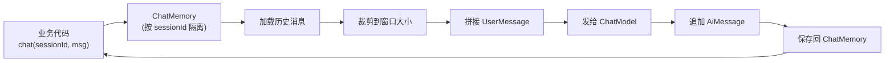
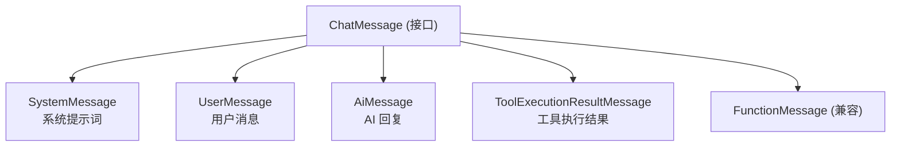

# Ch05 对话记忆 ChatMemory——让 LLM 真正"记住"你

> 本章目标：
> 1. 理解为什么需要 ChatMemory（HTTP 无状态 vs 多轮对话）
> 2. 掌握 LangChain4j 的消息体系（UserMessage / AiMessage / SystemMessage / ToolExecutionResultMessage）
> 3. 区分 ChatMemory 的两种窗口策略：MessageWindow / TokenWindow
> 4. 用 @MemoryId 实现多会话隔离
> 5. 持久化 ChatMemory 到 Redis，避免重启丢上下文
> 6. 选学：SummarizingTokenWindowChatMemory 长对话压缩
> 7. 把 smart-doc-assistant 升级到 v0.4：Redis 持久化 + 多会话管理

---

## 5.1 为什么需要 ChatMemory？

### 5.1.1 LLM 是"金鱼"——7 秒记忆

直接调 ChatModel 时，每一次调用都是**完全独立的**：

```
第1次调用: "你好，我叫小杜"           → 模型回复: "你好小杜！"
第2次调用: "我叫什么名字？"          → 模型回复: "抱歉，我不知道您的名字"

# 模型完全不知道第 1 次对话发生了什么！
```

**原因**：HTTP 本身是无状态的，每个 `/api/chat` 请求都是独立的。模型服务也是无状态的——你发什么它就回什么，不存任何上下文。

### 5.1.2 解决方案：客户端拼历史

最朴素的做法——每次调用时把历史消息手动拼起来：

```java
// ❌ 笨办法：手动维护 history
List<ChatMessage> history = new ArrayList<>();
history.add(SystemMessage.from("你是助手"));
history.add(UserMessage.from("你好，我叫小杜"));
history.add(AiMessage.from("你好小杜！"));
history.add(UserMessage.from("我叫什么名字？"));

ChatResponse response = chatModel.chat(ChatRequest.builder()
    .messages(history)   // ← 把所有历史都发给模型
    .build());
```

**问题**：
- ❌ 多线程下 history 串台（用户 A 的对话跑到用户 B）
- ❌ 没有窗口限制，聊久了消息列表爆炸 → token 费用失控
- ❌ 没有持久化，重启后所有上下文丢失
- ❌ 业务代码全是样板

### 5.1.3 ChatMemory：把"会话状态"封装起来

LangChain4j 的 ChatMemory 帮你做这几件事：



**核心抽象**：

| 类 | 职责 |
|----|------|
| `ChatMemory` | 单个会话的消息列表（增删查） |
| `ChatMemoryProvider` | 多会话的 ChatMemory 工厂（按 memoryId 取） |
| `ChatMemoryStore` | 底层存储（内存 / Redis / DB） |
| `@MemoryId` | AiService 方法参数，标识会话 |

---

## 5.2 消息体系——ChatMessage 全家福

LangChain4j 把所有消息类型统一在 `ChatMessage` 接口下：



### 5.2.1 SystemMessage：全局人设/规则

```java
// 静态字符串
SystemMessage.from("你是一个 Java 专家")

// 从资源文件加载
SystemMessage.from(readResource("prompts/system.txt"))

// 在 AiService 里用 @SystemMessage 标注（推荐）
@AiService
public interface Assistant {
    @SystemMessage("你是一个 Java 专家")
    String chat(@UserMessage String msg);
}
```

**特性**：
- ✅ 通常每个会话只有 1 条 SystemMessage
- ✅ 放在消息列表最前面
- ✅ 不计入 ChatMemory 的"消息计数"（影响窗口计算）

### 5.2.2 UserMessage：用户输入

```java
// 简单字符串
UserMessage.from("你好")

// 单张图片（多模态）
UserMessage.from(
    TextContent.from("这张图片是什么？"),
    ImageContent.from(new File("cat.jpg"))
)

// 多内容（图文混合）
UserMessage.from(List.of(
    TextContent.from("对比这两张图"),
    ImageContent.from(new File("cat.jpg")),
    ImageContent.from(new File("dog.jpg"))
))

// 自定义 metadata
UserMessage.builder()
    .text("你好")
    .metadata(Map.of("userId", "123", "channel", "web"))
    .build()
```

### 5.2.3 AiMessage：模型回复

```java
// 纯文本回复
AiMessage.from("你好，我是 Java 助手")

// 带工具调用（详见 Ch06）
AiMessage.builder()
    .text("我需要查询天气")
    .toolExecutionRequests(List.of(
        ToolExecutionRequest.builder()
            .id("call_123")
            .name("getWeather")
            .arguments("{\"city\":\"上海\"}")
            .build()
    ))
    .build()

// 自定义 metadata
AiMessage.builder()
    .text("你好")
    .metadata(Map.of("model", "deepseek-chat", "finishReason", "STOP"))
    .build()
```

### 5.2.4 ToolExecutionResultMessage：工具返回结果

```java
// 工具执行后的结果（框架自动产生）
ToolExecutionResultMessage.builder()
    .id("call_123")
    .toolName("getWeather")
    .text("{\"temp\":28,\"condition\":\"晴\"}")
    .build()
```

**重要**：这个消息类型**用户不直接构造**，是框架在 Tool Call 循环中自动插入的（详见 Ch06）。

### 5.2.5 消息列表的组成

一个典型的多轮对话消息列表长这样：

```
[0] SystemMessage               ← 全局人设（每会话 1 条）
[1] UserMessage("你好，我叫小杜")  ← 第 1 轮
[2] AiMessage("你好小杜！")       ← 第 1 轮回复
[3] UserMessage("我叫什么？")     ← 第 2 轮
[4] AiMessage("你叫小杜")        ← 第 2 轮回复
[5] UserMessage("今天天气？")     ← 第 3 轮
[6] ToolExecutionResultMessage   ← 工具调用结果
[7] AiMessage("上海今天 28 度，晴")  ← 第 3 轮回复（含工具结果）
```

**Token 消耗**：每次调用都把整个列表发给模型。随着对话变长，**费用线性增长**——这就是为什么需要"窗口"控制。

---

## 5.3 ChatMemory 接口与基础实现

### 5.3.1 ChatMemory 接口

```java
public interface ChatMemory {
    /** 唯一标识（通常就是 sessionId / userId） */
    Object id();

    /** 加载历史消息（已按窗口策略裁剪） */
    List<ChatMessage> messages();

    /** 用户发新消息时调用：把 UserMessage 追加 */
    void add(UserMessage message);

    /** 模型回复后调用：把 AiMessage 追加 */
    void add(AiMessage message);

    /** 工具执行结果（框架内部用） */
    void add(ToolExecutionResultMessage message);

    /** 清空所有消息（保留 SystemMessage 如果配置了 retainSystemMessage） */
    void clear();
}
```

### 5.3.2 MessageWindowChatMemory：按消息数裁剪

```java
ChatMemory memory = MessageWindowChatMemory.builder()
    .id("user-1")
    .maxMessages(20)                 // 只保留最近 20 条消息
    .chatMemoryStore(new InMemoryChatMemoryStore())  // 默认存储
    .build();

// 用法：
memory.add(UserMessage.from("你好"));
memory.add(AiMessage.from("你好！"));
// ... N 轮后
List<ChatMessage> recent = memory.messages();  // 最多 20 条
```

**裁剪策略**：保留 SystemMessage + 最近 N-1 条消息。

```
原始: [Sys, U1, A1, U2, A2, U3, A3, U4, A4, U5, A5]  (11 条)
maxMessages=8:
裁剪后: [Sys, U2, A2, U3, A3, U4, A4, U5, A5]  (9 条, Sys + 最近 8 条)
```

**优点**：
- ✅ 简单直观
- ✅ 不用担心 token 超限——因为消息数限制天然防止超长

**缺点**：
- ❌ 每条消息长度差异大（"你好" vs 3000 字长文），消息数限制不准
- ❌ 真实费用 = messages × 平均长度 → 估算困难

### 5.3.3 TokenWindowChatMemory：按 token 数裁剪

```java
ChatMemory memory = TokenWindowChatMemory.builder()
    .id("user-1")
    .maxTokens(4000, new OpenAiTokenCountEncoder("gpt-4o"))   // 4000 tokens 上限
    .chatMemoryStore(new InMemoryChatMemoryStore())
    .build();
```

**裁剪策略**：保留 SystemMessage + 最近 N 条消息，**直到总 token 数 ≤ maxTokens**。

```
假设 maxTokens=1000，当前消息总长 2000 tokens：
  从最新消息往前加，累加 token 直到接近 1000
  裁剪后: [Sys, U_last-k, ..., A_last]  (总 token 数 ≤ 1000)
```

**Token 计数器**：
- `OpenAiTokenCountEncoder("gpt-4o")` — OpenAI 兼容模型
- `OpenAiTokenCountEncoder("deepseek-chat")` — DeepSeek
- 也可以自定义（实现 `TokenCountEncoder` 接口）

**优点**：
- ✅ 精确控制费用
- ✅ 对长消息友好（短消息可以装更多条）

**缺点**：
- ❌ 每次新增消息都要重新算 token，有少量性能开销
- ❌ 选错 tokenizer 会导致超限（不同模型 tokenizer 不同）

### 5.3.4 选型决策

| 场景 | 推荐 |
|------|------|
| 简单对话客服 | MessageWindowChatMemory(20) |
| 长文写作 / 代码生成 | TokenWindowChatMemory(8000) |
| 费用敏感 / 多模型混用 | TokenWindowChatMemory + 限速 |
| 不确定 | 从 MessageWindow(20) 起步 |

---

## 5.4 ChatMemoryProvider——多会话隔离

### 5.4.1 为什么需要 Provider？

单例 ChatMemory 只能服务一个用户。生产环境需要：

```
用户 A 调 chat("user-A", "你好")
用户 B 调 chat("user-B", "你好")
用户 A 调 chat("user-A", "我刚才说什么？")  → 应该看到 A 的历史
用户 B 调 chat("user-B", "我刚才说什么？")  → 应该看到 B 的历史
```

`ChatMemoryProvider` 就是按 memoryId 分配 ChatMemory 的工厂：

```java
public interface ChatMemoryProvider {
    ChatMemory get(Object memoryId);
}
```

### 5.4.2 手动实现 Provider

```java
@Component
public class InMemoryChatMemoryProvider implements ChatMemoryProvider {

    private final ChatMemoryStore store = new InMemoryChatMemoryStore();
    private final Map<Object, ChatMemory> cache = new ConcurrentHashMap<>();

    @Override
    public ChatMemory get(Object memoryId) {
        return cache.computeIfAbsent(memoryId, id ->
            MessageWindowChatMemory.builder()
                .id(id)
                .maxMessages(20)
                .chatMemoryStore(store)
                .build()
        );
    }
}
```

### 5.4.3 AiService 自动接入 Provider

```java
@AiService
public interface MultiSessionAssistant {
    String chat(@MemoryId Long userId, @UserMessage String message);
}
```

**关键**：`@MemoryId` 标注的参数就是 memoryId。框架在调用 `assistant.chat(123L, "你好")` 时：
1. 调 `provider.get(123L)` 拿到对应的 ChatMemory
2. 把 history + 当前 UserMessage 拼起来发给模型
3. 把模型回复追加到 ChatMemory
4. 保存回 store

**注意**：memoryId 类型要和 Provider 的 `get(Object memoryId)` 类型匹配。建议用 `Long` / `UUID` / `String`，别用复杂对象。

---

## 5.5 ChatMemoryStore——持久化层

### 5.5.1 三个内置实现

| 实现类 | 存储位置 | 适用 |
|-------|---------|------|
| `InMemoryChatMemoryStore` | JVM 内存 | 单机测试 |
| `RedisChatMemoryStore` | Redis | 生产推荐 |
| 自定义实现 `ChatMemoryStore` | 任意存储 | PG / MongoDB / MySQL |

### 5.5.2 InMemoryChatMemoryStore

```java
// 进程内 ConcurrentHashMap，重启即丢失
ChatMemoryStore store = new InMemoryChatMemoryStore();
```

**适用**：单元测试、本地开发。
**缺点**：重启丢上下文、多实例不共享。

### 5.5.3 RedisChatMemoryStore

```java
ChatMemoryStore store = RedisChatMemoryStore.builder()
    .host("localhost")
    .port(6379)
    .password("xxx")
    .ttl(Duration.ofDays(30).toSeconds())   // 注意：1.19 起 ttl 参数是 Long（秒），不是 Duration；30 天自动过期
    .build();
```

**底层结构**：每个 memoryId 对应一个 Redis Key，value 是 JSON 序列化的消息列表。

**适用**：生产环境，单实例或多实例共享。

### 5.5.4 自定义 Store（PG 示例）

实现 `ChatMemoryStore` 接口：

```java
public interface ChatMemoryStore {
    List<ChatMessage> getMessages(Object memoryId);
    void updateMessages(Object memoryId, List<ChatMessage> messages);
    void deleteMessages(Object memoryId);
}
```

PG 实现：

```java
@Component
@RequiredArgsConstructor
public class PgChatMemoryStore implements ChatMemoryStore {

    private final JdbcTemplate jdbc;

    @Override
    public List<ChatMessage> getMessages(Object memoryId) {
        String json = jdbc.queryForObject(
            "SELECT messages FROM chat_memory WHERE memory_id = ?",
            String.class, String.valueOf(memoryId)
        );
        return json == null ? List.of() : deserialize(json);
    }

    @Override
    public void updateMessages(Object memoryId, List<ChatMessage> messages) {
        String json = serialize(messages);
        jdbc.update("""
            INSERT INTO chat_memory (memory_id, messages, updated_at)
            VALUES (?, ?, NOW())
            ON CONFLICT (memory_id) DO UPDATE
            SET messages = ?, updated_at = NOW()
            """, String.valueOf(memoryId), json, json);
    }

    @Override
    public void deleteMessages(Object memoryId) {
        jdbc.update("DELETE FROM chat_memory WHERE memory_id = ?", String.valueOf(memoryId));
    }
}
```
---

## 5.6 Redis 持久化实战

### 5.6.1 加依赖

```xml
<!-- pom.xml -->
<!-- ⚠️ Redis 存储已迁到 community 仓库：artifact 名是 community-redis，
     `langchain4j-redis` 早已停更在 1.0.0-alpha1，写错会直接拉不到依赖（详见 Ch10） -->
<dependency>
    <groupId>dev.langchain4j</groupId>
    <artifactId>langchain4j-community-redis</artifactId>
    <version>${langchain4j.beta.version}</version>
</dependency>

<dependency>
    <groupId>redis.clients</groupId>
    <artifactId>jedis</artifactId>
    <version>5.1.0</version>
</dependency>
```

### 5.6.2 Spring Boot 配置 Redis Store

```java
@Configuration
public class ChatMemoryStoreConfig {

    @Bean
    public ChatMemoryStore chatMemoryStore(
        @Value("${spring.data.redis.host}") String host,
        @Value("${spring.data.redis.port}") int port
    ) {
        return RedisChatMemoryStore.builder()
            .host(host)
            .port(port)
            .ttl(Duration.ofDays(30).toSeconds())   // 注意：1.19 起 ttl 参数是 Long（秒），不是 Duration
            .build();
    }
}
```

### 5.6.3 Provider 引用 Store

```java
@Configuration
@RequiredArgsConstructor
public class AiServiceConfig {

    private final ChatMemoryStore chatMemoryStore;   // ← Spring 自动注入

    @Bean
    public ChatMemoryProvider chatMemoryProvider() {
        return memoryId -> MessageWindowChatMemory.builder()
            .id(memoryId)
            .maxMessages(20)
            .chatMemoryStore(chatMemoryStore)
            .build();
    }
}
```

**关键**：`ChatMemoryStore` 是单例 Bean（每个 memoryId 一份存储），`ChatMemoryProvider` 按 memoryId 工厂化 ChatMemory，二者配合实现"多用户多会话"。

---

## 5.7 选学：SummarizingTokenWindowChatMemory 长对话压缩

### 5.7.1 为什么需要压缩？

对话超过 50 轮时：
- 消息列表 100+ 条
- Token 累计 5000+，加上 SystemMessage 可能撞模型上限
- 费用爆炸

**解决**：把"很久之前"的对话压缩成摘要，只保留最近 N 条原始消息。

### 5.7.2 真实 API：SummarizingTokenWindowChatMemory + Summarizer

LangChain4j 1.x 提供的是 `SummarizingTokenWindowChatMemory`，它基于 `TokenWindowChatMemory` + `Summarizer` 接口工作。**不是 `SummarizingChatMemory`**（那是 0.x 的旧类名）。

**核心抽象**：

| 类/接口 | 职责 |
|--------|------|
| `SummarizingTokenWindowChatMemory` | 主类，带摘要功能的 Token 窗口记忆 |
| `Summarizer` | 摘要策略接口，默认 `DefaultSummarizer` 用 ChatModel 生成摘要 |
| `DefaultSummarizer` | 内置实现：调 ChatModel 把旧消息压缩成摘要文本 |

### 5.7.3 构建方式

```java
ChatMemory memory = SummarizingTokenWindowChatMemory.builder()
    .id("user-1")
    // Token 窗口：超过 maxTokens 就触发摘要
    .maxTokens(4000, new OpenAiTokenCountEncoder("deepseek-chat"))
    // 底层持久化
    .chatMemoryStore(redisChatMemoryStore)
    // 摘要器：用 ChatModel 压缩旧对话
    .summarizer(DefaultSummarizer.builder()
        .chatModel(chatModel)
        // 可选：自定义摘要 Prompt
        // .prompt("把以下对话历史压缩成不超过 200 字的摘要...")
        .build())
    .build();
```

**完整参数列表**：

| builder 参数 | 作用 |
|-------------|------|
| `id(Object)` | 会话唯一标识 |
| `maxTokens(int, TokenCountEncoder)` | Token 窗口上限 + 编码器 |
| `chatMemoryStore(ChatMemoryStore)` | 底层存储（和普通 ChatMemory 一样） |
| `summarizer(Summarizer)` | 摘要策略，默认 `DefaultSummarizer` |

### 5.7.4 工作原理

```
每次 add(AiMessage) 后检查:
  当前总 token 数 > maxTokens ?
    ├── 否 → 正常追加，不做摘要
    └── 是 → 触发摘要:
           1. 取出所有历史消息
           2. 用 Summarizer 把较早的消息压缩成 1 段摘要文本
           3. 摘要作为 SystemMessage 插入列表顶部
           4. 只保留最近的几条原始消息（保证下次调用不超限）
           5. 写回 chatMemoryStore
```

**成本权衡**：摘要本身要调一次 LLM（输入几十条历史），但节省后续每轮的 token 消耗——只要对话轮次足够多、摘要质量高，**总体费用反而降**。

### 5.7.5 自定义 Summarizer

如果内置的 `DefaultSummarizer` 不够用（比如想用更短的摘要、不同的 prompt 模板），可以自己实现 `Summarizer` 接口：

```java
public interface Summarizer {
    /**
     * 对给定的消息列表做摘要
     * @param messages  需要摘要的旧消息
     * @param currentMemoryId 当前会话ID（可用于日志/审计）
     * @return 摘要后的 SystemMessage（会插入到记忆顶部）
     */
    SystemMessage summarize(List<ChatMessage> messages, Object currentMemoryId);
}
```

示例：极简摘要（只保留关键事实）

```java
public class ConciseSummarizer implements Summarizer {

    private final ChatModel chatModel;

    @Override
    public SystemMessage summarize(List<ChatMessage> messages, Object memoryId) {
        String prompt = """
            请从以下对话历史中提取关键事实，用 bullet point 列出，
            不超过 100 字。只保留对后续对话有用的信息。

            对话历史：
            %s
            """.formatted(formatMessages(messages));

        String summary = chatModel.chat(prompt);
        return SystemMessage.from("【对话历史摘要】\n" + summary);
    }
}
```

🔧 **最佳实践**：
- 摘要 Prompt 里明确字数限制和保留要点，避免摘要本身太长
- 生产环境可以缓存摘要结果，避免对同一段历史重复摘要
- 摘要质量直接影响模型回答质量——宁可多花一点 token 在摘要上，也别丢关键信息

---

## 5.8 ⚠️ 高频坑点与最佳实践

### 坑1：忘加 @MemoryId 导致所有用户串台

```java
// ❌ 没 @MemoryId，框架会用 null 作为 memoryId
// 整个系统所有人共享一个 ChatMemory
@AiService
public interface BadAssistant {
    String chat(@UserMessage String msg);
}

// ✅ 必须加 @MemoryId
@AiService
public interface GoodAssistant {
    String chat(@MemoryId Long userId, @UserMessage String msg);
}
```

**症状**：用户 A 问"我是谁"，模型回答用户 B 的信息。**这是 P0 安全问题**。

### 坑2：MessageWindowChatMemory 长度设置不合理

```
maxMessages=100  → 用户聊 50 轮就触发 token 超限（每条平均 100 token = 10000 token）
maxMessages=5    → 上下文太短，模型经常"忘记"之前的约定
```

**经验值**：
- 中文客服：20~30 条（覆盖 10~15 轮对话）
- 代码生成：50 条（需要保留大量上下文）
- 短回答机器人：10 条就够

### 坑3：TokenWindowChatMemory 用了错误的 tokenizer

```java
// ❌ 用 GPT-4 tokenizer 算 DeepSeek 模型的消息
.maxTokens(4000, new OpenAiTokenCountEncoder("gpt-4o"))

// ✅ 换成对应模型的 tokenizer
.maxTokens(4000, new OpenAiTokenCountEncoder("deepseek-chat"))
```

**症状**：实际 token 超限报错"max_tokens too large"，但 memory 还在追加。

### 坑4：ChatMemoryStore 没用 TTL 导致 Redis 内存爆炸

```java
// ❌ 不设 TTL，对话数据永久累积
RedisChatMemoryStore.builder().host("localhost").port(6379).build();

// ✅ 30 天过期，对长期不活跃的用户自动清理
RedisChatMemoryStore.builder()
    .host("localhost").port(6379)
    .ttl(Duration.ofDays(30).toSeconds())   // Long，单位秒
    .build();
```

### 坑5：SystemMessage 不计入窗口但每次都重发

SystemMessage 通常每会话 1 条（用户注册时写入），但每次调用都会发给模型。**不要把 SystemMessage 写得很长**：

```java
// ❌ SystemMessage 5000 字（每次都消耗 5000 token）
@SystemMessage(fromResource = "prompts/huge-system.txt")

// ✅ SystemMessage 精炼到 500 字以内，细节放外部文档按需 RAG
@SystemMessage(fromResource = "prompts/lean-system.txt")
```

### 坑6：流式场景下记忆丢失（详见 Ch04）

流式 + ChatMemory 时，**只有 `onCompleteResponse` 才会追加 AiMessage**。如果中途客户端断开，记忆不完整——需要手动回滚或落库。

### 坑7：@MemoryId 用 Object 类型导致类型转换异常

```java
// ❌ 用 Object 作 memoryId 类型
public String chat(@MemoryId Object userId, @UserMessage String msg);
// 实际传 Long 时，Provider 内部可能强转 String 报错

// ✅ 用具体类型
public String chat(@MemoryId Long userId, @UserMessage String msg);
```

### 坑8：自定义 Store 没处理并发写

```java
// ❌ 两个请求同时 updateMessages，后写的覆盖前写的
public void updateMessages(Object memoryId, List<ChatMessage> messages) {
    jdbc.update("UPDATE ... SET messages = ?", serialize(messages));
}

// ✅ 用乐观锁或 CAS
public void updateMessages(Object memoryId, List<ChatMessage> messages) {
    int updated = jdbc.update(
        "UPDATE chat_memory SET messages = ?, version = version + 1 " +
        "WHERE memory_id = ? AND version = ?",
        serialize(messages), memoryId, currentVersion
    );
    if (updated == 0) throw new OptimisticLockException();
}
```

### 最佳实践汇总

- ✅ **必须 @MemoryId**：单用户场景也要加，避免未来扩展翻车
- ✅ **生产用 RedisChatMemoryStore**：多实例共享 + 自动 TTL
- ✅ **TTL 必设**：30 天过期足够覆盖长对话，又防 Redis 内存爆炸
- ✅ **MessageWindow 从 20 开始**：根据实际场景微调
- ✅ **SystemMessage 精炼**：控制在 500 字以内
- ✅ **自定义 Store 处理并发**：乐观锁 / 悲观锁 / Redis CAS
- ✅ **长对话上 SummarizingChatMemory**：超过 50 轮考虑
- ✅ **Prompt 模板放 SystemMessage**：缓存命中率高（详见 Ch03）
- ❌ **不要用 InMemoryChatMemoryStore 上生产**
- ❌ **不要用 Object 类型 @MemoryId**
- ❌ **不要忽略 tokenizer 与模型的匹配**

---

## 5.9 💡 Spring AI 对比：记忆管理

| 能力 | LangChain4j | Spring AI |
|------|-------------|-----------|
| 抽象 | `ChatMemory` / `ChatMemoryProvider` | `ChatMemory` / `MessageWindowChatMemory`（类似） |
| 窗口策略 | MessageWindow / TokenWindow | MessageWindow（只有按消息数） |
| 持久化 Store | 内置 InMemory / Redis + 自定义 | 内置 InMemory，Redis 需自己集成 |
| 多会话隔离 | `@MemoryId` | `conversationId` 参数 |
| 摘要能力 | `SummarizingChatMemory`（1.x 新增） | 无内置，需自己实现 |
| 多用户支持 | Provider 工厂模式 | ConversationService 单例 |

**Spring AI 写法**（仅作对比）：

```java
// Spring AI
ChatMemory chatMemory = new MessageWindowChatMemory(20);
chatMemory.add(UserMessage.builder().text("你好").build());

ChatResponse response = chatClient.prompt()
    .messages(chatMemory.messages())   // ← 手动传 messages
    .user("我叫什么？")
    .call()
    .chatResponse();

chatMemory.add(AiMessage.from(response.getResult().getOutput().getText()));
```

**主要差异**：
1. Spring AI 需要手动 `add()` / `messages()`，LangChain4j 注解自动搞定
2. LangChain4j 提供 `TokenWindowChatMemory`，Spring AI 只有按消息数
3. LangChain4j 提供 Redis Store 开箱即用，Spring AI 需要自己实现

---

## 5.10 本章小结

| 知识点 | 关键 |
|-------|------|
| **HTTP 无状态** | LLM 默认不知道上一轮说了什么 |
| **ChatMemory 接口** | id/messages/add/clear，单会话消息列表 |
| **MessageWindowChatMemory** | 按消息数裁剪，简单但不准 |
| **TokenWindowChatMemory** | 按 token 数裁剪，精确但要选对 encoder |
| **@MemoryId** | 多会话隔离必加，P0 注解 |
| **ChatMemoryProvider** | 按 memoryId 工厂化 ChatMemory |
| **ChatMemoryStore** | 持久化层，InMemory / Redis / 自定义 |
| **RedisChatMemoryStore** | 生产推荐，设 TTL |
| **SummarizingChatMemory** | 长对话压缩，节省 token |
| **并发安全** | 自定义 Store 要乐观锁 |

---

## 5.11 本章项目代码状态（v0.4）

把 smart-doc-assistant 升级到 **v0.4**——核心新增 **Redis 持久化记忆 + 多会话管理 + 记忆清理接口**。

```
smart-doc-assistant/
├── pom.xml                                          (新增: langchain4j-community-redis)
└── src/main/
    ├── java/com/example/assistant/
    │   ├── AssistantApplication.java
    │   ├── config/
    │   │   ├── AiServiceConfig.java                 (升级: 注入 ChatMemoryStore)
    │   │   ├── ChatMemoryStoreConfig.java           ← 新增：Redis Store Bean
    │   │   └── StreamSessionManager.java
    │   ├── assistant/
    │   │   ├── ChatAssistant.java                   (升级: 改用 Redis ChatMemory)
    │   │   ├── StreamingChatAssistant.java
    │   │   ├── FlexibleAssistant.java
    │   │   ├── TranslationAssistant.java
    │   │   └── ReviewAnalysisAssistant.java
    │   └── controller/
    │       ├── AssistantController.java
    │       └── ChatStreamController.java
    └── resources/
        ├── application.yml                          (新增: redis 配置)
        └── prompts/
            └── (Ch03 的 4 个 prompt 文件)
```

**新增核心代码 1：ChatMemoryStoreConfig.java**

```java
package com.example.assistant.config;

import dev.langchain4j.store.memory.chat.ChatMemoryStore;
import dev.langchain4j.community.store.memory.chat.redis.RedisChatMemoryStore;
import lombok.extern.slf4j.Slf4j;
import org.springframework.beans.factory.annotation.Value;
import org.springframework.boot.autoconfigure.condition.ConditionalOnProperty;
import org.springframework.context.annotation.Bean;
import org.springframework.context.annotation.Configuration;

import java.time.Duration;

/**
 * Ch05 新增：ChatMemoryStore 的 Redis 持久化配置
 *
 * 关键设计：
 * - 单一 ChatMemoryStore Bean 被 ChatMemoryProvider 引用
 * - 多会话通过 memoryId 区分，每个会话一份独立存储
 * - TTL 30 天：长期不活跃的会话自动清理
 * - Redis 不可用时切到 InMemory（开发/测试环境零依赖启动）
 *
 * 启用 Redis：chat.memory.backend=redis（默认）
 * 不启用：chat.memory.backend=memory（纯内存，重启丢失）
 */
@Configuration
@Slf4j
public class ChatMemoryStoreConfig {

    /**
     * Redis 版 ChatMemoryStore（默认）
     */
    @Bean
    @ConditionalOnProperty(name = "chat.memory.backend", havingValue = "redis", matchIfMissing = true)
    public ChatMemoryStore redisChatMemoryStore(
            @Value("${spring.data.redis.host:localhost}") String host,
            @Value("${spring.data.redis.port:6379}") int port,
            @Value("${spring.data.redis.password:}") String password,
            @Value("${chat.memory.ttl-days:30}") int ttlDays) {

        log.info("Initializing RedisChatMemoryStore at {}:{} (TTL {} days)", host, port, ttlDays);

        RedisChatMemoryStore.Builder builder = RedisChatMemoryStore.builder()
                .host(host)
                .port(port)
                .ttl(Duration.ofDays(ttlDays));

        if (password != null && !password.isBlank()) {
            builder.password(password);
        }

        return builder.build();
    }

    /**
     * 内存版 ChatMemoryStore（fallback）
     */
    @Bean
    @ConditionalOnProperty(name = "chat.memory.backend", havingValue = "memory")
    public ChatMemoryStore inMemoryChatMemoryStore() {
        log.warn("Using InMemoryChatMemoryStore — conversations will be lost on restart!");
        return new dev.langchain4j.store.memory.chat.InMemoryChatMemoryStore();
    }
}
```

**升级核心代码 2：AiServiceConfig.java**

```java
package com.example.assistant.config;

import dev.langchain4j.memory.ChatMemory;
import dev.langchain4j.memory.ChatMemoryProvider;
import dev.langchain4j.memory.chat.MessageWindowChatMemory;
import dev.langchain4j.store.memory.chat.ChatMemoryStore;
import lombok.RequiredArgsConstructor;
import org.springframework.context.annotation.Bean;
import org.springframework.context.annotation.Configuration;

/**
 * Ch05 升级：ChatMemoryProvider 注入 Redis ChatMemoryStore
 *
 * 升级要点：
 * - 之前用 new InMemoryChatMemoryStore()，重启就丢
 * - 现在注入 Spring 容器里的 Redis ChatMemoryStore Bean
 * - 多实例部署时，所有实例共享同一份 Redis 记忆
 */
@Configuration
@RequiredArgsConstructor
public class AiServiceConfig {

    private final ChatMemoryStore chatMemoryStore;   // ← Redis 实现

    @Bean
    public ChatMemoryProvider chatMemoryProvider() {
        return memoryId -> MessageWindowChatMemory.builder()
                .id(memoryId)
                .maxMessages(20)
                .chatMemoryStore(chatMemoryStore)
                .build();
    }
}
```

**升级核心代码 3：application.yml**

```yaml
server:
  port: 8090

spring:
  data:
    redis:
      host: ${REDIS_HOST:localhost}
      port: ${REDIS_PORT:6379}
      password: ${REDIS_PASSWORD:}

# Ch05 新增：ChatMemory 配置
chat:
  memory:
    # redis（默认）| memory（开发 fallback）
    backend: ${CHAT_MEMORY_BACKEND:redis}
    # 会话 TTL，过期自动清理（仅 Redis 生效）
    ttl-days: 30

langchain4j:
  open-ai:
    chat-model:
      api-key: ${DEEPSEEK_API_KEY:sk-replace-me}
      model-name: deepseek-chat
      base-url: https://api.deepseek.com/v1
      temperature: 0.7
      max-tokens: 2000
      timeout: PT60S

  open-ai-chat-models:
    json-model:
      api-key: ${DEEPSEEK_API_KEY:sk-replace-me}
      model-name: deepseek-chat
      base-url: https://api.deepseek.com/v1
      temperature: 0.0
      max-tokens: 1000
      response-format: json_object

    creative-model:
      api-key: ${DEEPSEEK_API_KEY:sk-replace-me}
      model-name: deepseek-chat
      base-url: https://api.deepseek.com/v1
      temperature: 1.0
      top-p: 0.95
      frequency-penalty: 0.5
      max-tokens: 4000

logging:
  level:
    dev.langchain4j: INFO
```

**选学扩展：记忆管理接口**

生产环境通常需要对会话记忆做管理（清空、查看状态），可以在 AssistantController 里加两个接口：

```java
@RestController
@RequiredArgsConstructor
public class AssistantController {

    private final ChatMemoryStore chatMemoryStore;

    /**
     * 清空指定会话的记忆
     */
    @DeleteMapping("/api/chat/memory/{memoryId}")
    public Map<String, Object> clearMemory(@PathVariable String memoryId) {
        chatMemoryStore.deleteMessages(memoryId);
        return Map.of(
            "memoryId", memoryId,
            "cleared", true,
            "note", "已清空该会话的所有历史消息"
        );
    }

    /**
     * 查看会话记忆状态（消息数等）
     */
    @GetMapping("/api/chat/memory/{memoryId}/info")
    public Map<String, Object> getMemoryInfo(@PathVariable String memoryId) {
        List<ChatMessage> messages = chatMemoryStore.getMessages(memoryId);
        return Map.of(
            "memoryId", memoryId,
            "messageCount", messages.size(),
            "note", messages.isEmpty() ? "会话为空或已过期" : "会话有 " + messages.size() + " 条消息"
        );
    }
}
```

💡 **提示**：这两个接口属于运维能力，示例项目 v0.4 没内置。需要时把 `ChatMemoryStore` 注入 Controller 就能用，代码量很小。

**pom.xml 新增依赖**：

```xml
<dependency>
    <groupId>dev.langchain4j</groupId>
    <artifactId>langchain4j-community-redis</artifactId>
    <version>${langchain4j.beta.version}</version>
</dependency>

<dependency>
    <groupId>redis.clients</groupId>
    <artifactId>jedis</artifactId>
    <version>5.1.0</version>
</dependency>
```

**验证清单**：

- [ ] 理解 HTTP 无状态 + ChatMemory 的关系
- [ ] 能区分 MessageWindowChatMemory vs TokenWindowChatMemory 的适用场景
- [ ] 能用 @MemoryId 实现多用户多会话隔离
- [ ] 能配置 RedisChatMemoryStore 并注入到 ChatMemoryProvider
- [ ] 知道不同 ChatMemoryStore 的优劣（InMemory/Redis/自定义）
- [ ] 知道 SummarizingChatMemory 的工作原理
- [ ] smart-doc-assistant v0.4 跑起来，重启后历史会话还在

---

**下一章预告：Ch06 工具调用 Tools**——LLM 不是万能的（不能查实时数据、不能算数学、不能写数据库）。这一章讲 @Tool 注解、ToolExecutionRequest、ToolExecutionResultMessage、多 Tool 协作、ToolExecutionMode 权限控制。
