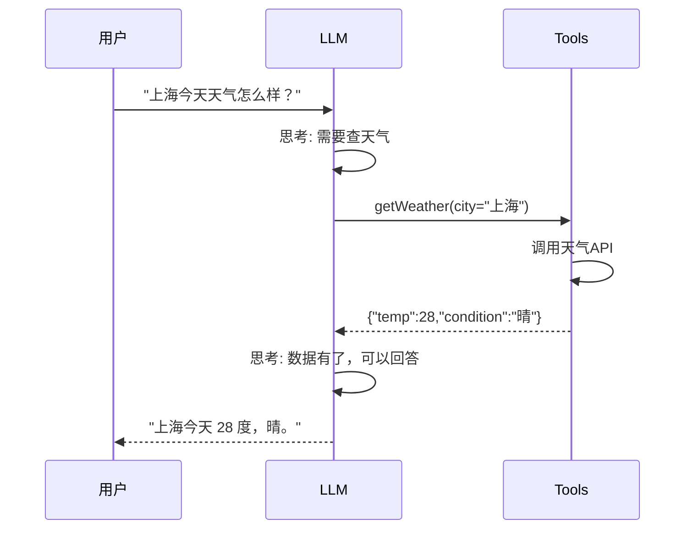
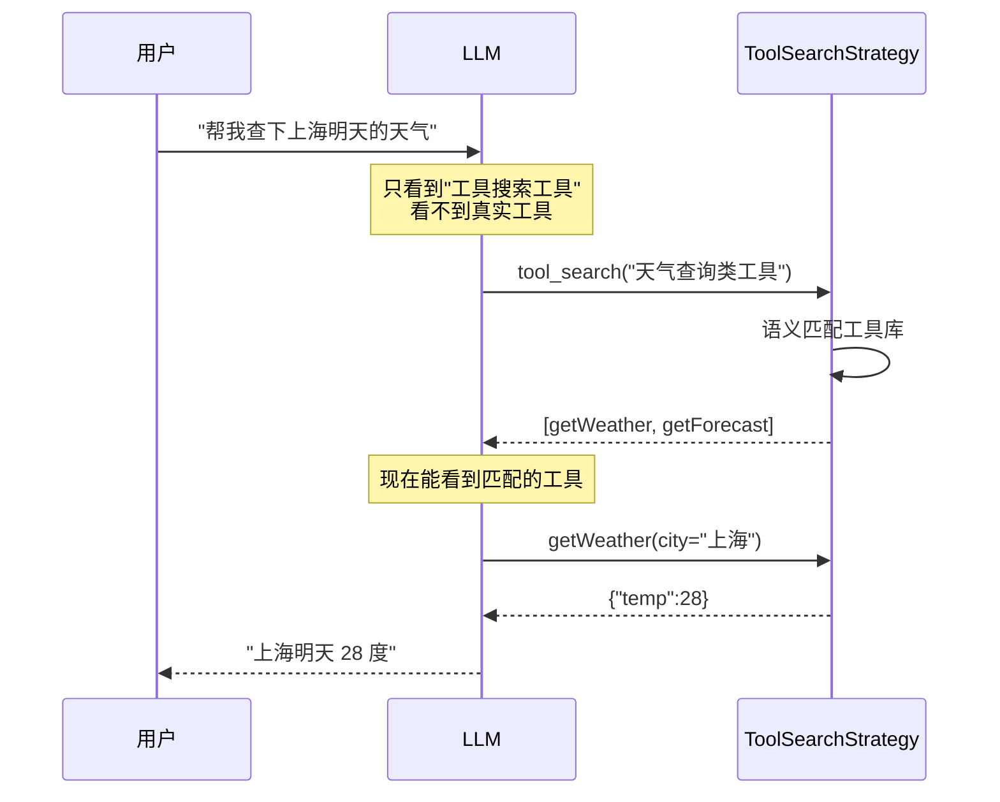
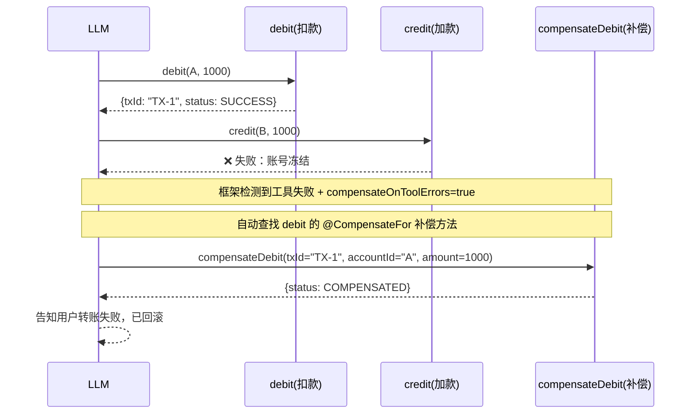

# Ch06 工具调用 Tools——给 LLM 装上"手脚"

> 本章目标：
> 1. 理解为什么需要 Tools（LLM 的能力边界）
> 2. 掌握 @Tool 注解 + 工具方法编写
> 3. 工具参数：基本类型 / POJO / 枚举 / List / Optional
> 4. 工具返回值与异常处理
> 5. ReturnBehavior：工具结果要不要再走 LLM
> 6. 人工审批——高风险工具的安全闸门
> 7. 多 Tool 协作 + 工具检索（ToolSearch / ToolProvider）
> 8. 工具补偿（@CompensateFor）+ 系统参数注入（InvocationContext）
> 9. 把 smart-doc-assistant 升级到 v0.4：业务工具集 + 工具执行溯源

---

## 6.1 为什么需要 Tools？——LLM 不是万能的

### 6.1.1 LLM 的三大能力边界

LLM 在 2026 年已经非常强，但它本质上只能做一件事——**基于训练数据预测下一个 token**。这意味着：

```
LLM 能做的:
  ✅ 文字总结、翻译、改写
  ✅ 代码生成（基于见过的模式）
  ✅ 推理（基于见过的模式）
  ✅ 结构化输出（按格式返回）

LLM 不能做的（必须借助 Tools）:
  ❌ 查实时数据（"今天上海天气"——训练数据截止前）
  ❌ 查私有数据（"我们公司上季度营收"）
  ❌ 精确数学（"1234567 × 8901234"——必须调计算器）
  ❌ 外部系统操作（"发邮件""创建订单""提交工单"）
  ❌ 时间敏感问题（"现在几点"）
```

**Tools 就是把"不能做"变成"能做"的关键**——把外部能力封装成函数，让 LLM 决定什么时候调用。

### 6.1.2 ReAct 模式：思考 + 行动

LangChain4j 的 Tool Call 实现的是经典的 **ReAct**（Reason + Act）模式：



**本质**：LLM 不会自己"做"事，它只决定"什么时候调什么工具"——执行由你写的 Java 代码完成。

### 6.1.3 一个完整的 Tool Call 示例

```java
// 工具类
public class WeatherTools {

    @Tool("查询指定城市的实时天气")
    public String getWeather(@P("城市名称，如：上海") String city) {
        // 实际调用天气 API（这里是模拟）
        return "{\"temp\":28,\"condition\":\"晴\",\"city\":\"" + city + "\"}";
    }
}

// AiService 自动接入工具
@AiService
public interface WeatherAssistant {
    String chat(@UserMessage String question);
}

// Spring 配置
@Configuration
class AiServiceConfig {
    @Bean
    public WeatherAssistant weatherAssistant(ChatModel chatModel) {
        return AiServices.builder(WeatherAssistant.class)
            .chatModel(chatModel)
            .tools(new WeatherTools())  // ← 注入工具
            .build();
    }
}

// 用户问
weatherAssistant.chat("上海今天天气怎么样？");
// 模型自动决定：调 getWeather("上海") → 拿到结果 → 总结回复
```

**3 行代码就接入了一个工具**，这就是 LangChain4j 的优雅之处。

---

## 6.2 @Tool 注解——工具方法的核心

### 6.2.1 最小可运行示例

```java
public class CalculatorTools {

    @Tool("计算两个整数的和")
    public int add(@P("第一个加数") int a, @P("第二个加数") int b) {
        return a + b;
    }
}
```

**关键点**：
- ✅ 方法必须 **public**
- ✅ 必须有 `@Tool` 注解
- ✅ 每个参数必须有 `@P` 注解（含描述）
- ✅ 方法名要"见名知义"（会传给 LLM 当工具名）
- ✅ 返回类型可以是任何 JSON 可序列化的类型

### 6.2.2 @Tool 注解详解

```java
@Tool(
    name = "sum_tool",                              // 自定义工具名（默认是方法名）
    value = "计算两个数的和",                          // 工具描述（LLM 据此决定何时调用）
    returnName = "sum"                              // 返回值在 Prompt 中的变量名（可选）
)
public int add(@P("第一个数") int a, @P("第二个数") int b) {
    return a + b;
}
```

**`value` 是最关键的字段**——LLM 通过这个描述判断"什么时候该调这个工具"。**写得越精确，LLM 用得越准**。

### 6.2.3 @P 注解详解

```java
@Tool("查询用户信息")
public UserInfo getUser(
    @P("用户ID") Long userId,
    @P(value = "查询字段列表", required = false) List<String> fields
) {
    return userService.getById(userId, fields);
}
```

**`@P` 属性**：
| 属性 | 作用 |
|------|------|
| `value` | 参数描述（必填，LLM 靠它理解参数含义） |
| `required` | 是否必填，默认 true |

**重要**：参数描述不要省略——它会作为工具 schema 的一部分传给 LLM。

### 6.2.4 工具类注册到 AiService

```java
// 方式 1：单工具类（推荐）
.tools(new WeatherTools())

// 方式 2：多个工具类
.tools(new WeatherTools(), new CalculatorTools(), new EmailTools())

// 方式 3：直接传对象（必须用 @Component 注入）
@AiService(wiringMode = EXPLICIT)
public interface Assistant {
    String chat(@UserMessage String msg);
}

// Spring 配置：
@Bean
public Assistant assistant(ChatModel chatModel, WeatherTools weatherTools) {
    return AiServices.builder(Assistant.class)
        .chatModel(chatModel)
        .tools(weatherTools)              // ← Spring 注入的工具
        .build();
}
```

**注意**：工具类**不需要任何注解**（不需要 @Component），它就是普通 POJO。但 Spring 管理的工具对象需要加 @Component 或显式 @Bean 注入。

---

## 6.3 工具参数类型——支持的范围

### 6.3.1 参数类型矩阵

| 参数类型 | 支持 | 备注 |
|---------|------|------|
| `String` / 包装类型 / 原始类型 | ✅ | 直接传给 LLM |
| `enum` | ✅ | 自动列出所有枚举值给 LLM |
| `POJO`（record 或 class） | ✅ | 自动转 JSON Schema |
| `List<T>` / `Set<T>` | ✅ | 元素可以是任意支持的类型 |
| `Optional<T>` | ✅ | 标记"可空" |
| `Map<String, Object>` | ✅ | JSON Object 类型 |
| 自定义复杂类型 | ✅ | 需要 JSON 可序列化 |

### 6.3.2 枚举类型示例

```java
public enum OrderStatus {
    PENDING, PAID, SHIPPED, DELIVERED, CANCELLED
}

public class OrderTools {
    @Tool("按状态查询订单")
    public List<Order> getOrdersByStatus(@P("订单状态") OrderStatus status) {
        return orderRepository.findByStatus(status);
    }
}
```

**LLM 怎么知道枚举值**：框架自动从 enum 反射出 `["PENDING","PAID",...]` 传给模型，模型只能选这些值。

### 6.3.3 POJO 参数示例

```java
public record DateRange(
    @P("开始日期，格式 yyyy-MM-dd") String startDate,
    @P("结束日期，格式 yyyy-MM-dd") String endDate
) {}

public class ReportTools {
    @Tool("查询时间段内的销售报表")
    public Report getSalesReport(@P("时间范围") DateRange range) {
        return reportService.generate(range);
    }
}
```

**LLM 调用时会传 JSON**：
```json
{"range": {"startDate": "2025-01-01", "endDate": "2025-01-31"}}
```

### 6.3.4 嵌套 POJO + List + Optional 综合示例

```java
public record OrderQuery(
    @P("客户ID列表") List<Long> customerIds,
    @P("订单状态，可选") Optional<OrderStatus> status,
    @P("时间范围") DateRange dateRange
) {}

@Tool("批量查询订单")
public List<Order> queryOrders(@P("查询条件") OrderQuery query) {
    // ...
}
```

LLM 调：
```json
{"query": {"customerIds": [1,2,3], "status": "PAID", "dateRange": {...}}}
```

---

## 6.4 工具返回值——所有可序列化类型

### 6.4.1 返回值类型

| 返回类型 | LLM 怎么用 |
|---------|-----------|
| `String` | 直接作为工具结果文本 |
| `int` / `long` / `double` 等 | 转字符串作为结果 |
| POJO / List / Map | 转 JSON 字符串 |
| `void` | 工具执行后 LLM 不知道结果（不推荐） |
| 自定义 Object | 转 JSON |
| `null` | 同 void |

### 6.4.2 返回 POJO 的最佳实践

```java
public record WeatherResult(
    @P("温度，摄氏度") double temp,
    @P("天气状况") String condition,
    @P("湿度百分比") int humidity,
    @P("风力等级") int windLevel
) {}

@Tool("查询实时天气")
public WeatherResult getWeather(@P("城市") String city) {
    // 实际调用 API
    return new WeatherResult(28.5, "晴", 65, 3);
}
```

**为什么返回 POJO 好**：
- ✅ 字段描述清晰，LLM 理解更准
- ✅ JSON 格式标准化，LLM 解析准确
- ✅ 字段缺失/异常能被 LLM 识别

### 6.4.3 返回 Markdown / 富文本

```java
@Tool("生成 Markdown 格式的周报")
public String generateWeeklyReport(@P("周次") String week) {
    return """
        # 第 %s 周工作周报

        ## 完成事项
        - 项目 A 上线
        - Bug 修复 15 个

        ## 下周计划
        - 项目 B 启动
        """.formatted(week);
}
```

LLM 收到 Markdown 文本后，会基于内容回答用户问题。

---

## 6.5 异常处理——工具出错了怎么办？

### 6.5.1 默认行为：异常抛给 LLM

```java
@Tool("查询天气")
public String getWeather(@P("城市") String city) {
    if (city == null || city.isBlank()) {
        throw new IllegalArgumentException("城市名不能为空");
    }
    // ...
}
```

**LLM 收到错误后会怎么做**：
1. 看到 `IllegalArgumentException` 错误信息
2. 重新尝试：换个参数 / 调别的工具 / 告诉用户参数错误

**示例对话**：
```
用户: "null 的天气"
LLM 调工具: getWeather(city="null")  ← 用户输入异常
工具抛异常: "城市名不能为空"
LLM 看到异常，重新理解用户意图:
LLM 回答: "抱歉，没听清你想查哪个城市。能告诉我具体城市名吗？"
```

### 6.5.2 自定义异常返回——告诉 LLM "用别的工具"

```java
@Tool("查询实时天气")
public WeatherResult getWeather(@P("城市") String city) {
    try {
        return weatherApi.fetch(city);
    } catch (CityNotFoundException e) {
        // 自定义异常，框架会捕获并把 message 当作工具结果
        throw new ToolExecutionException(
            "城市 '" + city + "' 不存在。请检查城市名拼写，或用 'getCityList' 工具查询所有可用城市。"
        );
    }
}
```

**关键**：用 `ToolExecutionException` 抛"可操作的错误信息"，LLM 能据此决定下一步——调用 `getCityList` 工具。

### 6.5.3 返回 null 或空值

```java
@Tool("查询用户最新订单")
public Optional<Order> getLatestOrder(@P("用户ID") Long userId) {
    return orderRepo.findFirstByUserIdOrderByCreatedAtDesc(userId);  // Optional
}
```

LLM 收到 Optional.empty() 时，会自己理解"用户没有订单"，自然地回答。

---

## 6.6 ReturnBehavior——工具结果的返回策略

### 6.6.1 为什么需要 ReturnBehavior？

默认情况下，工具执行完后，结果会**送回 LLM 重新处理**，模型再基于工具结果生成最终回答。但有些场景下，工具结果本身就是最终答案：

```
用户: "37 + 88 等于多少？"
  ↓
LLM 调用 add(37, 88)
  ↓
工具返回 125
  ↓
LLM 收到 125，再生成 "37 + 88 = 125"（又花一轮 token）
```

**问题**：多了一轮 LLM 调用 = 多花钱 + 多延迟。对于计算器、查订单号这类工具，结果直接给用户就行，不需要 LLM 再"润色"。

`ReturnBehavior` 就是控制"工具结果要不要再经过 LLM"的开关。

### 6.6.2 三种 ReturnBehavior

```java
public enum ReturnBehavior {
    TO_LLM,               // 默认：结果发给 LLM，继续推理
    IMMEDIATE,            // 立即返回：跳过 LLM，工具结果直接给调用方
    IMMEDIATE_IF_LAST     // 如果是最后一个工具则立即返回（用于显式结束序列）
}
```

在 `@Tool` 注解上配置：

```java
class CalculatorTools {
    @Tool(returnBehavior = ReturnBehavior.IMMEDIATE)
    public double add(int a, int b) {
        return a + b;
    }
}
```

### 6.6.3 IMMEDIATE 实战——省 token 的利器

```java
public class PriceTools {

    /**
     * 查询商品价格。
     * 结果直接返回给前端，LLM 不做二次处理——省一轮 token。
     */
    @Tool(value = "查询指定商品的实时价格", returnBehavior = ReturnBehavior.IMMEDIATE)
    public BigDecimal getProductPrice(@P("商品名称") String productName) {
        return priceService.getRealTimePrice(productName);
    }
}
```

**搭配 `Result<T>` 使用**：`IMMEDIATE` 模式要求 AiService 方法返回 `Result<T>`，因为工具结果直接塞在 `Result.toolExecutions()` 里，`Result.content()` 为 null：

```java
public interface PriceAssistant {
    Result<String> chat(@UserMessage String question);
}

// 调用
Result<String> result = priceAssistant.chat("iPhone 16 多少钱？");
// result.content() == null
// result.toolExecutions() → 包含 getProductPrice 的执行结果
```

⚠️ **如果 AiService 方法返回裸 `String` 而不是 `Result<T>`，用 IMMEDIATE 会触发 `IllegalConfigurationException`。**

### 6.6.4 IMMEDIATE_IF_LAST——显式结束序列的工具

适用于多步操作最后一步的"收尾工具"，比如屏幕自动化里的 `endExecutionAndGetFinalResult`：

```java
class ScreenAutomation {
    @Tool("鼠标左键点击")
    public String leftClick(int x, int y) { ... }

    @Tool("输入文本")
    public String typeText(String text) { ... }

    /**
     * 结束执行并返回最终结果。
     * 只要 LLM 把它放在工具调用的最后一位，就立即返回，
     * 省一轮 LLM 往返。
     */
    @Tool(value = "结束执行并返回最终结果摘要",
          returnBehavior = ReturnBehavior.IMMEDIATE_IF_LAST)
    public String endExecution(String summary) {
        return summary;
    }
}
```

**立即返回的触发条件（两个同时满足）**：
1. **没有工具出错**（任何错误都会强制重新处理，让 LLM 看到错误）
2. **每个工具都是 IMMEDIATE**，或**最后一个工具是 IMMEDIATE_IF_LAST**

### 6.6.5 成本视角——什么时候用 IMMEDIATE？

| 场景 | 用 IMMEDIATE？ | 原因 |
|------|--------------|------|
| 纯计算工具（加减乘除） | ✅ | 结果就是数字，不需要自然语言包装 |
| 实时数据查询（股价/天气） | 🤔 看需求 | 用户要原始数据就直接返，要解读就走 LLM |
| 副作用操作（下单/发邮件） | ✅ | 返回操作结果 + messageId 即可，不用 LLM 再加工 |
| RAG 检索 | ❌ | LLM 需要基于检索结果组织回答 |
| 多步推理的中间工具 | ❌ | 中间结果需要继续给 LLM 推理 |

🔧 **最佳实践**：给工具类做一次"成本审计"，把纯数据返回、无副作用、不需要自然语言包装的工具标成 `IMMEDIATE`，月 token 账单能降 20~40%。

---

## 6.7 人工审批——高风险工具的安全闸门

### 6.7.1 为什么需要人工审批？

默认情况下，LLM 决定调工具后**立即执行**。但涉及金钱、数据删除、邮件发送等副作用操作时，直接执行风险太大：

```
场景: 用户说"给我下个订单，金额 5000 元"

❌ 自动执行:
  LLM 直接调 createOrder(amount=5000)
  → 用户没机会反悔，可能是误操作或被提示注入

✅ 人工审批:
  LLM 决定调 createOrder(amount=5000)
  → 框架拦截，暂停执行
  → 前端弹出"确认下单吗？金额 5000 元"对话框
  → 用户点击"确认" → 才真正执行
```

⚠️ **注意**：LangChain4j 1.x 没有内建的 `ToolExecutionMode.MANUAL` 枚举（那是社区提议的功能）。人工审批需要你**自己实现拦截逻辑**，有两种主流方案。

### 6.7.2 方案一：ToolExecutionErrorHandler 抛业务异常（推荐）

思路：在工具方法里先"挂起"不执行，抛出自定义的审批异常，由 `ToolExecutionErrorHandler` 把审批请求透传给前端。

```java
/**
 * 自定义审批异常：工具需要人工审批时抛出
 */
public class ToolApprovalRequiredException extends RuntimeException {
    private final String toolName;
    private final String arguments;
    private final String reason;

    public ToolApprovalRequiredException(String toolName, String arguments, String reason) {
        super("需要人工审批: " + reason);
        this.toolName = toolName;
        this.arguments = arguments;
        this.reason = reason;
    }
    // getter...
}
```

在工具里判断是否需要审批：

```java
@Tool("创建订单")
public Map<String, Object> createOrder(
        @P("商品名称") String product,
        @P("金额") BigDecimal amount
) {
    // 金额超过 1000 元需要审批
    if (amount.compareTo(new BigDecimal("1000")) > 0) {
        throw new ToolApprovalRequiredException(
            "createOrder",
            "{product:\"" + product + "\", amount:" + amount + "}",
            "金额超过 1000 元，需要用户确认"
        );
    }
    // 正常下单
    String orderId = "ORD-" + System.currentTimeMillis();
    return Map.of("orderId", orderId, "status", "CREATED");
}
```

在 AiService 上配置 ErrorHandler，把审批需求包装成文本回给 LLM（或直接抛给上层）：

```java
AiServices.builder(OrderAssistant.class)
    .chatModel(chatModel)
    .tools(new OrderTools())
    .toolExecutionErrorHandler((error, ctx) -> {
        if (error.getCause() instanceof ToolApprovalRequiredException approvalEx) {
            // 把审批信息作为特殊格式回给 LLM
            // LLM 会据此告诉用户"需要确认"
            return ToolErrorHandlerResult.text(
                "[APPROVAL_REQUIRED] 工具 " + approvalEx.getToolName() +
                " 需要审批：" + approvalEx.getReason() +
                "。请告知用户等待审批。"
            );
        }
        // 其他异常：脱敏后返回
        return ToolErrorHandlerResult.text("工具执行失败，请稍后重试");
    })
    .build();
```

### 6.7.3 方案二：自定义 ToolExecutor（更灵活）

如果需要在执行前统一拦截所有工具调用（而不是在每个工具方法里判断），可以实现 `ToolExecutor` 接口：

```java
public class ApprovalAwareToolExecutor implements ToolExecutor {

    private final ToolExecutor delegate;  // 默认执行器
    private final ApprovalService approvalService;

    @Override
    public String execute(ToolExecutionRequest request, ToolSpecification spec) {
        // 1. 检查是否需要审批
        if (approvalService.requiresApproval(request.name())) {
            // 2. 创建审批单，挂起请求
            approvalService.createPending(request);
            throw new ToolApprovalRequiredException(
                request.name(), request.arguments(),
                "需要人工审批"
            );
        }
        // 3. 不需要审批 → 正常执行
        return delegate.execute(request, spec);
    }
}
```

配置到 AiService：

```java
AiServices.builder(OrderAssistant.class)
    .chatModel(chatModel)
    .tools(new OrderTools())
    .toolExecutor(new ApprovalAwareToolExecutor(defaultExecutor, approvalService))
    .build();
```

### 6.7.4 审批回调——恢复执行

用户在前端点击"确认"后，后端需要恢复工具调用。推荐做法：

1. 审批通过后，把工具执行结果存入缓存（key = 审批单 ID）
2. 前端重新发起同样的对话请求
3. 工具执行前先查缓存——如果有已审批的结果，直接返回，不再执行真实操作

```java
@Tool("创建订单")
public Map<String, Object> createOrder(
        @P("商品名称") String product,
        @P("金额") BigDecimal amount,
        InvocationContext ctx  // ← LangChain4j 注入，LLM 看不到
) {
    // 检查是否有已审批的结果
    String approvalKey = "approval:" + ctx.memoryId() + ":createOrder";
    if (approvalCache.exists(approvalKey)) {
        return approvalCache.getAndRemove(approvalKey);
    }
    // 需要审批 → 抛异常
    if (amount.compareTo(new BigDecimal("1000")) > 0) {
        approvalCache.createPending(approvalKey, product, amount);
        throw new ToolApprovalRequiredException("createOrder", "...", "金额超限");
    }
    // 正常执行
    String orderId = orderService.create(product, amount);
    return Map.of("orderId", orderId, "status", "CREATED");
}
```

💡 **生产提示**：审批流是 Agent 走向生产的必备基础设施。建议统一封装成 `ApprovalService`，所有高风险工具都走同一个审批通道，便于审计和权限管理。

---

## 6.8 多 Tool 协作——组合调用

### 6.8.1 LLM 会自动决定调用顺序

```java
public class TravelTools {
    @Tool("查询天气")
    public WeatherResult getWeather(@P("城市") String city) { ... }

    @Tool("查询航班")
    public List<Flight> searchFlights(@P("出发城市") String from, @P("到达城市") String to) { ... }

    @Tool("推荐酒店")
    public List<Hotel> recommendHotels(@P("城市") String city, @P("预算") int budget) { ... }
}
```

**用户问**："帮我规划上海 3 日游，预算 5000 元"

**LLM 自主决策**：
```
Thought: 需要天气、航班、酒店三方面信息
Action 1: getWeather(city="上海")
Action 2: searchFlights(from="北京", to="上海")
Action 3: recommendHotels(city="上海", budget=5000)
Observation 1/2/3...
Thought: 数据齐了，可以总结
Answer: 推荐行程如下...
```

**关键**：LLM 自动决定调用哪些工具、按什么顺序、传什么参数。**你的工作是写好工具，模型负责编排**。

### 6.8.2 控制 LLM 调工具的行为

```java
// 设置最大迭代次数（防止 LLM 无限循环调工具）
AiServices.builder(Assistant.class)
    .chatModel(chatModel)
    .tools(tools)
    .maxSequentialToolsInvocations(10)   // 最多连续调 10 个工具
    .build();
```

**默认是无限次**——生产环境必须设上限，否则 LLM 可能陷入"调工具 → 看到结果 → 再调工具"的死循环。
---

## 6.9 工具检索与 ToolSearch——按需动态加载工具

### 6.9.1 工具太多的问题

当工具数量超过 20 个时，**所有工具的 schema 都塞进 prompt** 会导致：
- 输入 token 暴涨
- LLM 难以在众多工具中精准选择
- 响应变慢

### 6.9.2 ToolProvider——动态工具供给

`ToolProvider` 是 LangChain4j 1.x 提供的**动态工具供给接口**——可以根据当前用户消息、对话上下文等条件，动态决定暴露哪些工具给 LLM。

```java
// 真实接口签名
@FunctionalInterface
public interface ToolProvider {
    ToolProviderResult provideTools(ToolProviderRequest toolProviderRequest);
}
```

**`ToolProviderRequest`** 包含：
- `userMessage()`：当前用户消息（用于判断用户需要什么工具）
- `chatMemoryId()`：当前会话 ID
- `instructions()`：系统指令

**`ToolProviderResult`** 返回：
- 工具描述（`ToolSpecification`）
- 工具执行器（`ToolExecutor`）
- `ReturnBehavior`（可选，控制是否立即返回）

**示例：根据关键词动态加载工具**

```java
ToolProvider toolProvider = (request) -> {
    String userText = request.userMessage().singleText();

    // 如果用户提到"订单"，只暴露订单相关工具
    if (userText.contains("订单") || userText.contains("order")) {
        return ToolProviderResult.builder()
            .add(
                ToolSpecifications.toolSpecificationFrom(OrderTools.class.getMethod("getOrder", String.class)),
                new DefaultToolExecutor(new OrderTools())
            )
            .build();
    }

    // 默认暴露通用工具
    return ToolProviderResult.builder()
        .add(
            ToolSpecifications.toolSpecificationFrom(TimeTools.class.getMethod("currentTime")),
            new DefaultToolExecutor(new TimeTools())
        )
        .build();
};

// 配置到 AiService
AiServices.builder(Assistant.class)
    .chatModel(chatModel)
    .toolProvider(toolProvider)    // ← 替代或补充 .tools()
    .build();
```

💡 **提示**：可以同时使用 `.tools()`（静态工具）+ `.toolProvider()`（动态工具），框架会把两者合并后一起暴露给 LLM。

### 6.9.3 ToolSearchStrategy——语义级工具搜索

当工具数量达到**几十上百个**时，即使动态供给也很难精准筛选。LangChain4j 1.x 提供了 **ToolSearch** 机制——让 LLM 自己"搜索"需要的工具，而不是预先全部暴露。

**核心流程**：



**两种开箱即用的策略**：

| 策略 | 匹配方式 | 适用场景 |
|------|---------|---------|
| `SimpleToolSearchStrategy` | 关键词匹配 | 工具名称描述性强、领域明确 |
| `VectorToolSearchStrategy` | 嵌入向量语义搜索 | 工具多、名称/描述语义多样 |

**配置示例**：

```java
// 方式一：关键词搜索（简单，零依赖）
AiServices.builder(Assistant.class)
    .chatModel(chatModel)
    .chatMemory(chatMemory)
    .tools(allTools)   // 所有工具都注册进来，但默认隐藏
    .toolSearchStrategy(new SimpleToolSearchStrategy())
    .build();

// 方式二：语义搜索（更准，需要 EmbeddingModel）
AiServices.builder(Assistant.class)
    .chatModel(chatModel)
    .chatMemory(chatMemory)
    .tools(allTools)
    .toolSearchStrategy(
        VectorToolSearchStrategy.builder()
            .embeddingModel(embeddingModel)
            .build()
    )
    .build();
```

### 6.9.4 始终可见的工具（ALWAYS_VISIBLE）

启用 ToolSearch 后，默认所有工具都隐藏，需要 LLM 主动搜索才能发现。但有些**核心高频工具**（比如"结束对话""查看历史"）应该始终可见——用 `searchBehavior = ALWAYS_VISIBLE` 标记：

```java
@Tool(value = "结束当前对话", searchBehavior = SearchBehavior.ALWAYS_VISIBLE)
public String endConversation() {
    return "对话已结束";
}
```

**等价的编程方式**：

```java
ToolSpecification.builder()
    .name("endConversation")
    .description("结束当前对话")
    .metadata(Map.of(
        ToolSpecification.METADATA_SEARCH_BEHAVIOR,
        SearchBehavior.ALWAYS_VISIBLE
    ))
    .build();
```

### 6.9.5 什么时候用 ToolSearch？

| 场景 | 推荐方案 |
|------|---------|
| 工具 < 10 个 | 直接 `.tools()` 全量暴露 |
| 工具 10~30 个，有明确分类 | `ToolProvider` 按分类动态供给 |
| 工具 > 30 个，跨领域 | `ToolSearchStrategy` 语义检索 |
| MCP 工具（见 Ch19） | `McpToolProvider` + ToolSearch 组合 |

⚠️ **注意**：ToolSearch 目前标记为 `@Experimental`，API 在未来版本可能演进。但核心思想（按需暴露工具 → 省 token + 提高选择准确率）是生产级 Agent 的必做优化。

---

## 6.10 完整实战：智能助手 + 业务工具集

### 6.10.1 场景：AI 助手调用日历工具

```java
public class CalendarTools {

    @Tool("查询指定日期范围内的日程")
    public List<CalendarEvent> listEvents(
        @P("开始日期，yyyy-MM-dd") String startDate,
        @P("结束日期，yyyy-MM-dd") String endDate
    ) {
        // 实际调用 Google Calendar / 飞书日历 API
        return calendarService.listEvents(startDate, endDate);
    }

    @Tool("创建新日程")
    public CalendarEvent createEvent(
        @P("日程标题") String title,
        @P("开始时间，ISO 8601 格式") String startTime,
        @P("结束时间，ISO 8601 格式") String endTime,
        @P("参与人邮箱列表") List<String> attendees
    ) {
        return calendarService.create(title, startTime, endTime, attendees);
    }
}

@AiService
public interface CalendarAssistant {
    String chat(@MemoryId Long userId, @UserMessage String question);
}

@Bean
public CalendarAssistant calendarAssistant(
    ChatModel chatModel,
    ChatMemoryProvider chatMemoryProvider,
    CalendarTools calendarTools
) {
    return AiServices.builder(CalendarAssistant.class)
        .chatModel(chatModel)
        .chatMemoryProvider(chatMemoryProvider)
        .tools(calendarTools)
        .build();
}
```

### 6.10.2 完整调用流程

```
用户: "帮我看下下周一有哪些会议，并创建一个产品评审会"
  ↓
LLM: 思考: 需要查下周一(2026-08-25)的日程
LLM → listEvents(startDate="2026-08-25", endDate="2026-08-25")
  ↓
工具返回: [{"title":"晨会",...},{"title":"客户对接",...}]
  ↓
LLM: 思考: 现有 2 个会议，可以创建新会议
LLM → createEvent(title="产品评审会", startTime="2026-08-25T15:00:00", endTime="2026-08-25T16:00:00", attendees=["pm@example.com","dev@example.com"])
  ↓
工具返回: {"id":"evt_123",...}
  ↓
LLM: "下周一有 2 个会议：晨会、客户对接。已创建产品评审会（8/25 15:00-16:00），参与人 PM、Dev。"
```

**框架自动循环**：LLM 调工具 → 拿到结果 → 决定下一步 → 再调工具或给答案。**最多调用次数**由 `maxSequentialToolsInvocations` 控制。

---

## 6.11 InvocationContext——系统参数注入（LLM 不可见）

### 6.11.1 为什么需要"看不见的参数"？

工具方法经常需要一些**业务上下文**，但这些上下文**不能让 LLM 知道**（也不该由 LLM 传）：

```
场景：查询订单
  - LLM 应该传：orderId（订单号）
  - 工具实际需要：orderId + tenantId（租户ID）+ userId（操作人ID）
  - tenantId / userId 从登录态来，不该由 LLM 决定（安全风险）
```

如果把 tenantId 作为普通 @P 参数：
- ❌ LLM 可以伪造 tenantId → 越权访问其他租户数据
- ❌ 浪费 token（每个工具都要传一遍 tenantId）
- ❌ 样板代码多（每个工具都要写 tenantId 参数）

`InvocationContext` 就是为了解决这个问题：**由框架注入、LLM 看不见的系统参数**。

### 6.11.2 InvocationContext 接口

```java
public interface InvocationContext {
    /** 会话ID（@MemoryId 的值） */
    Object memoryId();

    /** 自定义属性（可通过 AiServices.contextVariable() 注入） */
    Map<String, Object> attributes();

    /** 工具调用所在的 AiService 方法名 */
    default String aiServiceMethodName() { return null; }
}
```

**核心特性**：
- ✅ LLM 完全看不到这些参数（不会出现在 prompt 里）
- ✅ 由框架自动注入，工具方法里直接声明参数即可
- ✅ 支持自定义 attributes（租户ID、用户信息、traceId 等）

### 6.11.3 使用方式

在工具方法的参数列表里加一个 `InvocationContext` 类型的参数就行——**不需要 @P 注解**，框架自动识别：

```java
@Tool("查询订单详情")
public Map<String, Object> getOrder(
    @P("订单ID") String orderId,
    InvocationContext ctx  // ← 框架自动注入，LLM 看不到
) {
    Long userId = (Long) ctx.attributes().get("userId");
    String tenantId = (String) ctx.attributes().get("tenantId");

    // 用 tenantId 做数据隔离校验
    Order order = orderService.getByTenantAndId(tenantId, orderId);

    // 审计日志用 userId
    auditLog.record(userId, "getOrder", orderId);

    return order.toMap();
}
```

### 6.11.4 注入自定义 attributes

通过 `AiServices.builder().contextVariable(key, value)` 注入全局上下文，或者在 AiService 方法上加 `@V` 注解注入每次调用的变量：

```java
// 方式 1：全局 contextVariable（所有会话共享）
AiServices.builder(OrderAssistant.class)
    .chatModel(chatModel)
    .tools(new OrderTools())
    .contextVariable("tenantId", "tenant-001")
    .build();

// 方式 2：@V 注解（每次调用可不同）
public interface OrderAssistant {
    Result<String> chat(
        @MemoryId Long userId,
        @V("tenantId") String tenantId,  // ← 业务上下文变量
        @UserMessage String question
    );
}

// 调用时传入
assistant.chat(123L, "tenant-A", "查一下订单 ORD-1001");
```

🔧 **最佳实践**：
- **租户ID、用户角色、traceId** 等安全相关的上下文走 InvocationContext，不要走 @P 参数
- 工具方法里用 ctx 做**权限校验**，比在 Controller 层校验更可靠（LLM 无法绕过）
- 审计日志里带上 `ctx.memoryId()` + `ctx.attributes().get("traceId")`，方便排查问题

### 6.11.5 @ToolMemoryId：简化版的会话 ID 注入

如果你只需要会话ID（memoryId），不需要完整的 InvocationContext，可以用更轻量的 `@ToolMemoryId`：

```java
@Tool("查询用户的购物车")
public List<CartItem> getCart(@ToolMemoryId Long userId) {
    // userId 就是 @MemoryId 的值，LLM 看不到这个参数
    return cartService.getByUserId(userId);
}
```

**对比**：

| 方式 | 能拿到什么 | 适用场景 |
|------|----------|---------|
| `@ToolMemoryId` | 只有 memoryId | 只需会话ID，简单场景 |
| `InvocationContext` | memoryId + attributes + 方法名 | 需要租户ID、traceId 等多维度上下文 |

---

## 6.12 工具补偿 @CompensateFor——Saga 模式的 LLM 版

### 6.12.1 为什么需要工具补偿？

多步工具调用时，**中间某一步失败了怎么办**？

```
场景：银行转账（先扣 A 的钱，再加 B 的钱）
  Step 1: debit(account="A", amount=1000)  ✅ 成功
  Step 2: credit(account="B", amount=1000) ❌ 失败（账号冻结）

结果：A 的钱扣了，但 B 没收到 → 资金丢失！
```

普通的异常处理只能告诉 LLM"失败了"，但 LLM 不一定知道要**回滚之前的操作**。

`@CompensateFor` + `compensateOnToolErrors(true)` 就是 LangChain4j 的 **Saga 模式实现**——工具失败时自动调用补偿工具，回滚已完成的操作。

### 6.12.2 @CompensateFor 注解

```java
public class BankTransferTools {

    /**
     * 扣款：失败时自动调 compensateDebit 回滚
     */
    @Tool("从指定账户扣款")
    @CompensateFor("compensateDebit")  // ← 失败时的补偿工具
    public Map<String, Object> debit(
        @P("账户ID") String accountId,
        @P("金额") BigDecimal amount
    ) {
        // 执行扣款
        accountService.debit(accountId, amount);
        return Map.of(
            "txId", "TX-" + System.currentTimeMillis(),
            "status", "SUCCESS",
            "account", accountId,
            "amount", amount
        );
    }

    /**
     * 补偿：把钱退回去
     */
    @Tool("撤销扣款操作（补偿事务）")
    public Map<String, Object> compensateDebit(
        @P("原交易ID") String txId,
        @P("账户ID") String accountId,
        @P("金额") BigDecimal amount
    ) {
        accountService.credit(accountId, amount);
        return Map.of(
            "compensationTxId", "CMP-" + System.currentTimeMillis(),
            "status", "COMPENSATED",
            "originalTxId", txId
        );
    }
}
```

### 6.12.3 启用补偿：compensateOnToolErrors

```java
AiServices.builder(TransferAssistant.class)
    .chatModel(chatModel)
    .tools(new BankTransferTools())
    .compensateOnToolErrors(true)   // ← 开启工具失败自动补偿
    .build();
```

**完整补偿流程**：



### 6.12.4 补偿的参数匹配机制

框架怎么知道补偿方法要传什么参数？答：**从原工具的返回值里按字段名匹配**。

```
原工具 debit 返回:
  { "txId": "TX-1", "status": "SUCCESS", "account": "A", "amount": 1000 }

补偿工具 compensateDebit 参数:
  txId:      "TX-1"    ← 从返回值取 txId 字段
  accountId: "A"       ← 从返回值取 account 字段（按名匹配，忽略大小写）
  amount:    1000      ← 从返回值取 amount 字段
```

⚠️ **注意**：补偿方法的参数名必须和原工具返回值的字段名匹配（或接近，框架做模糊匹配）。如果匹配不上，补偿会失败。

### 6.12.5 适用场景与限制

**适用**：
- ✅ 金融转账、订单支付等需要事务一致性的多步操作
- ✅ 资源申请 + 资源释放（如预订酒店后取消）
- ✅ 外部 API 调用链，中间失败需要回滚

**限制**：
- ❌ 补偿工具本身也可能失败（需要幂等设计）
- ❌ 不是强一致性事务（中间状态可能被外部系统看到）
- ❌ 无法补偿"已发送的邮件""已推送的通知"等不可逆操作

🔧 **生产最佳实践**：
- 补偿方法必须**幂等**：多次调用和一次调用效果一样
- 补偿操作记**独立审计日志**，标注是"补偿执行"
- 对不可逆操作（发邮件、发短信），用"延迟发送"模式——所有步骤都成功了才真正发

---

## 6.13 ⚠️ 高频坑点与最佳实践

### 坑1：工具方法可见性——官方文档说任意可见性都可以

```java
// 官方文档明确说明：带 @Tool 注解的方法可以有任意可见性（public / private 等）
// 框架用反射可以调用 private 方法
@Tool("计算")
private int add(int a, int b) { return a + b; }  // ✅ 可以工作

// ✅ 推荐用 public，语义清晰且兼容所有框架版本
@Tool("计算")
public int add(@P("第一个数") int a, @P("第二个数") int b) { return a + b; }
```

🔧 **最佳实践**：虽然 `private` 也能工作，但生产代码推荐用 `public`——可读性更好，调试更方便，也避免某些特殊环境下反射权限不足的问题。

### 坑2：参数描述太模糊

```java
// ❌ 描述模糊，LLM 不知道传什么
@Tool("查询")
public User getUser(@P("ID") String id) { ... }

// ✅ 描述精确
@Tool("根据用户ID查询用户详细信息（不含密码）")
public User getUser(@P("用户ID，Long 类型，如 12345") Long id) { ... }
```

**经验值**：每个 @P 描述至少 5~10 字，把参数类型、格式、示例都说清楚。

### 坑3：忘记设 maxSequentialToolsInvocations

```java
// ❌ 不设上限，LLM 可能无限循环调工具
AiServices.builder(Assistant.class)
    .chatModel(chatModel)
    .tools(tools)
    .build();

// ✅ 必设上限
AiServices.builder(Assistant.class)
    .chatModel(chatModel)
    .tools(tools)
    .maxSequentialToolsInvocations(10)
    .build();
```

### 坑4：工具里有副作用但没考虑失败

```java
// ❌ 工具会真的发邮件，但失败时 LLM 看不出
@Tool("发送邮件")
public void sendEmail(@P("收件人") String to, @P("内容") String body) {
    emailService.send(to, body);   // 可能抛异常但 LLM 不知道结果
}

// ✅ 返回明确状态
@Tool("发送邮件")
public String sendEmail(@P("收件人") String to, @P("内容") String body) {
    try {
        String messageId = emailService.send(to, body);
        return "邮件发送成功，messageId=" + messageId;
    } catch (Exception e) {
        return "邮件发送失败：" + e.getMessage() + "。建议：检查收件人邮箱是否合法";
    }
}
```

### 坑5：工具方法名用中文/特殊字符

```java
// ❌ 中文方法名传给 LLM 可能编码错乱
@Tool("计算")
public int 计算和(@P("第一个") int a, @P("第二个") int b) { return a + b; }

// ✅ 用英文方法名 + 中文描述
@Tool("计算两个整数的和")
public int sumIntegers(@P("第一个加数") int a, @P("第二个加数") int b) { return a + b; }
```

### 坑6：工具异常吞掉还把内部错误泄露给 LLM

```java
// ❌ 默认行为：工具抛异常 → e.getMessage() 直接发给 LLM
// 可能泄露：堆栈、文件路径、内部服务名、凭据片段
@Tool("查询订单")
public String getOrder(@P("订单ID") String id) {
    try {
        return orderService.get(id).toString();
    } catch (Exception e) {
        return "查询失败";  // ← 自己吞异常，LLM 看不出原因也不知道怎么重试
    }
}
```

**真实的默认行为**：LangChain4j 默认会把工具方法抛出的 `Exception.getMessage()` 作为工具结果发给 LLM，让 LLM 有机会纠错并重试。但生产环境这有**信息泄露风险**——错误信息可能包含堆栈、内部服务名、SQL 语句、凭据等。

✅ **生产推荐：用 `ToolExecutionErrorHandler` 统一脱敏**

```java
AiServices.builder(Assistant.class)
    .chatModel(chatModel)
    .tools(tools)
    .toolExecutionErrorHandler((error, ctx) -> {
        // 1. 完整异常打日志（用于排错）
        log.error("Tool execution failed: {}", ctx.toolName(), error);

        // 2. 给 LLM 的是脱敏后的可操作错误信息
        String userFriendlyError = switch (error.getClass().getSimpleName()) {
            case "OrderNotFoundException" -> "订单不存在，请检查订单号";
            case "TimeoutException" -> "下游服务超时，请稍后重试";
            default -> "工具执行失败，请稍后重试或联系管理员";
        };

        return ToolErrorHandlerResult.text(userFriendlyError);
    })
    .build();
```

同样还有**参数错误**的处理器 `toolArgumentsErrorHandler`：

```java
.toolArgumentsErrorHandler((error, ctx) ->
    ToolErrorHandlerResult.text("参数错误：" + error.getMessage() + "，请修正后重试")
)
```

以及**工具名称幻觉**的策略 `hallucinatedToolNameStrategy`：

```java
.hallucinatedToolNameStrategy(req ->
    ToolExecutionResultMessage.from(req, "Error: 不存在名为 " + req.name() + " 的工具")
)
```

🔧 **核心原则**：对 LLM "可理解但不泄密"，对日志和监控系统保留完整细节。

### 坑7：Pojo 参数没加 @P 描述

```java
// ❌ POJO 字段没描述，LLM 看不出字段含义
public record OrderQuery(List<Long> ids, String status) {}

@Tool("查询订单")
public List<Order> q(@P("查询条件") OrderQuery query) { ... }
// LLM 看到字段名 ids/status，不知道是 ID 列表还是别的

// ✅ 每个字段加 @P
public record OrderQuery(
    @P("订单ID列表") List<Long> ids,
    @P("订单状态") String status
) {}
```

### 坑8：副作用工具没有审计日志

```java
// ❌ 工具直接执行副作用操作，没有任何审计记录
@Tool("删除用户")
public void deleteUser(@P("用户ID") Long userId) {
    userService.delete(userId);  // 删了就没了，无法追溯
}
```

工具调用是 LLM 决定的，出了问题你需要知道：**谁在什么时候因为什么原因调用了哪个工具**。

✅ **生产最佳实践：每个副作用工具都要有审计日志**

```java
@Tool("删除用户")
public String deleteUser(@P("用户ID") Long userId, InvocationContext ctx) {
    // 1. 记录审计日志（谁、什么工具、什么参数、什么时间）
    auditLog.record(ctx.memoryId(), "deleteUser", Map.of("userId", userId));

    // 2. 执行操作
    userService.delete(userId);

    // 3. 返回明确状态（不要用 void）
    return "用户 " + userId + " 已成功删除";
}
```

🔧 **补充**：配合 `handleBeforeTool` / `handleAfterTool` 钩子，可以在全局层面统一做审计和监控，不需要每个工具都写：

```java
AiServices.builder(Assistant.class)
    .chatModel(chatModel)
    .tools(tools)
    .handleBeforeTool((request, spec, aiMessage) -> {
        metrics.increment("tool.invoke.count", "tool:" + request.name());
        return request;
    })
    .handleAfterTool((request, spec, aiMessage, result) -> {
        auditLog.record(request.name(), request.arguments(), result);
        return result;
    })
    .build();
```

### 最佳实践汇总

- ✅ **每个 @P 至少 5~10 字描述**，包含类型、格式、示例
- ✅ **必设 maxSequentialToolsInvocations**：建议 10~20
- ✅ **工具方法名用英文 camelCase**
- ✅ **返回 POJO 而不是字符串**：LLM 解析更准
- ✅ **生产配置 ToolExecutionErrorHandler**：统一脱敏，防信息泄露
- ✅ **配置 ToolArgumentsErrorHandler**：让 LLM 能自我修正参数错误
- ✅ **副作用工具返回明确状态**：包含 messageId / 时间戳等，且记录审计日志
- ✅ **纯数据工具考虑 ReturnBehavior.IMMEDIATE**：省一轮 LLM token
- ✅ **工具 >30 个时上 ToolSearch**：按需暴露，省 token + 提高准确率
- ✅ **用 handleBeforeTool / handleAfterTool 做全局监控审计**
- ❌ **不要在工具里调用 LLM**（递归爆炸）
- ❌ **不要把数据库连接串 / API Key 放工具返回里**（安全）
- ❌ **不要让工具做重活**：每次调用都阻塞 LLM 循环
- ❌ **不要依赖默认异常透传**：生产一定要配置 ErrorHandler 脱敏

---

## 6.14 💡 Spring AI 对比：工具调用

| 能力 | LangChain4j | Spring AI |
|------|-------------|-----------|
| 工具注解 | `@Tool` + `@P` | `@Tool` + `@ToolParam`（不同注解名） |
| 工具注册 | `.tools(toolObj)` | `.defaultTools(toolObj)` |
| 工具调用控制 | `maxSequentialToolsInvocations` | 暂无原生支持 |
| 人工审批 | 需自行实现（ErrorHandler / ToolExecutor） | 需自行实现 |
| 立即返回 | `ReturnBehavior.IMMEDIATE` | 无内置 |
| 工具检索 | `ToolSearchStrategy` + `ToolProvider` | `ToolCallbackProvider` |
| 工具补偿 | `@CompensateFor` + `compensateOnToolErrors` | 无内置 |
| 执行钩子 | `handleBeforeTool / handleAfterTool` | 自定义 `FunctionCallback` 包装 |

**Spring AI 写法**（仅作对比）：

```java
// Spring AI
public class WeatherTools {
    @Tool(description = "查询指定城市的实时天气")
    public String getWeather(@ToolParam(description = "城市名") String city) {
        return weatherApi.fetch(city);
    }
}

// 接入 ChatClient
chatClient.prompt()
    .user("上海天气")
    .tools(new WeatherTools())      // 注意是 .tools() 不是 .defaultTools()
    .call()
    .content();
```

**主要差异**：
1. LangChain4j 用 `@P`，Spring AI 用 `@ToolParam`
2. LangChain4j 1.x 提供 `maxSequentialToolsInvocations` 防止循环，Spring AI 需要自己写
3. LangChain4j 提供 `ReturnBehavior.IMMEDIATE` 跳过 LLM 二次处理省 token，Spring AI 无内置
4. LangChain4j 提供 `@CompensateFor` 工具补偿（Saga 模式），Spring AI 需自行实现
5. LangChain4j 工具检索用 `ToolSearchStrategy` + `ToolProvider`，Spring AI 用 `ToolCallbackProvider`

---

## 6.15 本章小结

| 知识点 | 关键 |
|-------|------|
| **Tools 必要性** | LLM 不能查实时数据/做精确计算/操作外部系统 |
| **@Tool 注解** | value（描述）+ name（工具名）+ returnBehavior + searchBehavior |
| **@P 注解** | 描述每个参数的含义、类型、示例；支持 defaultValue |
| **参数类型** | 基本类型/enum/POJO/List/Optional/Map/多态 都支持 |
| **返回值** | 任意可序列化类型，POJO 比 String 好；void 返回 "Success" |
| **ReturnBehavior** | TO_LLM / IMMEDIATE / IMMEDIATE_IF_LAST，纯数据工具省 token |
| **异常处理** | 默认透传 e.getMessage()；生产用 ToolExecutionErrorHandler 脱敏 |
| **人工审批** | 1.x 无内置，用 ErrorHandler + 自定义异常实现 |
| **多 Tool 协作** | LLM 自动决定调用顺序，maxSequentialToolsInvocations 防循环 |
| **ToolProvider** | 按上下文动态供给工具 |
| **ToolSearch** | 工具 > 30 个时语义检索，省 token；Simple / Vector 两种策略 |
| **工具补偿** | @CompensateFor + compensateOnToolErrors，失败自动回滚 |
| **InvocationContext** | 注入系统上下文（memoryId 等），LLM 看不到 |

---

## 6.16 本章项目代码状态（v0.4）

把 smart-doc-assistant 升级到 **v0.4**——核心新增 **业务工具集**（计算器、当前时间、订单查询）+ **Result<T> 工具执行记录溯源**。

```
smart-doc-assistant/
├── pom.xml                                          (新增: langchain4j-redis + jedis)
└── src/main/
    ├── java/com/example/assistant/
    │   ├── AssistantApplication.java
    │   ├── config/
    │   │   ├── AiServiceConfig.java                 (升级: 注入 ChatMemoryStore)
    │   │   ├── ChatMemoryStoreConfig.java           (Ch05 新增: Redis + InMemory 双实现)
    │   │   ├── StreamSessionManager.java
    │   │   └── ToolConfig.java                     ← 新增：工具 Bean + ToolAssistant 配置
    │   ├── assistant/
    │   │   ├── ChatAssistant.java
    │   │   ├── StreamingChatAssistant.java
    │   │   ├── FlexibleAssistant.java
    │   │   ├── TranslationAssistant.java
    │   │   ├── ReviewAnalysisAssistant.java
    │   │   └── ToolAssistant.java                 ← 新增：调用工具的 AiService
    │   ├── tools/                                  ← 新增：业务工具目录
    │   │   ├── TimeTools.java                     (查询当前时间 + 日期差计算)
    │   │   ├── CalculatorTools.java                (四则运算 + 百分比，enum 参数)
    │   │   └── OrderTools.java                    (订单查询 + 创建，演示高风险工具)
    │   └── controller/
    │       ├── AssistantController.java            (升级: 新增 /api/tools/chat + 工具执行记录)
    │       └── ChatStreamController.java
    └── resources/
        ├── application.yml                          (新增: redis + chat.memory 配置)
        └── prompts/
            └── (Ch03 的 4 个 prompt 文件)
```

**新增核心代码 1：TimeTools.java**

```java
package com.example.assistant.tools;

import dev.langchain4j.agent.tool.P;
import dev.langchain4j.agent.tool.Tool;

import java.time.LocalDateTime;
import java.time.format.DateTimeFormatter;

/**
 * Ch06 新增：时间工具
 *
 * 演示：基本 @Tool 注解 + @P 参数描述
 */
public class TimeTools {

    @Tool("获取当前日期和时间")
    public String currentTime() {
        return LocalDateTime.now().format(DateTimeFormatter.ISO_LOCAL_DATE_TIME);
    }

    @Tool("计算两个时间点之间相差多少天")
    public long daysBetween(
            @P("开始日期，格式 yyyy-MM-dd") String start,
            @P("结束日期，格式 yyyy-MM-dd") String end
    ) {
        return java.time.temporal.ChronoUnit.DAYS.between(
            java.time.LocalDate.parse(start),
            java.time.LocalDate.parse(end)
        );
    }
}
```

**新增核心代码 2：CalculatorTools.java**

```java
package com.example.assistant.tools;

import dev.langchain4j.agent.tool.P;
import dev.langchain4j.agent.tool.Tool;

/**
 * Ch06 新增：计算器工具
 *
 * 演示：enum 参数 + 多种返回类型
 */
public class CalculatorTools {

    public enum Operation { ADD, SUBTRACT, MULTIPLY, DIVIDE }

    @Tool("对两个数执行四则运算")
    public double calculate(
            @P("第一个数字") double a,
            @P("运算类型：ADD 加 / SUBTRACT 减 / MULTIPLY 乘 / DIVIDE 除") Operation op,
            @P("第二个数字") double b
    ) {
        return switch (op) {
            case ADD -> a + b;
            case SUBTRACT -> a - b;
            case MULTIPLY -> a * b;
            case DIVIDE -> {
                if (b == 0) throw new IllegalArgumentException("除数不能为零");
                yield a / b;
            }
        };
    }

    @Tool("计算百分比")
    public double percentage(
            @P("部分值") double part,
            @P("总值") double total
    ) {
        return (part / total) * 100;
    }
}
```

**新增核心代码 3：OrderTools.java（演示高风险工具 + 金额阈值校验）**

```java
package com.example.assistant.tools;

import dev.langchain4j.agent.tool.P;
import dev.langchain4j.agent.tool.Tool;
import lombok.extern.slf4j.Slf4j;

import java.math.BigDecimal;
import java.util.List;
import java.util.Map;

/**
 * Ch06 新增：订单工具
 *
 * 演示：
 * - getOrder：只读查询工具（无副作用）
 * - createOrder：高风险工具（有副作用，金额超阈值需审批）
 *
 * ⚠️ 注意：LangChain4j 1.x 没有内置 ToolExecutionMode.MANUAL。
 * 高风险操作的审批流需要你自己实现——推荐在工具方法内判断阈值，
 * 抛自定义异常，由 ToolExecutionErrorHandler 统一处理（详见 6.7 节）。
 */
@Slf4j
public class OrderTools {

    @Tool("查询订单详情，返回订单号、金额、状态和商品列表")
    public Map<String, Object> getOrder(@P("订单ID") String orderId) {
        // 实际调用订单系统
        log.info("查询订单：{}", orderId);
        return Map.of(
            "orderId", orderId,
            "amount", 1280.00,
            "status", "PAID",
            "products", List.of("智能手表", "保护壳")
        );
    }

    /** 大额订单阈值：超过此金额需要人工审批 */
    private static final BigDecimal LARGE_ORDER_THRESHOLD = new BigDecimal("1000");

    @Tool(
        name = "createOrder",
        value = "创建新订单，返回订单号和状态。金额超过 1000 元的大额订单需要特别谨慎"
    )
    public Map<String, Object> createOrder(
            @P("商品名称") String product,
            @P("金额（元）") BigDecimal amount
    ) {
        // 金额超限：抛审批异常（生产环境由 ToolExecutionErrorHandler 统一拦截）
        if (amount.compareTo(LARGE_ORDER_THRESHOLD) > 0) {
            throw new ApprovalRequiredException(
                "createOrder",
                "{\"product\":\"" + product + "\",\"amount\":" + amount + "}",
                "金额 " + amount + " 元超过 " + LARGE_ORDER_THRESHOLD + " 元阈值，需要用户确认"
            );
        }

        String orderId = "ORD-" + System.currentTimeMillis();
        log.info("创建订单：{} {}元 → {}", product, amount, orderId);
        return Map.of(
            "orderId", orderId,
            "product", product,
            "amount", amount,
            "status", "CREATED"
        );
    }

    /**
     * 审批异常：工具需要人工审批时抛出
     * 由 ToolExecutionErrorHandler 捕获并透传给前端
     */
    public static class ApprovalRequiredException extends RuntimeException {
        private final String toolName;
        private final String arguments;
        private final String reason;

        public ApprovalRequiredException(String toolName, String arguments, String reason) {
            super("需要人工审批: " + reason);
            this.toolName = toolName;
            this.arguments = arguments;
            this.reason = reason;
        }

        public String getToolName() { return toolName; }
        public String getArguments() { return arguments; }
        public String getReason() { return reason; }
    }
}
```

**新增
核心代码 4：ToolConfig.java**

```java
package com.example.assistant.config;

import com.example.assistant.assistant.ToolAssistant;
import com.example.assistant.tools.CalculatorTools;
import com.example.assistant.tools.OrderTools;
import com.example.assistant.tools.TimeTools;
import dev.langchain4j.memory.ChatMemory;
import dev.langchain4j.memory.ChatMemoryProvider;
import dev.langchain4j.service.AiServices;
import lombok.RequiredArgsConstructor;
import org.springframework.context.annotation.Bean;
import org.springframework.context.annotation.Configuration;

/**
 * Ch06 新增：工具类 Bean + ToolAssistant AiService 配置
 *
 * 关键设计：
 * - 工具类是普通 POJO（不需要 @Component）
 * - 在 Config 里集中注册 + 注入到 AiService
 * - maxSequentialToolsInvocations 防 LLM 无限循环
 */
@Configuration
@RequiredArgsConstructor
public class ToolConfig {

    private final ChatMemoryProvider chatMemoryProvider;

    @Bean
    public TimeTools timeTools() {
        return new TimeTools();
    }

    @Bean
    public CalculatorTools calculatorTools() {
        return new CalculatorTools();
    }

    @Bean
    public OrderTools orderTools() {
        return new OrderTools();
    }

    @Bean
    public ToolAssistant toolAssistant(dev.langchain4j.model.chat.ChatModel chatModel) {
        return AiServices.builder(ToolAssistant.class)
                .chatModel(chatModel)
                .chatMemoryProvider(chatMemoryProvider)
                .tools(timeTools(), calculatorTools(), orderTools())  // ← 注入 3 个工具
                .maxSequentialToolsInvocations(10)  // ← 防循环
                .build();
    }
}
```

**新增核心代码 5：ToolAssistant.java**

```java
package com.example.assistant.assistant;

import dev.langchain4j.service.MemoryId;
import dev.langchain4j.service.Result;
import dev.langchain4j.service.UserMessage;

/**
 * Ch06 新增：调用工具的 AiService 接口
 *
 * ⚠️ 注意：这里没有加 @AiService 注解，因为工具注册和 maxSequentialToolsInvocations
 * 需要用 AiServices.builder() 手动配置（见 ToolConfig.toolAssistant()）。
 * 如果加了 @AiService，starter 会自动注册一个不带工具的 Bean，和手动的 Bean 冲突。
 *
 * 🔧 返回 Result<String> 而不是 String，这样可以拿到：
 * - content()：最终回答
 * - tokenUsage()：Token 用量（成本核算）
 * - toolExecutions()：本次调用执行了哪些工具（审计/排错）
 */
public interface ToolAssistant {

    Result<String> chat(@MemoryId Long userId, @UserMessage String question);
}
```

**新增接口 6：AssistantController.java 新增端点**

```java
private final ToolAssistant toolAssistant;

/**
 * Ch06 新增：工具调用接口
 * 返回最终回答 + 工具执行记录 + Token 用量，方便调试和审计
 */
@PostMapping("/api/tools/chat")
public Map<String, Object> chatWithTools(@RequestBody ToolChatRequest req) {
    Result<String> result = toolAssistant.chat(req.userId(), req.question());

    // 提取工具执行记录的摘要
    var toolSummaries = result.toolExecutions() == null ? List.of()
            : result.toolExecutions().stream()
                .map(te -> Map.of(
                    "tool", te.toolName(),
                    "method", te.methodName(),
                    "arguments", te.arguments() != null ? te.arguments().toString() : "{}",
                    "result", te.result() != null ?
                        truncate(te.result().toString(), 200) : ""
                ))
                .toList();

    return Map.of(
        "userId", req.userId(),
        "question", req.question(),
        "answer", result.content(),
        "toolExecutions", toolSummaries,
        "inputTokens", result.tokenUsage().inputTokenCount(),
        "outputTokens", result.tokenUsage().outputTokenCount(),
        "totalTokens", result.tokenUsage().totalTokenCount()
    );
}

public record ToolChatRequest(Long userId, String question) {}
```

**验证清单**：

- [ ] 理解 LLM 的能力边界（不能查实时数据、不能精确计算）
- [ ] 能用 @Tool + @P 写完整的工具类
- [ ] 能区分 enum/POJO/List/Optional 参数类型
- [ ] 理解 ReturnBehavior 三种模式及适用场景
- [ ] 理解 maxSequentialToolsInvocations 的必要性
- [ ] 知道 ToolExecutionErrorHandler 的作用（脱敏 + 可操作错误）
- [ ] 知道人工审批的两种实现方案（ErrorHandler / ToolExecutor）
- [ ] 知道 ToolProvider 和 ToolSearchStrategy 的区别
- [ ] 能通过 Result<T>.toolExecutions() 查看工具执行记录
- [ ] smart-doc-assistant v0.4 跑起来，3 个工具类都能正常调用

**测试用例**：

```bash
# 计算（加法）
curl -X POST http://localhost:8090/api/tools/chat \
  -H "Content-Type: application/json" \
  -d '{"userId":1,"question":"123 + 456 等于多少？"}'
# 期望：调 calculate(a=123, op=ADD, b=456) → "123 + 456 = 579"

# 计算（乘法）
curl -X POST http://localhost:8090/api/tools/chat \
  -H "Content-Type: application/json" \
  -d '{"userId":1,"question":"帮我算一下 3.14 乘以 25.6 等于多少"}'
# 期望：调 calculate(a=3.14, op=MULTIPLY, b=25.6) → 80.384

# 当前时间
curl -X POST http://localhost:8090/api/tools/chat \
  -H "Content-Type: application/json" \
  -d '{"userId":1,"question":"现在几点？"}'
# 期望：调 currentTime() → 返回 ISO 时间

# 日期计算
curl -X POST http://localhost:8090/api/tools/chat \
  -H "Content-Type: application/json" \
  -d '{"userId":1,"question":"从 2026-01-01 到 2026-08-20 相差多少天？"}'
# 期望：调 daysBetween(start="2026-01-01", end="2026-08-20") → 231

# 订单查询
curl -X POST http://localhost:8090/api/tools/chat \
  -H "Content-Type: application/json" \
  -d '{"userId":1,"question":"帮我查一下订单号 ORD-1001 的状态"}'
# 期望：调 getOrder(orderId="ORD-1001") → 返回订单详情
```

---

**下一章预告：Ch07 结构化输出**——让 LLM 100% 返回合法 JSON。这一章讲 JSON Schema 严格模式、POJO/Enum/嵌套类型的输出、OutputParser 原理、错误处理与重试策略。
