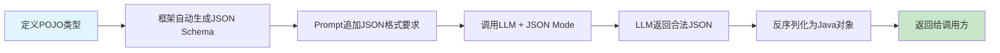
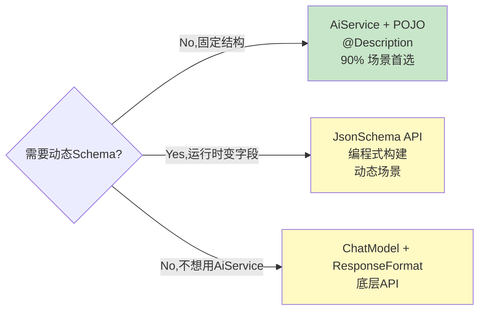

# Ch07 结构化输出——让 LLM 100% 返回你想要的数据格式

> 本章目标：
> 1. 理解为什么需要结构化输出（非结构化文本 → 机器可读数据）
> 2. 掌握 AiService 返回 POJO / enum / List 等 Java 类型
> 3. 学会用 @Description 注解引导 LLM 正确填充字段
> 4. 对比 JSON Mode vs JSON Schema 严格模式
> 5. 掌握 JsonSchema 编程式构建（底层 API）
> 6. 结构化输出的错误处理与重试策略
> 7. 把 smart-doc-assistant 升级到 v0.5：文档信息提取 + 结构化分类

---

## 7.1 为什么需要结构化输出？

### 7.1.1 非结构化文本的痛点

LLM 默认返回自然语言文本。但程序需要的是**机器可读的结构化数据**：

```
用户问: "分析一下这条评论：'这个手机外观好看，但是电池续航差，拍照还行'"

❌ 默认返回: "这条评论整体偏中性，提到了外观、电池和拍照三个方面..."
   → 无法直接存数据库、无法做统计分析、无法触发后续流程

✅ 期望返回:
   {
     "sentiment": "NEUTRAL",
     "rating": 3,
     "keyPoints": ["外观好看", "电池续航差", "拍照一般"],
     "suggestions": ["提升电池续航"]
   }
   → 直接写入 MySQL / ES，用于 BI 看板 + 改进建议自动分发
```

**典型场景**：
- 客户评论情感分析 → 分类 + 打分 + 关键点抽取
- 简历/合同/发票信息抽取 → 实体识别 + 字段填充
- 用户自然语言意图 → 命令对象（`{action:"search", keyword:"java", page:1}`）
- 内容生成 → 严格格式的报告/卡片/API 响应

### 7.1.2 三种方案对比

| 方案 | 可靠度 | 代码量 | 适用场景 |
|------|--------|--------|---------|
| **正则/字符串解析** | ❌ 极低 | 大 | 简单字段，但格式经常变 |
| **让 LLM 返回 JSON + 手动解析** | ⚠️ 中（偶有 markdown 包裹） | 中 | 临时脚本 |
| **AiService 返回 POJO + JSON Mode** | ✅ 95%+ | 小 | 生产推荐 |
| **JsonSchema 严格模式** | ✅ 99%+ | 小 | 对可靠性要求极高 |

### 7.1.3 LangChain4j 的结构化输出魔法

LangChain4j 的 **AiService** 能做到"声明返回类型，自动完成 JSON Schema 生成、Prompt 增强、响应反序列化"——你只需要定义好 Java 类型，其他全交给框架：

```java
// 1. 定义返回类型
public record ReviewAnalysis(
    Sentiment sentiment,
    Integer rating,
    List<String> keyPoints,
    List<String> suggestions
) {}

// 2. 在 AiService 里声明返回类型
@AiService
public interface ReviewAssistant {
    @UserMessage("分析以下客户评论：{{it}}")
    ReviewAnalysis analyze(String review);
}

// 3. 直接拿到 Java 对象
ReviewAnalysis result = assistant.analyze("这个手机外观好看，但是电池续航差");
// result.sentiment() → NEUTRAL
// result.rating() → 3
// result.keyPoints() → ["外观好看", "电池续航差"]
```

**框架背后做了什么**：



---

## 7.2 基础返回类型——从简单开始

### 7.2.1 原始类型：boolean / int / double

最基础的结构化输出——让 LLM 回答 yes/no 或数值：

```java
interface SentimentAnalyzer {
    @UserMessage("这句话是正面情感吗？只回答 true 或 false：{{it}}")
    boolean isPositive(String text);
}

interface RatingScorer {
    @UserMessage("给以下评论打1-5分，只返回数字：{{it}}")
    int score(String review);
}

// 用
boolean positive = analyzer.isPositive("这产品太棒了！");  // true
int score = scorer.score("还行吧，一般般");                // 3
```

**注意**：原始类型虽然可以用，但**推荐用 enum**（更可读 + 框架校验更严）。

### 7.2.2 Enum：分类任务首选

```java
enum Sentiment { POSITIVE, NEGATIVE, NEUTRAL }

interface SentimentClassifier {
    @UserMessage("分析以下文本的情感，只返回 POSITIVE / NEGATIVE / NEUTRAL 之一：{{it}}")
    Sentiment classify(String text);
}

Sentiment s = classifier.classify("产品垃圾，再也不买了");  // NEGATIVE
```

**为什么 enum 比 String 好**：
- ✅ 框架自动在 Prompt 里列出所有枚举值
- ✅ 反序列化失败时自动让 LLM 重试（如果是 String 就直接抛异常）
- ✅ Java 侧编译期类型安全，不会出现拼写错误

💡 **给枚举值加中文描述**：可以用 @Description 注解给 enum 常量加语义提示，提高分类准确率。

```java
enum Priority {
    @Description("系统崩溃/数据丢失/支付失败等，需立即处理")
    CRITICAL,
    @Description("核心功能不可用/严重影响用户，24小时内处理")
    HIGH,
    @Description("普通bug/功能建议，按排期处理")
    MEDIUM,
    @Description("小问题/文案修改，空闲时处理")
    LOW
}
```

### 7.2.3 List<String> / List<POJO>：集合返回

```java
interface KeywordExtractor {
    @UserMessage("从以下文本提取最多5个关键词，返回数组：{{it}}")
    List<String> extractKeywords(String text);
}

List<String> keywords = extractor.extractKeywords("LangChain4j是一个Java的LLM框架...");
// ["LangChain4j", "Java", "LLM", "框架", "AI"]
```

### 7.2.4 LocalDate / LocalDateTime：时间类型

框架支持 Java 时间类型，会自动要求 LLM 按 ISO 格式返回：

```java
interface DateExtractor {
    @UserMessage("从文本中提取日期，返回 yyyy-MM-dd 格式：{{it}}")
    LocalDate extractDate(String text);
}

LocalDate date = extractor.extractDate("下周三下午三点开会");  // 2026-08-26
```

⚠️ **坑**：时间提取涉及时区和自然语言歧义（"周三"是本周还是下周？），Prompt 里要明确锚定日期。

---

## 7.3 POJO 结构化输出——核心玩法

### 7.3.1 定义 POJO（record 或 class）

**推荐用 record**（Java 16+，不可变，无样板代码）：

```java
public record Person(
    String firstName,
    String lastName,
    LocalDate birthDate,
    String email
) {}
```

也可以用普通 class（需要无参构造 + getter/setter）：

```java
public class Person {
    private String firstName;
    private String lastName;
    private LocalDate birthDate;
    private String email;
    // getter / setter / 无参构造
}
```

### 7.3.2 @Description：字段的语义提示

字段名本身对 LLM 来说可能不够清晰，**`@Description` 注解是提高准确率的关键**：

```java
import dev.langchain4j.model.output.structured.Description;

public record BookReview(
    @Description("书名，完整中文名称")
    String bookTitle,

    @Description("作者全名")
    String author,

    @Description("推荐指数，1-5星整数，5星为强烈推荐")
    Integer rating,

    @Description("书评正文，300字以内，从内容、文笔、思想性三个维度评价")
    String content,

    @Description("适合阅读的人群标签，如：程序员/历史爱好者/科幻迷")
    List<String> targetReaders
) {}
```

**@Description 可以用在**：
- 类/record 上：描述整个对象的用途
- 字段上：描述字段含义、格式、取值范围
- enum 常量上：描述枚举值语义
- enum 类上：描述整个枚举的用途

### 7.3.3 在 AiService 里声明返回类型

```java
@AiService
public interface BookReviewAssistant {
    @UserMessage(fromResource = "prompts/book-review.txt")
    BookReview review(String bookName);
}
```

Prompt 文件 `prompts/book-review.txt`：

```
请为书籍《{{it}}》撰写一篇结构化书评。
要求：
1. rating 基于该书在豆瓣的评分给出合理分数
2. content 控制在 300 字以内
3. targetReaders 列出 3-5 个读者群体标签
直接返回 JSON 对象，不要用 markdown 代码块包裹。
```

### 7.3.4 嵌套 POJO

复杂结构直接嵌套就行，框架会递归生成 JSON Schema：

```java
public record OrderExtraction(
    @Description("订单号")
    String orderId,

    @Description("收货地址")
    Address shippingAddress,

    @Description("订单商品列表")
    List<OrderItem> items,

    @Description("支付方式")
    PaymentMethod paymentMethod
) {}

@Description("收货地址")
public record Address(
    @Description("省份")
    String province,
    @Description("城市")
    String city,
    @Description("详细街道地址")
    String street,
    @Description("收件人姓名")
    String recipient,
    @Description("联系电话")
    String phone
) {}

public record OrderItem(
    @Description("商品名称")
    String productName,
    @Description("数量")
    Integer quantity,
    @Description("单价，元")
    BigDecimal unitPrice
) {}

enum PaymentMethod { ALIPAY, WECHAT, CREDIT_CARD, COD }
```

---

## 7.4 JSON Mode——强制输出合法 JSON

### 7.4.1 为什么需要 JSON Mode？

即使 Prompt 里要求"返回 JSON"，LLM 偶尔还是会：
- 用 markdown 包裹：```json {...} ```
- 在 JSON 前后加自然语言注释
- 漏掉字段、加多余字段
- 返回非法的 JSON（如末尾多逗号）

**JSON Mode 是模型层面的强制约束**——模型保证输出是合法 JSON，但不保证字段结构（字段是否存在、类型是否正确由 prompt/Schema 控制）。

### 7.4.2 开启方式（Spring Boot application.yml）

```yaml
langchain4j:
  open-ai:
    chat-model:
      api-key: ${DEEPSEEK_API_KEY}
      model-name: deepseek-chat
      base-url: https://api.deepseek.com/v1
      temperature: 0.0          # ← 结构化输出用低温度
      response-format: json_object   # ← 开启 JSON Mode
      max-retries: 3                # ← JSON解析失败自动重试
```

**关键点**：
- `response-format: json_object` 告诉模型"必须输出合法 JSON"
- `temperature: 0.0` 让输出更确定性（结构化任务不需要创造性）
- 框架默认会在 JSON 解析失败时自动重试 3 次（带错误反馈）

### 7.4.3 json_object vs json_schema

LangChain4j 1.x 的 `response-format` 支持两种模式：

| 模式 | 配置 | 约束强度 | 模型支持 |
|------|------|---------|---------|
| `json_object` | `response-format: json_object` | 只保证合法 JSON，字段结构靠 Prompt | 大多数模型（DeepSeek/GPT-3.5/旧GPT-4） |
| `json_schema` | 需在代码里构建 `JsonSchema` 对象 | **严格字段约束**：类型、必填、enum、嵌套 | GPT-4o/4o-mini/Gemini/Ollama部分模型 |

### 7.4.4 开启严格 JSON Schema 模式（代码配置）

对于支持 Strict JSON Schema 的模型（GPT-4o 2024-08-06+、Gemini 2.0+），可以开启更严格的校验：

```java
OpenAiChatModel model = OpenAiChatModel.builder()
    .apiKey(apiKey)
    .modelName("gpt-4o-mini")
    .supportedCapabilities(Capability.RESPONSE_FORMAT_JSON_SCHEMA)  // ← 声明支持 Schema
    .strictJsonSchema(true)     // ← 严格模式：additionalProperties=false + 所有字段必填
    .build();
```

⚠️ **DeepSeek 当前不支持 `json_schema` 模式**（截至 2026.08），只能用 `json_object`。这是为什么本章后面会讲"错误处理和重试"——对于只支持 json_object 的模型，必须用 Prompt + @Description + 重试来兜底。

---

## 7.5 JsonSchema API——编程式构建（底层 API）

AiService 返回 POJO 已经能覆盖 90% 的场景。但当你需要**动态 Schema**（根据运行时条件决定字段）或者**不用 AiService**（直接用 ChatModel），就需要用底层的 JsonSchema API。

### 7.5.1 ResponseFormat + JsonSchema + JsonObjectSchema

```java
import dev.langchain4j.model.chat.request.ResponseFormat;
import dev.langchain4j.model.chat.request.ResponseFormatType;
import dev.langchain4j.model.chat.request.json.JsonSchema;
import dev.langchain4j.model.chat.request.json.JsonObjectSchema;

// 1. 构建 JsonSchema
JsonSchema schema = JsonSchema.builder()
    .name("ReviewAnalysis")                     // Schema 名称
    .rootElement(JsonObjectSchema.builder()
        .addStringProperty("summary")           // String 字段
        .addEnumProperty("sentiment", List.of("POSITIVE", "NEGATIVE", "NEUTRAL"))
        .addIntegerProperty("rating")           // Integer 字段
        .addStringProperty("keyPoints", true)   // List<String>（数组）
        .required("summary", "sentiment", "rating")  // 必填字段
        .build())
    .build();

// 2. 构建 ResponseFormat
ResponseFormat format = ResponseFormat.builder()
    .type(ResponseFormatType.JSON)
    .jsonSchema(schema)
    .build();

// 3. 发起请求
ChatRequest request = ChatRequest.builder()
    .messages(UserMessage.from("分析评论：" + review))
    .responseFormat(format)
    .build();

ChatResponse response = chatModel.chat(request);
String json = response.aiMessage().text();  // 合法 JSON 字符串
```

### 7.5.2 支持的 Schema 属性类型

| 方法 | JSON 类型 | 说明 |
|------|----------|------|
| `.addStringProperty(name)` | string | 字符串 |
| `.addIntegerProperty(name)` | integer | 整数 |
| `.addNumberProperty(name)` | number | 浮点数 |
| `.addBooleanProperty(name)` | boolean | 布尔值 |
| `.addEnumProperty(name, values)` | string enum | 枚举值 |
| `.addProperty(name, JsonSchemaProperty)` | 自定义 | 嵌套对象/数组 |
| `.required(names...)` | required | 标记必填字段 |

### 7.5.3 嵌套对象和数组示例

```java
JsonObjectSchema addressSchema = JsonObjectSchema.builder()
    .addStringProperty("province")
    .addStringProperty("city")
    .addStringProperty("street")
    .addStringProperty("recipient")
    .required("province", "city", "street", "recipient")
    .build();

JsonObjectSchema itemSchema = JsonObjectSchema.builder()
    .addStringProperty("productName")
    .addIntegerProperty("quantity")
    .addNumberProperty("unitPrice")
    .required("productName", "quantity", "unitPrice")
    .build();

JsonObjectSchema orderSchema = JsonObjectSchema.builder()
    .addStringProperty("orderId")
    .addProperty("shippingAddress", addressSchema)
    .addProperty("items", JsonArraySchema.builder().items(itemSchema).build())
    .addEnumProperty("paymentMethod", List.of("ALIPAY", "WECHAT"))
    .required("orderId", "items")
    .build();
```

### 7.5.4 AiService 场景优先用 POJO

底层 JsonSchema API 灵活但啰嗦，**AiService + POJO 才是日常开发的首选**——框架自动帮你从 POJO 生成 Schema，代码少、类型安全、可维护。



---

## 7.6 错误处理与重试——让结构化输出更可靠

### 7.6.1 常见失败场景

即使开了 JSON Mode，结构化输出仍可能失败：

| 失败类型 | 原因 | 发生频率 |
|---------|------|---------|
| JSON 解析失败（SyntaxError） | 模型输出截断 / 非法 JSON | 低（JSON Mode 下约 1-2%） |
| 字段缺失 | 模型漏返回某个字段 | 中（字段越多越容易） |
| 类型错误 | 返回字符串"3"而不是数字 3 | 低 |
| Enum 值错误 | 返回"happy"而不是 POSITIVE | 中 |
| 值超出范围 | rating 返回 6（应该 1-5） | 低 |
| 幻觉字段 | 多返回不存在的字段 | 中 |

### 7.6.2 框架默认的重试机制

LangChain4j AiService 内置了**带错误反馈的自动重试**：

```
第 1 次调用: LLM 返回有问题的 JSON
  ↓
框架检测到解析错误
  ↓
第 2 次调用: 把错误信息发给 LLM（"字段 rating 应该是整数，你返回了 'six'"）
  ↓
LLM 修正后重新返回
  ↓
最多重试 maxRetries 次（默认 3）
```

**配置重试次数**：

```yaml
langchain4j:
  open-ai:
    chat-model:
      max-retries: 3    # 默认就是 3，结构化输出场景建议 3~5
```

### 7.6.3 生产级错误处理：自定义 OutputParser

对于复杂场景，可以自定义解析器做更精细的错误恢复：

```java
AiServices.builder(ReviewAssistant.class)
    .chatModel(chatModel)
    // 自定义输出解析器
    .outputParser(new OutputParser<ReviewAnalysis>() {
        @Override
        public ReviewAnalysis parse(String text) {
            try {
                // 1. 先剥掉 markdown 代码块（模型偶尔会加 ```json ... ```）
                String clean = text.trim();
                if (clean.startsWith("```")) {
                    clean = clean.replaceAll("^```(?:json)?\\s*", "").replaceAll("\\s*```$", "");
                }
                // 2. 标准 Jackson 反序列化
                return objectMapper.readValue(clean, ReviewAnalysis.class);
            } catch (Exception e) {
                // 3. 失败时抛出带修复提示的异常（框架会自动重试）
                throw new OutputParsingException(
                    "JSON 解析失败，请返回合法 JSON 格式的 ReviewAnalysis 对象。" +
                    "上次错误：" + e.getMessage() +
                    "正确格式示例：{\"sentiment\":\"POSITIVE\",\"rating\":5,\"keyPoints\":[\"...\"],\"suggestions\":[]}",
                    e
                );
            }
        }
    })
    .build();
```

### 7.6.4 兜底策略：解析失败后降级

对于线上系统，重试 N 次后仍失败必须有兜底：

```java
public ReviewAnalysis safeAnalyze(String review) {
    try {
        return assistant.analyze(review);
    } catch (Exception e) {
        log.warn("结构化输出失败，兜底处理: review={}, error={}", review, e.getMessage());
        // 兜底：返回一个人工标注的默认结果，或入队走人工审核
        return new ReviewAnalysis(Sentiment.NEUTRAL, 3,
            List.of("自动分析失败，请人工复核"), List.of());
    }
}
```

**最佳实践**：
- 结构化任务**一定用低 temperature**（0.0~0.2）
- **字段不要超过 10 个**，太多字段模型容易漏；复杂任务拆成多轮
- @Description 里写**格式要求 + 示例**
- POJO 用 record，字段类型用 Integer 而不是 int（允许 null）
- List 字段初始化为空数组（避免 null）
- 生产环境配置 3 次重试 + 兜底降级
- 失败日志要把原始 LLM 响应打出来，便于调优 Prompt

---

## 7.7 实战场景：从非结构化文本提取信息

### 7.7.1 场景：简历关键信息抽取

一个常见的结构化输出需求——从候选人简历里提取关键字段：

```java
/**
 * 简历信息抽取结果
 *
 * 所有字段都是 Optional 风格（用 Integer 不用 int，String 允许 null），
 * 因为简历里不一定包含所有信息。
 */
public record ResumeExtraction(
    @Description("候选人姓名")
    String name,

    @Description("手机号，11位数字")
    String phone,

    @Description("邮箱地址")
    String email,

    @Description("最高学历：博士/硕士/本科/大专/高中及以下")
    String highestDegree,

    @Description("毕业院校")
    String university,

    @Description("工作年限，整数（年）")
    Integer yearsOfExperience,

    @Description("最近三家公司的名称列表，按时间倒序")
    List<String> recentCompanies,

    @Description("核心技术栈，如：Java,Spring Boot,MySQL,Redis")
    List<String> techStack,

    @Description("综合匹配度评分，1-10分整数，10分最匹配")
    Integer matchScore
) {}
```

AiService 接口：

```java
@AiService
public interface ResumeParser {
    @SystemMessage("""
        你是一个简历信息抽取助手。从用户提供的简历文本中提取结构化信息。
        规则：
        1. 如果字段信息在简历中找不到，填 null（不要编造）
        2. 手机号必须是11位数字，去掉+86等前缀
        3. techStack 最多列出 10 个最核心的技能
        4. matchScore 根据简历质量综合评分
        直接返回 JSON，不要加任何解释文字。
        """)
    @UserMessage("{{resume}}")
    ResumeExtraction parse(String resume);
}
```

### 7.7.2 调用示例

```java
@Service
@RequiredArgsConstructor
public class ResumeService {

    private final ResumeParser resumeParser;
    private final ResumeRepository resumeRepository;

    public ResumeExtraction parseAndSave(String resumeText) {
        ResumeExtraction extraction = resumeParser.parse(resumeText);

        // 拿到结构化数据后，直接写入数据库
        ResumeEntity entity = new ResumeEntity();
        entity.setName(extraction.name());
        entity.setPhone(extraction.phone());
        entity.setEmail(extraction.email());
        entity.setYearsOfExperience(extraction.yearsOfExperience());
        entity.setTechStack(String.join(",", extraction.techStack()));
        entity.setMatchScore(extraction.matchScore());

        resumeRepository.save(entity);
        return extraction;
    }
}
```

Controller 层：

```java
@PostMapping("/api/resume/parse")
public Map<String, Object> parseResume(@RequestBody ResumeRequest req) {
    ResumeExtraction result = resumeService.parseAndSave(req.resumeText());
    return Map.of(
        "data", result,
        "parsedAt", LocalDateTime.now().toString()
    );
}

public record ResumeRequest(String resumeText) {}
```

### 7.7.3 结构化输出 vs RAG 的关系

结构化输出**不是** RAG 的替代品：

| 场景 | 用结构化输出 | 用 RAG |
|------|------------|-------|
| 从已知文本**提取字段** | ✅ | ❌ |
| 基于**外部知识库**回答问题 | ❌ | ✅ |
| 把非结构化文本转为结构化数据 | ✅ | ❌ |
| 基于检索结果生成回答 | ❌ | ✅ |
| **RAG + 结构化输出组合**：先检索文档，再让 LLM 基于检索结果返回结构化答案 | ✅ | ✅ |

组合用法在 Ch09 RAG 章节会详细讲。

---

## 7.8 高频坑点与最佳实践

### 坑1：没开 JSON Mode，返回 markdown 包裹的 JSON

```java
// ❌ 没开 response-format: json_object，模型可能返回：
// "```json\n{\"sentiment\":\"POSITIVE\"}\n```"
// → Jackson 直接报错

// ✅ 配置里开启
// response-format: json_object
// 或者在自定义 OutputParser 里先 strip markdown
```

### 坑2：字段太多导致漏返回

```java
// ❌ 20+ 个字段，模型经常漏 2~3 个
public record HugeExtraction(
    String field1, String field2, ... String field25
) {}

// ✅ 拆成多步：先提取核心字段，再用第二个 AiService 补充细节
public record BasicInfo(String name, String phone, String email) {}
public record WorkExp(List<Job> jobs) {}
public record Education(List<Edu> edus) {}
```

### 坑3：用基本类型 int/boolean 接收 null

```java
// ❌ int 不能为 null，如果 LLM 没返回这个字段，反序列化时给 0 → 数据含义错误
public record BadReview(int rating) {}

// ✅ 用包装类型，允许 null
public record GoodReview(Integer rating) {}
```

### 坑4：@Description 写得太简略

```java
// ❌ 描述太简单，LLM 不知道格式要求
public record Bad(
    @Description("日期") String date,
    @Description("分数") int score
) {}

// ✅ 写清楚格式/范围/示例
public record Good(
    @Description("日期，格式 yyyy-MM-dd，如 2026-08-20") String date,
    @Description("评分，1-5 的整数，5 分最高") Integer score
) {}
```

### 坑5：temperature 太高，输出不稳定

```yaml
# ❌ temperature=0.7 做结构化提取，同样输入每次返回不同结果
temperature: 0.7

# ✅ 结构化任务用低温度
temperature: 0.0  # 或 0.1 增加一点鲁棒性
```

### 坑6：嵌套过深导致模型迷失

```java
// ❌ 嵌套 4 层以上，模型容易在某个层级出错
record A(B b); record B(C c); record C(D d); record D(String value);

// ✅ 扁平化：把关键字段提到顶层
record Flat(String value, String meta1, String meta2);
```

### 坑7：不做兜底，解析失败直接 500

```java
// ❌ 生产环境直接抛异常
@PostMapping("/api/analyze")
public ReviewAnalysis analyze(@RequestBody ReviewRequest req) {
    return assistant.analyze(req.review());  // 可能抛 OutputParsingException
}

// ✅ try-catch 兜底
@PostMapping("/api/analyze")
public Map<String, Object> analyze(@RequestBody ReviewRequest req) {
    try {
        return Map.of("success", true, "data", assistant.analyze(req.review()));
    } catch (Exception e) {
        log.error("Analyze failed", e);
        return Map.of("success", false, "error", "分析失败，请稍后重试");
    }
}
```

### 最佳实践汇总

- ✅ **结构化任务用低 temperature**：0.0~0.2
- ✅ **必开 JSON Mode**：`response-format: json_object`
- ✅ **字段加 @Description**：写清楚含义、格式、取值范围、示例
- ✅ **POJO 用 record + 包装类型**：Integer/Double 允许 null
- ✅ **List 字段初始化为空**：`new ArrayList<>()` 或 `List.of()`
- ✅ **字段不超过 10 个**：超过就拆分 AiService
- ✅ **配置 3 次重试**：`max-retries: 3`
- ✅ **失败有兜底**：默认值 + 告警日志
- ✅ **Prompt 明确"找不到填 null，不要编造"**：防幻觉
- ✅ **分类任务优先用 enum**：类型安全 + 自动校验
- ❌ **不要用基本类型接收可能缺失的字段**
- ❌ **不要让字段嵌套超过 3 层**
- ❌ **不要用 temperature > 0.3 做结构化任务**
- ❌ **不要忽视解析失败的日志**：里面有优化 Prompt 的线索

---

## 7.9 Spring AI 对比：结构化输出

| 能力 | LangChain4j | Spring AI |
|------|-------------|-----------|
| 返回 POJO | ✅ AiService 方法直接声明返回类型 | ✅ `BeanOutputConverter<T>` + `entity()` |
| 自动 JSON Schema | ✅ 从 POJO 反射生成 | ✅ 从 BeanClass 生成 |
| @Description 等价 | `@Description("...")` | `@JsonPropertyDescription("...")` + Jackson 注解 |
| JSON Mode | `response-format: json_object` / json_schema | 通过 `ResponseFormat` 配置 |
| 枚举返回 | ✅ 原生支持 | ✅ 支持 |
| 自动重试解析 | ✅ 内置 max-retries + 错误反馈 | ⚠️ 需要自己配 |
| 严格 Schema | `.strictJsonSchema(true)` | `.withAdditionalProperties(false)` |
| 动态 Schema | JsonSchema.builder() 编程式 | `SchemaBuilder` 编程式 |

**Spring AI 写法**（仅作对比）：

```java
// Spring AI 用 BeanOutputConverter
BeanOutputConverter<ReviewAnalysis> converter = new BeanOutputConverter<>(ReviewAnalysis.class);

String json = chatClient.prompt()
    .user(u -> u.text("分析评论：{review}").param("review", review))
    .responseFormat(converter.getFormat())    // ← 把 Schema 塞进 Prompt
    .call()
    .content();

ReviewAnalysis result = converter.convert(json);
```

**主要差异**：
1. LangChain4j AiService **完全隐藏解析细节**——方法直接返回 POJO，开发者不接触 JSON
2. LangChain4j **内置自动重试**（带错误反馈），Spring AI 需要自己写
3. LangChain4j @Description 是自定义注解，Spring AI 用 Jackson 的 @JsonPropertyDescription（更标准但功能弱一些）

---

## 7.10 本章小结

| 知识点 | 关键 |
|-------|------|
| **结构化输出必要性** | 非结构化文本无法直接入库/统计/触发流程 |
| **基础类型** | boolean / int / String / enum / List / LocalDate 都能直接返回 |
| **enum 分类** | 比 String 好：类型安全 + 自动枚举值注入 |
| **POJO record** | Java 16+ 首选，不可变无样板 |
| **@Description** | 字段级语义提示，提高准确率的核心 |
| **嵌套 POJO** | 直接嵌套，框架递归生成 Schema |
| **JSON Mode** | json_object（通用）/ json_schema（严格） |
| **temperature=0** | 结构化任务必须低温度 |
| **JsonSchema API** | 底层动态 Schema 构建，AiService 不够用时兜底 |
| **错误处理** | 内置重试 + OutputParser 自定义 + 兜底降级 |
| **字段设计** | ≤10个，包装类型，不超过3层嵌套 |

---

## 7.11 本章项目代码状态（v0.5）

smart-doc-assistant 升级到 **v0.5**——核心新增**文档信息提取助手**（DocExtractionAssistant），演示结构化输出在真实场景的应用。

```
smart-doc-assistant/
├── pom.xml
└── src/main/
    ├── java/com/example/assistant/
    │   ├── AssistantApplication.java
    │   ├── config/
    │   │   ├── AiServiceConfig.java
    │   │   ├── ChatMemoryStoreConfig.java
    │   │   ├── StreamSessionManager.java
    │   │   └── ToolConfig.java
    │   ├── assistant/
    │   │   ├── ChatAssistant.java
    │   │   ├── StreamingChatAssistant.java
    │   │   ├── FlexibleAssistant.java
    │   │   ├── TranslationAssistant.java
    │   │   ├── ReviewAnalysisAssistant.java
    │   │   ├── ToolAssistant.java
    │   │   └── DocExtractionAssistant.java      ← 新增：文档提取
    │   ├── tools/
    │   │   ├── TimeTools.java
    │   │   ├── CalculatorTools.java
    │   │   └── OrderTools.java
    │   └── controller/
    │       ├── AssistantController.java          (升级: 新增 /api/doc/extract 端点)
    │       └── ChatStreamController.java
    └── resources/
        ├── application.yml                        (升级: temperature 默认降为 0.0)
        └── prompts/
            ├── code-review-system.txt
            ├── cot-math-user.txt
            ├── review-analysis-user.txt
            ├── translator-system.txt
            └── doc-extraction-system.txt          ← 新增：文档提取系统 Prompt
```

**新增核心代码 1：DocExtractionAssistant.java**

```java
package com.example.assistant.assistant;

import dev.langchain4j.service.SystemMessage;
import dev.langchain4j.service.UserMessage;
import dev.langchain4j.service.spring.AiService;

import java.time.LocalDate;
import java.util.List;

/**
 * Ch07 新增：文档/合同关键信息提取助手
 *
 * 演示：
 * - 嵌套 POJO 结构化输出
 * - @Description 字段语义提示
 * - enum 分类
 * - List 嵌套
 * - 找不到字段填 null 而非编造
 */
@AiService
public interface DocExtractionAssistant {

    @SystemMessage(fromResource = "prompts/doc-extraction-system.txt")
    @UserMessage("""
        请从以下文档内容中提取关键信息：

        {{document}}
        """)
    DocExtraction extract(String document);

    // ========== 结构化输出类型 ==========

    /** 文档类型 */
    enum DocType {
        /** 合同 */
        CONTRACT,
        /** 发票 */
        INVOICE,
        /** 简历 */
        RESUME,
        /** 报告 */
        REPORT,
        /** 其他 */
        OTHER
    }

    /** 相关方信息 */
    record Party(
        @Description("甲方/乙方/公司名称/个人姓名")
        String name,
        @Description("联系电话，找不到填 null")
        String contact,
        @Description("地址，找不到填 null")
        String address
    ) {}

    /** 文档关键信息提取结果 */
    record DocExtraction(
        @Description("文档类型")
        DocType docType,

        @Description("文档标题")
        String title,

        @Description("文档签署/出具日期，格式 yyyy-MM-dd，找不到填 null")
        LocalDate docDate,

        @Description("涉及金额（元），无金额填 null")
        Double amount,

        @Description("合同/文档涉及的相关方列表")
        List<Party> parties,

        @Description("文档关键条款/要点摘要，最多 5 条")
        List<String> keyPoints,

        @Description("风险点提示，没有风险返回空数组")
        List<String> risks,

        @Description("文档摘要，200字以内")
        String summary
    ) {}
}
```

**新增核心代码 2：prompts/doc-extraction-system.txt**

```
你是一个专业的文档信息提取助手。从用户提供的文档中提取关键信息。

## 严格规则

1. **不要编造**：如果某个字段在文档中找不到，填 null 或空数组，绝对不要臆造
2. **金额准确**：amount 只提取明确的金额数字，不要带货币符号和逗号
3. **日期格式**：统一返回 yyyy-MM-dd 格式
4. **keyPoints**：最多 5 条，每条不超过 50 字
5. **risks**：只列出明确的法律/商业风险点，普通条款不算风险
6. **parties**：提取所有出现的公司/个人，判断甲乙方关系；无法判断时 name 照原文填

## 输出格式

直接返回 JSON 对象，不要加任何解释文字，不要用 markdown 代码块包裹。
```

**升级配置：application.yml**

```yaml
langchain4j:
  open-ai:
    chat-model:
      api-key: ${DEEPSEEK_API_KEY:sk-replace-me}
      model-name: deepseek-chat
      base-url: https://api.deepseek.com/v1
      temperature: 0.0          # ← Ch07：结构化输出必须低温度（从 0.7 改为 0.0）
      max-tokens: 2000
      timeout: PT60S
      max-retries: 3
      response-format: json_object   # ← 开启 JSON Mode
      log-requests: false
      log-responses: false
```

⚠️ **注意**：默认模型 temperature 从 0.7 降到 0.0 会影响普通对话的多样性。生产环境建议**结构化输出单独配一个 json-model Bean**，普通对话保留 0.7：

```yaml
langchain4j:
  open-ai:
    chat-model:
      # 默认模型：保留对话多样性
      temperature: 0.7
      response-format: text       # ← 普通对话用 text

  open-ai-chat-models:
    json-model:
      api-key: ${DEEPSEEK_API_KEY}
      model-name: deepseek-chat
      base-url: https://api.deepseek.com/v1
      temperature: 0.0
      response-format: json_object
      max-retries: 3
      max-tokens: 2000
```

然后 DocExtractionAssistant 显式指定 json-model：

```java
@AiService(chatModel = "jsonModel")   // ← 指定结构化模型 Bean
public interface DocExtractionAssistant {
    // ...
}
```

**升级核心代码 3：AssistantController 新增端点**

```java
private final DocExtractionAssistant docExtractionAssistant;

/**
 * Ch07 新增：文档关键信息提取（结构化输出）
 *
 * 演示：从合同/发票/简历等文本中提取关键字段
 */
@PostMapping("/api/doc/extract")
public Map<String, Object> extractDoc(@RequestBody DocExtractRequest req) {
    try {
        DocExtractionAssistant.DocExtraction result = docExtractionAssistant.extract(req.document());
        return Map.of(
            "success", true,
            "data", result,
            "extractedAt", LocalDateTime.now().toString()
        );
    } catch (Exception e) {
        log.warn("文档提取失败: docLength={}, error={}",
            req.document() == null ? 0 : req.document().length(), e.getMessage());
        return Map.of(
            "success", false,
            "error", "文档解析失败，请检查文档格式后重试",
            "extractedAt", LocalDateTime.now().toString()
        );
    }
}

public record DocExtractRequest(String document) {}
```

**验证清单**：

- [ ] 理解结构化输出 vs 非结构化文本的区别
- [ ] 能用 AiService + POJO record 定义结构化返回类型
- [ ] 会用 @Description 提高字段提取准确率
- [ ] 会开 JSON Mode（response-format: json_object）
- [ ] 知道 json_object 和 json_schema 的区别
- [ ] 会用 JsonSchema API 动态构建 Schema
- [ ] 理解结构化输出的错误重试机制
- [ ] 知道字段设计原则（≤10个/包装类型/≤3层嵌套）
- [ ] smart-doc-assistant v0.5 跑起来，/api/doc/extract 能正确提取文档字段

**测试用例**：

```bash
# 合同信息提取
curl -X POST http://localhost:8090/api/doc/extract \
  -H "Content-Type: application/json" \
  -d '{
    "document": "甲方：北京科技有限公司，乙方：张三。根据《中华人民共和国合同法》，甲乙双方经友好协商，就软件开发事宜达成如下协议：合同金额为人民币 50000 元，签订日期 2026年8月15日。乙方需在2026年12月31日前完成开发并交付。逾期交付需支付违约金，每日按合同金额的0.1%计算。甲方联系电话：010-12345678，地址：北京市朝阳区xxx路100号。"
  }'
# 期望：
# {
#   "success": true,
#   "data": {
#     "docType": "CONTRACT",
#     "title": "软件开发协议",
#     "docDate": "2026-08-15",
#     "amount": 50000.0,
#     "parties": [
#       {"name": "北京科技有限公司", "contact": "010-12345678", "address": "北京市朝阳区xxx路100号"},
#       {"name": "张三", "contact": null, "address": null}
#     ],
#     "keyPoints": ["合同金额 50000 元", "交付日期 2026-12-31", ...],
#     "risks": ["逾期违约金日0.1%较高..."],
#     "summary": "..."
#   }
# }

# 评论分析（已有的 ReviewAnalysisAssistant）
curl -X POST http://localhost:8090/api/review/analyze \
  -H "Content-Type: application/json" \
  -d '{"review": "这个手机外观非常漂亮，手感很好，但是电池不太耐用，续航一般，拍照还可以，性价比不错"}'
```

---

**下一章预告：Ch08 Embedding 向量模型与文本相似度**——为什么搜索引擎能"理解语义"？这一章讲 Embedding 模型原理、余弦相似度、向量维度、用 LangChain4j 的 EmbeddingModel 在内存里做语义搜索，为 Ch09 RAG 打基础。
