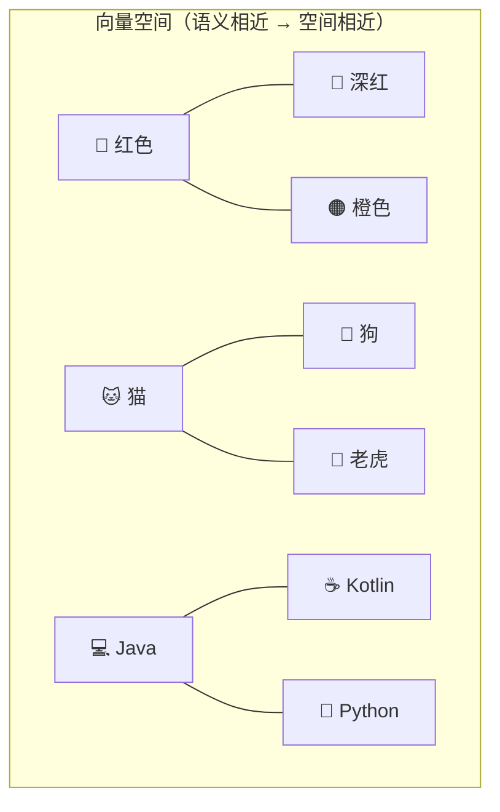
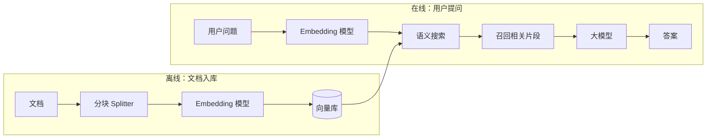
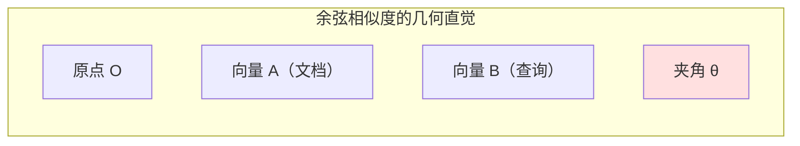
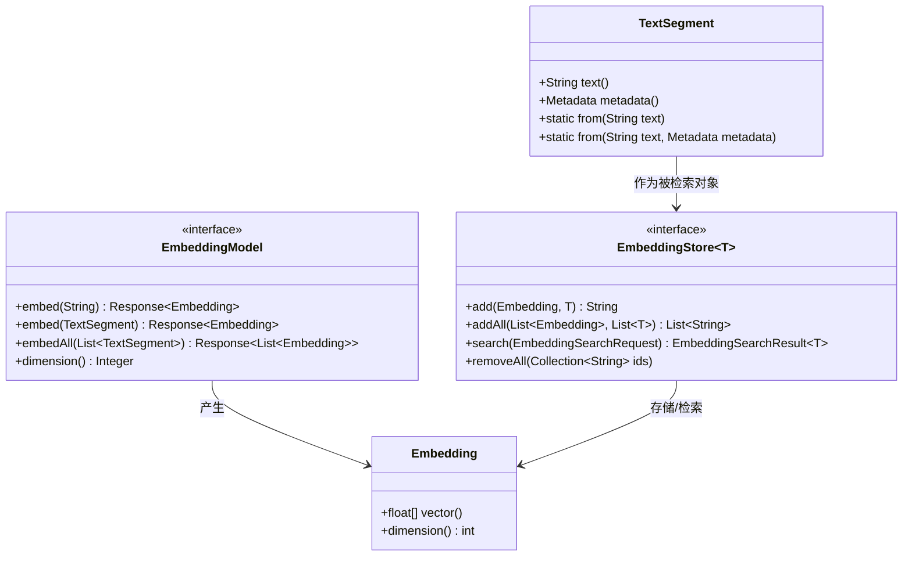
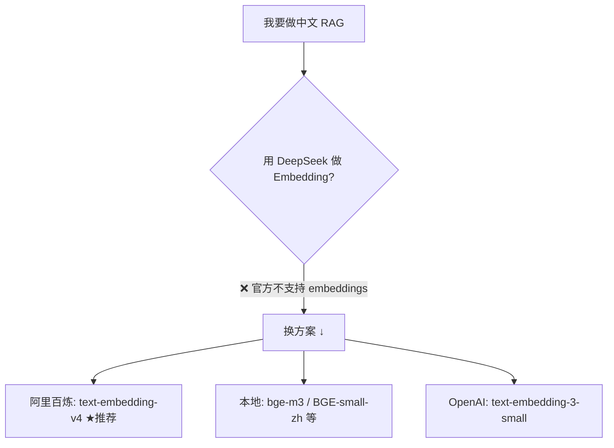
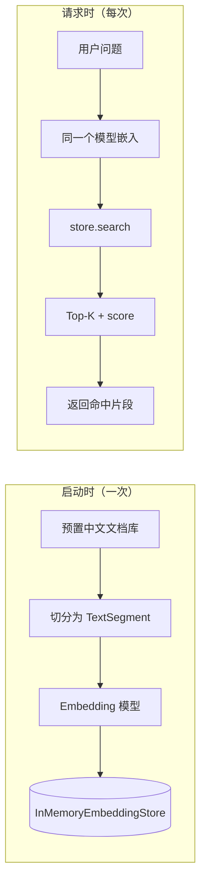
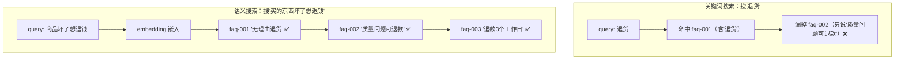

# Ch08 Embedding 向量模型——让程序"理解"语义

> 本章目标：
> 1. 理解什么是 Embedding：一段文本 → 一串有语义的数字向量
> 2. 掌握相似度度量：余弦相似度的公式、几何直觉与 Java 实现
> 3. 掌握 LangChain4j 向量四件套：EmbeddingModel / Embedding / TextSegment / EmbeddingStore
> 4. 会用本地 ONNX 模型做零成本嵌入（开发调试推荐）
> 5. 会用 OpenAI 兼容方式接入阿里百炼 Embedding（生产方案，本次测试平台）
> 6. 会用 InMemoryEmbeddingStore 实现内存语义搜索（含轻量持久化）
> 7. 把 smart-doc-assistant 升级到 v0.6：文档语义检索端点 + 模型可切换

---

## 8.1 为什么需要 Embedding：从关键词到语义

### 8.1.1 关键词搜索的局限

搜索引擎最朴素的做法是**关键词匹配**：用户搜"退货政策"，系统找包含"退货政策"这四个字的文档。

但真实世界里，同一个意思有无数种说法：

```
用户提问：         "我买的东西坏了，能退钱吗？"

文档 A 原文：      "如需退货，请在签收后 7 天内提交申请。"
                  → 包含"退货"，能匹配上

文档 B 原文：      "商品存在质量问题的，消费者有权要求退款。"
                  → 没有"退货"两个字，但语义上就是讲退货 → 关键词搜不到！
```

关键词搜索的三大痛点：

| 痛点 | 例子 |
|------|------|
| **同义词/近义表达** | "坏了" vs "质量问题"、"退钱" vs "退款" |
| **口语 vs 书面语** | "能退吗" vs "有权要求退款" |
| **一词多义** | "苹果"（水果 vs 手机品牌 vs 公司） |

### 8.1.2 Embedding 是什么

**Embedding（嵌入/向量化）** 是把一段文本转换成一串固定长度的数字，这串数字就是这段文本在"语义空间"里的坐标。

```
"退货政策"  →  [0.013, -0.221, 0.487, 0.102, ..., -0.088]   （1024 维）
"退款规则"  →  [0.015, -0.218, 0.491, 0.098, ..., -0.085]   （1024 维）
"红烧肉做法" →  [0.901,  0.332, 0.112, -0.056, ..., 0.271]  （1024 维）
```

关键性质：**语义越相近的文本，向量在空间里越靠近**。

- "退货政策"和"退款规则"意思相近 → 向量几乎指向同一个方向
- "退货政策"和"红烧肉做法"毫无关系 → 向量指向完全不同的方向

所以，**检索问题就变成了向量距离问题**：给查询向量，找出距离最近的文档向量——这就是**语义搜索（Semantic Search）**，也是 **RAG（检索增强生成）** 的地基。

### 8.1.3 语义空间直觉：二维世界示例

真实向量是几百上千维，人类想象不出。我们先降维到 2D 看直觉：



- "猫 / 狗 / 老虎"聚成一团（动物语义簇）
- "Java / Kotlin / Python"聚成一团（编程语言语义簇）
- "猫"和"Java"相隔很远

当你问"哪种宠物适合家庭饲养"，系统把问题向量化后，会落在动物簇附近，从而召回"猫""狗"相关的文档，而不会召回"Java"。

### 8.1.4 Embedding 在 RAG 里的位置



本章先把 **Embedding 模型 + 向量库 + 语义搜索** 这三块打通；文档分块（Splitter）和完整 RAG 管线在 Ch10~Ch13 展开。

---

## 8.2 Embedding 模型：文本到向量的引擎

### 8.2.1 Embedding 模型 vs 对话模型

Embedding 模型和对话模型（LLM）是**完全不同的两类模型**，职责不同：

| 维度 | 对话模型（Chat） | Embedding 模型 |
|------|-----------------|----------------|
| 输入 | 用户消息 / Prompt | 一段文本 |
| 输出 | 自然语言回复 | 一串固定长度数字向量 |
| 能力 | 理解 + 推理 + 生成 | 只做"语义 → 向量"映射 |
| 典型 | DeepSeek-V3、Qwen、GPT-4o | text-embedding-v4、BGE、All-MiniLM |
| 训练目标 | 预测下一个 token | 让相似文本的向量靠近 |

> 💡 **Spring AI 对比**：Spring AI 里对应 `EmbeddingModel` 接口（`org.springframework.ai.embedding.EmbeddingModel`），概念完全一致；LangChain4j 的接口名也叫 `EmbeddingModel`，都在 `dev.langchain4j.model.embedding` 包下。

### 8.2.2 主流 Embedding 模型盘点

| 模型 | 维度 | 语言 | 部署方式 | 成本 | 适用场景 |
|------|------|------|---------|------|---------|
| **All-MiniLM-L6-v2** | 384 | 多语言（含中文） | 本地 ONNX | 免费 | 开发调试、轻量 RAG |
| **BGE-small-zh-v1.5** | 512 | 中文为主 | 本地 ONNX | 免费 | 中文知识库（本地） |
| **text-embedding-v4**（Qwen3-Embedding 系列） | 2048~64（默认1024） | 100+ 语种 | 阿里百炼 | 0.0005元/千token | **中文生产推荐** |
| **text-embedding-v3** | 1024~64（默认1024） | 50+ 语种 | 阿里百炼 | 0.0005元/千token | 中文生产（性价比） |
| **text-embedding-3-small** | 1536（可降到 512） | 多语言 | OpenAI API | ~$0.02/1M tokens | 通用生产（海外） |
| **bge-m3** | 1024 | 多语言 | Ollama 本地 | 免费（需本机算力） | 本地中文 RAG |
| **tongyi-embedding-vision-flash** | 768（默认） | 中英等 30+ 语种 | 阿里百炼原生 API | 按量计费 | 图文/视频多模态检索 |

### 8.2.3 维度、成本与选型

**维度（dimension）** 决定了向量的"分辨率"：

| 维度 | 语义精度 | 存储/内存 | 检索速度 | 推荐场景 |
|------|---------|-----------|---------|---------|
| 384 | 够用 | 小（快） | 快 | 开发调试、小规模知识库 |
| 512~1024 | 良好 | 中 | 中 | 中文知识库、生产 |
| 1536~3072 | 高 | 大（贵） | 慢 | 大规模、高质量检索 |

**选型经验（成本敏感版）**：

```
开发/学习阶段  → 本地 ONNX 模型（免费、无 API key、秒启动）
             ↓ 效果不满意再升级
中文生产      → 阿里百炼 text-embedding-v4（0.0005元/千token，中文强）
英文生产      → text-embedding-3-small
图文多模态    → tongyi-embedding-vision（Ch09 展开）
```

> ✅ **最佳实践**：先花 0 成本用本地模型把链路跑通，确认效果瓶颈确实在"向量质量"而不是"检索逻辑/分块质量"后，再升级远程模型。**远程 API 的成本大头往往是被无效检索浪费的**，而不是模型单价本身。

### 8.2.4 ⚠️ 坑点：同一个向量库只能用一个模型

一个向量库里所有向量**必须来自同一个 Embedding 模型**（同一维度、同一语义空间）。

```
❌ 错误：一半文档用 All-MiniLM（384维），一半用 text-embedding-v4（1024维）
   → 维度都对不上，直接报错；维度碰巧相同也会因语义空间不同而检索结果错乱

✅ 正确：全库统一一个模型，升级模型 = 全量重新嵌入
```

---

## 8.3 文本相似度：余弦相似度与向量距离

### 8.3.1 向量的"方向"比"长度"更重要

两个向量比较相似度，最直觉的是算"距离"，但**向量长度（模长）会干扰判断**。

```
A = [2, 0]     模长 2
B = [4, 0]     模长 4
C = [0, 3]     模长 3
```

- A 和 B 方向完全一致，只是"长度"不同 → 语义应该完全相同（Embedding 里长度通常是归一化的）
- A 和 C 方向垂直 → 语义完全不同

如果算欧氏距离，A(2,0) 到 B(4,0) 距离是 2，A 到 C 距离是 √13≈3.6，看起来 A 和 B"更像"。但**对文本语义而言，我们关心的是方向，不是长度**。

### 8.3.2 余弦相似度公式

**余弦相似度（Cosine Similarity）** 衡量的是两个向量夹角的余弦值，只看方向，忽略长度：

```
              A · B
cos(θ) = ─────────────
          |A| × |B|
```

- A·B = 向量点积（对应分量相乘后求和）
- |A|、|B| = 向量模长



- θ = 0°  → cos = 1.0  → 方向完全一致，语义最接近
- θ = 90° → cos = 0    → 正交，无关
- θ = 180°→ cos = -1.0 → 方向相反（罕见）

### 8.3.3 手算一个例子

```
文本 A："我喜欢猫"  →  A = [1, 2, 3]
文本 B："我超爱猫"  →  B = [1, 2, 2]
文本 C："Java 编程" →  C = [5, 0, 0]

A·B = 1×1 + 2×2 + 3×2 = 11
|A| = √(1+4+9) ≈ 3.742
|B| = √(1+4+4) = 3
cos(A,B) = 11 / (3.742 × 3) ≈ 0.980   ← "喜欢猫"和"超爱猫"高度相似

A·C = 1×5 + 2×0 + 3×0 = 5
|C| = 5
cos(A,C) = 5 / (3.742 × 5) ≈ 0.267    ← 和"Java"几乎无关
```

### 8.3.4 Java 实现：余弦相似度

```java
/**
 * 计算两个向量的余弦相似度，范围 [-1, 1]，越高越相似。
 * 入参用 float[]（与 LangChain4j Embedding.vector() 返回类型一致）
 */
public static double cosineSimilarity(float[] a, float[] b) {
    if (a.length != b.length) {
        throw new IllegalArgumentException(
            "维度不一致: a=" + a.length + ", b=" + b.length);
    }
    double dot = 0, normA = 0, normB = 0;
    for (int i = 0; i < a.length; i++) {
        dot += a[i] * b[i];
        normA += a[i] * a[i];
        normB += b[i] * b[i];
    }
    if (normA == 0 || normB == 0) {
        return 0; // 零向量没有方向，视为无关
    }
    return dot / (Math.sqrt(normA) * Math.sqrt(normB));
}
```

### 8.3.5 欧氏距离 vs 余弦相似度 vs 点积

| 度量 | 公式 | 关注点 | 取值 | 何时用 |
|------|------|--------|------|--------|
| **欧氏距离** | √(Σ(aᵢ-bᵢ)²) | 绝对距离 | ≥0，越小越近 | 向量未归一化时（罕见） |
| **余弦相似度** | (A·B)/(|A||B|) | 方向夹角 | [-1,1]，越大越近 | ✅ 文本语义（默认） |
| **点积** | Σaᵢbᵢ | 方向+长度 | 无界 | 向量已 L2 归一化时 ≈ 余弦 |

> ✅ **最佳实践**：LangChain4j 的 `EmbeddingMatch.score()` 对 InMemoryEmbeddingStore 返回的正是**余弦相似度**（0~1，越大越相关）。大多数向量库的 score 会按各自距离策略映射，**检索时先搞清楚 score 的语义**。

### 8.3.6 相似度分数的实际含义（经验阈值）

| 余弦相似度 | 语义关系 | 建议 |
|-----------|---------|------|
| 0.90+ | 几乎同义 / 复述 | 高置信命中 |
| 0.75~0.90 | 强相关 | 可作答案上下文 |
| 0.60~0.75 | 弱相关 | 视场景决定 |
| < 0.60 | 基本无关 | 建议过滤 |

> ⚠️ **坑点**：阈值是**模型相关**的，不同 Embedding 模型分数分布差异很大（All-MiniLM 普遍比 text-embedding-v4 分数偏高）。**换模型必须重新标定阈值**，不能把 A 模型的 0.7 阈值直接套到 B 模型上。

---

## 8.4 LangChain4j 向量四件套

LangChain4j 用四个核心类型组织向量能力，职责清晰：



### 8.4.1 EmbeddingModel：嵌入引擎

```java
import dev.langchain4j.model.embedding.EmbeddingModel;
import dev.langchain4j.data.embedding.Embedding;

EmbeddingModel model = /* 见 8.5/8.6 */;

// 嵌入单个字符串
Embedding e1 = model.embed("Spring Boot 微服务").content();

// 嵌入带元数据的文本段
Embedding e2 = model.embed(TextSegment.from("...", metadata)).content();

// 批量嵌入（推荐！一次请求处理多段，省时间省费用）
List<TextSegment> segments = List.of(...);
List<Embedding> embeddings = model.embedAll(segments).content();

// 查询模型输出维度
Integer dim = model.dimension();  // 如 384 / 1024
```

| 方法 | 返回 | 说明 |
|------|------|------|
| `embed(String)` | `Response<Embedding>` | 嵌入单个字符串 |
| `embed(TextSegment)` | `Response<Embedding>` | 嵌入带元数据的文本段 |
| `embedAll(List<TextSegment>)` | `Response<List<Embedding>>` | 批量嵌入，**生产推荐** |
| `dimension()` | `Integer` | 模型输出维度（未知时返回 null） |

### 8.4.2 Embedding：向量本体

```java
Embedding embedding = model.embed("退货政策").content();

float[] vector = embedding.vector();   // 一串 float，如 [0.013, -0.221, ...]
int dim = embedding.dimension();       // 向量维度
```

> 💡 **Spring AI 对比**：Spring AI 的 `Embedding` 也是 float[]，但维度通过 `Embedding.dimensions()` 获取。LangChain4j 的 `Embedding` 还提供 `scalarProduct`、`cosineSimilarity` 等内置工具方法。

### 8.4.3 TextSegment：带元数据的文本单元

`TextSegment` 是"一段文本 + 一堆元数据"，是向量库里真正被检索和返回的对象：

```java
import dev.langchain4j.data.segment.TextSegment;
import dev.langchain4j.data.document.Metadata;

// 简单版：只有文本
TextSegment seg = TextSegment.from("Spring Boot 是基于 Java 的微服务框架");

// 带元数据版：文本 + 业务信息（来源、作者、时间、分类...）
Metadata metadata = new Metadata()
        .put("docId", "doc-1001")
        .put("author", "张三")
        .put("type", "技术文档")
        .put("createdAt", "2026-08-20");
TextSegment richSeg = TextSegment.from(
        "Spring Boot 自动配置极大简化了项目搭建", metadata);
```

检索命中后，你拿到的就是这个 `TextSegment`：

```java
EmbeddingMatch<TextSegment> match = matches.get(0);
TextSegment hit = match.embedded();
String text = hit.text();                       // 命中的文本内容
String docId = hit.metadata().getString("docId"); // 命中的来源文档 ID
```

> ✅ **最佳实践**：**元数据一定要带上**。语义搜索只告诉你"哪段文本相关"，至于"这条是哪个文档、哪个章节、有没有权限"，全靠 metadata 承载（8.9.2 会讲 metadata 过滤）。

### 8.4.4 EmbeddingStore：向量仓库

```java
import dev.langchain4j.store.embedding.EmbeddingStore;
import dev.langchain4j.store.embedding.EmbeddingSearchRequest;
import dev.langchain4j.store.embedding.EmbeddingSearchResult;
import dev.langchain4j.store.embedding.EmbeddingMatch;

EmbeddingStore<TextSegment> store = /* InMemory / PgVector / Redis / ES ... */;

// 写入：一条
store.add(embedding, segment);

// 写入：批量
store.addAll(embeddings, segments);

// 检索：构造查询
EmbeddingSearchRequest request = EmbeddingSearchRequest.builder()
        .queryEmbedding(queryEmbedding)   // 查询向量（必须用同一个模型生成）
        .maxResults(3)                    // 返回 Top-3
        .minScore(0.6)                    // 相似度下限，过滤噪声
        .build();

EmbeddingSearchResult<TextSegment> result = store.search(request);
List<EmbeddingMatch<TextSegment>> matches = result.matches();
```

LangChain4j 支持 **15+ 种 EmbeddingStore**，核心接口完全一致，切换只需换实现：

| EmbeddingStore | 部署 | 适用阶段 |
|----------------|------|---------|
| `InMemoryEmbeddingStore` | 进程内内存 | ✅ 开发调试、小规模 |
| `PgVectorEmbeddingStore` | PostgreSQL + pgvector | 生产（你的 KnowBase 场景） |
| `RedisEmbeddingStore` | Redis | 生产（已有 Redis 时） |
| `ElasticsearchEmbeddingStore` / `Milvus` / `Chroma` / `MongoDB` | 各自服务 | 大规模生产 |

> 💡 **Spring AI 对比**：Spring AI 用 `VectorStore` 接口（默认内存实现 `SimpleVectorStore`），职责类似；LangChain4j 的 `EmbeddingStore` 泛型 `T` 更灵活（可存 TextSegment 或其他对象），且自带统一的 `search` 查询抽象。

---

## 8.5 零成本本地模型：ONNX 嵌入式 Embedding

### 8.5.1 为什么开发阶段推荐本地模型

| 维度 | 本地 ONNX 模型 | 远程 API |
|------|---------------|---------|
| 成本 | **0 元**，随便调 | 按 token 计费 |
| API Key | 不需要 | 需要 |
| 网络 | 不依赖 | 依赖 |
| 隐私 | 数据不出进程 | 文本传到第三方 |
| 启动 | 首次加载模型稍慢 | 即时 |
| 效果 | 够用（教学/原型） | 通常更好 |

本地模型通过 **ONNX Runtime** 在 JVM 进程内推理，模型文件打包在 Maven 依赖里，**加了依赖就能用，无需额外下载、无需 GPU**（CPU 推理，百毫秒级）。

### 8.5.2 可用本地模型盘点

| Maven Artifact | 模型类（包名） | 维度 | 特点 |
|----------------|---------------|------|------|
| `langchain4j-embeddings-all-minilm-l6-v2` | `...onnx.allminilml6v2.AllMiniLmL6V2EmbeddingModel` | 384 | 多语言、轻量 |
| `langchain4j-embeddings-bge-small-zh` | `...onnx.bgesmallzh.BgeSmallZhEmbeddingModel` | 512 | 中文 |
| `langchain4j-embeddings-bge-small-zh-v15` | `...onnx.bgesmallzhv15.BgeSmallZhV15EmbeddingModel` | 512 | 中文 v1.5 |
| `langchain4j-embeddings-bge-small-en-v15-q` | `...onnx.bgesmallenv15q.BgeSmallEnV15QuantizedEmbeddingModel` | 384 | 英文量化版（~17MB） |

> 类名以 `dev.langchain4j.model.embedding.onnx.*` 为前缀，具体子包随 artifact 不同。**本章项目选用 All-MiniLM-L6-v2**：多语言（中文可用）、类名稳定、模型体积小，最适合教学演示。

### 8.5.3 引入依赖

```xml
<!-- pom.xml：本地 ONNX Embedding 模型（零成本，无需 API Key） -->
<!-- 注意：embeddings 模块只发 beta 版本线，必须用 langchain4j.beta.version，写成 1.22.0 会 404 -->
<dependency>
    <groupId>dev.langchain4j</groupId>
    <artifactId>langchain4j-embeddings-all-minilm-l6-v2</artifactId>
    <version>${langchain4j.beta.version}</version>
</dependency>
```

### 8.5.4 注册为 Spring Bean（支持切换）

考虑到生产/测试要用阿里百炼，我们把 Embedding 模型做成**可切换**的：`chat.embedding.provider=local` 用本地 ONNX（默认，零成本）；`=bailian` 用阿里百炼（8.6 详解）。通过 `@ConditionalOnProperty` 控制，两个 Bean 只有一个生效：

```java
package com.example.assistant.config;

import dev.langchain4j.model.embedding.EmbeddingModel;
import dev.langchain4j.model.embedding.onnx.allminilml6v2.AllMiniLmL6V2EmbeddingModel;
import dev.langchain4j.model.openai.OpenAiEmbeddingModel;
import dev.langchain4j.store.embedding.EmbeddingStore;
import dev.langchain4j.store.embedding.inmemory.InMemoryEmbeddingStore;
import dev.langchain4j.data.segment.TextSegment;
import org.springframework.beans.factory.annotation.Value;
import org.springframework.boot.autoconfigure.condition.ConditionalOnProperty;
import org.springframework.context.annotation.Bean;
import org.springframework.context.annotation.Configuration;

/**
 * Ch08：Embedding 组件配置。
 * chat.embedding.provider 决定用哪个 Embedding 模型：
 *   - local（默认）：本地 ONNX，零成本零 API Key，适合开发调试
 *   - bailian：阿里百炼 text-embedding-v4（OpenAI 兼容），中文生产推荐
 * 切换模型只改配置，业务代码零改动（依赖倒置的好处）。
 */
@Configuration
public class EmbeddingConfig {

    /** ① 本地 ONNX 模型：All-MiniLM-L6-v2，384 维，多语言 */
    @Bean
    @ConditionalOnProperty(name = "chat.embedding.provider",
            havingValue = "local", matchIfMissing = true)
    public EmbeddingModel localEmbeddingModel() {
        return new AllMiniLmL6V2EmbeddingModel();
    }

    /** ② 阿里百炼模型：text-embedding-v4，1024 维（OpenAI 兼容接口） */
    @Bean
    @ConditionalOnProperty(name = "chat.embedding.provider", havingValue = "bailian")
    public EmbeddingModel bailianEmbeddingModel(
            @Value("${chat.embedding.bailian.api-key}") String apiKey,
            @Value("${chat.embedding.bailian.base-url}") String baseUrl,
            @Value("${chat.embedding.bailian.model-name}") String modelName) {
        return OpenAiEmbeddingModel.builder()
                .apiKey(apiKey)
                .baseUrl(baseUrl)
                .modelName(modelName)
                .build();
    }

    /** 内存向量库：进程内存储，重启即失，可 serializeToFile 持久化 */
    @Bean
    public EmbeddingStore<TextSegment> embeddingStore() {
        return new InMemoryEmbeddingStore<>();
    }
}
```

对应配置（application.yml）：

```yaml
chat:
  embedding:
    # local = 本地 ONNX（默认）；bailian = 阿里百炼 text-embedding-v4
    provider: ${CHAT_EMBEDDING_PROVIDER:local}
    bailian:
      api-key: ${DASHSCOPE_API_KEY:}
      base-url: https://dashscope.aliyuncs.com/compatible-mode/v1
      model-name: text-embedding-v4
```

> ✅ **最佳实践**：把 EmbeddingModel / EmbeddingStore 都声明成 Bean，业务层只管注入，后续切换实现（本地 → 远程 / 内存 → pgvector）只改配置，业务代码零改动——这就是"依赖倒置"带来的收益。

### 8.5.5 第一次嵌入：看向量长什么样

```java
// 任意地方注入
@RequiredArgsConstructor
@Service
public class EmbeddingDemoService {
    private final EmbeddingModel embeddingModel;

    public void showVector() {
        Embedding e = embeddingModel.embed("Spring Boot 自动配置").content();

        System.out.println("维度: " + e.dimension());               // 384 或 1024
        float[] v = e.vector();
        System.out.println("前 8 个分量: "
                + Arrays.toString(Arrays.copyOf(v, 8)));
        // 输出: [0.0412, -0.0289, 0.0551, 0.0097, ...]

        // 两段相似文本的向量应该"靠近"
        Embedding a = embeddingModel.embed("我喜欢编程").content();
        Embedding b = embeddingModel.embed("我对写代码情有独钟").content();
        Embedding c = embeddingModel.embed("今天天气不错").content();

        System.out.println("cos(a,b) = " + cosineSimilarity(a.vector(), b.vector())); // ~0.7-0.9
        System.out.println("cos(a,c) = " + cosineSimilarity(a.vector(), c.vector())); // 明显更低
    }
}
```

---

## 8.6 阿里百炼 Embedding：OpenAI 兼容接入（生产推荐）

### 8.6.1 为什么选阿里百炼

DeepSeek 官方不提供 Embedding（8.6.4 详述），而你是中文场景、又要在这个平台上测试，**阿里百炼是中文 RAG 最顺的选择**：

| 优势 | 说明 |
|------|------|
| **中文效果好** | Qwen3-Embedding 在中文 CMTEB 榜单领先 |
| **便宜** | text-embedding-v4 0.0005元/千token，新用户还有免费额度 |
| **零新依赖** | 提供 OpenAI 兼容接口，项目现有 starter 直接可用 |
| **生态全** | 对话（qwen-flash/qwen-plus）、多模态、Batch 一站式 |

### 8.6.2 OpenAI 兼容 Embedding 接口

据[阿里云百炼官方文档《OpenAI Embedding 接口兼容》](https://help.aliyun.com/zh/model-studio/embedding-interfaces-compatible-with-openai)，百炼的 Embedding 模型兼容 OpenAI 接口规范，从 OpenAI 迁移只需改三个参数：

```
base_url：https://{WorkspaceId}.cn-beijing.maas.aliyuncs.com/compatible-mode/v1
         （也可用旧域名 https://dashscope.aliyuncs.com/compatible-mode/v1）
api_key ：阿里云百炼 API Key
model   ：text-embedding-v4 / v3 / v2 / v1
```

**支持的模型**（官方文档，单价均为每千输入 Token）：

| 模型 | 向量维度 | 单价 | 免费额度 | 说明 |
|------|---------|------|---------|------|
| **text-embedding-v4** | 2048/1536/**1024默认**/768/512/256/128/64 | 0.0005元 | 各100万Token（90天） | Qwen3-Embedding 系列，100+ 语种 |
| **text-embedding-v3** | 1024默认/768/512/256/128/64 | 0.0005元 | 同上 | 50+ 语种 |
| **text-embedding-v2** | 1536 | 0.0007元 | 各50万Token | 中英等 |
| **text-embedding-v1** | 1536 | 0.0007元 | 各50万Token | 中英等 |

> 📌 你在百炼控制台看到的 `qwen3-text-embedding` 等新模型名，OpenAI 兼容接口按模型名透传，**以百炼控制台实际可用的模型名为准**；官方文档稳定的写法是 `text-embedding-v4`（即 Qwen3-Embedding 系列）。

### 8.6.3 在 LangChain4j 里接入（三种方式）

**方式 A：用 `langchain4j.open-ai.embedding-model` 自动配置**（最省事，项目采用）

```yaml
langchain4j:
  open-ai:
    embedding-model:           # ← 只影响 Embedding，和 chat-model 互不干扰
      api-key: ${DASHSCOPE_API_KEY}
      base-url: https://dashscope.aliyuncs.com/compatible-mode/v1
      model-name: text-embedding-v4
      dimensions: 1024         # text-embedding-v4 支持 64~2048
      timeout: PT60S
      max-retries: 3
```

配置后 `EmbeddingModel` Bean 自动注入，业务代码和本地模型完全一致。

**方式 B：手动 builder（我们的 EmbeddingConfig 用的就是这个）**

```java
EmbeddingModel model = OpenAiEmbeddingModel.builder()
        .apiKey(System.getenv("DASHSCOPE_API_KEY"))
        .baseUrl("https://dashscope.aliyuncs.com/compatible-mode/v1")
        .modelName("text-embedding-v4")
        .build();
```

**方式 C：langchain4j-community-dashscope 原生 starter**

```
⚠️ 注意：langchain4j-community-* 与核心模块的发布节奏并不保证同步。
   1.19.0 那会儿，1.19.0-beta29 对应的 community 版本最新只有 1.18.0-beta28，确实错位过；
   到 1.22.0-beta32 已经追平（metadata 里能看到同版本号），但仍需每次升级时逐个核对。
```

> 复核时间 2026-10-28：`langchain4j-community-dashscope` 的版本列表已包含 `1.22.0-beta32`。本项目仍不采用这个 starter（原因见下），但"版本错位"不再是当前版本的障碍。

### 8.6.4 ⚠️ 坑点：DeepSeek 官方不支持 Embedding

截至 2026 年 8 月，**DeepSeek 官方 API 只提供对话模型（deepseek-chat / deepseek-reasoner），没有 embedding 端点**。这点很容易踩坑——很多人以为"我用了 DeepSeek 就能一路 DeepSeek"。



> ✅ **最佳实践**：**对话用 DeepSeek（便宜+中文好），向量用阿里百炼/本地模型**——两者互不冲突，本项目就是这种"混合供应商"架构：`chat-model` 走 DeepSeek，`embedding-model` 走百炼。

### 8.6.5 ⚠️ 坑点：多模态 Embedding 不走 OpenAI 兼容

你想测试的 `tongyi-embedding-vision-flash-2026-03-06`（以及 `qwen3-vl-embedding`）这类**多模态向量模型，官方明确不支持 OpenAI 兼容接口**，必须走 DashScope 原生多模态向量 API：

- 端点：`https://dashscope.aliyuncs.com/api/v1/services/embeddings/multimodal-embedding/multimodal-embedding`
- 请求体是**结构化 content**（text + image/video URL），不是纯字符串 → OpenAI 的 `/v1/embeddings` 传不了图片
- `tongyi-embedding-vision-flash-2026-03-06` 默认 768 维，支持独立向量和融合向量

**当前在 LangChain4j 标准 `EmbeddingModel` 里无法直接调多模态向量**，需要手动 HTTP 调 DashScope 原生 API（或用 DashScope Java SDK 封装成自己的 EmbeddingModel）。这部分是"图文跨模态检索"的高级话题，**Ch09 多模态章节会单独展开**。

### 8.6.6 本章项目的切换方式

```bash
# 默认：本地 ONNX（零成本，直接跑）
mvn spring-boot:run

# 切到阿里百炼（设置你的 DASHSCOPE_API_KEY）
export DASHSCOPE_API_KEY=sk-xxx
export CHAT_EMBEDDING_PROVIDER=bailian
mvn spring-boot:run
```

---

## 8.7 InMemoryEmbeddingStore：内存向量库

### 8.7.1 写入：add / addAll

```java
EmbeddingStore<TextSegment> store = new InMemoryEmbeddingStore<>();

// 单条
String id = store.add(embedding, segment);

// 批量（推荐：一次完成，省时省请求数）
List<String> ids = store.addAll(embeddings, segments);
```

### 8.7.2 搜索：EmbeddingSearchRequest

```java
EmbeddingSearchRequest request = EmbeddingSearchRequest.builder()
        .queryEmbedding(queryEmbedding)
        .maxResults(5)
        .minScore(0.6)
        .build();
EmbeddingSearchResult<TextSegment> result = store.search(request);

for (EmbeddingMatch<TextSegment> match : result.matches()) {
    System.out.println("score = " + match.score());
    System.out.println("text  = " + match.embedded().text());
    System.out.println("id    = " + match.embeddingId());
}
```

| 参数 | 作用 |
|------|------|
| `queryEmbedding` | 查询向量（**必须用入库时同一个模型**生成） |
| `maxResults` | 返回前 N 条 |
| `minScore` | 相似度下限，低于此分数直接丢弃（防噪声） |
| `filter` | 元数据过滤条件（8.9.2） |

### 8.7.3 持久化：serializeToFile / fromFile

InMemoryEmbeddingStore 虽在内存，但**支持序列化到文件**，对小规模知识库是零依赖的"伪持久化"：

```java
// 保存到文件（store 里所有向量 + 文本 + 元数据）
embeddingStore.serializeToFile("/data/embeddings.store");

// 启动时加载
EmbeddingStore<TextSegment> loaded =
        InMemoryEmbeddingStore.fromFile("/data/embeddings.store");
```

也支持 JSON 字符串形式：`serializeToJson()` / `InMemoryEmbeddingStore.fromJson(json)`（可存数据库/Redis）。

```java
@Bean
public EmbeddingStore<TextSegment> embeddingStore() {
    Path file = Path.of("/data/embeddings.store");
    if (Files.exists(file)) {
        return InMemoryEmbeddingStore.fromFile(file);   // 已有数据直接加载
    }
    return new InMemoryEmbeddingStore<>();              // 首次运行建空库
}
```

> ✅ **最佳实践**：开发阶段用文件持久化就能"重启不丢"，不必为小数据量直接上向量数据库。

### 8.7.4 局限：全量暴力扫描

InMemoryEmbeddingStore 的实现是**遍历所有向量逐个算余弦相似度**（brute force），时间复杂度 O(n)：

```
1 万条   → 毫秒级     ✅ 开发/小规模 OK
10 万条  → 百毫秒级    ⚠️ 开始吃紧
100 万条 → 秒级       ❌ 必须换带索引的向量库
```

生产规模（几十万 ~ 百万 chunk）需要 **ANN（近似最近邻）索引**——pgvector 的 HNSW/IVFFlat、Milvus、ES 等，Ch11 详细讲。

---

## 8.8 语义搜索实战：smart-doc-assistant v0.6

### 8.8.1 场景设计

给 smart-doc-assistant 增加"**产品知识语义搜索**"：预置一份产品 FAQ/文档库（中文），用户输入自然语言问题，返回最相关的文档片段。



**对比关键词搜索**：搜"退款"，关键词搜索只能命中含"退款"字样的文档；语义搜索能命中"商品质量问题可退钱"这种**字面不含关键词但语义相关**的文档。

### 8.8.2 代码：DocumentSearchService

```java
package com.example.assistant.service;

import dev.langchain4j.data.embedding.Embedding;
import dev.langchain4j.data.segment.TextSegment;
import dev.langchain4j.model.embedding.EmbeddingModel;
import dev.langchain4j.store.embedding.EmbeddingMatch;
import dev.langchain4j.store.embedding.EmbeddingSearchRequest;
import dev.langchain4j.store.embedding.EmbeddingStore;
import lombok.RequiredArgsConstructor;
import lombok.extern.slf4j.Slf4j;
import org.springframework.boot.ApplicationRunner;
import org.springframework.stereotype.Service;

import java.util.List;
import java.util.Map;

/**
 * Ch08：文档语义搜索服务。
 * 启动时把预置文档嵌入到内存向量库；运行时用同一个模型嵌入查询并检索。
 * 注入的是 EmbeddingModel 接口，local / bailian 切换对业务无感。
 */
@Slf4j
@Service
@RequiredArgsConstructor
public class DocumentSearchService implements ApplicationRunner {

    private final EmbeddingModel embeddingModel;
    private final EmbeddingStore<TextSegment> embeddingStore;

    /** 预置知识库：产品 FAQ / 政策片段（模拟生产环境从数据库加载的文档） */
    private static final List<Map<String, String>> DOCUMENTS = List.of(
            Map.of("id", "faq-001", "category", "退换货",
                   "content", "支持 7 天无理由退货，商品需保持完好，不影响二次销售。"),
            Map.of("id", "faq-002", "category", "退换货",
                   "content", "商品存在质量问题的，消费者有权要求退款或换货，运费由商家承担。"),
            Map.of("id", "faq-003", "category", "售后",
                   "content", "退款将在审核通过后 3 个工作日内原路退回您的支付账户。"),
            Map.of("id", "faq-004", "category", "支付",
                   "content", "支持支付宝、微信支付、银行卡等多种支付方式。"),
            Map.of("id", "faq-005", "category", "物流",
                   "content", "默认使用顺丰速运，下单后 24 小时内发货。"),
            Map.of("id", "doc-001", "category", "技术文档",
                   "content", "Spring Boot 基于 Java 构建，提供自动配置能力，简化微服务开发。"),
            Map.of("id", "doc-002", "category", "技术文档",
                   "content", "pgvector 是 PostgreSQL 的向量检索扩展，支持 HNSW 索引。"),
            Map.of("id", "doc-003", "category", "技术文档",
                   "content", "RAG 检索增强生成通过向量检索召回相关知识，交给大模型生成答案。")
    );

    /** 启动时：把所有文档片段嵌入并写入向量库（一次性建库） */
    @Override
    public void run(org.springframework.boot.ApplicationArguments args) {
        List<TextSegment> segments = DOCUMENTS.stream()
                .map(doc -> TextSegment.from(
                        doc.get("content"),
                        new dev.langchain4j.data.document.Metadata()
                                .put("docId", doc.get("id"))
                                .put("category", doc.get("category"))))
                .toList();

        List<Embedding> embeddings = embeddingModel.embedAll(segments).content();
        embeddingStore.addAll(embeddings, segments);
        log.info("✅ 已索引 {} 个文档片段到内存向量库（embedding 维度={}）",
                segments.size(), embeddingModel.dimension());
    }

    /** 语义搜索：嵌入查询 → 检索 Top-K */
    public List<SearchHit> search(String query, int topK, double minScore) {
        Embedding queryEmbedding = embeddingModel.embed(query).content();
        EmbeddingSearchRequest request = EmbeddingSearchRequest.builder()
                .queryEmbedding(queryEmbedding)
                .maxResults(topK)
                .minScore(minScore)
                .build();
        return embeddingStore.search(request).matches().stream()
                .map(this::toHit)
                .toList();
    }

    private SearchHit toHit(EmbeddingMatch<TextSegment> match) {
        TextSegment segment = match.embedded();
        return new SearchHit(
                match.score(),
                segment.metadata().getString("docId"),
                segment.metadata().getString("category"),
                segment.text()
        );
    }

    /** 检索结果 DTO（record 可直接序列化为 JSON） */
    public record SearchHit(double score, String docId, String category, String content) {}
}
```

> ✅ **最佳实践**：`ApplicationRunner` 在 Spring Boot 启动完成后执行一次，适合"建库/预热"这类一次性任务；生产环境文档量大时，应改为**异步任务 + 增量索引**（Ch10 文档处理管线详解）。

### 8.8.3 代码：Controller 端点

```java
package com.example.assistant.controller;

import com.example.assistant.service.DocumentSearchService;
import com.example.assistant.service.DocumentSearchService.SearchHit;
import lombok.RequiredArgsConstructor;
import org.springframework.web.bind.annotation.*;

import java.util.List;
import java.util.Map;

/** Ch08：语义搜索端点 */
@RestController
@RequiredArgsConstructor
public class SemanticSearchController {

    private final DocumentSearchService documentSearchService;

    @PostMapping("/api/search/semantic")
    public Map<String, Object> semanticSearch(@RequestBody SearchRequest req) {
        List<SearchHit> hits = documentSearchService.search(
                req.query(), req.topK() == null ? 3 : req.topK(),
                req.minScore() == null ? 0.6 : req.minScore());
        return Map.of(
                "success", true,
                "query", req.query(),
                "hits", hits
        );
    }

    public record SearchRequest(String query, Integer topK, Double minScore) {}
}
```

### 8.8.4 关键词 vs 语义对比验证

用同一条"想退钱"的查询分别对比：



**验证用例**：

```bash
# 默认本地模型跑通后，切到百炼再跑一遍，对比检索结果

# 语义搜索：同义表达也能命中（faq-002 不含"退货"二字）
curl -X POST http://localhost:8090/api/search/semantic \
  -H "Content-Type: application/json" \
  -d '{"query":"我买的东西坏了想退钱","topK":3,"minScore":0.5}'
# 期望：faq-002（质量问题可退款）高相关命中，faq-001/faq-003 次之

# 技术类查询：命中技术文档而不是 FAQ
curl -X POST http://localhost:8090/api/search/semantic \
  -H "Content-Type: application/json" \
  -d '{"query":"Java 怎么做微服务","topK":3,"minScore":0.5}'
# 期望：doc-001（Spring Boot 技术文档）命中

# 向量检索：超低分数阈值时什么都可能被捞出来（演示 minScore 的作用）
curl -X POST http://localhost:8090/api/search/semantic \
  -H "Content-Type: application/json" \
  -d '{"query":"天气怎么样","topK":3,"minScore":0.0}'
```

### 8.8.5 验证清单

- [ ] 理解 Embedding：文本 → 语义向量，相似语义向量靠近
- [ ] 会用余弦相似度衡量文本相似度，理解与欧氏距离的区别
- [ ] 能说出 LangChain4j 向量四件套的职责
- [ ] 会用本地 ONNX 模型零成本嵌入（All-MiniLM）
- [ ] 会用 OpenAI 兼容方式接入阿里百炼 text-embedding-v4，能切换 provider
- [ ] 知道 DeepSeek 官方不支持 Embedding，知道多模态向量不走 OpenAI 兼容
- [ ] 会用 InMemoryEmbeddingStore 做语义搜索，理解 minScore 的作用
- [ ] 会 serializeToFile/fromFile 做轻量持久化
- [ ] smart-doc-assistant v0.6 跑起来，/api/search/semantic 能返回相关片段

---

## 8.9 Embedding 最佳实践与避坑

### 8.9.1 批量嵌入 embedAll

**永远用批量，不要循环单条 embed**：

```java
// ❌ 慢且费：循环调用（远程模型按请求数/按次计费更贵）
List<TextSegment> segments = ...;
for (TextSegment s : segments) {
    embeddingStore.add(embeddingModel.embed(s).content(), s);
}

// ✅ 快且省：一次批量
List<Embedding> embeddings = embeddingModel.embedAll(segments).content();
embeddingStore.addAll(embeddings, segments);
```

> ✅ **最佳实践**：远程 embedding API 按 token 计费，批量不省 token，但能省**请求次数与并发压力**；本地模型批量还能复用算子、显著提速。

### 8.9.2 元数据过滤 filter

大规模知识库检索时，**先按元数据过滤再算相似度**，能大幅提升精度和性能：

```java
import dev.langchain4j.store.embedding.filter.Filter;
import static dev.langchain4j.store.embedding.filter.MetadataFilterBuilder.metadataKey;

// 只搜"技术文档"分类
Filter filter = metadataKey("category").isEqualTo("技术文档");

EmbeddingSearchRequest request = EmbeddingSearchRequest.builder()
        .queryEmbedding(queryEmbedding)
        .maxResults(5)
        .filter(filter)          // ← 过滤条件
        .build();
```

支持的比较操作：`isEqualTo` / `isNotEqualTo` / `isGreaterThan` / `isLessThan` / `isIn` / `containsString` 等，可组合 `and()` / `or()`。

> ⚠️ **坑点**：filter 只对**入库时写入的 metadata** 有效，且不同 EmbeddingStore 的 filter 支持度不同（InMemory 全支持；部分数据库实现有限制）。写代码前先看目标 store 的文档。

### 8.9.3 成本与缓存（你的 KnowBase 场景重点）

| 手段 | 说明 | 省成本效果 |
|------|------|-----------|
| **查询向量缓存** | 相同/相似 query 复用结果（如 LRU 缓存 top-K） | ⭐⭐⭐ 高 |
| **批量嵌入** | 入库时一次 embedAll | ⭐⭐ |
| **本地模型承担冷启动** | 开发/小流量用本地，上量再切远程 | ⭐⭐⭐ |
| **控制 maxResults** | 只取够用的 top-K，别拿 20 条 | ⭐ |
| **降维** | text-embedding-v4 降到 512 维（64~2048 可选） | 存储/检索成本 ↓ |

```java
// 查询结果缓存示意（生产建议用 Caffeine/Redis）
@Cacheable(cacheNames = "semanticSearch", key = "#query + ':' + #topK")
public List<SearchHit> searchCached(String query, int topK, double minScore) {
    return search(query, topK, minScore);
}
```

### 8.9.4 换模型必须全量重嵌

8.2.4 的坑延伸：**升级 Embedding 模型（哪怕只是版本号变了）= 语义空间完全变了 = 库里旧向量全部作废**。

```
升级模型前的 Checklist：
□ 记录当前模型的 名称/版本/维度
□ 全量重新生成向量（原文本要有保留，不能只存向量！）
□ 重嵌后重新标定 minScore 阈值
□ 灰度对比新旧模型的检索效果再全量切换
```

> ⚠️ **坑点**：**永远不要把原始文本丢了只存向量**。向量是"不可逆的压缩表示"，只有文本在手，才能随时用新模型重建索引。

### 8.9.5 分块质量决定检索上限

Embedding 检索能召回"相关片段"，但**片段切得烂，检索神仙也救不了**：

```
❌ 整篇 2000 字文档切成 5 段但语义被切断 → 每段都不完整
❌ 一段 2000 字不分块 → 语义被稀释，相似度被拉低

✅ 按语义边界（段落/标题/句子）切分 + 适当重叠（overlap）
```

分块策略（DocumentSplitter、chunk size / overlap 调优）是 **Ch10 文档处理管线** 的核心内容，也是决定 RAG 质量的上限——这里先埋个伏笔。

---

## 8.10 小结与项目代码状态

### 8.10.1 本章要点

| 概念 | 一句话总结 |
|------|-----------|
| **Embedding** | 文本 → 固定长度向量，语义相近则向量靠近 |
| **余弦相似度** | 向量夹角的 cos，只看方向不看长度，越大越相关 |
| **EmbeddingModel** | 生成向量的引擎（`embed` / `embedAll` / `dimension`） |
| **TextSegment** | 文本 + 元数据，向量库里被检索的对象 |
| **EmbeddingStore** | 向量仓库（`add` / `addAll` / `search`），15+ 种实现 |
| **InMemoryEmbeddingStore** | 内存暴力扫描，支持文件持久化，适合开发/小规模 |
| **本地 vs 远程** | 开发用本地 ONNX 零成本，生产中文用百炼 text-embedding-v4 |
| **DeepSeek 坑** | 官方不支持 Embedding，中文 RAG 用百炼 / bge-m3 |
| **多模态坑** | tongyi-embedding-vision 不走 OpenAI 兼容，需原生 API（Ch09） |

### 8.10.2 smart-doc-assistant v0.6 项目代码状态

| 模块 | 文件 | 说明 |
|------|------|------|
| 配置 | `config/EmbeddingConfig.java` | local/bailian 双模式 + InMemoryEmbeddingStore Bean |
| 服务 | `service/DocumentSearchService.java` | 启动建库 + 语义搜索 |
| 控制器 | `controller/SemanticSearchController.java` | POST /api/search/semantic |
| 配置 | `application.yml` | `chat.embedding.provider` 切换 + 百炼参数 |
| 依赖 | `pom.xml` | + `langchain4j-embeddings-all-minilm-l6-v2`，版本 v0.5→v0.6 |

**运行方式**：

```bash
cd smart-doc-assistant
# 方式一：本地 ONNX（默认，无需 API Key，直接可跑）
mvn spring-boot:run
# 启动日志: ✅ 已索引 8 个文档片段到内存向量库（embedding 维度=384）

# 方式二：切到阿里百炼（你测试的平台）
export DASHSCOPE_API_KEY=sk-xxx
export CHAT_EMBEDDING_PROVIDER=bailian
mvn spring-boot:run
# 启动日志: ✅ 已索引 8 个文档片段到内存向量库（embedding 维度=1024）

# 语义搜索
curl -X POST http://localhost:8090/api/search/semantic \
  -H "Content-Type: application/json" \
  -d '{"query":"我买的东西坏了想退钱","topK":3,"minScore":0.5}'
```

---

**下一章预告：Ch09 多模态与图像模型**——从纯文本跨入"看得见"的 AI。这一章讲 LangChain4j 如何让模型理解图片、OCR、图文问答，并揭开 `tongyi-embedding-vision` 多模态向量（图文跨模态检索）的实现方式。
