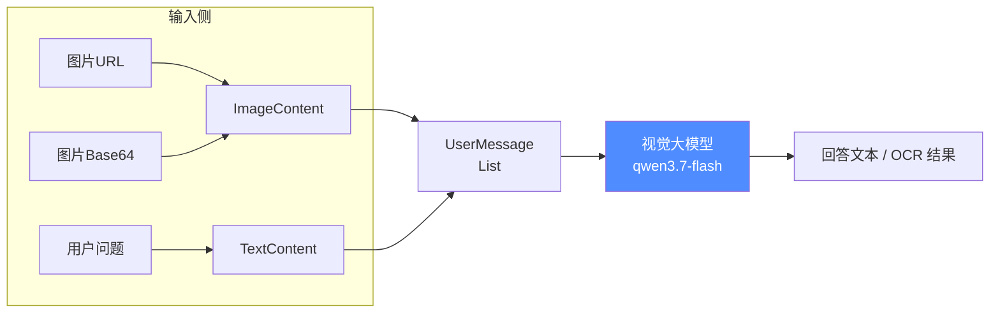
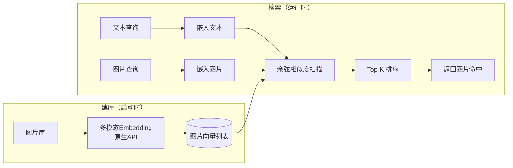

# Ch09 多模态与图像模型——让 AI「看得见」

> 本章目标：
> 1. 理解多模态能力：从纯文本 AI 跨入「看得见」的 AI
> 2. 掌握 LangChain4j 多模态消息体系：`UserMessage` + `Content`（TextContent / ImageContent / AudioContent / VideoContent / PdfFileContent）
> 3. 掌握图片输入的两种方式：公网 URL 与 Base64
> 4. 图文问答实战：用 qwen3.7-flash（原生支持图像/视频输入）做图像理解与 OCR
> 5. 掌握多模态 Embedding 原理：为什么 tongyi-embedding-vision 不走 OpenAI 兼容，必须走 DashScope 原生 API
> 6. 跨模态检索实战：文本搜图 / 图搜图（零新增依赖，Java 21 HttpClient 手动调用原生 API）
> 7. 把 smart-doc-assistant 升级到 v0.7：图像分析端点 + 多模态语义搜索端点

---

## 9.1 为什么需要多模态：AI 的「眼睛」

### 9.1.1 纯文本模型的困局

你一直在用的 DeepSeek 是**纯文本模型**——它只能「读字」，不能「看图」。官方 models.json 里写得直白：输入模态只有 `text`。扔一张 UI 截图、一张发票、一张商品图过去，它只能干瞪眼。

但真实业务里，信息大多是**非文本**的：

```
用户上传一张发票照片  → 要提取金额、税号、开票方
一张 App 界面截图     → 要理解这个页面能干什么
一张商品图            → 要识别商品并生成卖点文案
一段手机视频          → 要总结内容要点
```

这些场景都需要模型「长出一双眼睛」——这就是**多模态（Multimodal）**。

### 9.1.2 多模态的三种能力

| 能力 | 说明 | 本章位置 |
|---|---|---|
| **多模态理解** | 图片/视频/音频 → 文本（看图说话、OCR、视频摘要） | 9.2~9.4 |
| **多模态生成** | 文本 → 图片/音频（文生图、TTS，如 Wanx 万相） | 提一下，不做主战场 |
| **多模态检索** | 文本与图片映射到同一语义空间，跨模态相似度检索 | 9.5~9.6 |

> 💡 一句话理解：**理解**是「把图片翻译成文字」，**检索**是「把图片和文字都变成向量再比远近」。前者靠视觉大模型，后者靠多模态 Embedding 模型。

### 9.1.3 你的场景：混合架构

你在生产里主推 DeepSeek（推理强、便宜），但 DeepSeek 看不了图。最务实的方案不是等它出多模态版本，而是**外挂一个视觉模型专职识图**：

```
主推理：DeepSeek（负责逻辑、文案、决策）
识图翻译：qwen3.7-flash（负责把图片翻译成文字描述，喂给主模型）
```

这就是「主模型 + 视觉外挂」的分工架构，成本极低——识一张图约 0.02 元。

---

## 9.2 LangChain4j 多模态消息模型

### 9.2.1 UserMessage 不再是纯文本：Content 体系

在 LangChain4j 里，`UserMessage` 不再只是一个 `String`。它内部是 `List<Content> contents`，而 `Content` 是一个接口，有一组实现：

| Content 实现 | 对应模态 | 典型用法 |
|---|---|---|
| `TextContent` | 文本 | `TextContent.from("描述这张图")` |
| `ImageContent` | 图片 | `ImageContent.from(url)` 或 `ImageContent.from(base64, "image/png")` |
| `AudioContent` | 音频 | 语音理解 |
| `VideoContent` | 视频 | 视频理解 |
| `PdfFileContent` | PDF 文件 | 文档理解 |

也就是说，`UserMessage` 可以**同时携带文本 + 图片**，像拼积木一样组合：

```java
UserMessage message = UserMessage.from(
        TextContent.from("这张图里有什么？"),   // 文本
        ImageContent.from("https://example.com/cat.jpg")  // 图片
);
ChatResponse response = model.chat(message);
```

**这打破了纯文本的边界**——从此你的应用可以「发一张图 + 一个问题」给模型。

### 9.2.2 图片的两种打开方式

图片进模型有两种姿势，对应不同来源：

```java
// 方式一：公网 URL（适合图床 / OSS / 第三方图片链接）
// 注意：模型服务端要能访问到这个 URL，内网/私有地址不行
ImageContent.from("https://dashscope.oss-cn-beijing.aliyuncs.com/images/dog_and_girl.jpeg");

// 方式二：Base64 数据（适合用户本地上传 / 二进制流）
// 第一个参数是 base64 字符串，第二个参数是 MIME 类型
byte[] bytes = Files.readAllBytes(Path.of("/tmp/photo.png"));
String base64 = Base64.getEncoder().encodeToString(bytes);
ImageContent.from(base64, "image/png");
```

> ⚠️ **坑点**：`ImageContent.from(url)` 要求图片**公网可访问**。用户本地文件的路径（`/Users/xxx/a.png`）模型端根本访问不到——必须转成 Base64 或先上传到图床/OSS。

### 9.2.3 多模态消息流转（Mermaid）



---

## 9.3 图文问答实战：qwen3.7-flash 看图（v0.7）

### 9.3.1 为什么选 qwen3.7-flash

你测试平台是阿里百炼，指定了 `qwen3.7-flash-2026-07-15`。一个关键事实：[阿里云官方模型页](https://help.aliyun.com/en/model-studio/qwen3-7-flash) 明确 qwen3.7-flash 的 **Input Modality = Image / Text / Video**，Output = Text——**它本身就是原生视觉语言模型**，既能当对话模型，也能看图，不需要再单独引入 qwen-vl 系列。

| 维度 | qwen3.7-flash（轻量低成本档） |
|---|---|
| 输入模态 | 图像 / 文本 / 视频 |
| 上下文 | 100 万 token |
| 价格 | 输入 ¥0.2~1.2 / 百万 token，输出 ¥0.8~4.8 / 百万 token |
| 单图上限 | 最高 1600 万像素 |
| 场景 | OCR、图文问答、视频摘要、轻量视觉理解 |

> 💡 百炼视觉模型分档：**qwen3.8-max**（高能力）/ **qwen3.7-plus**（平衡，旗舰）/ **qwen3.7-flash**（轻量低成本）。教程用 flash 覆盖你的测试需求；生产要更强视觉可换 plus/max，配置只改一个模型名。

### 9.3.2 视觉模型配置：VisionModelConfig

关键设计：qwen3.7-flash 走的是百炼 **OpenAI 兼容接口**（`compatible-mode/v1`），所以直接用已有的 `langchain4j-open-ai-starter` + `OpenAiChatModel`，**零新增依赖**。

但要注意：项目默认聊天模型是 DeepSeek（纯文本）。所以单独注册一个 `visionChatModel` Bean，用 `@Qualifier` 显式注入，互不干扰：

```java
// config/VisionModelConfig.java
package com.example.assistant.config;

import dev.langchain4j.model.chat.ChatLanguageModel;
import dev.langchain4j.model.openai.OpenAiChatModel;
import org.springframework.beans.factory.annotation.Value;
import org.springframework.context.annotation.Bean;
import org.springframework.context.annotation.Configuration;

/**
 * Ch09：视觉对话模型配置。
 * qwen3.7-flash 原生支持图像/视频/文本输入，走百炼 OpenAI 兼容接口，零新增依赖。
 */
@Configuration
public class VisionModelConfig {

    @Value("${chat.multimodal.chat-model.api-key}")
    private String apiKey;

    @Value("${chat.multimodal.chat-model.base-url}")
    private String baseUrl;

    @Value("${chat.multimodal.chat-model.model-name}")
    private String modelName;

    @Bean("visionChatModel")
    public ChatLanguageModel visionChatModel() {
        return OpenAiChatModel.builder()
                .apiKey(apiKey)
                .baseUrl(baseUrl)
                .modelName(modelName)
                .temperature(0.2)   // 图像描述/OCR 要客观准确，温度压到 0.2
                .maxTokens(1024)
                .build();
    }
}
```

配置项（`application.yml`）：

```yaml
langchain4j:
  open-ai:
    chat-model:            # ← 默认模型仍是 DeepSeek，不动
      api-key: ${DEEPSEEK_API_KEY:sk-replace-me}
      model-name: deepseek-chat
      base-url: https://api.deepseek.com/v1

chat:
  multimodal:
    chat-model:            # ← Ch09 新增：视觉模型
      api-key: ${DASHSCOPE_API_KEY:}
      base-url: https://dashscope.aliyuncs.com/compatible-mode/v1
      model-name: ${CHAT_MULTIMODAL_MODEL:qwen3.7-flash}
```

### 9.3.3 图像理解服务：VisionAnalysisService

```java
// service/VisionAnalysisService.java
package com.example.assistant.service;

import dev.langchain4j.data.message.ImageContent;
import dev.langchain4j.data.message.TextContent;
import dev.langchain4j.data.message.UserMessage;
import dev.langchain4j.model.chat.ChatLanguageModel;
import org.springframework.beans.factory.annotation.Qualifier;
import org.springframework.stereotype.Service;

@Service
public class VisionAnalysisService {

    private final ChatLanguageModel visionModel;

    public VisionAnalysisService(@Qualifier("visionChatModel") ChatLanguageModel visionModel) {
        this.visionModel = visionModel;
    }

    /** 通用图片问答：传图片 URL + 问题，返回模型回答 */
    public String analyzeByUrl(String imageUrl, String question) {
        String prompt = question == null || question.isBlank()
                ? "请详细描述这张图片的内容，包括其中的主体、文字、颜色和布局。"
                : question;
        UserMessage message = UserMessage.from(
                ImageContent.from(imageUrl),   // 方式一：公网 URL
                TextContent.from(prompt)
        );
        return visionModel.chat(message).aiMessage().text();
    }

    /** 通用图片问答：传 Base64 图片数据 + MIME 类型 + 问题 */
    public String analyzeByBase64(String base64Data, String mimeType, String question) {
        String prompt = question == null || question.isBlank()
                ? "请详细描述这张图片的内容，包括其中的主体、文字、颜色和布局。"
                : question;
        UserMessage message = UserMessage.from(
                ImageContent.from(base64Data, mimeType),  // 方式二：Base64
                TextContent.from(prompt)
        );
        return visionModel.chat(message).aiMessage().text();
    }
}
```

### 9.3.4 图像理解端点：VisionController

```java
// controller/VisionController.java
package com.example.assistant.controller;

import com.example.assistant.service.VisionAnalysisService;
import lombok.RequiredArgsConstructor;
import org.springframework.web.bind.annotation.PostMapping;
import org.springframework.web.bind.annotation.RequestBody;
import org.springframework.web.bind.annotation.RestController;

import java.util.Map;

@RestController
@RequiredArgsConstructor
public class VisionController {

    private final VisionAnalysisService visionAnalysisService;

    @PostMapping("/api/vision/analyze")
    public Map<String, Object> analyze(@RequestBody VisionRequest req) {
        String answer;
        if (req.imageUrl() != null && !req.imageUrl().isBlank()) {
            answer = visionAnalysisService.analyzeByUrl(req.imageUrl(), req.question());
        } else if (req.imageBase64() != null && !req.imageBase64().isBlank()) {
            answer = visionAnalysisService.analyzeByBase64(
                    req.imageBase64(),
                    req.mimeType() == null ? "image/png" : req.mimeType(),
                    req.question());
        } else {
            return Map.of("success", false, "error", "imageUrl 与 imageBase64 至少提供一个");
        }
        return Map.of("success", true, "answer", answer);
    }

    public record VisionRequest(String imageUrl, String imageBase64, String mimeType, String question) {}
}
```

### 9.3.5 实测

```bash
export DASHSCOPE_API_KEY=sk-xxx
mvn spring-boot:run

# ① URL 传图：看图说话
curl -X POST http://localhost:8090/api/vision/analyze \
  -H "Content-Type: application/json" \
  -d '{"imageUrl":"https://help-static-aliyun-doc.aliyuncs.com/file-manage-files/zh-CN/20241022/emyrja/dog_and_girl.jpeg","question":"描述这张图片"}'

# ② URL 传图：提取图中文字（OCR 场景）
curl -X POST http://localhost:8090/api/vision/analyze \
  -H "Content-Type: application/json" \
  -d '{"imageUrl":"https://dashscope.oss-cn-beijing.aliyuncs.com/images/256_1.png","question":"把图片里所有文字原样念出来"}'
```

> ⚠️ **坑点——图片 Token 计费公式**：百炼按图片像素计 token，公式为 `h × w / (32 × 32) + 2`。一张 1024×768 的图 ≈ 768 个 token。传图虽便宜，但批量处理大量高清图时，token 会累积，记得按需压缩分辨率（建议压缩到 512~1024px 宽，视觉任务通常够用）。

---

## 9.4 OCR 与文档理解

### 9.4.1 两种思路

| 方案 | 模型 | 适合场景 | 说明 |
|---|---|---|---|
| **通用图文问答** | qwen3.7-flash / qwen3.7-plus | 截图理解、商品识别、UI 分析 | 既能认字也能理解语义 |
| **专用 OCR** | qwen-vl-ocr | 发票、合同、扫描件等纯文字提取 | 专攻文字识别，对版式、倾斜、手写更稳 |

百炼 OpenAI 兼容模式支持 `qwen-vl-ocr`，用法和视觉模型完全一致，只改模型名：

```yaml
chat:
  multimodal:
    chat-model:
      model-name: qwen-vl-ocr   # 换成专用 OCR 模型
```

### 9.4.2 实战场景：UI 截图分析

```
用户问：这张支付页面能做什么？
模型答：这是一个支付确认界面，用户可以输入金额、备注，点击确认按钮完成支付。
```

这本质就是「图片理解 + 语义归纳」，通用视觉模型就能做。而发票数字、税号这类**精确文本**提取，用 `qwen-vl-ocr` 更稳。

> **最佳实践**：一句话——**要理解用通用模型，要精确抠字用专用 OCR**。两个都只需要改 model-name，同一套代码。

---

## 9.5 多模态 Embedding：tongyi-embedding-vision 原生 API

### 9.5.1 为什么不能走 OpenAI 兼容接口

Ch08 我们用百炼 OpenAI 兼容接口接 text-embedding-v4 很顺。但**多模态向量（tongyi-embedding-vision 系列）是例外**：

> 官方文档明确：*To generate independent multimodal vectors, use the DashScope SDK or call the API directly. This feature is unavailable through the OpenAI compatible API or in the console.*（生成独立多模态向量只能走 DashScope SDK 或直接调 API，OpenAI 兼容接口和控制台都不可用。）

原因很实在：OpenAI 兼容接口只定义了 `text` 一种输入类型，没有 `image` / `video` / `multi_images` 的规范——多模态输入格式是 DashScope 独有的。所以必须走原生 API：

```
POST {base-url}/api/v1/services/embeddings/multimodal-embedding/multimodal-embedding
```

### 9.5.2 请求格式：独立向量 vs 融合向量

`input.contents` 数组里每个元素是一个 content，有两种组织方式：

**① 独立向量**（每个 content 各出一个向量，type 区分 text / image）：

```json
{
  "model": "tongyi-embedding-vision-flash-2026-03-06",
  "input": {
    "contents": [
      { "text": "一只白猫坐在窗台" },
      { "image": "https://dashscope.oss-cn-beijing.aliyuncs.com/images/256_1.png" }
    ]
  },
  "parameters": { "dimension": 768 }
}
```

**② 融合向量**（text 和 image 放**同一个** content 对象，融合为 1 个向量，type=fused）：

```json
{
  "model": "tongyi-embedding-vision-flash-2026-03-06",
  "input": {
    "contents": [
      { "text": "白色运动鞋，轻便透气", "image": "https://xxx/shoes.jpg" }
    ]
  },
  "parameters": { "dimension": 768 }
}
```

> 融合向量适合「一张商品图 + 一段卖点文案」作为一个整体去检索；独立向量适合「文本搜图 / 图搜图」——把查询和候选分别向量化再比距离。本章实战用**独立向量**。

### 9.5.3 模型参数速查

| 参数 | tongyi-embedding-vision-flash-2026-03-06 |
|---|---|
| 向量维度 | **768**（默认）/ 512 / 256 / 128 / 64 |
| 文本长度限制 | 1024 token |
| 图片大小 | 建议 ≤5MB，最大 10MB，单次最多 64 张 |
| 图片输入 | 公网 URL 或 `data:image/png;base64,...` |
| 视频输入 | URL（H.264/H.265，≤50MB） |
| 计费 | 百炼免费额度可覆盖测试 |

---

## 9.6 跨模态检索实战：MultimodalEmbeddingClient（v0.7）

### 9.6.1 零依赖的 HTTP 客户端

原生 API 有官方 Java SDK（`com.alibaba:dashscope-sdk-java`），但为了你的轻量化偏好，我们用 **Java 21 自带 HttpClient + Spring 自带 Jackson**，零新增依赖手动调。

```java
// service/MultimodalEmbeddingClient.java（核心片段）
package com.example.assistant.service;

import com.fasterxml.jackson.databind.JsonNode;
import com.fasterxml.jackson.databind.ObjectMapper;
import lombok.extern.slf4j.Slf4j;
import org.springframework.beans.factory.annotation.Value;
import org.springframework.stereotype.Component;

import java.net.URI;
import java.net.http.HttpClient;
import java.net.http.HttpRequest;
import java.net.http.HttpResponse;
import java.util.ArrayList;
import java.util.LinkedHashMap;
import java.util.List;
import java.util.Map;

@Slf4j
@Component
public class MultimodalEmbeddingClient {

    private static final String ENDPOINT_PATH =
            "/api/v1/services/embeddings/multimodal-embedding/multimodal-embedding";

    private final HttpClient httpClient = HttpClient.newHttpClient();
    private final ObjectMapper objectMapper = new ObjectMapper();

    @Value("${chat.multimodal.embedding.api-key}")
    private String apiKey;

    @Value("${chat.multimodal.embedding.base-url}")
    private String baseUrl;

    @Value("${chat.multimodal.embedding.model-name}")
    private String modelName;

    @Value("${chat.multimodal.embedding.dimension:768}")
    private int dimension;

    /** 文本 → 向量（独立向量，type=text） */
    public float[] embedText(String text) {
        return embedSingle(Map.of("text", text));
    }

    /** 图片 → 向量（独立向量，type=image） */
    public float[] embedImage(String imageUrlOrDataUri) {
        return embedSingle(Map.of("image", imageUrlOrDataUri));
    }

    /** 文本 + 图片 融合 → 单个向量（type=fused） */
    public float[] embedFused(String text, String imageUrl) {
        Map<String, String> fused = new LinkedHashMap<>();
        fused.put("text", text);
        fused.put("image", imageUrl);
        return embedSingle(fused);
    }

    /** 最底层封装：批量嵌入，每个 content 返回一个向量（按顺序一一对应） */
    public List<float[]> embed(List<Map<String, String>> contents) {
        try {
            Map<String, Object> body = new LinkedHashMap<>();
            body.put("model", modelName);
            body.put("input", Map.of("contents", contents));
            body.put("parameters", Map.of("dimension", dimension));

            HttpRequest request = HttpRequest.newBuilder()
                    .uri(URI.create(baseUrl + ENDPOINT_PATH))
                    .header("Authorization", "Bearer " + apiKey)
                    .header("Content-Type", "application/json")
                    .POST(HttpRequest.BodyPublishers.ofString(objectMapper.writeValueAsString(body)))
                    .build();

            HttpResponse<String> response = httpClient.send(
                    request, HttpResponse.BodyHandlers.ofString());

            if (response.statusCode() != 200) {
                throw new RuntimeException(
                        "多模态 Embedding 调用失败：HTTP " + response.statusCode()
                                + "，响应：" + response.body());
            }

            JsonNode root = objectMapper.readTree(response.body());
            JsonNode embeddings = root.path("output").path("embeddings");

            List<float[]> result = new ArrayList<>();
            for (JsonNode node : embeddings) {
                float[] vector = objectMapper.convertValue(node.get("embedding"), float[].class);
                result.add(vector);
            }
            return result;
        } catch (Exception e) {
            throw new RuntimeException("多模态 Embedding 请求异常：" + e.getMessage(), e);
        }
    }

    private float[] embedSingle(Map<String, String> content) {
        List<float[]> all = embed(List.of(content));
        return all.isEmpty() ? new float[0] : all.get(0);
    }

    public int dimension() {
        return dimension;
    }
}
```

> **为什么手动 HTTP 而不是官方 SDK？** 官方 `dashscope-sdk-java` 会引入一堆传递依赖（OkHttp / RxJava / Gson / Lombok 等），违背你「轻量零依赖」的偏好。而这里只需要一个 POST + 一个 JSON 解析，Java 21 原生能力足够。

### 9.6.2 跨模态检索服务：MultimodalSearchService

核心思路一句话：**图片和文本被映射到同一个语义空间，直接算余弦相似度**。文本搜图 = 文本向量去撞图片向量库；图搜图 = 新图片向量去撞图片向量库。

```java
// service/MultimodalSearchService.java（核心片段）
package com.example.assistant.service;

import lombok.extern.slf4j.Slf4j;
import org.springframework.boot.ApplicationArguments;
import org.springframework.boot.ApplicationRunner;
import org.springframework.stereotype.Service;

import java.util.ArrayList;
import java.util.Comparator;
import java.util.List;

@Slf4j
@Service
public class MultimodalSearchService implements ApplicationRunner {

    private final MultimodalEmbeddingClient embeddingClient;

    /** 预置图片库：公网可访问的示例图 + 文字描述（模拟商品图库/素材库） */
    private static final List<ImageDoc> IMAGE_LIBRARY = List.of(
            new ImageDoc("img-001",
                    "https://help-static-aliyun-doc.aliyuncs.com/file-manage-files/zh-CN/20241022/emyrja/dog_and_girl.jpeg",
                    "一个小女孩和一只白色小狗在户外草地上"),
            new ImageDoc("img-002",
                    "https://dashscope.oss-cn-beijing.aliyuncs.com/images/256_1.png",
                    "一只白猫坐在室内窗台上"),
            new ImageDoc("img-003",
                    "https://dashscope.oss-cn-beijing.aliyuncs.com/images/tiger.png",
                    "一只老虎的图片"),
            new ImageDoc("img-004",
                    "https://img.alicdn.com/imgextra/i3/O1CN01rdstgY1uiZWt8gqSL_!!6000000006071-0-tps-1970-356.jpg",
                    "一双白色运动鞋，轻便透气，适合跑步日常穿着")
    );

    private final List<float[]> imageVectors = new ArrayList<>();

    public MultimodalSearchService(MultimodalEmbeddingClient embeddingClient) {
        this.embeddingClient = embeddingClient;
    }

    /** 启动时：把预置图片库全部嵌入（一次性建库） */
    @Override
    public void run(ApplicationArguments args) {
        for (ImageDoc doc : IMAGE_LIBRARY) {
            float[] vector = embeddingClient.embedImage(doc.imageUrl());
            imageVectors.add(vector);
        }
        log.info("已索引 {} 张图片到多模态向量库（embedding 维度={}）",
                IMAGE_LIBRARY.size(), embeddingClient.dimension());
    }

    /** 文本搜图 */
    public List<ImageHit> searchByText(String text, int topK) {
        return rank(embeddingClient.embedText(text), topK);
    }

    /** 图搜图 */
    public List<ImageHit> searchByImage(String imageUrl, int topK) {
        return rank(embeddingClient.embedImage(imageUrl), topK);
    }

    /** 余弦相似度暴力扫描（数据量小时够用，生产应换 pgvector / ES） */
    private List<ImageHit> rank(float[] query, int topK) {
        List<ImageHit> hits = new ArrayList<>();
        for (int i = 0; i < IMAGE_LIBRARY.size(); i++) {
            double score = cosineSimilarity(query, imageVectors.get(i));
            ImageDoc doc = IMAGE_LIBRARY.get(i);
            hits.add(new ImageHit(score, doc.id(), doc.imageUrl(), doc.description()));
        }
        hits.sort(Comparator.comparingDouble(ImageHit::score).reversed());
        return hits.stream().limit(topK).toList();
    }

    /** 余弦相似度：值域 [-1, 1]，越大越相似 */
    static double cosineSimilarity(float[] a, float[] b) {
        if (a.length != b.length) {
            throw new IllegalArgumentException("向量维度不一致：" + a.length + " vs " + b.length);
        }
        double dot = 0, normA = 0, normB = 0;
        for (int i = 0; i < a.length; i++) {
            dot += a[i] * b[i];
            normA += a[i] * a[i];
            normB += b[i] * b[i];
        }
        if (normA == 0 || normB == 0) return 0;
        return dot / (Math.sqrt(normA) * Math.sqrt(normB));
    }

    public record ImageDoc(String id, String imageUrl, String description) {}
    public record ImageHit(double score, String id, String imageUrl, String description) {}
}
```

### 9.6.3 端点 + Mermaid 流程

```java
// controller/MultimodalSearchController.java
package com.example.assistant.controller;

import com.example.assistant.service.MultimodalSearchService;
import com.example.assistant.service.MultimodalSearchService.ImageHit;
import lombok.RequiredArgsConstructor;
import org.springframework.web.bind.annotation.PostMapping;
import org.springframework.web.bind.annotation.RequestBody;
import org.springframework.web.bind.annotation.RestController;

import java.util.List;
import java.util.Map;

@RestController
@RequiredArgsConstructor
public class MultimodalSearchController {

    private final MultimodalSearchService multimodalSearchService;

    @PostMapping("/api/search/multimodal")
    public Map<String, Object> multimodalSearch(@RequestBody MultimodalSearchRequest req) {
        int topK = req.topK() == null ? 3 : req.topK();
        List<ImageHit> hits;
        String mode = req.mode() == null ? "text" : req.mode();

        if ("image".equals(mode)) {
            if (req.imageUrl() == null || req.imageUrl().isBlank()) {
                return Map.of("success", false, "error", "mode=image 时 imageUrl 必填");
            }
            hits = multimodalSearchService.searchByImage(req.imageUrl(), topK);
        } else {
            if (req.query() == null || req.query().isBlank()) {
                return Map.of("success", false, "error", "mode=text 时 query 必填");
            }
            hits = multimodalSearchService.searchByText(req.query(), topK);
        }
        return Map.of("success", true, "mode", mode, "hits", hits);
    }

    public record MultimodalSearchRequest(String mode, String query, String imageUrl, Integer topK) {}
}
```



### 9.6.4 实测

```bash
export DASHSCOPE_API_KEY=sk-xxx
mvn spring-boot:run
# 启动日志: 已索引 4 张图片到多模态向量库（embedding 维度=768）

# ① 文本搜图：用一句话找图片
curl -X POST http://localhost:8090/api/search/multimodal \
  -H "Content-Type: application/json" \
  -d '{"mode":"text","query":"一只猫","topK":3}'
# 期望：img-002（白猫）/ img-003（老虎）排前面

# ② 图搜图：用一张图找相似图
curl -X POST http://localhost:8090/api/search/multimodal \
  -H "Content-Type: application/json" \
  -d '{"mode":"image","imageUrl":"https://dashscope.oss-cn-beijing.aliyuncs.com/images/256_1.png","topK":3}'
```

---

## 9.7 最佳实践与避坑

### 坑点汇总

| # | 坑点 | 对策 |
|---|---|---|
| 1 | 图片 URL 必须是**公网可访问** | 用户本地上传 → 转 Base64 或先传 OSS/图床 |
| 2 | Base64 图片**不能太大**（建议 ≤5MB/张） | 上传前压缩；Controller 层做大小校验 |
| 3 | 多模态 Embedding **不支持 OpenAI 兼容** | 必须走 DashScope 原生端点（本章 9.5/9.6） |
| 4 | 切换向量模型/维度后**向量库必须重建** | 不同维度向量无法互相比较 |
| 5 | 图片按像素计 token（`h×w/1024+2`） | 批量处理前先压缩分辨率，控制成本 |
| 6 | 视觉任务 temperature 要低 | 描述/OCR 压到 0.2，避免模型自由发挥 |

### 最佳实践

1. **混合架构**：DeepSeek 管推理、qwen3.7-flash 管看图，各取所长、成本最低。
2. **模型按任务分档**：理解用 flash、旗舰视觉用 plus/max、纯文字提取用 qwen-vl-ocr——只改 model-name，同一套代码。
3. **图片入库前先归一化**：压缩到统一尺寸（如最长边 1024），既省 token 又稳。
4. **多模态向量小规模先用内存暴力扫描**，图片库超过几万张再上 pgvector / ES（对齐 Ch11）。

### Spring AI 对比

| 能力 | LangChain4j | Spring AI |
|---|---|---|
| 图片消息 | `UserMessage.from(ImageContent, TextContent)` | `MessageBuilder` + `UserMessage` 含 media 数组 |
| 图片来源 | URL / Base64 统一 `ImageContent` | URL / Base64，结构类似 |
| 多模态 Embedding | 无官方实现，需手动原生 API（本章） | 需引 spring-ai-alibaba-dashscope 扩展 |
| 通用性 | 核心接口统一，任何兼容模型可换 | 绑定 Spring AI 生态 |

> 结论：图片**理解**两边都容易；但**多模态向量检索**这条路，LangChain4j 生态目前没有现成封装，手写原生 API 调用（本章方案）反而是最透明、最可控的。

---

## 9.8 小结与项目代码状态

### 9.8.1 本章核心收获

| 概念 | 一句话 |
|---|---|
| **多模态** | 让 AI 处理图片/视频/音频，三大能力：理解 / 生成 / 检索 |
| **Content 体系** | `UserMessage` = 多个 Content 的组合，图片用 `ImageContent` |
| **两种传图** | 公网 URL（`ImageContent.from(url)`）或 Base64（`ImageContent.from(data, mime)`） |
| **qwen3.7-flash** | 百炼视觉模型，原生支持图像/视频输入，既能对话也能看图 |
| **视觉模型选择** | 理解用 flash/plus，精确抠字用 qwen-vl-ocr，只改 model-name |
| **多模态 Embedding** | tongyi-embedding-vision 不走 OpenAI 兼容，必须走 DashScope 原生 API |
| **跨模态检索** | 文本/图片映射到同一语义空间 → 余弦相似度 → 文本搜图/图搜图 |
| **零依赖调用** | Java 21 HttpClient + Jackson 手动调原生端点，不引官方 SDK |

### 9.8.2 smart-doc-assistant v0.7 项目代码状态

| 模块 | 文件 | 说明 |
|---|---|---|
| 配置 | `config/VisionModelConfig.java` | 新增 qwen3.7-flash 视觉模型 Bean（OpenAI 兼容） |
| 服务 | `service/VisionAnalysisService.java` | 新增 图像理解（URL / Base64 双模式） |
| 控制器 | `controller/VisionController.java` | 新增 POST /api/vision/analyze |
| 服务 | `service/MultimodalEmbeddingClient.java` | 新增 DashScope 原生多模态 Embedding 客户端（零依赖） |
| 服务 | `service/MultimodalSearchService.java` | 新增 跨模态检索（启动建库 + 文本搜图/图搜图） |
| 控制器 | `controller/MultimodalSearchController.java` | 新增 POST /api/search/multimodal |
| 配置 | `application.yml` | + `chat.multimodal.*` 配置块 |
| 依赖 | `pom.xml` | 版本 v0.6→v0.7，**零新增依赖** |

**运行方式**：

```bash
cd smart-doc-assistant
export DASHSCOPE_API_KEY=sk-xxx
mvn spring-boot:run

# 图像理解
curl -X POST http://localhost:8090/api/vision/analyze \
  -H "Content-Type: application/json" \
  -d '{"imageUrl":"https://dashscope.oss-cn-beijing.aliyuncs.com/images/256_1.png","question":"描述这张图片"}'

# 文本搜图
curl -X POST http://localhost:8090/api/search/multimodal \
  -H "Content-Type: application/json" \
  -d '{"mode":"text","query":"一只猫","topK":3}'

# 图搜图
curl -X POST http://localhost:8090/api/search/multimodal \
  -H "Content-Type: application/json" \
  -d '{"mode":"image","imageUrl":"https://dashscope.oss-cn-beijing.aliyuncs.com/images/256_1.png","topK":3}'
```

---

**下一章预告：Ch10 文档处理流水线**——进入 RAG 检索增强生成深度实战。这一章讲如何把 PDF / Word / 网页 / 数据库内容清洗、分块（Chunking）、变成可检索的文档库，为 Ch11 的向量存储与检索打地基。
