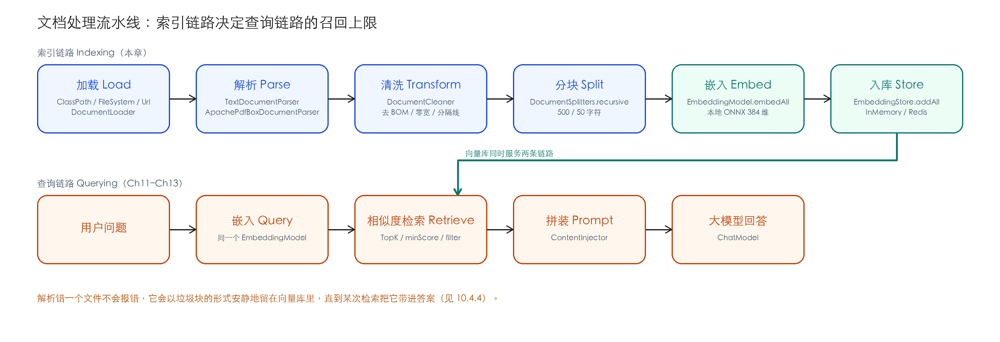
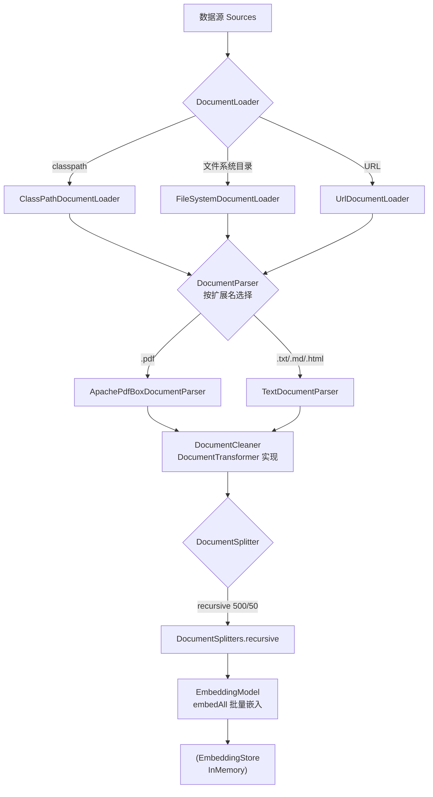
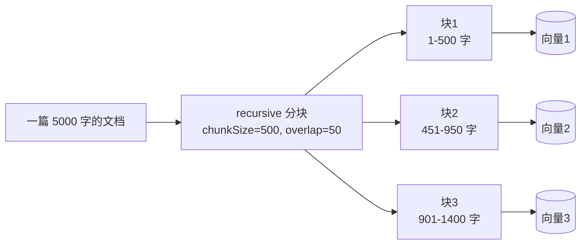
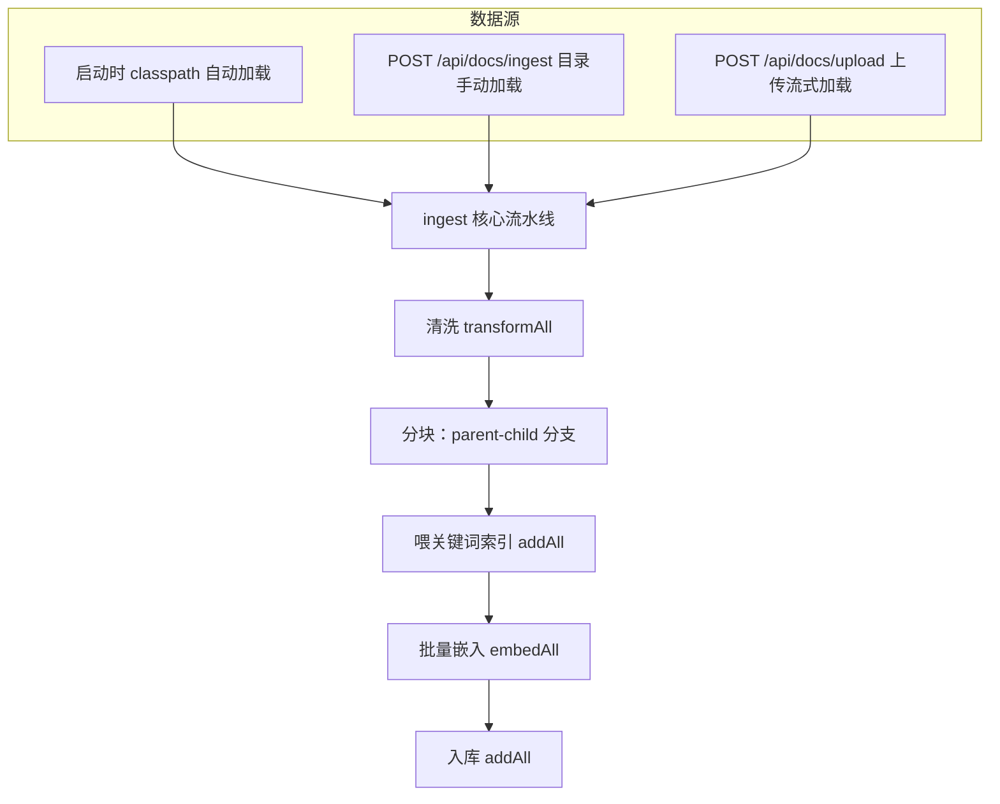

# Ch10 文档处理流水线——RAG 的「第一公里」

> **本章基线**：项目 `smart-doc-assistant` ｜ 端口 `8090` ｜ LangChain4j `1.22.0` + 实验模块 `1.22.0-beta32` ｜ JDK `21` ｜ 最后验证 `2026-10-28`（扁平分块与父子分块两种模式均实跑）

> 本章目标：
> 1. 理解为什么 RAG 应用必须有一条「文档处理流水线」：从原始文件到可检索块的标准化通道
> 2. 掌握文档处理的四大抽象：`Document` / `DocumentLoader` / `DocumentParser` / `DocumentTransformer` / `DocumentSplitter`
> 3. 掌握三种加载方式：classpath（随 jar 打包）/ 文件系统目录 / URL，以及按扩展名自动选解析器
> 4. 掌握分块（Chunking）策略：7 种内置 Splitter、recursive 的逐级降级切割、chunk-size / chunk-overlap 调优
> 5. 读懂仓库里的 `DocumentIngestionService`：三种数据源汇聚到同一条 `ingest()` 主干
> 6. 亲手复现一个真实踩到的坑：classpath 启动把 PDF 当纯文本啃进向量库——并知道怎么修
> 7. 记录一次真实的 P0 工程修复：`langchain4j-redis` 停更，迁移到 `langchain4j-community-redis`

---

## 10.1 先想清楚：为什么 RAG 需要一条文档处理流水线

### 10.1.1 从 8 条硬编码说起

Ch08 搭第一个语义检索时，知识库是这么来的——在 `DocumentSearchService` 里硬编码 8 条 `Map.of`：

```java
private static final List<Map<String, String>> DOCUMENTS = List.of(
        Map.of("id", "faq-001", "category", "退换货",
                "content", "支持 7 天无理由退货，商品需保持完好，不影响二次销售。"),
        ...
);
```

这在教学上很直观——跳过所有前置步骤，直接演示「嵌入 → 检索」。但它等于假设：**知识天生就是一句一句切好的**。真实业务不会配合这个假设，知识库的需求往前走一步，你要补的东西就多一层：

| 知识库需求演进 | 你需要补的环节 | 复杂度 |
|---|---|---|
| 8 条写死的一句话（Ch08） | — | ⭐ |
| 一份 200 页的 PDF 产品手册 | 解析：字节 → 文本 | ⭐⭐ |
| 运维往服务器目录丢文件 | 加载器 + 按扩展名选解析器 | ⭐⭐⭐ |
| 客服现场上传一份 Word | 上传接口 + 流式解析 | ⭐⭐⭐ |
| 内容大改 / 换了 embedding 模型 | 清库重建策略 | ⭐⭐⭐⭐ |
| 文档持续增长 | 增量入库 + 评估（Ch13） | ⭐⭐⭐⭐⭐ |

把「原始文件」变成「可检索块」的这一段标准化通道，就是**文档处理流水线（Ingestion Pipeline）**。

### 10.1.2 原始文件为什么不能直接嵌入

无论来源是 PDF、Word 还是网页，原始文件都不能直接塞进向量库，原因有三：

1. **格式异构**：PDF/Word/网页的「字节 → 文本」各有各的格式，需要不同的解析器；
2. **噪声多**：BOM、零宽字符、页眉页脚、分隔线、多余空白会污染向量语义；
3. **体积超限**：一个大文档整体嵌入，向量是「全书平均」，任何查询跟它都不够近——必须先切成语义完整的「块」。

### 10.1.3 流水线在 RAG 中的位置

RAG 有两条链路，文档处理流水线属于**索引链路（Indexing Pipeline）**的前半段：



> 💡 **一句话理解**：索引链路的质量（解析是否完整、分块是否合理、元数据是否丰富）**直接决定**查询链路的召回上限。检索不到的东西，大模型再强也答不出来——这就是「第一公里」的含义。本章 10.4.4 会用一个真实事故演示这句话：一份解析错的 PDF 不会报错，它会安静地躺在向量库里污染检索。

### 10.1.4 LangChain4j 的四大抽象

LangChain4j 把索引链路的前半段抽象成四个接口 + 一个数据模型：

| 抽象 | 职责 | 输入 → 输出 |
|---|---|---|
| `Document` | 统一文档模型：文本 + 元数据 | 一切环节的载体 |
| `DocumentLoader` | 从数据源加载 | 文件/URL/classpath → `List<Document>` |
| `DocumentParser` | 字节 → 文本 | `InputStream` → `Document` |
| `DocumentTransformer` | 文本清洗/转换 | `Document` → `Document` |
| `DocumentSplitter` | 长文切块 | `Document` → `List<TextSegment>` |

> 💡 **Spring AI 对比**：Spring AI 的对应物是 `DocumentReader`（读取）、`DocumentTransformer`（清洗）与 `TokenTextSplitter`（分块）；LangChain4j 把「加载」和「解析」拆成两个接口，职责更细。两者最终都汇入同一个概念：**文档先切块，块再向量化**。

---

## 10.2 流水线全景：六个环节

完整的文档处理流水线有六个环节：



**六个环节各自的「为什么」**：

| 环节 | 解决什么问题 | 本章位置 | 对应的项目代码 |
|---|---|---|---|
| **加载 Load** | 文件从哪来：classpath / 目录 / 远程 URL | 10.3 | `ingestClasspathDocs` / `ingestFromDirectory` |
| **解析 Parse** | 字节怎么变成文本：PDF/Word/网页各说各话 | 10.4 | `parserFor` |
| **清洗 Transform** | 文本里的噪声怎么去掉：BOM/零宽/多余空白 | 10.5 | `DocumentCleaner` |
| **分块 Split** | 长文怎么切成语义完整的块 | 10.6 | `DocumentSplitters.recursive` |
| **嵌入 Embed** | 文本块怎么变成向量（复用 Ch08 的模型） | 10.7 | `embeddingModel.embedAll` |
| **入库 Store** | 向量存哪、元数据带什么（复用 Ch08 的存储） | 10.7 | `embeddingStore.addAll` |

> ✅ **最佳实践**：这六个环节应该**解耦成独立的类/方法**，每个环节可单独测试、单独替换。项目的 `DocumentIngestionService` 就是这么组织的：清洗器是独立 `DocumentCleaner`（实现 `DocumentTransformer`），解析器按扩展名动态选择，分块参数走配置——任何一个环节升级都不影响其他环节。

**先交代一个口径，避免读到后面困惑**：仓库当前代码的 `ingest()` 里有一个分块开关——`chat.rag.parent-child`，**默认开启，走的是 Ch12 的「父子分块」**；关掉它才是本章主线讲的扁平分块（`DocumentSplitters.recursive` 一层切到底）。两条路共用清洗 → 嵌入 → 入库主干，`ingest()` 里就是一个二选一分支。本章按扁平分块讲原理（Ch12 讲为什么父子分块更好），跑示例时加一个启动参数即可切到本章模式：

```bash
java -jar target/smart-doc-assistant-0.16.0-SNAPSHOT.jar --chat.rag.parent-child=false
```

两种模式各实测过一次（同样的 4 个示例文档，解析错配修复前）：扁平分块 **20 块**，父子分块 **26 块**。数字本身不重要，重要的是你知道它从哪个分支来——10.8 读代码时会看到这个分支。还有一层要先打预防针：那两个数字里都掺着一份被解析错的 PDF 产生的垃圾块；2026-10-28 修复落地后，启动路径直接给你干净的 **7 块 / 10 块**，10.4.4 会把这件事完整还原。

---

## 10.3 文档加载 DocumentLoader：三种来源

### 10.3.1 加载器总览

| 加载器 | 数据源 | 典型场景 |
|---|---|---|
| `ClassPathDocumentLoader` | classpath 资源目录 | 示例文档随 jar 打包，零路径配置 |
| `FileSystemDocumentLoader` | 服务器文件系统目录 | 生产环境：运维把文档丢进约定目录 |
| `UrlDocumentLoader` | 远程 URL | 抓取网页 / 远程 PDF |

三种加载器返回的都是 `List<Document>`——**调用方无感知**，这正是抽象的价值。

### 10.3.2 classpath：随 jar 打包的示例知识库

项目的示例文档放在 `smart-doc-assistant/src/main/resources/docs/`：

```
src/main/resources/docs/
├── product-faq.txt       # 客服 FAQ（纯文本，1.6 KB）
├── technical-guide.md    # 技术开发手册（Markdown，1.8 KB）
├── refund-policy.txt     # 退款政策（纯文本，1.4 KB）
└── report.pdf            # 智能咖啡机 K-3000 产品使用手册（PDF，5.2 KB，含中文；文件名叫 report，内容是产品手册）
```

启动时由 `DocumentIngestionService` 加载（`ingestClasspathDocs`，见 10.8.3）：

```java
List<Document> documents = ClassPathDocumentLoader.loadDocuments(docsClasspath, new TextDocumentParser());
```

- 第一个参数是 classpath 路径，来自配置 `chat.document-pipeline.docs-classpath`（默认 `docs`）；
- 第二个参数是解析器——**这里是统一传了 `TextDocumentParser`**，这个"统一"在 10.4.4 会变成一个实测抓到的坑，先记着；
- 目录随 jar 打包，部署后不需要额外拷贝文件——教学演示最友好。

### 10.3.3 文件系统：生产环境的标准做法

生产环境文档经常由运营/法务/客服手工维护，放服务器固定目录最省事：

```java
List<Document> documents;
try (var files = Files.list(Path.of(directoryPath))) {
    documents = files
            .filter(Files::isRegularFile)
            .map(path -> FileSystemDocumentLoader.loadDocument(
                    path, parserFor(path.getFileName().toString())))
            .toList();
}
```

注意这里的写法：**自己遍历目录、逐文件过 `parserFor` 选解析器**。这不是绕弯——1.19 起 `loadDocuments(Path, Function<String, DocumentParser>)` 这个"遍历时按文件名自动选解析器"的重载已被移除（1.22.0 用 `javap` 核过，确实没有），所以逐文件选择只能自己写。上面就是项目里 `ingestFromDirectory` 的真实实现，目录里混着 txt 和 pdf 也能各归其位。

> 💡 两个加载器在 1.22.0 里都有 `loadDocuments(dir, PathMatcher, DocumentParser)` 这一族重载（各 8 个 PathMatcher 变体，`javap` 核过），都**没有** `Function<String, DocumentParser>` 这种"逐文件按名选解析器"的重载。所以"按扩展名分拨"只有两种写法：PathMatcher 过滤后分两次加载（10.4.4 的修复配方用这个），或者像上面这样手工遍历、逐文件 `parserFor`。项目目录入口选了后者，两种都对。

### 10.3.4 URL：远程网页 / 远程文件

LangChain4j 同样支持直接加载远程资源（项目未用，生产可扩展）：

```java
Document doc = UrlDocumentLoader.load(
        new URL("https://example.com/product.html"), new TextDocumentParser());
```

> ⚠️ **坑点**：`UrlDocumentLoader` 加载的是**静态内容**。SPA 页面（Vue/React 渲染）返回的是空壳 HTML，解析出来全是脚本标签——这类场景需要无头浏览器渲染后再抓，超出 LangChain4j 范畴。

---

## 10.4 文档解析 DocumentParser：从字节到文本

### 10.4.1 解析器生态总览

`DocumentParser` 只有一个方法：`Document parse(InputStream inputStream)`——把字节流变成 `Document`。生态按格式划分：

| 解析器 | 格式 | 依赖 | 适用场景 |
|---|---|---|---|
| `TextDocumentParser` | txt / md / csv / json | 无（内置） | 纯文本与类纯文本 |
| `ApachePdfBoxDocumentParser` | PDF | `langchain4j-document-parser-apache-pdfbox` | 有文本层的 PDF |
| `ApachePoiDocumentParser` | Word/Excel/PPT | `langchain4j-document-parser-apache-poi` | Office 三件套 |
| `ApacheTikaDocumentParser` | 数十种格式 | `langchain4j-document-parser-apache-tika` | 格式杂、不想逐格式引依赖 |
| `MarkdownDocumentParser` | Markdown | `langchain4j-document-parser-markdown` | 需要保留 Markdown 结构（标题/列表） |
| `DoclingDocumentParser` | PDF/Word 等 | `langchain4j-document-parser-docling` | 复杂排版文档，结构化输出 |

> ✅ **最佳实践**：**按需引依赖，不要一上来就引 Tika**。Tika 一个依赖拖进几十个传递依赖，启动变慢、体积变大。项目里格式单一（就 txt/md/pdf）时，Text + PDFBox 足够；等格式真的杂了再加 Tika。

先看清 `TextDocumentParser` 的真身——它就是 1.22.0 源码里的这几行：

```java
public Document parse(InputStream inputStream) {
    String text = new String(inputStream.readAllBytes(), charset);  // UTF_8
    if (text.isBlank()) {
        throw new BlankDocumentException();
    }
    return Document.from(text);
}
```

**任何字节流都按 UTF-8 强转成字符串**，只有全空白才抛 `BlankDocumentException`。给它一份 PDF 二进制，它不会报错——会返回一份带乱码的"文本"。这个特性是 10.4.4 那个坑的根源。

### 10.4.2 按扩展名自动选择解析器

`DocumentIngestionService` 里的 `parserFor` 是本章的选型核心：

```java
/** 按文件扩展名选择解析器 */
private DocumentParser parserFor(String fileName) {
    String lower = fileName == null ? "" : fileName.toLowerCase();
    if (lower.endsWith(".pdf")) {
        return new ApachePdfBoxDocumentParser();
    }
    // txt / md / html / json 等纯文本格式
    return new TextDocumentParser();
}
```

- `.pdf` → PDFBox；其余 → 纯文本；
- 将来要支持 Word，只需加一个 `endsWith(".docx")` 分支返回 `ApachePoiDocumentParser`，**调用方零改动**；
- 解析器是无状态的，每次 new 一个即可，不用缓存。

但注意它在项目里的两个调用点：目录入库（`ingestFromDirectory`）和上传入库（`ingestUpload`）都过了 `parserFor`——**唯独 classpath 启动建库没有过**（10.8.3）。坑就埋在这。

### 10.4.3 PDF 解析与中文

示例文档 `report.pdf` 是 ReportLab 生成的**带文本层** PDF（中文字体 STSong-Light），内容是一份智能咖啡机的产品使用手册（开箱安装、操作步骤、保养——文件名里的 report 名不副实，这一点本章后面还会回头说）。PDFBox 解析直接提取文本层：

```java
Document document = parserFor(fileName).parse(file.getInputStream());
```

实测（2026-10-28，`/api/docs/upload` 上传这份文件，日志原文）：

```
上传文档 report.pdf 解析成功（801 字符）
 分块完成：1 个文档 → 2 个块（parent-child=false）
```

5.2 KB 的 PDF 提取出 801 字符的中文正文，切成 2 个干净块——这是"带文本层的 PDF"该有的样子。

> ⚠️ **坑点：扫描版 PDF 没有文本层**。PDFBox 只能提取「文本层」，扫描件本质是图片，解析出来是空字符串或乱码。处理扫描件需要 OCR（如 PaddleOCR / Tesseract），且要走图像流水线——这属于另一个技术栈，别指望 `ApachePdfBoxDocumentParser` 一键搞定。
>
> 验证办法：`pdfinfo` / 在 PDF 阅读器里试「选中文字」。能选中的有文本层，选不中的是扫描件。

### 10.4.4 实测事故还原：一个 PDF 的两种命运

这是本章最重要的一节，全部来自 2026-10-28 对仓库当前代码的真机实测。

**事故现场**：启动建库走的是 `ClassPathDocumentLoader.loadDocuments(docsClasspath, new TextDocumentParser())`——**统一**用纯文本解析器加载整个目录，包括其中的 `report.pdf`。于是这份 PDF 的字节被按 UTF-8 硬转成字符串，清洗、分块、嵌入，一路绿灯进了向量库。全程无任何报错。

把它捞出来看看真身（`/api/search/semantic`，query=`退款政策`，topK=20，minScore=0，返回 20 块中的一块）：

```
%PDF-1.4
%���� ReportLab Generated PDF document (opensource)
1 0 obj
<<
/F1 2 0 R /F2 3 0 R
>> endobj
```

这是 PDF 文件的**对象结构原文**（`%PDF-1.4` 魔数、`obj/endobj` 语法、字体声明），文件头第二行的 4 个非 UTF-8 字节变成了 4 个 U+FFFD 替换字符混在里面。其余的垃圾块长得更隐蔽——是 PDF 内部 ASCII85 编码的压缩流，像 `?[,;"@A1TV/#KJn"` 这样的可打印乱码，不含 U+FFFD，清洗器的任何一条规则都碰不到它们；用「退款多久能到账」去查，这类块排在第 6 到第 9 位，分数 0.60–0.61，刚好压在接口默认阈值 0.6 的上面。它对「退款政策」这个查询的相似度是 **0.5371**——如果 minScore 设 0.5，它已经够格混进检索结果了，只是被 topK 挡在了后面。检索到它的用户会看到什么？一段 PDF 语法。而大模型拿到这段语料，就会一本正经地把它编进答案。

**对照组**：同一个 `report.pdf`，走 `/api/docs/upload` 入口——先过 `parserFor` 选 PDFBox——提取出 801 字符干净正文（10.4.3 的实测日志）。再做一组更狠的对照：把同样这 4 个文件从**目录入口**重建一次（`POST /api/docs/ingest?dir=src/main/resources/docs&rebuild=true`，逐文件过 `parserFor`），库里只剩 **7 块**；而 classpath 启动建出来的是 **20 块**——多出来的 13 块，全是这一份 PDF 被当文本啃出来的垃圾，占了整个库的 65%。父子分块模式下同样的对照是 26 对 10。

| 入口 | 解析器 | 结果 |
|---|---|---|
| `/api/docs/upload` | PDFBox（`parserFor` 选的） | 801 字符中文正文 → 2 个干净块 |
| 目录 rebuild | 逐文件 `parserFor` | 4 个文件共 7 块（扁平模式），全部可读 |
| classpath 启动 | 统一 `TextDocumentParser` | 20 块，其中 13 块是 PDF 对象语法 + 乱码，静默入库 |

还有一个副作用值得记一笔：原来这一章把 `report.pdf` 描述成"季度经营报告"，而干净重建后一检索，它的真实内容是**智能咖啡机 K-3000 的产品使用手册**。文件名叫 report，没人打开看过里面是什么——因为启动路径从来没有把它正确解析出来过。一个解析错配，连带着让作者对自己示例数据的描述都错了小半年。

**关键理解：同一个文件，换一条入口进来就是垃圾。** 解析错配不会在任何一层报错——`TextDocumentParser` 照单全收、清洗器认为这是"正文"不动它、分块器照切、嵌入模型照算向量。它在向量库里安静地躺到某一天，某个查询的相似度刚好过了阈值，它就出现在用户的答案里。这类 bug 的可怕之处在于**日志全是绿的**。

**修复配方**（API 真实存在，1.22.0 `javap` 核实；glob 语义在 JDK 21 上验证过：`**.pdf` 对裸文件名、相对路径、绝对路径都匹配）：利用 `ClassPathDocumentLoader.loadDocuments(dir, PathMatcher, DocumentParser)` 重载，按扩展名分两拨加载——和目录入口的 `parserFor` 思路对齐：

```java
public synchronized void ingestClasspathDocs() {
    var fs = FileSystems.getDefault();
    List<Document> documents = new ArrayList<>();
    // PDF 走 PDFBox
    documents.addAll(ClassPathDocumentLoader.loadDocuments(
            docsClasspath, fs.getPathMatcher("glob:**.pdf"),
            new ApachePdfBoxDocumentParser()));
    // 纯文本走 Text
    documents.addAll(ClassPathDocumentLoader.loadDocuments(
            docsClasspath, fs.getPathMatcher("glob:**.{txt,md}"),
            new TextDocumentParser()));
    // ……后续与现状相同：判空、日志、ingest(documents)
}
```

这个坑在仓库里活了很久，2026-10-28 被写进 Ch13 的评估闭环当天就修掉了——上一段配方就是现在仓库里 `ingestClasspathDocs` 的真实代码。修坑之前，Ch13 先在含垃圾块的库上量过一轮基线（6 题集 MRR 0.694），修完用扩充到 11 题的 golden set 重测（MRR 0.652），两组数字怎么读、为什么不能直接比，Ch13 13.3.4 有完整记录。如果你手头是修复前的旧版本，自己动手照配方改一遍再重启，亲眼看看 20 块怎么变 7 块——**改了解析或分块，就要重建库、重跑评估**，这句话值得亲手过一遍。

---

## 10.5 文档清洗 DocumentTransformer

### 10.5.1 为什么解析出来的文本不能直接用

解析器只负责「字节 → 文本」，不负责「文本 → 干净文本」。实际解析结果里常有：

```
\uFEFF产品常见问题 FAQ        ← UTF-8 BOM
\r\n\r\n                       ← Windows 换行符
一、退换货政策                 ← 制表符缩进
----------------------         ← Markdown 分隔线（对语义无贡献）
                              ← 零宽空格/不间断空格
```

这些噪声不进向量库最好——它们会稀释语义、干扰相似度计算、浪费 token。清洗器（`DocumentTransformer`）就是干这个的。

### 10.5.2 DocumentCleaner 实战

以下是项目里的完整实现（`smart-doc-assistant/src/main/java/com/example/assistant/service/DocumentCleaner.java`，与仓库逐行一致）：

```java
@Component
public class DocumentCleaner implements DocumentTransformer {

    /** UTF-8 BOM */
    private static final Pattern BOM = Pattern.compile("^\uFEFF");

    /** 零宽字符（\u200B 零宽空格 / \u200C 零宽非连接符 / \u200D 零宽连接符 / \uFEFF） */
    private static final Pattern ZERO_WIDTH = Pattern.compile("[\\u200B\\u200C\\u200D\\uFEFF]");

    /** 纯分隔线行：------ 或 ==== 或 **** 等，长度 >= 5 */
    private static final Pattern SEPARATOR_LINE = Pattern.compile("^[\\-=\\*_\\s]{5,}$");

    /** 连续 3 个以上空白（含换行）压缩为单个换行 */
    private static final Pattern MULTI_BLANK = Pattern.compile("[ \\t]{3,}");

    /** 连续 2 个以上空行压缩为 1 个 */
    private static final Pattern MULTI_EMPTY_LINE = Pattern.compile("\\n{3,}");

    @Override
    public Document transform(Document document) {
        String text = document.text();

        // 1. 去 BOM 与零宽字符
        text = BOM.matcher(text).replaceFirst("");
        text = ZERO_WIDTH.matcher(text).replaceAll("");

        // 2. 统一换行符（\r\n / \r → \n）
        text = text.replace("\r\n", "\n").replace('\r', '\n');

        // 3. 压缩多余空白（保留单个空格与换行）
        text = MULTI_BLANK.matcher(text).replaceAll("");

        // 4. 过滤纯分隔线行
        StringBuilder sb = new StringBuilder();
        for (String line : text.split("\n", -1)) {
            if (!SEPARATOR_LINE.matcher(line).matches()) {
                sb.append(line).append('\n');
            }
        }

        // 5. 压缩连续空行
        String cleaned = MULTI_EMPTY_LINE.matcher(sb.toString()).replaceAll("\n\n").trim();

        return Document.from(cleaned, document.metadata().copy());
    }

    @Override
    public List<Document> transformAll(List<Document> documents) {
        return DocumentTransformer.super.transformAll(documents);
    }
}
```

三个关键设计：

1. **实现 `DocumentTransformer` 接口**——可以嵌入 LangChain4j 的转换体系，也能独立测试；
2. **保留 `metadata().copy()`**——清洗只动文本，不动元数据；
3. **`transformAll` 走接口默认实现**——逐文档调用 `transform`，一行代码都不用写。

> ✅ **最佳实践：清洗要「保守」**。只去除确定是噪声的内容（BOM/零宽/分隔线/多余空白），**不要**动代码缩进、表格对齐空格、列表符号——那可能是正文语义的一部分。清洗激进（比如把所有换行压成空格）会导致分块时丢失段落边界，检索质量反而下降。

> 💡 **Spring AI 对比**：Spring AI 的 `DocumentTransformer` 概念一致，也有现成的 `TextContentFormatter` 等实现；LangChain4j 不内置清洗器，一般自己写——项目的 `DocumentCleaner` 就是这个思路的参考实现。

顺带一提：10.4.4 那个 PDF 垃圾块，清洗器为什么没拦住？因为它的规则全是"保守"的——`%PDF-1.4` 不是分隔线、不是零宽字符、不是多余空白。**清洗器防的是格式噪声，防不了"根本不是文本"**，后者只能靠 10.4.2 那一层"选对解析器"来防。

---

## 10.6 分块 DocumentSplitter：决定检索质量的关键

### 10.6.1 为什么必须分块

一个大文档整体嵌入，会面临两个问题：

1. **语义稀释**：200 页手册的向量是「全书平均」的，任何查询跟它都不够近；
2. **召回粒度粗**：即使命中了，把 200 页原文喂给大模型也超出上下文窗口。

分块（Chunking）把文档切成**语义相对完整**的小块，每块单独嵌入。检索时命中「最相关的那一块」，而不是「整本书」。



### 10.6.2 内置 Splitter 总览

`DocumentSplitters` 只提供一个静态工厂 `recursive(...)`，其余切分器都是**具体类、直接 new**。1.22.0 里可用的这几个（与 1.19 相比该类清单零变化）：

| 类 / 工厂 | 常用构造器 | 切割依据 | 适用场景 |
|---|---|---|---|
| `DocumentSplitters.recursive` | `recursive(chunkSize, overlap)` | 段落 → 行 → 句子 → 词，逐级下切 | **通用首选**（本章用它） |
| `DocumentByParagraphSplitter` | `(int maxSize, int maxOverlap)` | 空行（`\n\n`）分段；超长段落交给句子切分器 | 段落边界清晰的文档 |
| `DocumentByLineSplitter` | `(int, int)` | 换行符 | 日志、清单、逐行文本 |
| `DocumentBySentenceSplitter` | `(int, int)` | 句子边界；超长句交给词切分器 | 英文为主、句子完整 |
| `DocumentByWordSplitter` | `(int, int)` | 空格分词 | 英文长句兜底 |
| `DocumentByCharacterSplitter` | `(int, int)` | 逐字符硬切，没有下级 | 任何语言的最后兜底 |
| `DocumentByRegexSplitter` | `(String regex, String joinDelimiter, int maxSize, int maxOverlap)` | 自定义正则 | 有明确分隔符的结构化文本 |

三个容易踩的点：

- **`DocumentSplitters` 上并没有 `byParagraph()` / `byLine()` / `sentence()` 这些工厂方法**，写 `DocumentSplitters.byParagraph(500, 50)` 会直接编译报错（"找不到符号"）。要按段落切就 `new DocumentByParagraphSplitter(500, 50)`。
- 上面这些构造器除了 `(maxSize, maxOverlap)`，都还有带 `TokenCountEstimator` 的重载。**不传 estimator 时 `maxSize` 按字符算**，传了就按 token 算——`recursive(chunkSize, overlap)` 内部就是 `recursive(chunkSize, overlap, null)`，所以默认是字符口径。
- `recursive(...)` 本质是个**组合器**：它返回 `DocumentByParagraphSplitter(..., DocumentByLineSplitter(..., DocumentBySentenceSplitter(..., DocumentByWordSplitter(...))))`，把"切不动就换更细的粒度"这条链一次搭好，所以日常直接用它就够了。

> 💡 **Spring AI 对比**：Spring AI 提供 `TokenTextSplitter`（按 token 数切，自带 `defaultChunkSize` 默认 800 token 与 350 overlap）。LangChain4j 的 `recursive` 与之思路一致，但**默认按字符计**，中文场景更直观。

### 10.6.3 recursive 的切割逻辑

`DocumentSplitters.recursive(chunkSize, chunkOverlap)` 是通用首选，它的切割顺序是**逐级降级**的：

```
目标块大小 500 字符（chunkSize=500, overlap=50）

第 1 轮：按「段落」（连续非空行）切
        段落 ≤ 500 → 直接成块
        段落 > 500 → 进入第 2 轮

第 2 轮：按「行」切
        行 ≤ 500 → 行组块
        行 > 500 → 进入第 3 轮

第 3 轮：按「句子」（中文按句号/问号/叹号）切
        句子 ≤ 500 → 句组块
        句子 > 500 → 进入第 4 轮

第 4 轮：按「词」（中文按字符）硬切
        兜底：单字符块
```

**这种「先保语义边界、再保块大小」的降级策略**，比固定长度硬切好得多：大多数中文段落都在 500 字符内，recursive 第一轮就结束了，每块天然是一段完整语义。

项目里一行代码创建分块器（`ingest()` 内，扁平模式分支）：

```java
DocumentSplitter splitter = DocumentSplitters.recursive(chunkSize, chunkOverlap);
List<TextSegment> segments = splitter.splitAll(cleaned);
```

实测对照（2026-10-28 启动日志原文，4 个示例文档）：

```
 从 classpath:docs 加载到 4 个文档
清洗完成（4 → 4 文档）
 分块完成：4 个文档 → 20 个块（parent-child=false）
```

20 个块里有 13 块是 10.4.4 说的垃圾——同样 4 个文件从目录入口重建只剩 7 块。同一个数字，换个角度读就是体检报告。

### 10.6.4 chunk-size / overlap 怎么定

本章的默认值来自配置（`application.yml`）：

```yaml
chat:
  document-pipeline:
    docs-classpath: docs
    chunk-size: ${DOC_CHUNK_SIZE:500}
    chunk-overlap: ${DOC_CHUNK_OVERLAP:50}
```

**chunkSize 的权衡**：

| chunkSize | 优点 | 缺点 |
|---|---|---|
| 过小（<200） | 召回精确 | 语义碎片化、块数多、检索噪声大 |
| 适中（300~600） | 语义完整、检索均衡 | — |
| 过大（>1000） | 语义上下文完整 | 语义稀释、超过 embedding 模型有效输入、检索命中整段无关内容 |

**chunkOverlap 的作用**：相邻块重叠几十个字符，保证「跨越边界」的语义不会因为硬切而丢失（比如一句话前一半在块1、后一半在块2）。经验值：overlap ≈ chunkSize 的 10%。

> ⚠️ **坑点 1：overlap 不是越大越好**。overlap 过大 = 同一段内容被反复嵌入，浪费存储与 token，且检索时会重复召回近似内容。
>
> ⚠️ **坑点 2：metadata 会被复制到每个块**。分块后每个 `TextSegment` 都继承原文档的 metadata——块多了 metadata 膨胀。入库前想清楚哪些元数据值得带（docId、category 有价值；临时调试字段不要带）。而且"有价值"的前提是**真的有人写过**——10.9.2 有一个没人写导致检索全返回 null 的实测案例。
>
> ⚠️ **坑点 3：换 embedding 模型必须重新分块/重嵌入**。chunk 参数和 embedding 模型是耦合的：模型变了，最优 chunkSize 通常也变了。改配置后**清库重建**（10.8.6 的 `rebuild=true`），不要增量混着来。

---

## 10.7 嵌入与入库：与 Ch08 的衔接

### 10.7.1 复用既有抽象

分块得到 `List<TextSegment>` 后，剩下的环节 Ch08 已经铺好路——`DocumentIngestionService` 注入的就是那两个既有 Bean：

```java
// DocumentIngestionService 字段（构造器注入）
private final EmbeddingModel embeddingModel;
private final EmbeddingStore<TextSegment> embeddingStore;
```

注入的是接口，实现由配置决定（`EmbeddingConfig`，`@ConditionalOnProperty` 按 `chat.embedding.provider` 切换）：

| provider | 实现 | 维度 | 成本 | 适用 |
|---|---|---|---|---|
| `local`（**默认**，`matchIfMissing=true`） | 本地 ONNX All-MiniLM-L6-v2 | 384 | 零成本、零 API Key、零外呼 | 开发调试、离线 |
| `bailian` | 阿里百炼 text-embedding-v4 | 1024 | 按 API 计费 | 中文生产 |

本章所有实测都是 `local` 模式跑的——**整条流水线（解析/清洗/分块/嵌入/入库/检索）不花一分钱、不出一次外网**，这是本地 ONNX 嵌入对教学和开发的最大价值。

### 10.7.2 批量嵌入与入库

```java
// 3. 嵌入
List<Embedding> embeddings = embeddingModel.embedAll(segments).content();

// 4. 入库
embeddingStore.addAll(embeddings, segments);
```

要点：

- **用 `embedAll` 批量，不要 for 循环 `embed`**——批量复用请求、减少往返，远程 API 省请求次数，本地 ONNX 复用算子提速（Ch08 已强调）；
- `addAll(embeddings, segments)` 的**下标一一对应**：第 i 个向量对应第 i 个块，LangChain4j 内部自动把 `TextSegment` 的 text 与 metadata 一起存进向量库。

> ✅ **最佳实践：分块在嵌入之前、清洗在分块之前**，顺序别搞反。先清洗（去掉噪声）→ 再分块（切在干净文本上）→ 最后嵌入（只嵌入有语义的块）。

---

## 10.8 三种数据源汇聚：DocumentIngestionService 实战

### 10.8.1 类的职责划分

这一章重构后，检索和建库彻底分家：

| 类（均在 `com.example.assistant` 下） | 职责 | 相对 Ch08 的变化 |
|---|---|---|
| `service.DocumentSearchService` | **只做检索**（`/api/search/semantic`） | 删掉硬编码 DOCUMENTS 与建库逻辑，接口行为不变 |
| `service.DocumentIngestionService` | **只做建库**：三种数据源 + 清洗→分块→嵌入→入库 + 统计 | 本章新增 |
| `service.DocumentCleaner` | 文本清洗（`DocumentTransformer` 实现） | 本章新增 |
| `service.LexicalSegmentIndex` | 关键词倒排索引 | Ch12 新增；本章的 `ingest()` 顺手给它喂料，Ch12 混合检索才用它 |
| `controller.DocumentController` | 流水线 REST 端点 | 本章新增 |

三种数据源最终汇聚到同一个 `ingest(List<Document>)` 私有方法：



### 10.8.2 核心流水线 ingest()——读仓库里的真实代码

下面是 `DocumentIngestionService.ingest()` 的**当前真实实现**（与仓库逐行一致，含 Ch12 的分支）：

```java
/**
 * 核心流水线：清洗 → 分块 → 嵌入 → 入库。
 * 所有数据源最终都汇聚到这里。
 */
private void ingest(List<Document> documents) {
    // 1. 清洗：去 BOM/零宽/多余空白/分隔线，统一换行
    List<Document> cleaned = documentCleaner.transformAll(documents);
    log.info(" 清洗完成（{} → {} 文档）", documents.size(), cleaned.size());

    // 2. 分块：父子分块（Ch12，默认开）或扁平分块（Ch10 旧行为）
    List<TextSegment> segments = parentChild
            ? splitIntoParentChild(cleaned)
            : DocumentSplitters.recursive(chunkSize, chunkOverlap).splitAll(cleaned);
 log.info("️ 分块完成：{} 个文档 → {} 个块（parent-child={}）",
            cleaned.size(), segments.size(), parentChild);

    // 2.5 填充关键词检索索引（混合检索的"全文"一路，Ch12）
    lexicalSegmentIndex.addAll(segments);

    // 3. 嵌入
    List<Embedding> embeddings = embeddingModel.embedAll(segments).content();

    // 4. 入库
    embeddingStore.addAll(embeddings, segments);

    documentCount.addAndGet(cleaned.size());
    segmentCount.addAndGet(segments.size());
 log.info("入库完成：累计 {} 文档 / {} 块（embedding 维度={}）",
            documentCount.get(), segmentCount.get(), embeddingModel.dimension());
}
```

怎么读这 20 行：

- **第 2 步的三元分支**就是 10.2 交代过的口径开关：`parentChild=true`（默认）走 `splitIntoParentChild`（Ch12 讲），`false` 走本章的 `recursive` 扁平分块。**两条路在 2.5 步之后完全合流**——这正是"流水线各环节解耦"的好处：换一种切法，下游一行不用动；
- **第 2.5 步**本章当它不存在即可：它只是把同样的块喂给关键词索引，语义检索不用它，Ch12 做混合检索时它会成为"全文检索"那一路的地基；
- `documentCount` / `segmentCount` 用 `AtomicInteger` 做进程内累计，供 stats 端点查询；
- 构造器里 8 个 `@Value` 参数全部有默认值、全部能被环境变量覆盖（`DOC_CHUNK_SIZE` 等）；其中父子分块的 5 个（1 个开关 + 父块、子块各一对 size/overlap）属于 Ch12——配置的完整清单看 `application.yml` 的 `chat.document-pipeline` 与 `chat.rag` 两块。

### 10.8.3 数据源一：classpath 启动自动建库

实现 `ApplicationRunner`，应用启动完成后自动执行：

```java
/** 启动时：从 classpath 加载示例文档库并建库 */
@Override
public void run(ApplicationArguments args) {
    try {
        ingestClasspathDocs();
    } catch (Exception e) {
 log.error("启动建库失败", e);
    }
}

/** 数据源一：classpath 目录（示例文档，随 jar 打包） */
public synchronized void ingestClasspathDocs() {
    List<Document> documents = ClassPathDocumentLoader.loadDocuments(docsClasspath, new TextDocumentParser());
    if (documents.isEmpty()) {
 log.warn("️ classpath:{} 下没有发现文档", docsClasspath);
        return;
    }
 log.info("从 classpath:{} 加载到 {} 个文档", docsClasspath, documents.size());
    ingest(documents);
}
```

两件事值得盯着看：

- **`try-catch` 不是可有可无的**。`ApplicationRunner` 抛异常会让 Spring Boot 启动失败、应用直接退出。文档目录缺失、嵌入模型初始化失败都可能炸——**建库失败不应该是启动失败的理由**，记录日志、应用照常起来，留待手动重试（`/api/docs/ingest`）；
- `loadDocuments(docsClasspath, new TextDocumentParser())` 的"统一解析器"——10.4.4 已经完整还原过它造成的事故，修复配方也在那一节。这里保留原样，是为了让正文、代码、事故三者的口径一致：**仓库当前代码就是这个样子**。

### 10.8.4 数据源二：文件系统目录手动入库

```java
/** 数据源二：文件系统目录（生产环境：服务器上的文档目录） */
public synchronized void ingestFromDirectory(String directoryPath) {
    Path dir = Path.of(directoryPath);
    List<Document> documents;
    try (var files = Files.list(dir)) {
        documents = files
                .filter(Files::isRegularFile)
                .map(path -> FileSystemDocumentLoader.loadDocument(
                        path, parserFor(path.getFileName().toString())))
                .toList();
    } catch (IOException e) {
        throw new RuntimeException("读取目录失败: " + directoryPath, e);
    }
    if (documents.isEmpty()) {
 log.warn("️ 目录 {} 下没有发现文档", directoryPath);
        return;
    }
    log.info("从目录 {} 加载到 {} 个文档", directoryPath, documents.size());
    ingest(documents);
}
```

`parserFor(path.getFileName().toString())` 就是 10.4.2 的扩展名选择器——目录入口的每个文件都各归其位，这也是它和 classpath 入口的本质区别。

### 10.8.5 数据源三：上传文件流式入库（不落盘）

```java
/** 数据源三：上传文件（流式解析，不落盘） */
public synchronized void ingestUpload(MultipartFile file) {
    String fileName = file.getOriginalFilename();
    try {
        Document document = parserFor(fileName).parse(file.getInputStream());
        log.info(" 上传文档 {} 解析成功（{} 字符）", fileName, document.text().length());
        ingest(List.of(document));
    } catch (IOException e) {
        throw new RuntimeException("上传文件解析失败: " + fileName, e);
    }
}
```

- `MultipartFile.getInputStream()` 直接喂给解析器，**文件不落盘**——小文件即时入库的最轻路径；
- 解析失败抛 `RuntimeException`，由全局异常处理兜底（本项目 Spring Boot 默认返回 500 + 错误详情）。

### 10.8.6 清库重建

```java
/** 清空向量库（重建时调用） */
public synchronized void clearStore() {
    embeddingStore.removeAll();
    lexicalSegmentIndex.clear();
    documentCount.set(0);
    segmentCount.set(0);
 log.info("向量库已清空");
}
```

**什么时候用**：改了 chunk 参数、换了 embedding 模型、知识库内容大改——这些场景下旧向量全部失效，必须 `rebuild=true` 清库重建。注意它连 `lexicalSegmentIndex` 一起清——**两条索引必须同生共死**，只清一边的话混合检索的两路数据就不同源了（这个坑 Ch12 会再撞一次）。

三个入口和 `clearStore` 都标了 `synchronized`，为什么？它们写的是**同一个** `EmbeddingStore` 和同一对计数器，并发入库会出现计数错乱甚至交错写入。`synchronized` 保证进程内串行。它的边界也要说清楚：**只防本进程内的并发**——多实例部署时各进程各有各的锁，那是 Ch11 / Ch24 生产化时再处理的问题。

---

## 10.9 REST 端点：DocumentController

三个端点覆盖「查看状态 / 手动建库 / 即时入库」三种操作需求（`controller/DocumentController.java`，与仓库一致）：

```java
@Slf4j
@RestController
@RequiredArgsConstructor
public class DocumentController {

    private final DocumentIngestionService ingestionService;

    /** 流水线统计 */
    @GetMapping("/api/docs/stats")
    public Map<String, Object> stats() {
        PipelineStats stats = ingestionService.stats();
        return Map.of("success", true, "stats", stats);
    }

    /** 手动触发目录入库；rebuild=true 时先清空向量库再重建 */
    @PostMapping("/api/docs/ingest")
    public Map<String, Object> ingestFromDirectory(
            @RequestParam(defaultValue = "./docs") String dir,
            @RequestParam(defaultValue = "false") boolean rebuild) {
        if (rebuild) {
            ingestionService.clearStore();
        }
        ingestionService.ingestFromDirectory(dir);
        PipelineStats stats = ingestionService.stats();
        return Map.of(
                "success", true,
                "message", rebuild ? "已清库并重建" : "增量入库完成",
                "dir", dir,
                "stats", stats);
    }

    /** 上传文件直接入库（不落盘，适合小文件即时入库） */
    @PostMapping("/api/docs/upload")
    public Map<String, Object> upload(@RequestParam("file") MultipartFile file) {
        if (file == null || file.isEmpty()) {
            throw new IllegalArgumentException("上传文件为空");
        }
        String fileName = file.getOriginalFilename();
        ingestionService.ingestUpload(file);
        PipelineStats stats = ingestionService.stats();
        return Map.of(
                "success", true,
                "message", "文件已入库: " + fileName,
                "stats", stats);
    }
}
```

`PipelineStats` 是 `DocumentIngestionService` 里的 record：

```java
public record PipelineStats(int documentCount, int segmentCount, int dimension, int chunkSize, int chunkOverlap) {}
```

### 10.9.1 实战验证（2026-10-28 实测记录）

```bash
cd smart-doc-assistant
mvn -DskipTests package
java -jar target/smart-doc-assistant-0.16.0-SNAPSHOT.jar --chat.rag.parent-child=false
```

启动后整条流水线的日志原文（本地 ONNX 嵌入，无需任何 API Key；解析修复后启动即干净库）：

```
Started AssistantApplication in 6.871 seconds (process running for 7.138)
 从 classpath:docs 加载到 4 个文档
清洗完成（4 → 4 文档）
 分块完成：4 个文档 → 7 个块（parent-child=false）
 入库完成：累计 4 文档 / 7 块（embedding 维度=384）
```

**① 看统计**：

```bash
curl http://localhost:8090/api/docs/stats
```

```json
{"success":true,"stats":{"documentCount":4,"segmentCount":20,"dimension":384,"chunkSize":500,"chunkOverlap":50}}
```

**② 语义检索**（Ch08 的端点，检索的就是本章建出来的库）：

```bash
curl -X POST http://localhost:8090/api/search/semantic \
  -H "Content-Type: application/json" \
  -d '{"query":"七天无理由退货的条件是什么？","topK":3,"minScore":0.5}'
```

真实响应（content 截取）：

```json
{"success":true,"hits":[
  {"score":0.7865,"docId":null,"category":null,
   "content":"退款政策说明（客服处理依据）\n\n本政策适用于平台内所有自营商品的退款申请……第一条 七天无理由退货\n消费者自签收商品之日起七日内，可以无理由退货。……"},
  {"score":0.7739,"docId":null,"category":null,
   "content":"四、物流配送\n1. 默认使用顺丰速运，下单后 24 小时内发货。……"},
  {"score":0.7703,"docId":null,"category":null,
   "content":"产品常见问题 FAQ（客服知识库）\n\n一、退换货政策\n1. 支持 7 天无理由退货，商品需保持完好，不影响二次销售。……"}
]}
```

Top-1 正中退款政策的第一条，FAQ 和技术手册的相关段落跟在后面——流水线建出来的库是能用的。

**③ 上传 PDF 即时入库**：

```bash
curl -X POST -F "file=@src/main/resources/docs/report.pdf" http://localhost:8090/api/docs/upload
```

```json
{"success":true,"message":"文件已入库: report.pdf",
 "stats":{"documentCount":5,"segmentCount":22,"dimension":384,"chunkSize":500,"chunkOverlap":50}}
```

4→5 文档、20→22 块：PDFBox 提取的 801 字符正文切成 2 块增量入库，全程文件不落盘。

**④ 清库重建**（改了 chunk 参数或换了模型之后；这里顺手演示用目录入口重建示例库）：

```bash
curl -X POST 'http://localhost:8090/api/docs/ingest?dir=src/main/resources/docs&rebuild=true'
```

```json
{"success":true,"message":"已清库并重建","dir":"src/main/resources/docs",
 "stats":{"documentCount":4,"segmentCount":7,"dimension":384,"chunkSize":500,"chunkOverlap":50}}
```

同样 4 个文件，**解析修复前**启动是 20 块、目录重建是 7 块——差的 13 块就是 10.4.4 那份 PDF 的垃圾。修复落地后两条路一致，启动就是 7 块（父子模式 10 块）。检索"咖啡机开箱安装"，能命中 PDF 的真实正文了。

### 10.9.2 一个真实存在过的坑：docId 和 category 为什么是 null（已修复）

上面 ② 的响应里，`docId` 和 `category` 已经是真值（`refund-policy` / `refund`）。**修复前它们全是 null**，原因要回到元数据的写入端：整条流水线里**没有任何代码给文档写过这两个 key**。加载器只负责来源信息（如 `file_name`，定义在 `Document` 接口常量里）；`docId`、`category` 是业务字段，得业务代码自己 `metadata().put(...)`。Ch08 硬编码时代它们是 `Map.of("id", ..., "category", ...)` 手工带的，重构建库时丢了写入端，检索端还在读——于是永远 null，且无任何报错。

修复已落仓库：三个数据源统一在 `ingest()` 入口盖章，从加载器写的 `file_name` 派生——docId 取去扩展名的文件名，category 取文件名第一段（`product-faq` → `product`）：

```java
/** 三个数据源统一在 ingest() 入口盖章（真实代码） */
private void stampMetadata(List<Document> documents) {
    int seq = 0;
    for (Document doc : documents) {
        String fileName = doc.metadata().getString("file_name");
        String docId = fileName == null || fileName.isBlank()
                ? "doc" + seq++
                : fileName.replaceAll("\\.[^.]+$", "");
        String category = docId.contains("-")
                ? docId.substring(0, docId.indexOf('-'))
                : docId;
        doc.metadata().put("docId", docId);
        doc.metadata().put("category", category);
    }
}
```

盖章放在清洗**之前**——清洗器实现是规规矩矩的 `metadata().copy()`，元数据能活着穿过它；之后扁平分块由 `DocumentSplitter` 自动遗传给每个块，父子分块则在 `splitIntoParentChild` 里显式写进子块。这些真值会一路传到 Ch11 的 metadata 过滤（"只在 refund-policy 里搜"）和 Ch13 的评估口径。**元数据的规则是：检索端读的每一个 key，写入端必须有对应来源；两边对不上的 key，就会像修复前那样安静地返回 null。**

---

> ✅ **最佳实践：把「建库」从「启动」中解放出来**。生产环境文档是持续增长的，启动时全量建库只适合小知识库。文档量大时，把 `ingestFromDirectory` 挂到定时任务（每天凌晨增量入库）、`upload` 挂到文件上传事件，实现增量索引——Ch13 评估章节会展开增量更新策略。

---

## 10.10 ⚠️ 高频坑点与最佳实践汇总

本章的坑点集中过一遍（全部来自项目真实经历或当日实测）：

### 坑 1：classpath 启动把 PDF 当纯文本啃进库（10.4.4，实测事故）

`loadDocuments(dir, new TextDocumentParser())` 对目录里所有文件一视同仁。PDF 二进制被 UTF-8 硬转，垃圾块静默入库，检索相似度能到 0.5+。修法：PathMatcher 分拨加载，或干脆把 PDF 从 classpath 启动集里拿出去只走 upload。本项目已按分拨加载修掉（10.4.4 修复配方即现行代码）。

### 坑 2：检索端读的元数据没人写，永远 null（10.9.2，实测）

`docId` / `category` 重构后丢了写入端，检索输出全 null 且无任何报错。规则：读写的 key 两端对齐。已修复：`ingest()` 入口统一 `stampMetadata` 盖章（10.9.2）。

### 坑 3：启动建库不 try-catch，应用起不来（10.8.3）

`ApplicationRunner` 抛异常 = Spring Boot 启动失败。建库失败记日志、降级启动。

### 坑 4：扫描版 PDF 没有文本层（10.4.3）

PDFBox 只提文本层，扫描件要 OCR，是另一个技术栈。先 `pdfinfo` 判断再入库。

### 坑 5：overlap 不是越大越好（10.6.4）

overlap ≈ chunkSize 的 10% 起步。过大 = 重复嵌入 + 重复召回。

### 坑 6：metadata 随分块遗传膨胀（10.6.4）

每个块都带全量文档元数据，入库前想清楚哪些 key 值得带。

### 坑 7：换 chunk 参数 / 换 embedding 模型，必须清库重建（10.6.4 / 10.8.6）

增量混着来 = 新旧口径的向量混在一个库里。Redis 持久化时还有一层：索引已存在的话 `dimension` 参数被**静默忽略**，改维度前必须先删旧索引。

### 坑 8：升级依赖先核 Maven Central，再动代码

`langchain4j-redis` 在 Central 不存在（停更，社区迁移到 `langchain4j-community-*`），`mvn` 拉依赖直接失败。项目里的完整修复记录见 10.12.2。

**最佳实践汇总**：

- ✅ 六环节解耦成独立类/方法，每个环节可单测可替换
- ✅ 解析器按扩展名选，**每个加载入口都要选**（坑 1 的教训）
- ✅ 清洗保守：只去确定是噪声的，不动可能是语义的
- ✅ `embedAll` 批量，别 for 循环单条
- ✅ 建库失败不挡启动，留手动重试入口
- ✅ 开发调试用本地 ONNX 嵌入：零成本零外呼
- ❌ 不要假设"解析失败会报错"——它多半不报，只是脏
- ❌ 不要在启动建库里做重活（全量重建大库），增量策略进 Ch13

---

## 10.11 本章小结

### 10.11.1 概念速查表

| 概念 | 一句话 |
|---|---|
| **文档处理流水线** | RAG 索引链路前半段：原始文件 → 可检索块的标准化通道 |
| **Document** | 统一文档模型：文本 + 元数据，一切环节的载体 |
| **DocumentLoader** | 三种来源：classpath（随 jar 打包）/ 文件系统目录 / URL |
| **DocumentParser** | 字节 → 文本；按扩展名选：PDFBox（pdf）/ Text（txt/md/html）；**每个入口都要选** |
| **DocumentTransformer** | 文本清洗；保守原则：只去噪声，不动语义；防不了"不是文本" |
| **DocumentSplitter** | 长文切块；recursive 按 段落→行→句子→词 逐级降级，默认字符口径 |
| **chunk-size / overlap** | 中文通用起点 500/50；换模型必须清库重建 |
| **三种数据源汇聚** | classpath 启动自动 / 目录手动 / 上传流式 → 同一 ingest() |
| **parent-child 开关** | 仓库默认走 Ch12 父子分块；本章扁平分块用 `--chat.rag.parent-child=false` |
| **rebuild** | 清库重建：改 chunk 或换 embedding 模型后的标准操作，两条索引一起清 |

### 10.11.2 验证清单

- [ ] 能说出六个环节各自解决什么问题、对应 `DocumentIngestionService` 的哪段代码
- [ ] 能解释 10.4.4 的事故：为什么 PDF 进库全程无报错，日志全绿
- [ ] `--chat.rag.parent-child=false` 启动，`/api/docs/stats` 拿到 4 文档 / 7 块 / 384 维
- [ ] `/api/search/semantic` 问"七天无理由退货的条件"，Top-1 命中退款政策第一条
- [ ] 上传 report.pdf，观察到 801 字符解析成功、stats 里块数随之增加
- [ ] 目录入口 rebuild 后 stats 仍是 7 块，能说出修复前启动为什么曾是 20 块（差的 13 块是 PDF 垃圾）
- [ ] 能复述 10.9.2 的元数据坑：修复前 `docId` 为什么是 null，修复后 `stampMetadata` 在哪个环节盖章
- [ ] 能说出"改 chunk 参数 / 换 embedding 模型后必须做什么"（清库重建，两条索引一起）

---

## 10.12 本章项目代码状态

仓库当前代码即完整实现，本章能力已全部落地（无 tag、无版本快照，以下均为当前路径）：

| 模块 | 文件 | 说明 |
|---|---|---|
| 依赖 | `smart-doc-assistant/pom.xml` | + `langchain4j-document-parser-apache-pdfbox`；redis 依赖迁移 community（见 10.12.2） |
| 配置 | `src/main/resources/application.yml` | `chat.document-pipeline.*`（docs-classpath / chunk-size / chunk-overlap）+ `chat.rag.parent-child` 开关 |
| 资源 | `src/main/resources/docs/` | 4 个示例文档：product-faq.txt / technical-guide.md / refund-policy.txt / report.pdf（咖啡机产品手册） |
| 服务 | `service/DocumentCleaner.java` | 清洗器（DocumentTransformer 实现） |
| 服务 | `service/DocumentIngestionService.java` | 流水线核心：三种数据源 + parent-child 分支 + 统计（10.8.2 逐行讲过） |
| 服务 | `service/LexicalSegmentIndex.java` | Ch12 的关键词倒排索引（本章 `ingest()` 只负责喂料） |
| 服务 | `service/DocumentSearchService.java` | 重构后只做检索（/api/search/semantic） |
| 控制器 | `controller/DocumentController.java` | GET /api/docs/stats、POST /api/docs/ingest、POST /api/docs/upload |

**已知现场（故意保留）**：`DocumentIngestionService.java` 的 `ingestClasspathDocs` 仍是统一 `TextDocumentParser`——10.4.4 的事故现场与修复配方都在等你练手。

### 10.12.1 两处依赖注释里的坑（pom.xml 原文）

依赖不只是版本号，注释里记录了两个真实踩过的坑：

- **Jedis 版本**：`langchain4j-community-redis` 按 Jedis 7.x API 编译，Spring Boot 默认管理的 6.0.0 会在运行时抛 `NoSuchMethodError: UnifiedJedis.pipelined()`，必须显式对齐 7.2.1；
- **commons-logging 排除**：pdfbox 传递依赖的 commons-logging 与 Spring 的 spring-jcl 撞车，会往 stdout 打日志——普通 Web 应用无所谓，但 stdout 是 JSON-RPC 协议流的 MCP Server（Ch19）会被这一行打挂，所以引依赖时就排除。

### 10.12.2 P0 修复记录：redis 依赖迁移 community

升级 1.22.0 时撞到的真 P0，记录于此：

| 项 | 说明 |
|---|---|
| **问题** | `langchain4j-redis:1.19.0-beta29` 在 Maven Central **不存在**（该模块已停更，最高只有 `1.0.0-alpha1`，2026-10 复核未变），`mvn` 拉依赖即失败 |
| **原因** | LangChain4j 把 Redis 等存储实现迁移到独立的 community 仓库维护 |
| **修复** | 依赖改为 `langchain4j-community-redis:${langchain4j.beta.version}`（当前锁 `1.22.0-beta32`） |
| **代码变化** | import 改为 `dev.langchain4j.community.store.memory.chat.redis.RedisChatMemoryStore` |
| **API 变化** | `Builder.ttl(...)` 参数从 `Duration` 变为 `Long`（秒），调用改 `.ttl(Duration.ofDays(ttlDays).toSeconds())` |

**经验**：升级 LangChain4j 版本后，**先核对 Maven Central 上每个依赖确实存在**再动代码。社区模块与核心模块版本节奏不同，个别版本号缺失是常态。

---

## 10.13 练习题

1. **验收 10.4.4 的修复**（配方已落仓库，你来做验收）：重启后对比三件事——`/api/docs/stats` 应为 7 块（扁平模式；父子模式 10 块）；检索"咖啡机开箱安装步骤"能命中 PDF 正文；`minScore=0.5`、topK 拉大时不再出现 `%PDF-1.4` 开头的块。
2. **观察元数据盖章**：调 `/api/search/semantic` 看每条命中的 `docId` / `category`，对照 10.9.2 的派生规则（`refund-policy.txt` → `refund-policy` / `refund`）说出每个值是从哪来的；然后试着解释：为什么盖章要放在清洗之前而不是之后。
3. 把 `chunk-size` 改成 200 和 1000 各跑一次 `/api/docs/stats` 与语义搜索，观察块数与召回差异。
4. 用 `/api/docs/upload` 上传一份不含文本层的扫描 PDF，记录报错/空结果，理解「PDFBox 只能提文本层」的边界。
5. 写一个 `BannerCleaner`（实现 `DocumentTransformer`），去除文档头部固定横幅文案，接入流水线并用 `/api/docs/stats` 前后对比验证它生效。

---

**下一章：Ch11 向量存储与检索**——本章把文档变成块、块变成向量，但向量**存在哪**还没细讲。Ch11 会深入 `EmbeddingStore` 的实现选型：内存版、Redis、pgvector、Milvus 各自的适用边界与检索调优（Top-K、阈值、metadata 过滤），并回答「什么时候该从内存库升级到真正的向量数据库」。
