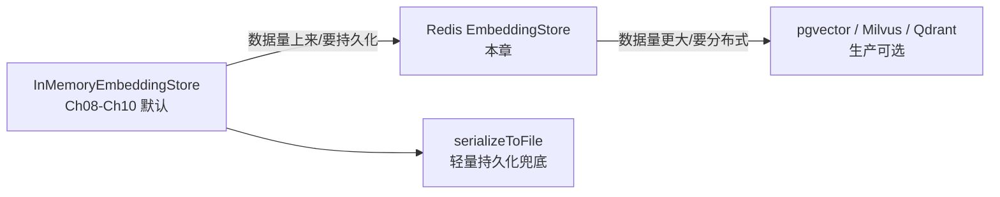
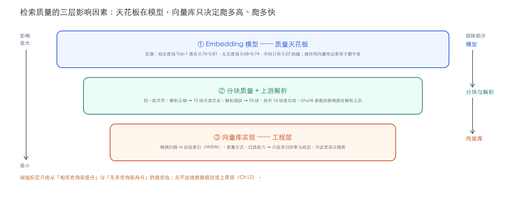
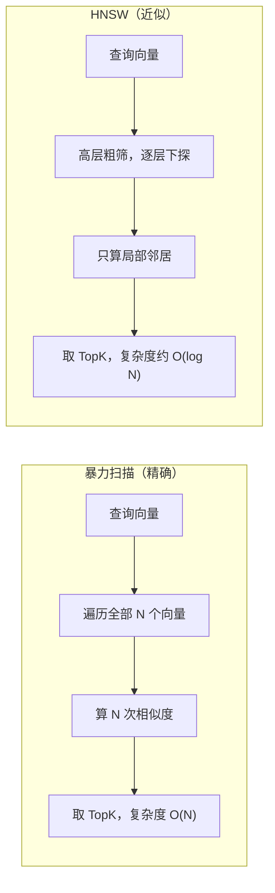

# Ch11 向量存储与检索——从内存库到真正的向量数据库

> **本章基线**：项目 `smart-doc-assistant` ｜ 端口 `8090` ｜ LangChain4j `1.22.0` + 实验模块 `1.22.0-beta32` ｜ JDK `21` ｜ 最后验证 `2026-10-28`（inmemory 路径当日实跑；Redis 路径沿用作者早先实测记录，本轮未重跑，坑点照记）

> 本章目标：
> 1. 理解 `EmbeddingStore` 抽象：`add` / `search` / `removeAll` 与检索请求 `EmbeddingSearchRequest`
> 2. 用一组真实查询的分数分布，搞清楚检索质量的三层影响因素：Embedding 模型 > 分块与上游解析 > 向量库实现
> 3. 掌握向量库生态选型：InMemory / Redis / pgvector / Milvus 的适用边界与决策逻辑
> 4. 理解「精确检索 vs 近似检索（HNSW）」的权衡：换库改变的是召回率与延迟，不是语义
> 5. 实战：`EmbeddingConfig` 支持 `inmemory` / `redis` 切换，一行配置换向量库，业务代码零改动
> 6. 学会检索调优三件套：TopK / minScore 阈值 / metadata 过滤——并且知道它们在这个模型上各自能干什么、不能干什么
> 7. 记录两个环境坑：Redis 缺 RediSearch 模块（`FT._LIST` unknown）、`dimension` 必须与模型匹配且改了不生效

---

## 11.1 为什么需要真正的向量存储

### 11.1.1 回顾：Ch08 到 Ch10，向量一直存在"内存里"

从 Ch08 的 `InMemoryEmbeddingStore` 到 Ch10 的文档流水线，向量库始终是这一行：

```java
@Bean
public EmbeddingStore<TextSegment> embeddingStore() {
    return new InMemoryEmbeddingStore<>();
}
```

教学上这非常友好——零依赖、零配置、开箱即用。但 `InMemoryEmbeddingStore` 有四个硬伤：

| 局限 | 后果 |
|---|---|
| **进程内存储** | 重启即失，向量库每次启动都要重建 |
| **单机不共享** | 多实例部署时，每个实例各有一份向量库，检索结果不一致 |
| **O(n) 暴力扫描** | 每个查询都要遍历全部向量算相似度，数据量上来后延迟线性恶化 |
| **无过滤能力** | 无法按 metadata（类目/时间/来源）先过滤再检索 |

**什么时候该升级？** 三个信号满足其一就要认真考虑：

```
① 数据量超过万级（暴力扫描开始明显变慢）
② 需要持久化 / 多实例共享（重启重建成本不可接受）
③ 需要 metadata 过滤 / 与业务数据联动
```

### 11.1.2 升级路径



> **先剧透一句（11.3 展开）**：很多人一上来就纠结"向量库选哪个"——但本章会用实测数据论证，对检索质量影响最大的**根本不是向量库，而是 Embedding 模型（天花板）和分块与上游解析的质量**。向量库只决定"召回率多高、延迟多低"。先把这条认知顺序立住，选型时才不会本末倒置。

> 💡 **Spring AI 对比**：Spring AI 的对应抽象是 `VectorStore`，同样有 `SimpleVectorStore`（内存版）与各类实现；LangChain4j 的 `EmbeddingStore` 与之同构。两者都遵循同一个原则：**业务代码面向接口，换存储不动业务**。

### 11.1.3 不升级的兜底：让内存库活过重启

四个硬伤里，"重启即失"是最先咬人的那个——开发时每次重启都要等建库，几千篇文档就是几分钟。在上 Redis 之前，`InMemoryEmbeddingStore` 自带一条轻量出路（1.22.0 `javap` 核实的方法签名）：

```java
// 落盘 / 读回
store.serializeToFile(Path.of("data/embeddings.json"));
InMemoryEmbeddingStore<TextSegment> store = InMemoryEmbeddingStore.fromFile("data/embeddings.json");

// 也有 JSON 字符串版：serializeToJson() / fromJson(String)
// 以及把多个内存库合成一个：InMemoryEmbeddingStore.merge(a, b)
```

接到 Spring 里就是"有文件就读、关机时写"：

```java
@Bean
@ConditionalOnProperty(name = "chat.embedding.store", havingValue = "inmemory", matchIfMissing = true)
public EmbeddingStore<TextSegment> inMemoryEmbeddingStore(
        @Value("${chat.embedding.snapshot:}") String snapshotPath) {
    if (!snapshotPath.isBlank() && Files.exists(Path.of(snapshotPath))) {
        return InMemoryEmbeddingStore.fromFile(snapshotPath);   // 启动直接读回，跳过建库
    }
    return new InMemoryEmbeddingStore<>();
}
// 关机前：((InMemoryEmbeddingStore<TextSegment>) store).serializeToFile(snapshotPath)
// 放在一个 @PreDestroy 方法里即可
```

它解决的只有"重启重建"这一条：仍然是进程内、仍然是暴力扫描、多实例仍然各存一份。但对单机开发和小知识库，这几行比一个 Redis Stack 容器划算得多。顺带一提，1.22.0 的 `InMemoryEmbeddingStore` 还多了 `searchAsync`（非阻塞检索）和 `removeAll(Filter)`（按元数据条件删除）——后者在 11.6.4 的元数据补齐之后，就是"只删某个类目的向量"的现成工具。

---

## 11.2 EmbeddingStore 抽象与检索请求

### 11.2.1 接口在项目里的三处使用

`EmbeddingStore<TextSegment>` 是检索链路的落点。整个项目对它的使用只有三处：

| 方法 | 谁在用 | 干什么 |
|---|---|---|
| `addAll(embeddings, segments)` | `DocumentIngestionService.ingest()` | 分块→嵌入→批量入库 |
| `search(EmbeddingSearchRequest)` | `DocumentSearchService.search()` | 相似度检索 |
| `removeAll()` | `DocumentIngestionService.clearStore()` | 清库重建 |

入库、检索、清库，各只有一个调用点——这就是面向接口编程的好处：本章要换掉这个接口背后的实现，三处调用一行都不用动。

### 11.2.2 检索请求 EmbeddingSearchRequest

`search()` 的入参是一个请求对象，项目里 `DocumentSearchService` 是这样构建的：

```java
Embedding queryEmbedding = embeddingModel.embed(query).content();
// 做业务过滤更精准效率更高
// Filter filter = MetadataFilterBuilder.metadataKey("bizId").isEqualTo("customer");

EmbeddingSearchRequest request = EmbeddingSearchRequest.builder()
        .queryEmbedding(queryEmbedding)   // ① 查询向量（EmbeddingModel.embed 得到）
        .maxResults(topK)                 // ② 返回几条（Top-K）
        .minScore(minScore)               // ③ 最低相似度阈值（降噪）
     // .filter(filter)                  // ④ metadata 条件过滤（仓库里注释着，11.6.4 讲）
        .build();
return embeddingStore.search(request).matches().stream()
        .map(this::toHit)
        .toList();
```

上面是仓库真实代码，包括那两行注释——filter 的能力留着没用，是故意留的：接口先保持 Ch08 的形状，等元数据的写入端补齐了再打开（Ch10 的 10.9.2 讲过为什么现在打开也没用：`docId` / `category` 没人写，过滤一个永远为 null 的字段什么都搜不出来）。四个参数就是本章调优的主线：

| 参数 | 含义 | 默认建议 |
|---|---|---|
| `maxResults` | 召回条数 TopK | 3~5 |
| `minScore` | 低于此相似度不返回 | 0.5~0.7（**必须按自己的模型标定**，11.6.2） |
| `filter` | metadata 条件过滤（11.6.4） | 无 |
| `queryEmbedding` | 查询向量 | 与入库用同一个模型 |

### 11.2.3 坑点：score 的语义跨库可能不同

`minScore` 阈值是**跟着度量方式走的**：

- **余弦相似度（COSINE）**：值域 [-1, 1]，**越大越相似**，`minScore=0.6` 这类经验值才有意义；
- **L2 距离（L2）**：值域 [0, +∞)，**越小越相似**——此时 `minScore` 语义反转，直接套用余弦阈值会过滤掉几乎所有结果。

好在**本章的 `RedisEmbeddingStore` 固定用 COSINE**（源码 Javadoc 明示：*assumes the index uses the cosine distance metric*），且内部把 Redis KNN 返回的距离归一化回余弦相似度（`score = (2 - distance) / 2`，范围 [0, 1]）——所以**切到 Redis 后 minScore 经验值可直接复用**。但换用支持 L2/IP 的库（如 pgvector）时必须重新标定。

### 11.2.4 返回结果

```java
record EmbeddingMatch<TextSegment>(double score, TextSegment embedded) {}
```

每个 match 带 `score`（相似度）和命中的 `TextSegment`（文本 + metadata）。`DocumentSearchService.toHit()` 就是从 segment 的 metadata 里取 `docId` / `category` 拼成 DTO 返回——至于这两个字段现在为什么是 null，Ch10 的 10.9.2 已经还原过，本章 11.6.4 会讲到把它们用起来。

---

## 11.3 检索质量的三层影响因素

这是本章最重要的概念。**检索结果的质量由三个因素决定，且影响程度从大到小排列**：



### 11.3.1 ① Embedding 模型：天花板，实测给你看

向量是"语义的编码"。模型差，再好的向量库也救不回来——**检索不到的东西，排序再准也没用**。

这句话听着像口号，看一组实测就不是了。下面是 2026-10-28 在本项目默认库（本地 ONNX All-MiniLM-L6-v2，384 维）上跑的分数，五个查询，两个相关三个故意无关：

| 查询 | 与库的相关性 | Top-1 分数 | Top-1 是什么 |
|---|---|---|---|
| Spring Boot 的自动配置是什么 | 相关 | **0.8117** | 技术手册 Spring Boot 段 ✓ |
| 七天无理由退货的条件是什么？ | 相关 | **0.7865** | 退款政策第一条 ✓ |
| 退款多久能到账？ | 相关 | **0.7560** | 退款政策第四条（部分退款）△ |
| 今天天气怎么样 | 无关 | 0.7411 | 退款政策开头 ✗ |
| 怎么做红烧肉 | 无关 | 0.6825 | 退款政策第四条 ✗ |

读这张表：

- 相关查询的 Top-1 压在 **0.76–0.81**，无关查询的 Top-1 压在 **0.68–0.74**——两条带子**中间只有 0.02–0.07 的缝**；
- 问天气，最相关的退款政策拿到了 0.741。任何低于 0.75 的阈值都拦不住它。

这就是"模型是天花板"的具体形状：这个 384 维小模型把所有中文文本的相似度都压进了一条窄带，相关与无关在分数上几乎分不开。**换任何一个向量库，这条窄带一毫米都不会变**——库里存的还是这些向量，算的还是这些相似度。想把带子拉开，只能换更强的 embedding 模型（项目里 `chat.embedding.provider=bailian` 切到 text-embedding-v4，1024 维），或者在检索之后加一层重排（Ch12）。

> ⚠️ 别把这张表的数字当成通用参考。分数分布是「模型 × 语料」一起决定的，你换了模型、换了自己的文档，分布就变了。能带走的是方法：**拿五六个相关查询、五六个无关查询，各跑一遍看 Top-1 分数落在哪，你的阈值只能从两条带子的缝里选**。

### 11.3.2 ② 分块质量与上游解析：垃圾进，垃圾出

Ch10 讲过 chunk-size/overlap 怎么定。但本章想强调的是分块上游的那一环：**解析质量决定分块原料**。同一个项目的同一批文档，Ch10 实测过一组对照（解析错配修复前）：classpath 启动（PDF 被当文本啃）建出 26 块，用对解析器重建只有 10 块——那 16 块垃圾不会报错、不会让启动失败，它们安静地参与每一次检索（Ch10 捞到过相似度 0.61 的 PDF 语法块，刚好压着默认阈值）。修复已落仓库，如今启动直接是 10 块；但教训不过期：调 chunk 参数之前，先确认进分块器的每一篇都是干净文本。

分块参数本身的影响（切太碎语义碎、切太大语义稀释、TopK 太小漏召回）Ch10 的 10.6.4 已讲，此处不重复。

### 11.3.3 ③ 向量库实现：只影响工程层

向量库做的事只有两件：**存向量、算最近邻**。它的差异体现在：

| 差异 | 说明 |
|---|---|
| **精确 vs 近似** | 暴力扫描 100% 召回但 O(n)；HNSW 等近似索引牺牲 1~10% 召回率换数量级提速 |
| **度量方式** | 余弦 / 内积 / L2，排序可能不同（11.2.3 的坑） |
| **过滤能力** | 是否支持 metadata 过滤、预过滤还是事后过滤 |

> ✅ **最佳实践（一句话）**：换向量库 ≈ 换"搜索引擎"，不换"语义理解能力"。**检索质量的天花板在 Embedding 模型和分块，向量库只决定"天花板之上你能爬多接近"（召回率）和"爬多快"（延迟）**。排障时先查模型和 chunk，别一上来就怀疑向量库。

---

## 11.4 向量库生态选型

### 11.4.1 精确 vs 近似：HNSW 是什么

暴力扫描在数据量小时没问题，数据量大了必须上**近似最近邻（ANN）**。最流行的是 **HNSW**（Hierarchical Navigable Small World）：



HNSW 把向量组织成多层图：顶层稀疏（粗筛）、底层稠密（精排）。查询从顶层快速下探，只计算局部邻居，速度指数级提升。**代价是可能漏掉真正的最近邻**——通过 `ef_search` 参数控制"搜索多努力"，召回率 90%~99% 可调。

### 11.4.2 四个候选的对比

| 维度 | InMemory | Redis（RediSearch） | pgvector | Milvus / Qdrant |
|---|---|---|---|---|
| **索引算法** | 无（暴力） | FLAT / HNSW | 精确 / IVFFlat / HNSW | HNSW / IVF / 量化 |
| **存储介质** | 进程内存 | 内存 | 磁盘 | 磁盘 / 分布式 |
| **数据规模** | 万级 | 百万级（受内存限制） | 百万级 | **十亿级** |
| **metadata 过滤** | 支持（Filter DSL 完整实现） | 支持，需声明字段 | **SQL 原生 WHERE** | 预过滤/后过滤都强 |
| **一致性/事务** | 无 | 无 | **事务 + 备份 + SQL** | 弱一致 |
| **运维负担** | 无 | 低（已有 Redis 则零新增） | 低（复用 Postgres） | 高（独立集群） |
| **LangChain4j 支持** | 内置 | `RedisEmbeddingStore`（community） | `PgVectorEmbeddingStore` | 各有实现 |

### 11.4.3 怎么选（决策逻辑）

```
数据量 < 万级、开发调试 → InMemory（零依赖）
百万级以内：
    已有 Postgres → pgvector（磁盘便宜 + SQL 原生，首选）
    已有 Redis → Redis Stack（"顺手用"，本章演示）
    都没有 → 二选一按团队熟悉度
千万级以上 / 复杂过滤 / 分布式 → Milvus / Qdrant
```

> ⚠️ **坑点：Redis 是"顺手用"的向量库，不是"专门选"的**。向量全驻内存，100 万条 × 1024 维 ≈ 4GB 内存，纯为检索烧内存不划算；且 metadata 过滤是事后过滤（先 KNN 再筛），复杂混合查询弱于 pgvector 的 SQL。本章用 Redis 演示"一行配置换库"的架构能力，生产推荐 pgvector/Milvus。

---

## 11.5 实战：一行配置切换向量库

### 11.5.1 环境准备：Redis Stack

`RedisEmbeddingStore` 依赖 **RediSearch 模块**（`FT.CREATE` / `FT.SEARCH` 命令），**普通 Redis 不行**。用 Docker 起 Redis Stack 最省事：

```bash
docker run -d --name redis-stack -p 6379:6379 -v redis-data:/data redis/redis-stack-server:latest
```

> `-v redis-data:/data` 挂载数据卷，容器重启后向量不丢。

> ⚠️ **坑点（作者本机实测记录）**：如果用的是普通 Redis（或缺失 RediSearch 的发行版），`RedisEmbeddingStore` 构造时会抛：
> ```
> ERR unknown command 'FT._LIST'
> ```
> 验证方法：`redis-cli FT._LIST`，报 unknown command 就说明没有 RediSearch。macOS 上 `brew install redis` 装的**不是** Redis Stack，需要 `brew tap redis-stack/redis-stack && brew install redis-stack` 或直接 Docker。

### 11.5.2 改造 EmbeddingConfig：存储可切换

核心改动——把写死的 `embeddingStore()` 拆成两个条件 Bean，用 `chat.embedding.store` 属性切换（与 Ch08 的 `provider` 切换同款套路）。下面是 `config/EmbeddingConfig.java` 里与存储相关的真实代码：

```java
// RedisEmbeddingStore 与 RedisChatMemoryStore 同在 community 包
//    （dev.langchain4j.community.store.embedding.redis）；langchain4j-redis 旧模块已停更。
//    依赖 langchain4j-community-redis 已在 Ch10 的 P0 修复里引入，本章无需新增依赖。
import dev.langchain4j.community.store.embedding.redis.RedisEmbeddingStore;
import redis.clients.jedis.HostAndPort;
import redis.clients.jedis.UnifiedJedis;   // jedis 随 community-redis 传递引入

/** 内存向量库（默认）：进程内存储，重启即失，零依赖，开发调试首选。
 *  可 serializeToFile/fromFile 做轻量持久化。 */
@Bean
@ConditionalOnProperty(name = "chat.embedding.store",
        havingValue = "inmemory", matchIfMissing = true)
public EmbeddingStore<TextSegment> inMemoryEmbeddingStore() {
    return new InMemoryEmbeddingStore<>();
}

/** Redis 连接（Ch11）：统一 Jedis 客户端，复用连接池，与 ChatMemoryStoreConfig 同风格。
 *  仅 chat.embedding.store=redis 时创建。 */
@Bean
@ConditionalOnProperty(name = "chat.embedding.store", havingValue = "redis")
public UnifiedJedis unifiedJedisForEmbedding(
        @Value("${chat.embedding.redis.host:localhost}") String host,
        @Value("${chat.embedding.redis.port:6379}") int port) {
    return new UnifiedJedis(new HostAndPort(host, port));
}

/** Redis 向量库（Ch11）：需要 Redis Stack（含 RediSearch 模块），数据可持久化。
 * dimension 必须与 EmbeddingModel 匹配：local=384 / bailian=1024。 */
@Bean
@ConditionalOnProperty(name = "chat.embedding.store", havingValue = "redis")
public EmbeddingStore<TextSegment> redisEmbeddingStore(
        UnifiedJedis unifiedJedis,
        @Value("${chat.embedding.redis.index-name:embedding-index}") String indexName,
        @Value("${chat.embedding.redis.dimension:384}") int dimension) {
    return RedisEmbeddingStore.builder()
            .unifiedJedis(unifiedJedis)
            .indexName(indexName)
            .dimension(dimension)
            .build();
}
```

四个要点：

1. **两个 `@Bean` 用 `@ConditionalOnProperty` 互斥激活**——inmemory 是默认（`matchIfMissing = true`），redis 显式开启，永远只有一个 `EmbeddingStore` Bean 存在，不会有歧义注入；
2. **`dimension` 必须与 Embedding 模型匹配**：local（All-MiniLM-L6-v2）= 384，bailian（text-embedding-v4）= 1024；
3. **`UnifiedJedis` 独立成 Bean**：连接池全局共享、只建一次，避免每次 new 连接（与 `ChatMemoryStoreConfig` 的 redis 配置同风格）；
4. `RedisEmbeddingStore.builder()` 其余参数可选：`prefix`（key 前缀）、`metadataKeys`/`metadataConfig`（声明哪些 metadata 字段可过滤，11.6.4 用）。

> ⚠️ **坑点（源码核实）**：RediSearch 索引**只在「不存在」时创建**（`RedisEmbeddingStore` 构造时 `isIndexExist` 检查，不存在才 `createIndex`）。也就是说**索引已存在时，`dimension` 参数会被静默忽略**——改了维度但旧索引还在，会默默按旧维度建索引，向量写进去全错但启动不报错。**换 dimension 前必须先删旧索引**（`redis-cli FT.DROPINDEX embedding-index`）或换一个新的 `index-name`。

### 11.5.3 配置：application.yml

```yaml
chat:
  embedding:
    provider: ${CHAT_EMBEDDING_PROVIDER:local}   # Ch08：模型 local/bailian
    store: ${CHAT_EMBEDDING_STORE:inmemory}      # Ch11：向量库 inmemory/redis
    bailian:
      api-key: ${DASHSCOPE_API_KEY:}
      base-url: https://dashscope.aliyuncs.com/compatible-mode/v1
      model-name: text-embedding-v4
    redis:                                       # Ch11：Redis 向量库配置
      host: ${REDIS_HOST:localhost}
      port: ${REDIS_PORT:6379}
      index-name: ${REDIS_EMBEDDING_INDEX:embedding-index}
      dimension: ${REDIS_EMBEDDING_DIMENSION:384}  # 切 bailian 模型时改 1024
```

### 11.5.4 切换验证

```bash
# 默认 inmemory（无需 Redis）
mvn spring-boot:run

# 切到 Redis（需要 Redis Stack 在 6379）
CHAT_EMBEDDING_STORE=redis mvn spring-boot:run
```

启动日志（inmemory 路径，2026-10-28 实测；Ch10 解析修复后，默认父子分块 10 块，`--chat.rag.parent-child=false` 扁平 7 块——修复前这里曾是 26 / 20，差的是 PDF 垃圾）：

```
 从 classpath:docs 加载到 4 个文档
清洗完成（4 → 4 文档）
 分块完成：4 个文档 → 10 个块（parent-child=true）
 入库完成：累计 4 文档 / 10 块（embedding 维度=384）
```

检索验证（两种 store 下结果应该一致）：

```bash
curl -X POST http://localhost:8090/api/search/semantic \
  -H "Content-Type: application/json" \
  -d '{"query":"七天无理由退货的条件是什么？","topK":3,"minScore":0.5}'
```

> 💡 换库后 **top1 通常一致，TopK 的"尾巴"可能不同**——这正是 11.3 讲的"换库只影响召回率与延迟"的直观体验，不是 bug。

> ⚠️ **坑点：换库/换模型后必须清库重建**。Ch10 的 `rebuild=true` 机制在这里就是标配：`POST /api/docs/ingest?dir=...&rebuild=true` 会先 `removeAll()` 再重新入库。**不要**增量混着来——旧库的向量是旧维度/旧模型算的，混在一起检索质量会崩。

---

## 11.6 检索调优：用真实分数说话

调优三件套（TopK / minScore / filter）的原理不难，难的是知道**它们在你手上的模型和语料里各自管不管用**。这一节全部用 2026-10-28 的实测数据讲。

### 11.6.1 TopK：管"拿多少"，不管"拿的是不是好的"

拿相关查询「七天无理由退货的条件是什么？」跑 TopK=5，五个位置是这样的：

| 排名 | 分数 | 内容 | 判定 |
|---|---|---|---|
| 1 | 0.7865 | 退款政策 · 第一条 七天无理由退货 | ✓ 正中 |
| 2 | 0.7703 | FAQ · 一、退换货政策 | ✓ 相关 |
| 3 | 0.7460 | FAQ · 三、支付方式 | ✗ 噪声 |
| 4 | 0.6984 | 退款政策 · 第四条 部分退款 | △ 沾边 |
| 5 | 0.6852 | 技术手册 · RAG 质量段 | ✗ 无关 |

从第 3 名开始就是噪声了。TopK 从 3 调到 10，捞上来的尾巴会更长——解析修复前的库里，Ch10 那几块 0.60–0.61 的 PDF 乱码就在这个区间候着。**TopK 决定的是上下文窗口里塞多少块，塞进来的第 4、第 5 名会原样进 Prompt**，模型被无关内容带偏的风险随之上涨。问答类给 3，摘要对比类给 5~10，再多就要配合重排或更高阈值用（都不行就上 Ch12 的 reranker）。

### 11.6.2 minScore：这个模型上，默认值形同虚设

接口默认 `minScore=0.6`（`SemanticSearchController` 里写的）。看 11.3.1 那张表就知道它意味着什么：问「今天天气怎么样」，默认参数原样返回 3 条，分数 0.741 / 0.713 / 0.677——**全部高过阈值，一条没拦住**。从检索层看，这是一个高分查询；只有人知道它和知识库毫无关系。

标定方法本来很朴素：拿一批真实 query 跑一遍，找「相关结果的最低分」与「不相关结果的最高分」，阈值取两者之间。放到本项目的数据上：

- 相关查询的 Top-1 最低 0.756，无关查询的 Top-1 最高 0.741；
- 缝只有 0.015 宽。阈值卡 0.75，天气那条是拦住了，「退款多久能到账」（0.756）也差点被误杀。

在这个模型上，阈值不是调优手段，是碰运气。出路两条：换分辨力更强的 embedding 模型（把两条带子拉开），或者承认召回层就是会带噪声、在后面加精排（Ch12）。**先跑分，再定阈值**——任何直接抄来的经验值都默认了"你的模型和作者的一样"。

### 11.6.3 一个排序错位的例子：差 0.01，答案就从第 1 掉到第 2

问「退款多久能到账？」，正确答案在退款政策的**第三条**：审核 48 小时、3 个工作日原路退回。检索结果：

| 排名 | 分数 | 内容 |
|---|---|---|
| 1 | 0.7560 | 第四条 部分退款与特殊情形（缺货商品可申请部分退款……） |
| 2 | **0.7465** | 退款政策开头至第三条 退款时效（★ 含正确答案） |

两块只差 **0.0095**。第一名讲的是"部分退款"，第二名里才有"多久到账"。如果 TopK=1（只取最相关的一块），喂给模型的就答非所问。这不是配置错误——双编码器（query 和文档各编各的向量再算距离）天生分不清"讲退款"和"回答退款时效"，它的分辨率就到 0.01 这个量级。要让"谁真的在回答这个问题"重新排队，需要交叉编码器把 query 和每块文本放在一起打分——那就是 Ch12 的 reranker，也是 Ch13 评估里 MRR 这个指标存在的原因（它量的就是"正确答案排第几"）。

### 11.6.4 metadata 过滤：Filter DSL 与它的前提

只检索"某个类目/某段时间"的文档时，用 `EmbeddingSearchRequest.filter(...)`。LangChain4j 的 Filter 是链式 DSL（1.22.0 核实，包内类清单与 1.19 零变化），支持 `isEqualTo` / `isNotEqualTo` / `isIn` / `isGreaterThan` / `containsString` 等比较与 `and` / `or` / `not` 组合：

```java
import dev.langchain4j.store.embedding.filter.MetadataFilterBuilder;

// 只搜 category=退换货 的文档
Filter filter = MetadataFilterBuilder.metadataKey("category").isEqualTo("退换货");

EmbeddingSearchRequest request = EmbeddingSearchRequest.builder()
        .queryEmbedding(queryEmbedding)
        .maxResults(3)
        .filter(filter)
        .build();
```

用之前想清楚两件事：

- **前提是元数据真的存在**。11.2.2 那两行注释为什么一直没打开？因为 Ch10 的 10.9.2 讲过：`category` 这个 key 现在没有任何写入端，过滤一个恒为 null 的字段，结果永远是空。先按 10.9.2 把写入端补上，再开 filter；
- **各库的支持方式不同**，声明了才能过滤：

| 库 | filter 支持 |
|---|---|
| InMemory | 支持（完整实现：eq/neq/in/gt/lt/containsString + and/or/not） |
| Redis | 支持，需在 `metadataKeys`/`metadataConfig` 声明字段 |
| pgvector | SQL WHERE 原生，最强 |
| Milvus | 预过滤/后过滤都支持 |

本项目 `DocumentSearchService.search()` 暂未暴露 `filter` 参数（保持 Ch08 接口兼容），标准写法如上，练习题 3 会带你把它接进 Controller。

---

## 11.7 端点与验证（完整链路）

```bash
cd smart-doc-assistant
# 1. 起 Redis Stack（如未启动）
docker start redis-stack

# 2. 以 Redis 向量库启动
CHAT_EMBEDDING_STORE=redis mvn spring-boot:run

# 3. 查看流水线统计（文档数/分块数/维度）
curl http://localhost:8090/api/docs/stats
# → {"success":true,"stats":{"documentCount":4,"segmentCount":10,"dimension":384,...}}
#    （解析修复后：默认父子分块 10 块；--chat.rag.parent-child=false 时 7 块）

# 4. 语义检索（走 Redis KNN）
curl -X POST http://localhost:8090/api/search/semantic \
  -H "Content-Type: application/json" \
  -d '{"query":"七天无理由退货的条件是什么？","topK":3,"minScore":0.5}'

# 5. 用一个无关查询检验你的阈值（2026-10-28 实测：默认参数下返回 3 条，0.741/0.713/0.677）
curl -X POST http://localhost:8090/api/search/semantic \
  -H "Content-Type: application/json" \
  -d '{"query":"今天天气怎么样"}'

# 6. 清库重建（换库/换模型后的标准操作）
curl -X POST 'http://localhost:8090/api/docs/ingest?dir=src/main/resources/docs&rebuild=true'
# → segmentCount 从 26 变 10（目录入口 PDF 解析正确，见 Ch10 10.4.4）
```

---

## 11.8 高频坑点与最佳实践汇总

### 坑 1：普通 Redis 没有 RediSearch，报 `ERR unknown command 'FT._LIST'`

`RedisEmbeddingStore` 依赖 RediSearch 模块。`redis-cli FT._LIST` 自查；macOS 的 `brew install redis` 不带模块，用 `redis/redis-stack-server` 镜像。（作者踩过，11.5.1）

### 坑 2：改了 `dimension` 不生效，检索结果全错但启动不报错

RediSearch 索引只在不存在时创建，已存在则 dimension 被**静默忽略**。换维度先 `FT.DROPINDEX` 或换 `index-name`，再 `rebuild=true`。（源码核实，11.5.2）

### 坑 3：换库 / 换模型不清库，新旧向量混着检索

旧向量是旧模型算的，混库后分数没有可比性，检索质量崩。`rebuild=true` 是换库标配。（11.5.4）

### 坑 4：minScore 跨库、跨模型直接复用

余弦越大越近、L2 越小越近；就算同为余弦，不同模型的分数分布也不同（11.3.1 的窄带就是证据）。**换任何一个，先重跑分数分布再定阈值。**（11.2.3 / 11.6.2）

### 坑 5：默认阈值 0.6 在小模型上形同虚设

本项目的真实数据：无关查询「今天天气怎么样」Top-1 拿 0.741，默认阈值一条不拦。阈值要从你自己语料的相关/无关分数缝里选，选不出来就换模型或上重排。（11.6.2）

### 坑 6：TopK 拉大，垃圾块乘虚而入

解析修复前，Ch10 的 PDF 乱码块分数 0.60–0.61，默认阈值拦不住，topK=10 时它们就进 Prompt 了。库的干净程度是检索调优的地基——解析修复要赶在任何调参之前。（11.6.1）

### 坑 7：filter 打开了，字段没人写

metadata 过滤的前提是写入端真的写了那个 key。恒为 null 的字段，过滤结果永远是空。（11.6.4，配合 Ch10 10.9.2）

**最佳实践汇总**：

- ✅ 业务代码面向 `EmbeddingStore` 接口，换存储零改动（本章实战的立足点）
- ✅ 排障顺序：模型 → 分块与解析 → 库，别反过来
- ✅ 阈值标定用"相关查询最低分 / 无关查询最高分"夹逼，标不出缝就升级模型
- ✅ 问答类 TopK=3 起步，第 3 名以后的内容默认当噪声看
- ✅ 开发调试 inmemory + 本地 ONNX，零成本零依赖；生产按 11.4.3 决策树选
- ❌ 不要把向量库当检索质量的救命稻草——它只管召回率和延迟
- ❌ 不要在没跑过分数分布的情况下相信任何 minScore 经验值

---

## 11.9 本章小结

### 11.9.1 概念速查表

| 概念 | 一句话 |
|---|---|
| **EmbeddingStore** | 向量库抽象：add / search / removeAll，业务面向接口 |
| **EmbeddingSearchRequest** | 检索请求：queryEmbedding + maxResults(TopK) + minScore + filter |
| **三层影响因素** | Embedding 模型（天花板）> 分块与上游解析 > 向量库实现（召回率/延迟） |
| **精确 vs 近似** | 暴力扫描 100% 召回 O(n)；HNSW 近似索引 90-99% 召回 O(log n) |
| **换库不换语义** | 库只决定"能爬多接近天花板"，语义精度由模型和分块决定 |
| **minScore 跨库不可复用** | 余弦（越大越近）vs L2（越小越近），跨度量必须重新标定；同度量跨模型也要重标 |
| **Redis 定位** | 已有 Redis 时的"顺手用"，教学演示升级路径；生产首选 pgvector/Milvus |
| **dimension 匹配** | Redis 索引维度必须与模型一致：local=384 / bailian=1024；改维度先删索引 |
| **阈值标定** | 相关查询最低分与无关查询最高分之间取值；夹不出缝就换模型或上重排 |

### 11.9.2 验证清单

- [ ] 能说出 `EmbeddingStore` 在项目里的三个调用点，并解释换库为什么不动业务代码
- [ ] 跑过 11.3.1 的五个查询，能读出"相关与无关的分数带"并说出你这个模型的缝在哪
- [ ] 能解释为什么默认 `minScore=0.6` 拦不住"今天天气怎么样"
- [ ] 能讲清 HNSW 用什么换什么（召回率换延迟）
- [ ] `CHAT_EMBEDDING_STORE=redis` 切换成功，且知道 RediSearch 模块怎么自查
- [ ] 能说出改 dimension 的正确顺序（删索引 → 改配置 → rebuild）
- [ ] 能解释"退款多久能到账"那个例子：为什么正确答案排第 2，MRR 量的就是这件事

---

## 11.10 本章项目代码状态

仓库当前代码即完整实现（无 tag、无版本快照，以下均为当前路径）：

| 模块 | 文件 | 说明 |
|---|---|---|
| 配置 | `config/EmbeddingConfig.java` | 4 个条件 Bean：local/bailian 模型 + inmemory/redis 存储，两两正交组合 |
| 配置 | `src/main/resources/application.yml` | `chat.embedding.store`（inmemory/redis）+ `chat.embedding.redis.*`（host/port/index-name/dimension） |
| 依赖 | `pom.xml` | 无变化——`langchain4j-community-redis` 同时包含 `RedisChatMemoryStore`（Ch05/Ch10）和 `RedisEmbeddingStore`（本章），Ch10 的 P0 修复已引入，跳过 Ch10 直接读本章的读者无需再动 pom |
| 业务 | `service/DocumentSearchService.java` | **零改动**——依赖倒置的胜利，换库不动业务；filter 的两行注释留在原处（11.2.2 / 11.6.4） |
| 业务 | `controller/SemanticSearchController.java` | 默认参数 topK=3 / minScore=0.6 在这里，读完 11.6 你就知道这个 0.6 意味着什么 |

### 11.10.1 环境坑记录（作者实测）

| 坑 | 症状 | 原因 | 解决 |
|---|---|---|---|
| Redis 无 RediSearch | `ERR unknown command 'FT._LIST'` | 普通 Redis 或缺失模块的发行版 | 用 `redis/redis-stack-server` 镜像；`redis-cli FT._LIST` 自查 |
| 换 dimension 不生效 | 启动不报错、检索结果全错 | 索引仅在不存在时创建，已存在则 dimension 被静默忽略 | 先 `redis-cli FT.DROPINDEX embedding-index` 或换 `index-name`；再 rebuild=true |
| 换库后阈值失效 | 检索结果异常 | minScore 跨度量方式不可复用（余弦 vs L2） | 本章 Redis 固定 COSINE 且归一化为 [0,1]，minScore 可直接复用；pgvector 等需重新标定 |

---

## 11.11 练习题

1. **跑一遍你自己的分数带**：把 11.3.1 的五个查询（三个相关两个无关）换成你业务里的真实问题，各跑一遍 `/api/search/semantic`（topK=1, minScore=0），把 Top-1 分数列成表——你的模型和语料的"缝"在哪，看完这张表就知道。
2. 把 `chat.embedding.provider` 切到 `bailian`（需要 `DASHSCOPE_API_KEY`，注意 `dimension` 改 1024 并先删索引），重跑练习 1 的表，对比两条带子拉开了多少。
3. 给 `DocumentSearchService.search()` 增加一个 `filter` 参数（参考 11.6.4 的 Filter DSL），实现"只搜某个 category"并接入 `SemanticSearchController`——记得先把 Ch10 10.9.2 的元数据写入端补上，否则过滤结果永远是空。
4. 把 `chat.embedding.store` 切到 `redis`，分别用 TopK=1 和 TopK=5 跑同一个查询，观察命中内容差异；再解释这个差异为什么和 11.3 的结论一致。
5. 思考题：11.6.3 的例子里正确答案排第 2，差 0.0095。在不换 embedding 模型的前提下，你能想出几种办法让它排到第 1？（提示：改分块、改查询、加一层打分——第三种就是 Ch12。）

---

**下一章：Ch12 RAG 高级管线**——本章的三个遗留问题（分数带太窄、排序错位、纯向量检索不懂关键词）都会在 Ch12 得到回应：**父子分块**（小 chunk 检索、大 chunk 喂 LLM）、**reranker 重排序**（交叉编码器精排）、**混合检索**（向量 + 关键词两路融合）。Ch12 会在这三条路上把检索质量再提一个台阶。
