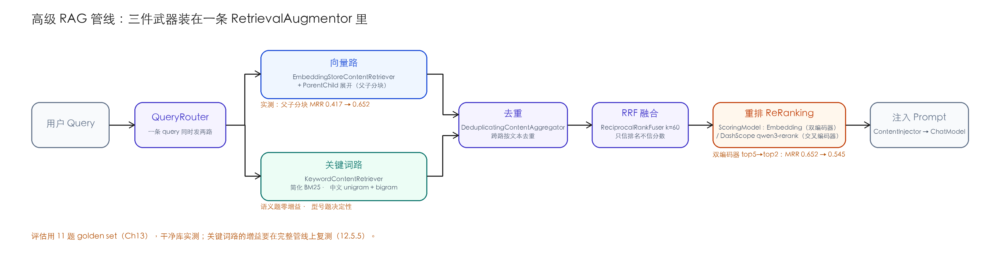
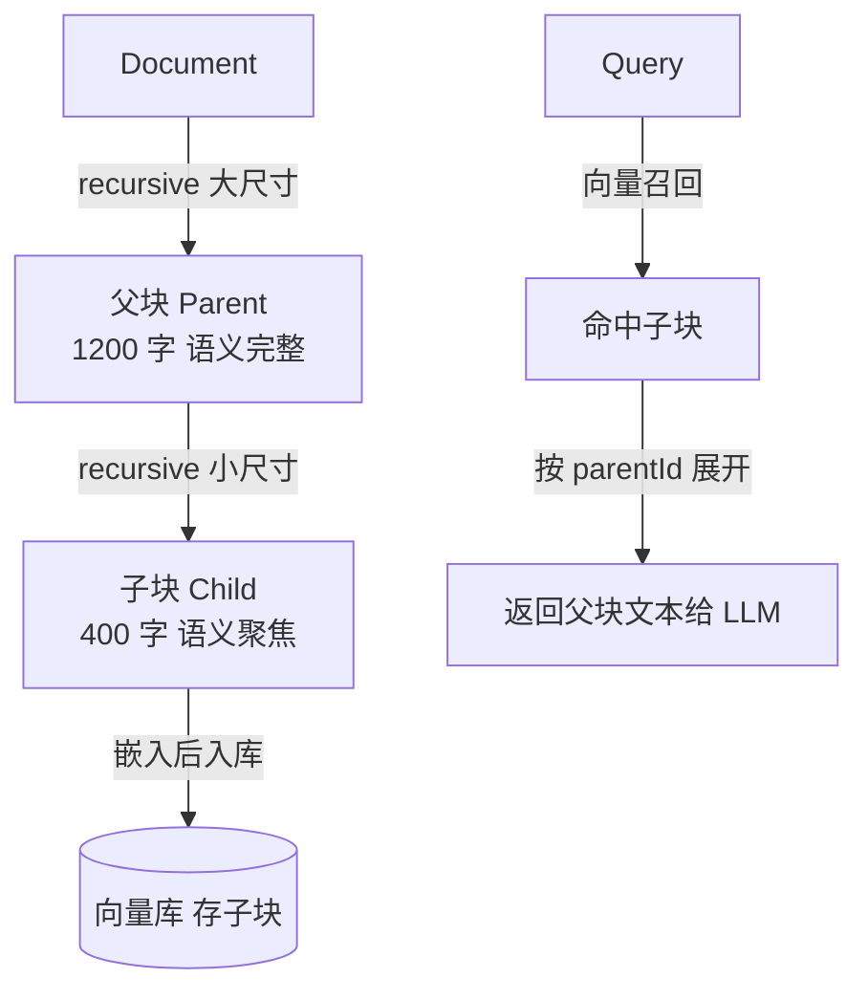

# Ch12 高级 RAG 管线——父子分块 + 重排序 + 混合检索

> **本章基线**：项目 `smart-doc-assistant` ｜ 端口 `8090` ｜ LangChain4j `1.22.0` + 实验模块 `1.22.0-beta32` ｜ JDK `21` ｜ 最后验证 `2026-10-28`（检索链路当日实跑 A/B；`/api/rag/ask` 的 LLM 环节与 DashScope 重排需 API Key，未在本轮实测范围）

> 本章目标：
> 1. 理解「单一 chunk 尺寸」的根本矛盾，掌握**父子分块**：小块入库召回、大块喂 LLM——并用一组 A/B 评估看清它值多少
> 2. 理解**重排序（reranker）**：`ScoringModel` 接口、双编码器与交叉编码器的差别、官方提供了哪些现成实现
> 3. 理解**混合检索（hybrid）**：向量路 + 关键词路，RRF 融合——并且搞清楚它**什么时候有用、什么时候没有用**（两种情况本章都实测了）
> 4. 掌握 RAG 编排 API：`RetrievalAugmentor` / `QueryRouter` / `ContentRetriever` / `ContentAggregator`，以及两路结果为什么要去重
> 5. 读懂仓库里的 `AdvancedRagConfig`：一套 `RetrievalAugmentor` 串起三件武器，业务侧一句接口
> 6. 记录三个实测结论：① 父子分块让 MRR 从 0.417 提到 0.652（11 题·干净库）；② 双编码器重排截断到 top2 会伤召回；③ 关键词路在语义问题上零增益，单路由型号对照里的"一发正中"进完整管线后会被 RRF 对冲——结论要落在管线评估上

---

## 12.1 为什么需要"高级"管线

Ch10 把文档切成块、Ch11 把块存进向量库——到这一步，"能检索"已经成立。但 Ch11 末尾留下的三个问题还没解决：分数带太窄（相关与无关只差 0.02）、排序会错位（正确答案排第 2、差 0.01）、纯向量不懂精确关键词。高级管线就是冲这三件事来的。

### 12.1.1 痛点一：单一 chunk 尺寸的死结

Ch10 的 `DocumentSplitters.recursive(chunkSize, chunkOverlap)` 只用**一个**尺寸。问题立刻出现：

| chunk 太小（如 200 字） | chunk 太大（如 1500 字） |
|---|---|
| 召回准、噪声少 | 语义完整、上下文足 |
| 但一块装不下完整语义，**LLM 拿到的上下文是碎片** | 但语义被稀释、相似度算的是"平均语义" |
| 且块数爆炸、token 浪费 | 且无关内容混进上下文、带偏 LLM |

一句话：**"用来嵌入/检索的块"和"喂给 LLM 的块"需要的是两种尺寸**，单一尺寸顾此失彼。

### 12.1.2 痛点二：向量召回的排序不是最优的

- 向量相似度（bi-encoder）是"query 与 doc 各自编码后再比"，两个文本从没"见过面"，细粒度交互捕捉不到——Ch11 的「退款多久能到账」例子里，讲部分退款的块以 0.0095 的优势压住了真正回答时效问题的块；
- 纯向量还会漏掉**精确关键词**（型号、专有名词、数字）——"K-3000" 这种查询，语义相似度基本靠猜。

所以光靠"向量召回 TopK"不够，需要两件事补刀：**重排序**（把初召回重新排一遍）+ **混合检索**（再加一路关键词）。

> 💡 **Spring AI 对比**：Spring AI 对应 `QuestionAnswerAdvisor` / `VectorStore` + 自写 rerank；LangChain4j 的 `RetrievalAugmentor` 把"路由→多路检索→聚合(融合/重排)→注入"做成了一套可组装的接口，思路同构。两者都遵循：**检索增强 = 可插拔的管线，不是某个魔法函数**。

---

## 12.2 三件武器全景



| 武器 | 解决 | 实测效果（本章后面给数） |
|---|---|---|
| **父子分块** | 嵌入尺寸 ≠ 上下文尺寸 | MRR 0.417 → 0.652（12.3.4） |
| **重排序** | 初召回排序不优 | 双编码器增益有限；topK 截断有代价（12.4.4） |
| **混合检索** | 关键词/精确项漏召回 | 语义问题上零增益；单路由决定性 ≠ 管线增益（12.5.5） |

下面逐个拆解。每一件的"实测效果"都是在同一个 11 题评估集（Ch13 会细讲它）上量出来的，先看结论再看代码，读起来有锚点。

---

## 12.3 父子分块（Parent-Child Chunking）

### 12.3.1 原理

把"切块"拆成两步：



- **父块**：大（默认 1200 字），语义完整，是最终喂给 LLM 的上下文；
- **子块**：小（默认 400 字），语义聚焦，用来嵌入和向量召回——召回更准；
- 入库的是**子块**，但它的 metadata 带着 `parentText`（父块全文）+ `parentId`；
- 检索命中子块后，**展开成父块、按 parentId 去重**，把父块交给 LLM。

这样既享受"小块召回准"，又享受"大块上下文足"。项目的开关是 `chat.rag.parent-child`（默认 `true`），Ch10 的 `ingest()` 分支就是它的入口。

### 12.3.2 代码：入库时切父子块

`DocumentIngestionService.splitIntoParentChild()`（与仓库逐行一致）：

```java
/**
 * Ch12 父子分块：先把文档切成较大的「父块」，再把每个父块切成较小的「子块」。
 * 入库的是子块（小、语义聚焦、召回准），但每个子块的 metadata 带上父块文本（parentText）
 * 与 parentId——检索时按 parentId 展开为父块、去重后喂给 LLM（大、上下文足）。
 */
private List<TextSegment> splitIntoParentChild(List<Document> cleaned) {
    DocumentSplitter parentSplitter = DocumentSplitters.recursive(parentChunkSize, parentChunkOverlap);
    DocumentSplitter childSplitter = DocumentSplitters.recursive(childChunkSize, childChunkOverlap);
    List<TextSegment> children = new ArrayList<>();
    int docSeq = 0;
    for (Document doc : cleaned) {
        String docId = doc.metadata().getString("docId");
        String category = doc.metadata().getString("category");
        List<TextSegment> parents = parentSplitter.split(doc);   // ① 切父块
        int p = 0;
        for (TextSegment parent : parents) {
            String parentId = (docId == null ? "doc" + docSeq : docId) + "#P" + p;
            // ② 父块包成 Document 再切子块，父块 metadata（docId/category）会遗传给子块
            List<TextSegment> kids = childSplitter.split(Document.from(parent.text(), parent.metadata()));
            int c = 0;
            for (TextSegment kid : kids) {
                Metadata kidMeta = new Metadata()
                        .put("docId", docId == null ? "" : docId)
                        .put("category", category == null ? "" : category)
                        .put("parentId", parentId)
                        .put("parentText", parent.text())   // ③ 关键：带上父块全文
                        .put("childIndex", String.valueOf(c));
                children.add(TextSegment.from(kid.text(), kidMeta));
                c++;
            }
            p++;
        }
        docSeq++;
    }
    return children;
}
```

三个源码级的要点：

> ⚠️ **参数单位是字符，不是 token**。`DocumentSplitters.recursive(int, int)` 的两个参数是**字符**（不传 `TokenCountEstimator` 时）。本项目 `child-chunk-size: 400` 一直是 400 **字符**——按 token 估算调参，中文场景下会偏差一倍以上（一个汉字 ≈ 0.6~1 token，看模型）。
>
> ⚠️ **`DocumentSplitter.split` 接收 `Document` 不是 `TextSegment`**（源码：`List<TextSegment> split(Document)`）。所以"父块→子块"要把父块用 `Document.from(parent.text(), parent.metadata())` 包回去再切，这就是代码里第 ② 步那行的原因。
>
> ✅ **`parentText` 存进每个子块的 metadata，是拿存储换简单的取舍**。4 个子块的父块各存一份全文，本项目 26 个子块无感；文档量上去后向量库体积随子块数线性膨胀，应改成"内存/独立表维护 parentId→parentText 映射"，检索时查表展开（12.7 的升级路径之一）。

### 12.3.3 代码：检索时展开父子块

`ParentChildEmbeddingStoreRetriever`（`rag/ParentChildEmbeddingStoreRetriever.java`）包装 `EmbeddingStoreContentRetriever`：命中子块 → 按 `parentId` 展开为父块并去重。

```java
public class ParentChildEmbeddingStoreRetriever implements ContentRetriever {

    private final EmbeddingStoreContentRetriever delegate;

    public ParentChildEmbeddingStoreRetriever(EmbeddingStoreContentRetriever delegate) {
        this.delegate = delegate;
    }

    @Override
    public List<Content> retrieve(Query query) {
        List<Content> childContents = delegate.retrieve(query);

        Set<String> seenParent = new LinkedHashSet<>();
        List<Content> parentContents = new ArrayList<>();
        for (Content child : childContents) {
            TextSegment seg = child.textSegment();
            String parentId = seg.metadata().getString("parentId");
            String parentText = seg.metadata().getString("parentText");
            // 有父块信息且与子块不同 → 展开为父块（按 parentId 去重）
            if (parentId != null && parentText != null && !parentText.equals(seg.text())) {
                if (seenParent.add(parentId)) {
                    parentContents.add(Content.from(TextSegment.from(parentText, seg.metadata())));
                }
            } else {
                // 扁平段：直接保留
                parentContents.add(child);
            }
        }
        return parentContents;
    }
}
```

注意最后一个 else：段上没有 `parentId` / `parentText` 时（扁平模式）**原样返回**，所以这个检索器在两种分块模式下都能用，不需要按开关换装配。`ContentMetadata` 枚举只有 `SCORE / RERANKED_SCORE / EMBEDDING_ID` 三项（1.22.0 `javap` 核实），父块文本走 `TextSegment.text()`，不占枚举位。

### 12.3.4 实测：父子分块值多少 MRR

用 Ch13 的评估集（11 个 golden case，`/api/rag/evaluate?includeAnswer=false`）做 A/B，其余配置全同，只切 `chat.rag.parent-child`（2026-10-28 实测；Ch10 10.4.4 的解析修复落地后，classpath 启动即干净库，扁平 7 块 / 父子 10 块）：

| 指标 | 扁平（500/50） | 父子（1200/150 + 400/50） |
|---|---|---|
| recall@1 | 0.182 | **0.455** |
| recall@3 | 0.545 | **0.818** |
| recall@5 | 0.818 | **1.0** |
| MRR | 0.417 | **0.652** |

逐题看 reciprocal rank 的变化更直观：

| 问题 | 父子模式 | 扁平模式 |
|---|---|---|
| 七天无理由退货需要满足什么条件？ | 1.0 | 0.5 |
| 退款一般多久能到账？ | 1.0 | 1.0 |
| 支持哪些支付方式？ | 0.5 | 0.333 |
| 什么是 RAG？ | 0.25 | 0.25 |
| pgvector 是什么？ | 0.25 | **0.0（前五全空）** |
| Spring Boot 的核心思想是什么？ | 1.0 | 1.0 |
| 咖啡机多久除垢一次？ | 0.333 | 0.25 |
| K-3000 开箱清单里都有哪些物品？ | 1.0 | 0.5 |
| K-3000 咖啡机坏了怎么报修？ | 1.0 | **0.0（前五全空）** |
| 做一杯美式咖啡大概要多久？ | 0.333 | 0.25 |
| K-3000（裸型号） | 0.5 | 0.5 |

前五全空的换了一茬：pgvector 还是老样子（小块语义太碎），新朋友是「K-3000 报修」——手册这种"全篇讲一个产品"的文档，扁平 500 字切完后"报修"那段孤零零地跟全文比相似度，查询里的"咖啡机""坏了"把手册的其他段全都排到了它前面；父子模式"小块被找到、大块讲清楚"，直接满分。小块负责"被找到"，大块负责"讲清楚"，这两个角色分开之后，11 题里 7 题的排名都变了。MRR +0.235 就是这么来的。

---

## 12.4 重排序（Reranker）

### 12.4.1 为什么需要 reranker

向量召回（bi-encoder）是"先编码再比"，query 和 doc 没有交互。reranker 换思路：**把 query+doc 拼在一起过一次模型（cross-encoder），或至少逐对再打一遍分（bi-encoder rerank）**，对初召回 TopK 重新排序，把真正相关的顶上去。

它是"召回之后、喂 LLM 之前"的一道精排闸门，也是把检索质量再提一档最常用的手段。但它不是免费的——12.4.4 有一组实测，告诉你双编码器重排能干什么、不能干什么。

### 12.4.2 LangChain4j 的 reranker 接口：`ScoringModel`

RAG 聚合器 `ReRankingContentAggregator` 依赖 `ScoringModel` 接口（`dev.langchain4j.model.scoring.ScoringModel`），核心方法：

```java
Response<List<Double>> scoreAll(List<TextSegment> segments, String query);
```

即"对一批 (query, segment) 打分，返回与 segments 同序的分数列表"。聚合器内部先 `ReciprocalRankFuser` 做 RRF 融合，再 `reRankAndFilter` 按分数降序重排并截断（源码 `aggregate()` 流程）。

### 12.4.3 官方提供了哪些 ScoringModel——先纠正一个流传很广的误会

本项目早期的章稿写过一句"官方交叉编码器 reranker 模块从未发布，只能自实现"。**这句话是查错了对象得出的**：Central 上确实没有叫 `langchain4j-reranker-cohere` 的 artifact（那个名字本来就不存在），但官方的 ScoringModel 实现一直都在，1.22.0-beta32 全部可用（本次逐一访问 Maven Central 核实）：

| 模块 | 实现类 | 类型 | 备注 |
|---|---|---|---|
| `langchain4j-onnx-scoring` | `OnnxScoringModel(pathToModel, pathToTokenizer)` | **本地交叉编码器** | 内部类就叫 `OnnxScoringBertCrossEncoder`；塞一个 bge-reranker 的 ONNX + tokenizer 就是离线精排 |
| `langchain4j-cohere` | `CohereScoringModel.builder()...` | API 交叉编码器 | Cohere Rerank API，model 名由 builder 透传 |
| `langchain4j-jina` | `JinaScoringModel` | API | |
| `langchain4j-voyage-ai` | `VoyageAiScoringModel` | API | |
| `langchain4j-vertex-ai` | `VertexAiScoringModel` | API | |
| `langchain4j-watsonx` | `WatsonxScoringModel` | API | |
| （core，1.22 新增） | `DecisionScoringModel` | DecisionModel 路线 | 配合 `DecisionServices` 用 |

那本项目为什么还自写了两个 `ScoringModel`？两个真实原因：一是**环境与账号**——教程主线走阿里百炼，embedding 已经是百炼的，重排用同一个账号的 `qwen3-rerank` 最顺手，Cohere/Jina 要另开账号；二是**离线兜底**——`langchain4j-onnx-scoring` 虽然免费离线，但要为 bge-reranker 额外托管一个模型文件，教学仓库不想加这个负担。于是项目里的选择是：

- **`EmbeddingScoringModel`**（双编码器）：复用已有的 `EmbeddingModel`，query 和每个候选段各嵌一次算余弦。零成本、零 key、零新依赖，作为默认与兜底；
- **`DashScopeRerankScoringModel`**（交叉编码器）：调百炼 `qwen3-rerank` API（OpenAI 兼容 rerank 格式，`POST .../compatible-api/v1/reranks`，返回 `{results:[{index, relevance_score}]}`），配了 `DASHSCOPE_API_KEY` 且 `chat.rag.reranker.provider=dashscope` 时启用。**要真正享受交叉编码器的精度，用这个**。

两者通过一个配置开关切换（`AdvancedRagConfig` 的真实代码）：

```java
@Bean
public ScoringModel embeddingScoringModel(
        EmbeddingModel embeddingModel,
        @Value("${chat.rag.reranker.provider:embedding}") String rerankProvider,
        @Value("${chat.rag.reranker.dashscope.api-key:}") String dashscopeApiKey,
        @Value("${chat.rag.reranker.dashscope.base-url:https://dashscope.aliyuncs.com/compatible-api/v1/reranks}") String dashscopeBaseUrl,
        @Value("${chat.rag.reranker.dashscope.top-n:10}") int dashscopeTopN) {

    if ("dashscope".equalsIgnoreCase(rerankProvider) && !dashscopeApiKey.isBlank()) {
        return new DashScopeRerankScoringModel(dashscopeApiKey, dashscopeBaseUrl, dashscopeTopN);
    }
    // fallback：bi-encoder（复用 embedding 模型，零成本）
    // 注意 provider=dashscope 但没配 key 时也走这里——不抛异常，保证离线/子进程（MCP）能启动
    return new EmbeddingScoringModel(embeddingModel);
}
```

> ⚠️ **静默回落是特性也是坑**：`provider=dashscope` 但 key 没配上时，系统照常启动、照常重排——只是悄悄退回了双编码器。你以为在用交叉编码器，其实没有。确认方法：开了 dashscope 后日志里应出现 `[Rerank] request: model=qwen3-rerank, docs=N, top_n=N`（`DashScopeRerankScoringModel` 的真实日志行），没有这行就是回落了。价格参考：代码注释记的百炼重排刊例是 0.5 元/百万 token，以官网为准。

`EmbeddingScoringModel` 全文（`rag/EmbeddingScoringModel.java`，核心部分）：

```java
/** 双编码器重排：query 与 segment 各自嵌入、算余弦相似度作为重排分数 */
public class EmbeddingScoringModel implements ScoringModel {
    private final EmbeddingModel embeddingModel;

    @Override
    public Response<List<Double>> scoreAll(List<TextSegment> segments, String query) {
        Embedding queryEmbedding = embeddingModel.embed(query).content();
        List<Double> scores = new ArrayList<>(segments.size());
        for (TextSegment segment : segments) {
            Embedding segEmb = embeddingModel.embed(segment.text()).content();
            scores.add(cosineSimilarity(queryEmbedding, segEmb));
        }
        return Response.from(scores);
    }
    // cosineSimilarity：按定义计算 dot / (|a|·|b|)，不假设向量已归一化
}
```

注意它的成本形状：候选 N 段就要 **N+1 次嵌入**（query 一次 + 每段一次）。而它算出来的分数，和向量召回那一轮本来就是同一对向量算的余弦——所以它能做的只是"用批量重嵌的细微差异再排一遍座次"，天花板很低。下一节的实测就是它的天花板长什么样。

### 12.4.4 实测：双编码器重排 + 截断的代价

把 `chat.rag.reranker.max-results` 从 5 调到 2（其余配置同 12.3.4 的默认组），2026-10-28 实测：

| 指标 | 重排留 top5（默认） | 重排留 top2 |
|---|---|---|
| recall@1 | 0.455 | 0.455 |
| recall@3 | 0.818 | 0.636 |
| recall@5 | 1.0 | 0.636 |
| MRR | **0.652** | 0.545 |

逐题看，归零的四题是「什么是 RAG」「pgvector 是什么」「咖啡机多久除垢」「做一杯美式要多久」——它们的正确答案原本在第 3~5 位，截断到 top2 后 rr 全部 0。而型号题（K-3000 开箱/报修）纹丝不动还是 1.0。也就是说：**双编码器重排没能把语义题的第 3~5 名顶进前 2，截断只把它们的答案扔掉了**，而且砸得毫不均匀——语义弱命中挨刀，型号强命中无感。这正是 12.4.3 说的"双编码器重排增益有限"的数据形态——它算不出比向量召回更多的信息，于是在 topK 收紧时只剩下截断的代价。

生产上想要"截断到 2~3 条还保得住答案"，需要的是真正的交叉编码器：`DashScopeRerankScoringModel`（配 key 即用）或官方 `langchain4j-onnx-scoring` 本地跑 bge-reranker。切换只动 `AdvancedRagConfig` 里那一个 `ScoringModel` Bean，下游零改动。DashScope 路线需要 API Key，不在本轮离线实测范围内，Ch13 的 A/B 配方里给了验证步骤。

---

## 12.5 混合检索（Hybrid：向量 + 关键词）

### 12.5.1 为什么混合

向量路擅长语义、弱在精确关键词；关键词路相反。两条路**互补**：

- 查"退款流程" → 向量路更准；
- 查"K-3000 除垢" → 关键词路（精确匹配）更准。

混合 = 两路各召回一批，再融合成一份。但"什么时候真的需要关键词路"，本章给出了比大多数教程更严格的一个答案：**用评估说话**——12.5.5 会同时展示它"零增益"的一面和"决定性"的一面。

### 12.5.2 融合算法：RRF（Reciprocal Rank Fusion）

融合不用"把两种分数相加"（BM25 分和余弦分量纲不同，没法加），而用 **RRF**：只信"排名"，不问"分数"。

```
score(content) = Σ  1 / (k + rank_i(content))
```

`k` 是常数（LangChain4j 默认 **60**，源码 `ReciprocalRankFuser.fuse(..., 60)`）。排名越靠前贡献越大，两路都靠前的自然总分最高。RRF 对分数量纲不敏感，正好适合"向量分 + 关键词分"这种异构融合。

### 12.5.3 代码：关键词一路（简化 BM25）

`KeywordContentRetriever`（`rag/KeywordContentRetriever.java`）扫描进程内 `LexicalSegmentIndex`（Ch10 讲过：入库时 `ingest()` 的 2.5 步给它喂料），做轻量词重叠打分，返回父块。核心三部分——BM25 打分、中文分词、父块展开：

```java
public class KeywordContentRetriever implements ContentRetriever {

    private static final Pattern LATIN = Pattern.compile("[a-z0-9]+");
    private static final Pattern CJK = Pattern.compile("[一-鿿]");

    private final LexicalSegmentIndex index;   // 入库时填充的段索引（Ch12）
    private final int topK;

    public KeywordContentRetriever(LexicalSegmentIndex index, int topK) {
        this.index = index;
        this.topK = topK;
    }

    @Override
    public List<Content> retrieve(Query query) {
        Set<String> queryTerms = new LinkedHashSet<>(tokenize(query.text()));
        if (queryTerms.isEmpty()) {
            return List.of();
        }

        // ① 预计算 DF 与平均长度（索引很小，教学可接受每次重算）
        List<List<String>> docs = new ArrayList<>();
        for (TextSegment seg : index.all()) {
            docs.add(tokenize(seg.text()));
        }
        int n = docs.size();
        double avgdl = docs.stream().mapToInt(List::size).average().orElse(0.0);
        Map<String, Integer> df = new HashMap<>();
        for (List<String> d : docs) {
            for (String tok : new LinkedHashSet<>(d)) {
                df.put(tok, df.getOrDefault(tok, 0) + 1);
            }
        }

        // ② 全量打分，取分数 > 0 的段
        List<ScoredSegment> scored = new ArrayList<>();
        for (TextSegment seg : index.all()) {
            double score = bm25(tokenize(seg.text()), queryTerms, df, n, avgdl);
            if (score > 0) {
                scored.add(new ScoredSegment(seg, score));
            }
        }
        scored.sort(Comparator.<ScoredSegment>comparingDouble(s -> s.score).reversed());

        // ③ 展开为父块（按 parentId 去重），截断到 topK
        Set<String> seenParent = new LinkedHashSet<>();
        List<Content> result = new ArrayList<>();
        for (ScoredSegment s : scored) {
            if (result.size() >= topK) {
                break;
            }
            TextSegment seg = s.segment;
            String parentId = seg.metadata().getString("parentId");
            String parentText = seg.metadata().getString("parentText");
            if (parentId != null && parentText != null && !parentText.equals(seg.text())) {
                if (seenParent.add(parentId)) {
                    result.add(Content.from(TextSegment.from(parentText, seg.metadata())));
                }
            } else {
                result.add(Content.from(seg));
            }
        }
        return result;
    }

    /** 简化 BM25：k=1.5, b=0.75；IDF 用本机 DF 近似，+1 防负无穷。 */
    private double bm25(List<String> docTokens, Set<String> queryTerms,
                        Map<String, Integer> df, int n, double avgdl) {
        if (docTokens.isEmpty()) {
            return 0.0;
        }
        Map<String, Integer> tf = new HashMap<>();
        for (String tok : docTokens) {
            tf.put(tok, tf.getOrDefault(tok, 0) + 1);
        }
        double score = 0.0;
        double k = 1.5, b = 0.75;
        for (String qt : queryTerms) {
            Integer f = tf.get(qt);
            if (f == null) {
                continue;
            }
            int docFreq = df.getOrDefault(qt, 0);
            double idf = Math.log((n - docFreq + 0.5) / (docFreq + 0.5) + 1);
            score += idf * (f * (k + 1)) / (f + k * (1 - b + b * docTokens.size() / avgdl));
        }
        return score;
    }

    /** 分词：拉丁单词 + 中文"字 unigram + 相邻 bigram"。 */
    private List<String> tokenize(String text) {
        String t = text.toLowerCase();
        List<String> tokens = new ArrayList<>();
        Matcher m = LATIN.matcher(t);
        while (m.find()) {
            tokens.add("w:" + m.group());
        }
        StringBuilder cjk = new StringBuilder();
        for (int i = 0; i < t.length(); i++) {
            String ch = String.valueOf(t.charAt(i));
            if (CJK.matcher(ch).matches()) {
                cjk.append(ch);
            } else {
                emitCjkBigrams(cjk, tokens);
                cjk.setLength(0);
            }
        }
        emitCjkBigrams(cjk, tokens);
        return tokens;
    }

    /** 连续中文片段：逐字 unigram + 相邻字 bigram（如 "退货流程" → c:退 c:货 c:退*货 c:流 c:程 c:货*流）。 */
    private void emitCjkBigrams(StringBuilder cjk, List<String> tokens) {
        String s = cjk.toString();
        for (int i = 0; i < s.length(); i++) {
            tokens.add("c:" + s.charAt(i));
            if (i + 1 < s.length()) {
                tokens.add("c:" + s.charAt(i) + String.valueOf(s.charAt(i + 1)));
            }
        }
    }

    private record ScoredSegment(TextSegment segment, double score) {}
}
```

> ⚠️ **坑点：中文分词**。默认 `split(" ")` 对中文无效（中文没空格）。本实现 `tokenize` 对拉丁做单词、对中文做"字 unigram + 相邻 bigram"，是**教学用简化**。生产中文全文检索请用 **Postgres tsvector + zhparser**（专业分词、可下推 SQL），见 12.7。

### 12.5.4 路由与去重：QueryRouter + DeduplicatingContentAggregator

LangChain4j 用 `QueryRouter` 决定"查询发往哪些 `ContentRetriever`"。混合检索就返回一个**两路列表**：

```java
QueryRouter router = query -> retrievers;   // [向量路, 关键词路]，两路并行检索
```

多路结果交给 `ContentAggregator` 融合。这里有一个不包一层就会踩的坑：**`ReRankingContentAggregator` 只排序不去重**——同一个父块从向量路、关键词路各来一次时，会以两个紧挨着的名次占掉 topK 的两个坑。项目的解法是包一层装饰器（`rag/DeduplicatingContentAggregator.java`）：

```java
/**
 * 去重装饰器：在真正聚合（融合 + 重排）之前，先按文本内容去掉跨 retriever 的重复 Content。
 * 两路各自内部已去重，但合并后同一父块可能同时出现两次（rank 紧挨着占坑）。
 * 按文本去重（而非 parentId），因为扁平段没有 parentId；用 LinkedHashMap
 * 保持每个 query 首次出现的顺序，避免改变原始排名语义。
 */
public class DeduplicatingContentAggregator implements ContentAggregator {

    private final ContentAggregator delegate;

    public DeduplicatingContentAggregator(ContentAggregator delegate) {
        this.delegate = delegate;
    }

    @Override
    public List<Content> aggregate(Map<Query, Collection<List<Content>>> queryToContents) {
        Map<Query, Collection<List<Content>>> deduped = new LinkedHashMap<>();
        for (Map.Entry<Query, Collection<List<Content>>> entry : queryToContents.entrySet()) {
            Set<String> seen = new LinkedHashSet<>();
            List<Content> merged = new ArrayList<>();
            for (List<Content> contents : entry.getValue()) {
                for (Content c : contents) {
                    String text = c.textSegment() != null ? c.textSegment().text() : "";
                    if (seen.add(text)) {
                        merged.add(c);
                    }
                }
            }
            deduped.put(entry.getKey(), List.of(merged));
        }
        return delegate.aggregate(deduped);
    }
}
```

### 12.5.5 实测：关键词路什么时候有用——两个方向的数据都给你

**先看"没用"的一面。** 在 11 题 golden set（含 4 条咖啡手册用例和 1 条裸型号题）上，`chat.rag.keyword.enabled=false` 和默认（开）的评估结果**一个数字都不差**：

| 指标 | keyword=on | keyword=off |
|---|---|---|
| recall@1 / @3 / @5 | 0.455 / 0.818 / 1.0 | 0.455 / 0.818 / 1.0 |
| MRR | 0.652 | 0.652 |

原因想明白就不奇怪：11 道题绝大多数是**语义问题**（"七天无理由退货需要满足什么条件？"），向量路自己就能答好。连裸型号题「K-3000」都没差——干净父子库上，向量路自己就能把手册排到第 2，关键词路送进去的第 1 名经 RRF 对冲后仍落第 2。如果只跑这一组实验，很容易得出"混合检索没什么用"的错误结论。

**再看"决定性"的一面。** 换一批查询：知识库里那份咖啡机手册（文件名 report.pdf）里的**型号和实物词**。同一批干净语料（目录入口解析，7 块），向量路与关键词路各查一次（关键词路用项目真实的 `KeywordContentRetriever`，向量路用同参数的 `EmbeddingStoreContentRetriever`，Top-3）：

| 查询 | 向量路 Top-3 | 关键词路 |
|---|---|---|
| K-3000 | 技术手册 ✗ → 咖啡机手册 ✓ → 物流配送 ✗ | **咖啡机手册（唯一命中，一发正中）** |
| K-3000 除垢保养 | 手册 ✓ → 退款政策 ✗ → FAQ ✗ | **手册开箱段 ✓ + 手册保养段 ✓** → 退款政策 ✗ |
| 咖啡机怎么保养 | 退款政策 ✗ → FAQ ✗ → 手册 △ | **手册 ✓ + 保养段 ✓** → 退款政策 ✗ |

三个查询里向量路错两个半：型号查不中（精确 token 不在它的强项里），"保养"这种实词被中文小模型的窄分数带抹平（Ch11 的老问题）。关键词路三次全部把手册和保养段顶在前面——bigram 分词让"保养"两个字就是硬匹配。

所以本章给混合检索的结论不是"有用"或"没用"，而是**触发条件**——外加一条口径警告。触发条件：查询里有型号、数字、专有名词、或 embedding 模型不熟的实词时，它是救命的那一路；查询全是自然语义问句、语料又是向量模型熟悉的领域时，它不添乱（RRF 融合后排名不变）也不帮忙。口径警告：上面这组对照是**单路由**实验（两路各查各的、互不掺和），它的结论**外推不到完整管线**——型号题后来进了 golden set（Ch13 13.4.2），在真实管线上复测（`keyword.enabled` 开/关），关键词路的增益依旧没有显形，因为管线里的向量路（父子库）对"K-3000 开箱""报修"这类带语义线索的问题自己就能排到前 2，裸「K-3000」也排在第 2。**单路由的"一发正中"，经 RRF 与另一路对冲后可能只剩下"名次不变"。混合检索到底有没有用，最终要拿完整管线跑评估说话**——这正是 Ch13 的闭环要替你把住的关。

---

## 12.6 装配：一套 RetrievalAugmentor 串起三件武器

`config/AdvancedRagConfig.java`——本章的枢纽，与仓库一致（含 `@Primary`、provider 切换、去重包装）：

```java
@Configuration
public class AdvancedRagConfig {

    // ScoringModel Bean：见 12.4.3（provider 切换 + 无 key 回落）

    @Bean
    @Primary
    public RetrievalAugmentor advancedRetrievalAugmentor(
            EmbeddingStore<TextSegment> embeddingStore,
            EmbeddingModel embeddingModel,
            LexicalSegmentIndex lexicalSegmentIndex,
            ScoringModel embeddingScoringModel,
            @Value("${chat.rag.vector.max-results:5}") int vectorMaxResults,
            @Value("${chat.rag.vector.min-score:0.0}") Double vectorMinScore,
            @Value("${chat.rag.keyword.enabled:true}") boolean keywordEnabled,
            @Value("${chat.rag.keyword.max-results:5}") int keywordMaxResults,
            @Value("${chat.rag.reranker.min-score:0.0}") Double rerankMinScore,
            @Value("${chat.rag.reranker.max-results:5}") int rerankMaxResults) {

        // ① 向量一路（父子展开）
        EmbeddingStoreContentRetriever vector = EmbeddingStoreContentRetriever.builder()
                .embeddingStore(embeddingStore)
                .embeddingModel(embeddingModel)
                .maxResults(vectorMaxResults)
                .minScore(vectorMinScore)
                .build();
        ContentRetriever vectorRetriever = new ParentChildEmbeddingStoreRetriever(vector);

        // ② 混合一路：关键词（可关闭）；两路一起进路由器
        List<ContentRetriever> retrievers = new ArrayList<>();
        retrievers.add(vectorRetriever);
        if (keywordEnabled) {
            retrievers.add(new KeywordContentRetriever(lexicalSegmentIndex, keywordMaxResults));
        }
        QueryRouter router = query -> retrievers;

        // ③ 融合（RRF）+ 重排；外层包去重，消掉向量/关键词两路的重复父块
        ReRankingContentAggregator rerankingAggregator = ReRankingContentAggregator.builder()
                .scoringModel(embeddingScoringModel)
                .minScore(rerankMinScore)
                .maxResults(rerankMaxResults)
                .build();
        ContentAggregator aggregator = new DeduplicatingContentAggregator(rerankingAggregator);

        return DefaultRetrievalAugmentor.builder()
                .queryRouter(router)
                .contentAggregator(aggregator)
                .build();
    }
}
```

三个装配细节：`@Primary` 让这个 augmentor 成为默认注入的那一个（`@AiService` 按名字引用时不受影响，别的 Bean 注入 `RetrievalAugmentor` 时不会歧义）；`DefaultRetrievalAugmentor.builder()` 的 `queryRouter` 必填（源码 `ensureNotNull`），不填 `contentAggregator` 则用默认聚合器；向量一路的 `min-score` 默认 **0.0**（`application.yml` 里 `CHAT_RAG_VECTOR_MINSCORE:0.0`）——**过滤交给重排截断去做**，召回层不设阈值，这是和 Ch11 调参思路的一个有意区别：既然阈值在这个模型上分不开相关与无关（Ch11 11.6.2），不如全放进候选，让重排和 topN 决定谁进 Prompt。

业务侧怎么用？一个 `@AiService` 把 augmentor 接上即可（`assistant/DocQaAssistant.java`，Spring 版注解的 `retrievalAugmentor` 属性，`javap` 核实过）：

```java
@AiService(
        wiringMode = AiServiceWiringMode.EXPLICIT,
        chatModel = "openAiChatModel",
        retrievalAugmentor = "advancedRetrievalAugmentor")   // ← 接高级管线
public interface DocQaAssistant {

    @SystemMessage("你是智能文档助手，只依据下方提供的参考资料用简洁中文回答；" +
            "如果资料里没有相关信息，明确说「资料中未提及」，不要编造。")
    Result<String> ask(String question);
}
```

返回 `Result<String>` 而不是裸 `String`——`answer.sources()` 里就是检索注入的内容，排障时能直接看到"模型到底看了哪些块"。Controller（`controller/RagController.java`）也是这么做的：`POST /api/rag/ask` 收 question、调 `ask()`，把 `sources` 打进日志，异常兜底成 `{"success":false,"error":...}` 而不是 500 裸奔。

> ✅ **依赖倒置的胜利**：业务代码（`DocQaAssistant` + `RagController`）完全不碰向量库/检索/重排细节。把 `ScoringModel` 从 `EmbeddingScoringModel` 换成 `DashScopeRerankScoringModel` 或官方 `OnnxScoringModel`，只改 `AdvancedRagConfig` 一个 Bean，业务零改。

---

## 12.7 性能与资源边界 + 生产升级路径

**本章方案是"教学架构"，四条边界别带进生产**：

- **关键词路 O(N) 全量扫描**：`KeywordContentRetriever` 每次检索都遍历 `LexicalSegmentIndex` 的全部段、逐个算 BM25，没有倒排索引——文档量小没问题，量级上去延迟线性恶化；
- **双编码器重排 = N+1 次嵌入调用**：`EmbeddingScoringModel.scoreAll` 对每个候选段各做一次 embedding，检索链路从"1 次嵌入"变成"1 + N 次"；
- **parentText 冗余放大存储**：N 个子块各存一份父块全文（12.3.2 已提），向量库体积随子块数线性膨胀；
- **索引进程内、重启即失**：`LexicalSegmentIndex` 是 `CopyOnWriteArrayList` 内存索引，进程重启后随建库重新填充。

对应的换装路线（`ScoringModel` 接口不变，业务零改）：

1. **重排换交叉编码器**：最省事的是百炼 `qwen3-rerank`（项目已内置 `DashScopeRerankScoringModel`，配 key + 切 provider 即用）；要离线就用官方 `langchain4j-onnx-scoring` 的 `OnnxScoringModel(pathToModel, pathToTokenizer)` 托一个 bge-reranker 的 ONNX 模型；
2. **全文路下推 SQL**：进程内 BM25 换 **Postgres tsvector + zhparser**，关键词路与 pgvector 向量路在同一张表里 `@@` 匹配 + 相似度检索，融合在 SQL 层做；
3. **父块映射外置**：`parentId → parentText` 挪到独立存储（一张 PG 表足矣），向量库里只留子块，检索时查表展开。

---

## 12.8 实战验证（完整链路）

```bash
cd smart-doc-assistant
# 默认 inmemory + 本地 ONNX 嵌入（检索链路无需 Redis、无需任何 API Key）
mvn -DskipTests package
java -jar target/smart-doc-assistant-0.16.0-SNAPSHOT.jar

# 启动日志（2026-10-28 实测，Ch10 解析修复后）：
# ✂️  分块完成：4 个文档 → 10 个块（parent-child=true）   ← 干净库（扁平模式 7 块；修复前曾是 26 / 20，见 Ch10 10.4.4）

# 检索链路量化评估（不含 LLM，离线可跑，11 题 golden set）
curl "http://localhost:8090/api/rag/evaluate?includeAnswer=false"
# → {"recallAt1":0.4545,"recallAt3":0.8182,"recallAt5":1.0,"mrr":0.6515,"totalCases":11,...}

# 高级 RAG 问答（检索+融合+重排+LLM 全链路；LLM 环节需要有效的 chat model Key）
curl -X POST http://localhost:8090/api/rag/ask \
  -H "Content-Type: application/json" \
  -d '{"question":"七天无理由退货的条件是什么？"}'
# → {"success":true,"answer":"..."}   ← 答案依据参考资料；后台日志能看到注入的 sources

# 旧的扁平语义检索仍可用（Ch10/Ch11 接口不变）
curl -X POST http://localhost:8090/api/search/semantic \
  -H "Content-Type: application/json" \
  -d '{"query":"退货需要多久到账","topK":2,"minScore":0.4}'
```

> ⚠️ **坑点：换分块结构后必须清库重建**。父子分块改了块结构（子块带 parentText），与旧扁平库不兼容。`POST /api/docs/ingest?dir=src/main/resources/docs&rebuild=true` 先 `removeAll()` + 清空 `LexicalSegmentIndex` 再重嵌。混合检索的"全文"一路依赖 `LexicalSegmentIndex`，不清会拿到旧索引（Ch10 10.8.6 说过：两条索引必须同生共死）。

---

## 12.9 ⚠️ 高频坑点与最佳实践汇总

### 坑 1：recursive 的参数当 token 估

两个参数是**字符**。中文场景按 token 估 chunk-size，偏差一倍以上。（12.3.2）

### 坑 2：拿 `TextSegment` 直接喂 `splitter.split()`

`split(Document)` 只收 `Document`，父块要先 `Document.from(text, metadata)` 包回去。（12.3.2）

### 坑 3：两路结果不去重，topK 被重复父块占坑

`ReRankingContentAggregator` 只排序不去重；向量/关键词两路命中的同一父块会占两个名次。包一层按文本去重的装饰器。（12.5.4）

### 坑 4：以为在用交叉编码器，其实静默回落了

`provider=dashscope` 没配 key 时回落到双编码器，不报错。看日志有没有 `[Rerank] request: model=qwen3-rerank` 这行。（12.4.3）

### 坑 5：双编码器重排 + 激进截断 = 召回倒退

实测 top5→top2，MRR 0.652→0.545：重排顶不上去，截断只会扔答案，而且先砸语义弱命中。要么用交叉编码器再截断，要么别截那么狠。（12.4.4）

### 坑 6：拿单路由实验给完整管线下结论

关键词路在单路由对照里"型号查询一发正中"，进完整管线后 11 题零增益——RRF 会把单路由的领先对冲掉。评估要落在最终管线上，单路由实验只当机理演示。（12.5.5）

### 坑 7：召回层和重排层抢活干

本项目召回层 `min-score=0.0`、过滤交给重排截断——是明知阈值无效后的有意取舍。如果你在召回层设了高阈值、重排层又设了 min-score，两层一起过滤，谁也说不清召回率掉在哪一层。（12.6）

**最佳实践汇总**：

- ✅ 父子分块的默认参数（1200/150 + 400/50）是合理起点，实测 +0.235 MRR 后再微调
- ✅ 重排的接入点只有 `ScoringModel` 一个 Bean，换实现不动业务
- ✅ 评估先行：改任何一层之前，先让 `/api/rag/evaluate` 会说话
- ✅ 检索质量的天花板仍在 embedding 模型（Ch11 结论不变），管线三件套是在天花板下爬高度
- ❌ 不要把教学架构（进程内 BM25、parentText 冗余、O(N) 扫描）直接搬上生产
- ❌ 不要在没有 A/B 数据的情况下开 关键词路 / 调 rerank 截断

---

## 12.10 本章小结

### 12.10.1 概念速查表

| 概念 | 一句话 |
|---|---|
| **父子分块** | 小块入库召回、大块喂 LLM；子块 metadata 带 `parentText`+`parentId`，检索展开去重；实测 MRR 0.417→0.652 |
| **chunk 单位** | `DocumentSplitters.recursive` 参数是**字符**（非 token），调参别按 token 估 |
| **ScoringModel** | 重排接口：`scoreAll(segments, query)` 返回同序分数；官方 6 个实现全在 beta 线，`onnx-scoring` 可离线交叉编码 |
| **双 vs 交叉编码器** | 双编码器≈把召回重算一遍（增益有限，实测截断还倒扣）；交叉编码器 query+doc 联合打分才提得了座次 |
| **provider 切换** | `chat.rag.reranker.provider=embedding/dashscope`；dashscope 无 key 静默回落，看日志确认 |
| **混合检索** | 向量路 + 关键词路，RRF(k=60) 融合（只信排名不信分数）；语义题零增益；单路由优势进管线可能被对冲，结论以管线评估为准 |
| **去重装饰器** | `ReRankingContentAggregator` 只排序不去重，两路结果先按文本去重再融合 |
| **RetrievalAugmentor** | 编排：路由→多路检索→聚合(融合/重排)→注入；`@AiService(retrievalAugmentor=...)` 接入 |
| **召回层阈值** | 本项目向量路 min-score=0.0，过滤交给重排截断——两层别抢活 |

### 12.10.2 验证清单

- [ ] 能画出 12.2 的链路图，并说出每个箭头对应 `AdvancedRagConfig` 里的哪几行
- [ ] 跑过 12.3.4 的 A/B，能复述父子分块把哪两道题从"前五全空"救了回来（pgvector 到第 4，K-3000 报修到第 1）
- [ ] 能解释双编码器重排为什么顶不动座次，以及 top2 截断为什么倒扣 MRR
- [ ] 能说出官方 ScoringModel 至少 3 个实现和"项目为什么自写两个"
- [ ] 跑过 12.5.5 的型号查询对照，能说出关键词路的触发条件
- [ ] 能解释为什么向量路 min-score 默认 0.0
- [ ] 知道换 provider 后去哪行日志确认没有静默回落

---

## 12.11 本章项目代码状态

仓库当前代码即完整实现（无 tag、无版本快照，以下均为当前路径）：

| 模块 | 文件 | 说明 |
|---|---|---|
| 配置 | `config/AdvancedRagConfig.java` | 枢纽：`ScoringModel`（provider 切换 + 回落）+ `RetrievalAugmentor`（路由→两路→去重→融合→重排），`@Primary` |
| 检索器 | `rag/ParentChildEmbeddingStoreRetriever.java` | 向量命中子块→展开父块去重；扁平段自动退化原样返回 |
| 检索器 | `rag/KeywordContentRetriever.java` | 混合检索"全文"路，进程内简化 BM25（中文 unigram+bigram） |
| 重排 | `rag/EmbeddingScoringModel.java` | `ScoringModel` 双编码器实现（复用 EmbeddingModel，零依赖兜底） |
| 重排 | `rag/DashScopeRerankScoringModel.java` | `ScoringModel` 交叉编码器实现（百炼 qwen3-rerank，OpenAI 兼容 rerank 格式） |
| 聚合 | `rag/DeduplicatingContentAggregator.java` | 去重装饰器：跨路按文本去重再交给 ReRankingContentAggregator |
| 索引 | `service/LexicalSegmentIndex.java` | `@Component`，`CopyOnWriteArrayList` 段索引；入库填充、`clearStore` 同步清 |
| 入库 | `service/DocumentIngestionService.java` | `splitIntoParentChild`（父→子），填充索引，`clearStore` 同步清索引；2026-10-28 修复 classpath 解析错配（PathMatcher 分拨）+ docId/category 写侧（Ch10 10.4.4） |
| 助手 | `assistant/DocQaAssistant.java` | `@AiService(retrievalAugmentor="advancedRetrievalAugmentor")`，返回 `Result<String>` |
| 接口 | `controller/RagController.java` | `POST /api/rag/ask`，sources 进日志，异常兜底 |
| 配置 | `application.yml` | `chat.rag.*`：parent-child / 父子块参数 / vector / keyword / reranker（含 dashscope） |
| 业务 | `service/DocumentSearchService.java` 等 | **零改动**——依赖倒置，加高级管线不动旧检索 |

---

## 12.12 练习题

1. **型号题的管线复测**（原题"给 golden set 补一道型号题"作者已做完：K-3000 相关 5 条用例已进集，见 Ch13 13.4.2）：你来做后半段——跑 `keyword.enabled=true` 和 `false` 两轮 evaluate，对照 12.5.5 的单路由结论，亲手验证"单路由一发正中 ≠ 管线增益"。
2. **接上交叉编码器**：配好 `DASHSCOPE_API_KEY` + `CHAT_RAG_RERANK_PROVIDER=dashscope`，先看日志确认 `[Rerank] request` 出现（没有就是静默回落），再跑评估对比双编码器基线 MRR 0.652。
3. 把 `chat.rag.parent-child` 设为 `false` 重启，复现 12.3.4 的扁平模式数字（recall@1 0.182 / MRR 0.417），找出 pgvector 和「K-3000 报修」两题掉出前五的具体块。
4. 把 `chat.rag.reranker.max-results` 调到 2 和 8 各跑一次评估，画出 MRR 曲线，结合 12.4.4 解释拐点。
5. 思考题：把 `EmbeddingScoringModel` 换成官方 `OnnxScoringModel`（本地 bge-reranker），需要改哪几个文件、动哪些配置？`DocQaAssistant` 和 `RagController` 要不要动？为什么？

---

**下一章：Ch13 RAG 评估与持续优化**——本章反复用到的那 11 道 golden 题和 MRR 0.652 是哪来的、怎么算的，还没交代。Ch13 拆开 `RagEvaluator`：golden set 怎么设计（12.5.5 的教训会变成设计规则）、recall@K / MRR 怎么算、LLM-as-Judge 怎么给答案质量打分、以及"改一层 → 跑评估 → 看数字"的闭环怎么搭。
