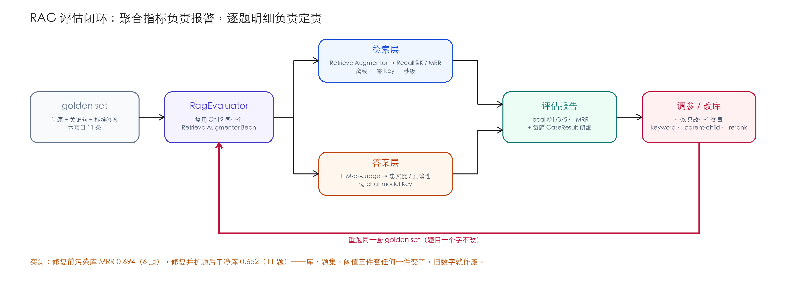
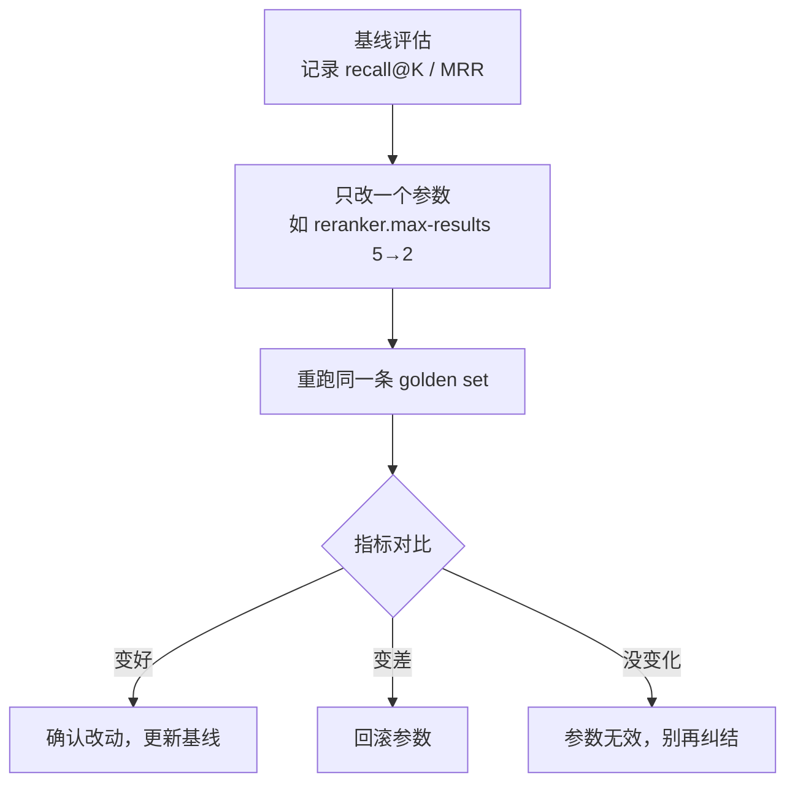

# Ch13 RAG 评估与持续优化——用 golden set 量化"检索好不好"

> **本章基线**：项目 `smart-doc-assistant` ｜ 端口 `8090` ｜ LangChain4j `1.22.0` + 实验模块 `1.22.0-beta32` ｜ JDK `21` ｜ 最后验证 `2026-10-28`（检索层指标当日两种库各实测一轮；答案层（LLM-as-Judge）沿用作者早先实测记录，本轮未重跑——需要 chat model Key）

> 本章目标：
> 1. 理解为什么 RAG 必须评估：改参数靠"感觉"不可复现，"感觉变好了"没有证据
> 2. 掌握**分层评估**：检索层（Recall@K / MRR，离线）与答案层（忠实度 / 正确性，LLM-as-Judge）分开看，才能定位"检索错还是 LLM 编"
> 3. 会读两组真实基线：同一套管线，**库"变干净"之后指标反而掉了**——学会解释这种反直觉
> 4. 会设计 **golden set**：直球 / 多跳 / 否定 / 长尾四种问法，加上本章用真实缺陷换来的三条设计规则
> 5. 读懂仓库里的 `RagEvaluator`：复用 Ch12 的 `RetrievalAugmentor` 直接量指标（**离线、零 API Key**）
> 6. 掌握 **LLM-as-Judge 的偏差学**：位置偏差、长度偏差、自我偏好、格式敏感——以及本项目裁判代码里真实存在的一个解析漏洞
> 7. 形成"评估 → 调参 → 再评估"闭环 + CI 回归门禁

---

## 13.1 为什么 RAG 必须评估

Ch12 把父子分块、重排序、混合检索三件武器装好了。但新的问题立刻出现：**怎么知道它比 Ch11 好？** 靠感觉不行，有三个具体痛点：

| 痛点 | 场景 | 为什么致命 |
|---|---|---|
| **调参靠感觉** | 把 `reranker.max-results` 从 5 改到 2，"感觉"答案变好了 | 感觉不可复现，无法和上个版本对比 |
| **无法定位错因** | 用户说"答案不对" | 是检索没召回相关片段，还是 LLM 没用对上下文？不拆开看只能瞎猜 |
| **回归守不住** | 换了分块策略，之前能答对的问题变答错了 | 没有回归基线，坏了都不知道 |

一句话：**没有评估的 RAG 优化是玄学。**

本章还会给你看第四个只有评估才能暴露的现象：把库里 16 块解析错误的垃圾清掉、换成正确解析的真实文本——一套"只可能变好"的操作——评估指标反而**降了**。没有数字，你连"系统到底有没有变坏"都说不清。

> ✅ **最佳实践**：任何"提升检索质量"的改动（分块尺寸、topK、minScore、reranker 参数、混合开关、换解析器）都必须先在评估上过一遍，用数字说话，再放给用户。评估就是 RAG 的"测试用例"。

---

## 13.2 分层评估：检索层 vs 答案层

RAG 的答案质量 = **检索质量 × 生成质量**。两层混在一起看，永远定位不了问题。所以评估必须分层：

| 层 | 评估什么 | 指标 | 是否要 LLM |
|---|---|---|---|
| **检索层** | 相关片段有没有被召回、排得够不够靠前 | Recall@K / Precision@K / MRR / NDCG | ❌ 否（离线、零 Key、秒级） |
| **答案层** | 回答是否忠于上下文 / 是否正确 | 忠实度 Faithfulness / 正确性 Correctness | ✅ 是（LLM-as-Judge） |

整个评估是一个**闭环**：



**两层指标怎么用**（这是本章最重要的思维）：

- `recall@3 = 1.0` 但答案还错 → **问题在生成层**：上下文里明明有答案，是 LLM 没用对 / Prompt 没约束好；
- `recall@3` 很低 → **问题在检索层**：分块、embedding、topK、混合配置要调；
- 两层都好但用户体验差 → 问题在**业务层**（回答风格、引用来源、格式），那是另一类评估。

> 💡 **Spring AI 对比**：据笔者了解，Spring AI 生态同样没有"开箱即用"的 RAG 评估器（官方建议接外部评测工具；本条为生态观察，未做源码级核实）。评估思路与框架无关：**golden set + 分层指标 + LLM-as-Judge** 这套方法论在两家都适用。

---

## 13.3 检索层指标：用两组真实基线学会读数

### 13.3.1 指标家族：查全 vs 查准

所有检索层指标都基于**一条 golden case**：给一个问题 + 一句"答案里必不可少的关键句"（`expectedContextContains`），看检索结果里有没有它、排第几。

| 指标 | 公式/定义 | 回答的问题 | 短板 |
|---|---|---|---|
| **Recall@K** | top-K 里包含关键句的用例占比 | "该召回的相关片段**漏了没**？" | 只问漏没漏，不问排得乱不乱、准头 |
| **Precision@K** | top-K 里"确实相关"的占比 | "召回来的片段**有多少是有用的**？" | 需要逐条标注相关性，成本高 |
| **MRR** | `mean(1 / 首个命中的排名)`，未命中 0 | "第一个相关片段**排得多靠前**？" | 只看第一个，不看整体排序 |
| **NDCG** | 按位置折扣的累计相关度 | "整体排序**质量**如何？" | 需要相关性分级（不只 0/1） |

**为什么 RAG 优先看 Recall**：RAG 的答案质量**天花板由召回决定**——LLM 拿不到相关片段，再好的排序也白搭。所以 `recall@3 = 1.0` 是底线（相关片段至少得进上下文），`MRR` 是优化项（排得靠前更省 token、更稳）。搜索场景（用户自己在结果里挑）才更看 NDCG/Precision。

### 13.3.2 两组真实基线：同一个系统，两种库

本节是**修复前**的一段实测记录（解析错配的修复当天晚上才落地，见 13.3.4）。当时的 6 条 golden case、Ch12 默认参数（父子分块 + 混合 + 双编码器重排 top5），2026-10-28 上午各实测一轮，唯一区别是库的状态：

| 指标 | 库 A：启动默认库（26 块，含 16 块 PDF 垃圾） | 库 B：目录重建干净库（10 块，PDF 正确解析） |
|---|---|---|
| recall@1 | **0.500** | 0.500 |
| recall@3 | **1.000** | 0.667 |
| recall@5 | 1.000 | 1.000 |
| MRR | **0.694** | 0.667 |

逐题看 reciprocal rank（首个命中位置的倒数）：

| 问题 | 库 A | 库 B |
|---|---|---|
| 七天无理由退货需要满足什么条件？ | 1.0 | 1.0 |
| 退款一般多久能到账？ | 1.0 | 1.0 |
| 支持哪些支付方式？ | 0.5 | 0.5 |
| 什么是 RAG？ | 0.333 | **0.25** |
| pgvector 是什么？ | 0.333 | **0.25** |
| Spring Boot 的核心思想是什么？ | 1.0 | 1.0 |

掉的是「什么是 RAG」和「pgvector 是什么」两题：正确内容（技术手册里的对应段）从第 3 名掉到了第 4 名。原因值得想清楚——

**库 A 里那份 PDF 是被当文本啃进去的 16 块垃圾，相似度只有 0.60 左右，从来不进 top5**，所以它没挤过任何正确答案；**库 B 里 PDF 被正确解析成咖啡机手册的真实文本**，这些真实文本块第一次进入候选池，语义上恰好比"技术手册讲 RAG 的段落"更接近某些泛化查询，于是把正确答案往后挤了一到两位。

系统变坏了吗？没有。库里的内容变了、题目没变，指标是"内容 × 题目"的函数。这件事没有评估你根本发现不了，发现了也解释不了——而它指向的不是回滚"清理"（清理是对的），而是下一节的问题：**golden set 该不该覆盖那份手册？**（答案：该，见 13.4.2。）

顺手对个账：早期章稿里写过一版"MRR 0.6666"，后来在启动库上复现出 0.6944，一度以为前者测错了——真相是**那两个数字分别属于库 B 和库 A**，都真实存在。没有"基线要连库的状态一起记"这条纪律，这种悬案永远结不了。

### 13.3.3 A/B 实测：假设、结果、以及一个零增益

把"下一步该调什么"变成实验，一次只动一个变量，golden set 一个字别改（以下均在库 A——修复前的污染启动库——上，2026-10-28 实测；修复后的复测见 13.3.4）：

| 实验 | 只改这一处 | 假设 | 实测结果 |
|---|---|---|---|
| 基线 | — | — | recall@1/3/5 = 0.5 / 1.0 / 1.0，MRR 0.694 |
| 关关键词路 | `--chat.rag.keyword.enabled=false` | recall@3 掉 → 说明关键词路在补漏 | **六个数字一个不变** |
| 扁平分块 | `--chat.rag.parent-child=false` | 父子分块更优 | recall@1 0.333 / @3 0.667 / MRR **0.514**——掉得干脆 |
| 重排截断 top2 | `--chat.rag.reranker.max-results=2` | 看截断代价 | recall@3 0.667 / MRR **0.583**——rank 3 的两题归零 |

三组结果三种教训：**扁平分块的对照**验证了 Ch12 父子分块的价值（pgvector 一题在扁平模式下前五全空）；**重排截断**验证了"双编码器重排顶不动座次、截断只会扔答案"（Ch12 12.4.4）；而**关键词路**的零增益不是"混合检索没用"，是**这 6 道题里没有一道是它的菜**——型号、数字、专有名词一个都没有（Ch12 12.5.5 有它的正面数据）。假设被数据否掉，和假设被验证一样值钱。

跑法固定：`curl "http://localhost:8090/api/rag/evaluate?includeAnswer=false"`（GET），把返回的 `recallAt1 / recallAt3 / mrr` 抄进对照表。

> ⚠️ **坑点：指标被 golden set 的"关键句"选择绑架**。关键句选得太宽（如单字"退货"）指标虚高、选得太严（要求整段逐字）指标虚低。正确姿势：关键句 = **该问题标准答案里"必不可少"的那一句**，宁严勿宽。**改关键句 = 换了一套测试题，新旧指标不可比**——记录基线时要连 golden set 版本、库的状态一起记。

### 13.3.4 修复落地：基线重测与完整矩阵

13.4.2 盘点的三个缺陷和 13.5.5 的解析漏洞，没有在盘点后过夜——当天就全部修掉了：Ch10 10.4.4 的解析修复 + 元数据写侧补齐、golden set 6→11 条（4 条咖啡手册用例 + 1 条裸型号题）、`parseYesNo` 改前缀全等。这正是调参闭环的第一圈：**评估发现问题 → 修复 → 重测 → 新基线**。

修复后启动即干净库（父子 10 块 / 扁平 7 块），11 题新基线与三组 A/B 全部重测（同一库存量、同一题集，一次只动一个变量）：

| 配置 | recall@1 | recall@3 | recall@5 | MRR |
|---|---|---|---|---|
| **默认（父子 + 混合 + 重排 top5）** | **0.455** | **0.818** | **1.000** | **0.652** |
| 扁平分块（500/50） | 0.182 | 0.545 | 0.818 | 0.417 |
| 重排截断 top2 | 0.455 | 0.636 | 0.636 | 0.545 |
| 关关键词路 | 0.455 | 0.818 | 1.000 | 0.652 |

四行四个结论，方向与修复前一致，幅度更清楚：

- **父子分块 +0.235 MRR**，最鲜活的一题是新的：「K-3000 咖啡机坏了怎么报修？」扁平模式 rr=0（前五全空），父子模式 1.0。手册这种"全篇讲一个产品"的文档，扁平 500 字切完后"报修"那段孤零零地跟全文比相似度，查询里的"咖啡机""坏了"把手册的其他段全都排到了它前面；父子分块"小块被找到、大块讲清楚"，直接满分。
- **重排 top2 砍掉的全是语义题**：「什么是 RAG」「pgvector」「除垢」「美式」四题 rr 集体归零，型号题照旧 1.0 不动——双编码器重排对语义弱的题是精确打击，截断的代价不均匀。
- **关键词路 11 题零变化**，包括补进来的裸型号题「K-3000」。这和 Ch12 12.5.5 的单路由对照不矛盾：那个实验里向量路对裸「K-3000」完全跑偏（技术手册排第一），关键词路才"一发正中"；而在干净父子库的完整管线上，向量路自己就能把手册排到第 2，关键词路给出的第 1 名经 RRF 对冲后仍落第 2。**单路由的结论外推不到管线——评估要在最终管线上做**。这也是型号题进 golden set 的真正价值：它把"混合检索什么时候有用"从直觉变成了可复测的数字。
- 顺带回应 13.3.2 的悬案：手册真实文本进入候选池后，「什么是 RAG」这类泛化题的 rr 从污染库的 0.333 落到 0.25——**题目没变，语料变了，数字就是会动**。基线三件套（阈值 / golden set 版本 / 库构建方式）任何一件变了，旧数字就作废。

---

## 13.4 golden set 设计：不止一种问法

golden set 是评估的"测试用例集"，项目里落在 `src/main/resources/rag-golden-set.json`：

```json
{
  "cases": [
    {
      "question": "七天无理由退货需要满足什么条件？",
      "expectedContextContains": "不影响二次销售",
      "referenceAnswer": "商品需保持完好、不影响二次销售，自签收起七日内可无理由退货；定制类、鲜活易腐、数字化商品不适用。"
    },
    {
      "question": "退款一般多久能到账？",
      "expectedContextContains": "3 个工作日内原路退回",
      "referenceAnswer": "审核通过后款项在 3 个工作日内原路退回；退款审核时限为 48 小时（FAQ 记为 24 小时）。"
    }
    // …其余 9 条略（真实文件共 11 条：6 条语义直球 + 4 条咖啡手册用例 + 1 条裸型号题）
  ]
}
```

三个字段各司其职：

| 字段 | 用途 | 被谁消费 |
|---|---|---|
| `question` | 跑检索 / 跑问答的输入 | 检索层 + 答案层 |
| `expectedContextContains` | 判断"相关片段有没有被召回" | 只被**检索层**消费 |
| `referenceAnswer` | 判断"回答对不对"的标准 | 只被**答案层**消费 |

**为什么用"关键句子串"而不是 chunkId 或文件路径做命中判定？** 因为 Ch12 父子分块后检索返回的是**父块**（文本），且块 id 随分块参数变化不稳定；而"关键句是否出现在检索文本里"直接、可解释、和分块策略解耦。缺点是不够精确（片段包含该句 ≠ 该片段最相关），作为教学基线足够。

### 13.4.1 用例形态：覆盖真实问法的四种

只有"直球问题"的 golden set 会高估系统——真实用户不会只问标准问法。四种必测形态：

| 形态 | 示例 | 为什么必测 |
|---|---|---|
| **直球** | "退款要多久到账？" | 基线，最基础的召回 |
| **多跳** | "3 个工作日内到账，那最快是什么时候能到？" | 需要多个片段**联合**才能答，考验检索的"组合召回" |
| **否定/反问** | "是不是什么商品都能七天无理由退？" | 需要召回"不适用清单"（定制/鲜活/数字化）——常见失败点 |
| **长尾/口语化** | "我买的东西不喜欢能退不？" | "不喜欢"≠"质量问题"，考验语义检索而非关键词 |

### 13.4.2 本项目 golden set 的三个真实缺陷（改稿当天盘点，当天修复）

设计规则从缺陷里长出来才记得住。那个只有 6 条的 golden set，本章改稿当天盘点出三个真实缺陷，每条都在前面的实测里现过形；修复动作也都在当天落地（重测结果见 13.3.4）：

**缺陷一：零覆盖 report.pdf——原因还是误诊。** 6 条用例全部落在三个文本文档上，没有一题碰那份咖啡机手册。早期章稿对此的解释是"图片型 PDF 暂无对应用例"——错的，它是带文本层的 PDF（Ch10 10.4.4 查过）。真实原因更尴尬：Ch10 的解析 bug 让它**从来没被正确索引过**，库里只有它的垃圾块，谁也没见过里面是什么，自然写不出它的用例。直到目录重建后检索出"智能咖啡机 K-3000 产品使用手册"，覆盖盲区才现形。教训：**golden set 的覆盖清单要对着"正确解析后的语料清单"核对，不能对着"库里碰巧有什么"**。这条的修复和 Ch10 的解析修复是同一件事的两面：手册能被正确索引的当天，它的 4 条用例就进了集。

**缺陷二：全是直球语义题，混合检索零触发。** 13.3.3 的关键词路零增益实验就是这么来的。按 13.4.1 的形态表对照：多跳 0 条、否定 0 条、长尾 0 条、型号题 0 条。修复当天补了 4 条手册用例加 1 条裸型号题（6→11）。有意思的是补完在完整管线上复测，型号题并没有让关键词路的增益显形，反而暴露了更深一层的事：**单路由实验的结论，不能直接外推到管线**（13.3.4 第四条）。

**缺陷三：6 条太小，一个名次就是一个百分点级别。** 13.3.2 里两题从第 3 掉到第 4，MRR 就动了 0.028、recall@3 动了 0.333。小样本不是不能用，是**每个数字都要逐题看**——聚合值只配当入口，`cases` 明细才是证据。修复当天扩到 11 条只是缓解，不消除；生产级规模建议 30~100 条起，仍然保留逐题明细的输出（`RagEvaluator` 的 `CaseResult` 天生支持）。

### 13.4.3 语料自相矛盾，标准答案怎么写

这条 golden set 里藏着一个真实的语料冲突：退款审核时限，政策文（refund-policy.txt）写 **48 小时**，FAQ（product-faq.txt）写 **24 小时**。看那条用例的 `referenceAnswer` 是怎么处理的：

> "审核通过后款项在 3 个工作日内原路退回；退款审核时限为 48 小时（**FAQ 记为 24 小时**）。"

标准答案把冲突**记录在案**而不是假装只有一个答案。这很重要，因为两个文档都会被召回，LLM 会看到两个说法——它可能只说一个、可能都说、可能自己调和。没有这条标注，"答案里只有 48 小时"算对还是算错，裁判和人都没法判。工程上的三种处理，按投入排序：标注冲突（本项目做法，零成本）；给文档定优先级（政策文 > FAQ，检索时过滤或注入时声明）；修语料（长期正道）。**语料冲突不是评估的敌人，是评估替你抓出来的第一类真问题。**

---

## 13.5 实战：RagEvaluator

`service/RagEvaluator.java`，约 220 行。**关键设计：直接复用 Ch12 装配好的 `RetrievalAugmentor` Bean，不另起炉灶**——评估的就是线上同一套管线（启动日志会打一行 `[Eval] 使用 RetrievalAugmentor = dev.langchain4j.rag.DefaultRetrievalAugmentor`，评估的装配对不对，这行日志是凭据）。Core 库没有现成评估模块可引（1.22.0 的 core/main 两个 jar 里评估相关类为零，本次 `unzip -l` 核实），所以这套轻量框架是自建的。

### 13.5.1 数据结构：四个 record

```java
/** golden set 一条用例 */
public record GoldenCase(String question, String expectedContextContains, String referenceAnswer) {}

/** 单条用例的评估结果 */
public record CaseResult(String question, boolean hitAt1, boolean hitAt3, boolean hitAt5,
                         double mrr, List<RetrievedChunk> context,
                         String answer, Boolean faithful, Boolean correct) {}

/** 整体评估报告 */
public record EvaluationReport(double recallAt1, double recallAt3, double recallAt5, double mrr,
                                int totalCases, int faithfulCount, int correctCount,
                                boolean answerJudged, List<CaseResult> cases) {}
```

`CaseResult` 里留着完整的 `context`（每个召回片段的 rank / text / score）——这就是"聚合值只配当入口，明细才是证据"的结构保证。score 取分逻辑：优先 `RERANKED_SCORE`，没有再取 `SCORE`（重排过的分数和召回分数不是一个量纲，别混着看）。

### 13.5.2 第一步：让管线吐出检索结果

```java
// ① 检索：直接跑 Ch12 装配好的 RetrievalAugmentor（向量+关键词→RRF 融合→重排）
UserMessage um = UserMessage.from(c.question());
AugmentationResult aug = retrievalAugmentor.augment(
        new AugmentationRequest(um, Metadata.from(um, "eval", List.of())));
List<Content> contents = aug.contents();   // 已融合+重排的结果，顺序即最终排名
```

> **核实留痕**：`1.22.0` 中 `RetrievalAugmentor.augment(AugmentationRequest)` 返回 `AugmentationResult`（非旧文档的 `RetrievalAugmentorResult`）——javap 核实（1.22 只新增了 `augmentAsync` 这个 default 方法，签名未变）。`Metadata.from(ChatMessage, Object chatMemoryId, List<ChatMessage>)` 里的 memoryId 传 `"eval"` 占位即可。

### 13.5.3 第二步：算 Recall@K 与 MRR

```java
String needle = c.expectedContextContains().toLowerCase();
boolean h1 = containsAt(texts, needle, 1);   // top1 拼接文本里有没有关键句
boolean h3 = containsAt(texts, needle, 3);
boolean h5 = containsAt(texts, needle, 5);
double mrr = reciprocalRank(texts, needle);  // 第一个命中的排名的倒数，未命中 0
```

实现就两个私有方法（真实代码）：

```java
/** topK 个片段的拼接文本中是否包含关键句（忽略大小写） */
private boolean containsAt(List<String> texts, String needle, int k) {
    StringBuilder sb = new StringBuilder();
    for (int i = 0; i < Math.min(k, texts.size()); i++) {
        sb.append(texts.get(i)).append("\n");
    }
    return sb.toString().toLowerCase().contains(needle);
}

/** 首个包含关键句的片段排名的倒数（MRR）；未命中返回 0 */
private double reciprocalRank(List<String> texts, String needle) {
    for (int i = 0; i < texts.size(); i++) {
        if (texts.get(i).toLowerCase().contains(needle)) {
            return 1.0 / (i + 1);
        }
    }
    return 0.0;
}
```

注意 `containsAt` 是把 top-K 片段**拼接后**做子串匹配——关键句如果恰好跨在两个片段的边界上（理论上不该发生，父子分块就是为了防这个），它按"进了上下文就算命中"算。这是子串匹配方案固有的宽松处，13.9 的生产升级里换 chunk 级标注可解。

### 13.5.4 第三步：LLM-as-Judge（答案层）

答案层评估的通用套路：**让一个 LLM 当裁判**，把"上下文 / 回答 / 标准答案"喂给它，让它判"是/否"。两个裁判的真实代码：

```java
private Boolean judgeFaithful(String context, String answer) {
    String prompt = "你是严格的 RAG 质量评估员。下面有一段【参考资料】和一份【回答】。\n" +
            "请只判断：回答是否完全基于参考资料、没有编造或超出资料范围。\n" +
            "只回答一个字：基于资料就回“是”，有编造就回“否”。\n\n" +
            "【参考资料】\n" + context + "\n\n【回答】\n" + answer;
    return parseYesNo(askLlm(prompt));
}

private Boolean judgeCorrect(String question, String reference, String answer) {
    String prompt = "你是严格的问答质量评估员。\n" +
            "请判断【回答】是否正确回答了【问题】，且与【标准答案】要点一致（允许表述不同）。\n" +
            "只回答一个字：一致回“是”，不一致或错误回“否”。\n\n" +
            "【问题】" + question + "\n【标准答案】" + reference + "\n【回答】" + answer;
    return parseYesNo(askLlm(prompt));
}

private String askLlm(String prompt) {
    ChatResponse resp = chatModel.chat(UserMessage.from(prompt));   // 1.22：chat() 返回 ChatResponse
    AiMessage ai = resp.aiMessage();
    return ai.text() == null ? "" : ai.text();
}
```

两个细节值得说：

> **核实留痕**：`1.22.0` 的 `ChatModel` **没有** `generate()`，统一用 `chat(...)` 返回 `ChatResponse`，取答案走 `chatResponse.aiMessage().text()`——javap 核实（老教程里的 `Response<AiMessage>` 写法已失效，写代码时别照抄旧版）。
>
> ️ **Prompt 里的引号用的是中文弯引号（“是”），不是直引号**。Java 字符串字面量里的直引号必须转义（`\"是\"`），漏了就编译不过——早期章稿的示例代码就栽在这里。仓库代码选中文弯引号，一石二鸟：不用转义，LLM 读起来也更自然。裁判 Prompt 是中文任务，就别用英文标点添乱。

### 13.5.5 一个真实存在过的解析漏洞（发现当天已修复）

先看**修复前**的代码——它能被一句话击穿：

```java
/** 极简判断：含“否”→false；含“是”→true；否则 null（模型没按格式回答） */
private Boolean parseYesNo(String text) {
    if (text == null) return null;
    String t = text.trim();
    if (t.contains("否")) return false;
    if (t.contains("是")) return true;
    return null;
}
```

注释说它是"极简判断"，没说的是**裁判回答「这是编造」会被判成 true**——"这是编造"含"是"、不含"否"，按代码逻辑返回 faithful=true。同理「不是完全基于资料」也返回 true。含"否"的优先级先判算是打了个补丁（「并不是」会被正确判 false），但「这是……」这类句式就是漏网之鱼。

修复后的现行实现（前缀全等 + 三态）：

```java
/** 极简判断：只认「是/否」打头（或全文就是这一个字）；格式不符返回 null（按未判定处理） */
private Boolean parseYesNo(String text) {
    if (text == null || text.isBlank()) return null;
    String t = text.trim();
    if (t.startsWith("是")) return true;
    if (t.startsWith("否") || t.startsWith("不是")) return false;
    return null;
}
```

「这是编造」现在返回 null（判官没按格式说话，按未判定处理，不计入通过数），「不是」开头的否定也能正确判 false。更彻底的修法仍是生产升级方向：① 裁判 Prompt 要求 JSON 输出 `{"verdict":"yes|no"}` + 结构化解析（Ch07 的 JSON 模式）；② 直接上 13.9 的专业评估框架。**评估器的 bug 比系统的 bug 更危险**——它把错的判成对的，你还拿着这个数字去调系统。

### 13.5.6 完整流程与容错

```java
public EvaluationReport evaluate(boolean includeAnswer) {
    // 1. 加载 golden set（classpath: rag-golden-set.json，Jackson 反序列化成 GoldenSet）
    // 2. 每条用例：augmentor.augment → 算 Recall@K / MRR
    // 3. includeAnswer=true 时：docQaAssistant.ask(question) 拿端到端回答，
    //    再 judgeFaithful / judgeCorrect 各评一次（每条用例 3 次 LLM 调用）
    // 4. 聚合：recall@1/3/5、MRR、faithfulCount / correctCount
}
```

两处容错值得抄走：LLM 调用包在 `safe()` 里（返回"（评估调用异常：…）"字符串而不是让整个评估崩掉），`parseYesNo` 返回 `Boolean`（三态：true / false / **null**，null 表示"裁判没按格式回答"，聚合时不算成功也不算失败）。**评估必须比被评估的系统更抗造**——它跑在 CI 里，一崩就是整条流水线红。

`includeAnswer=false`（默认）**只算检索层，完全离线**——没有 API Key 也能跑，秒级返回，适合 CI 里当回归门禁；`includeAnswer=true` 才调 LLM。

---

## 13.6 接口验证

`EvaluationController` 暴露 `GET /api/rag/evaluate`：

```bash
# ① 仅检索指标（离线、零 Key、秒级）——2026-10-28 修复落地后在两种库存量上各实测：
curl "http://localhost:8090/api/rag/evaluate?includeAnswer=false"
# 启动默认库（修复后即干净库，父子 10 块，11 题）：
# → {"recallAt1":0.4545,"recallAt3":0.8182,"recallAt5":1.0,"mrr":0.6515,"totalCases":11,...}
# --chat.rag.parent-child=false（扁平 7 块）：
# → {"recallAt1":0.1818,"recallAt3":0.5455,"recallAt5":0.8182,"mrr":0.4167,"totalCases":11,...}

# ② 含端到端答案 + LLM-as-Judge（需 chat model Key）——修复前在污染库、6 题集上实测，本轮未重跑：
curl "http://localhost:8090/api/rag/evaluate?includeAnswer=true"
# → {"recallAt1":0.5,"recallAt3":1.0,"mrr":0.6944,
#     "totalCases":6,"faithfulCount":6,"correctCount":6,"answerJudged":true,...}
#    6 条用例约 17 秒（每条 3 次 LLM 调用：生成 + 两个裁判）
```

②里（修复前·污染库·6 题集）有个绝佳教学点（逐题明细来自 `cases` 数组）：`"支持哪些支付方式？"` 这条 **hit@1=false（mrr=0.5，排第 2）**；`"什么是 RAG？"` 和 `"pgvector 是什么？"` 更低，**mrr=0.333（排第 3）**。但端到端回答**仍然正确且忠实**——因为 top3 里已经有它们。这正好演示了 13.2 的分层价值：**检索排序一般 ≠ 答案一定错**，所以看指标要看全（recall@3 + 答案层），别只看 recall@1 就下结论。

---

## 13.7 LLM-as-Judge 的偏差学（深挖）

LLM-as-Judge 是"用便宜的模型模拟人工评审"，它省人力，但**带着一身的偏差**——不知道这些偏差，你的评估数字就是假的。

### 13.7.1 四个已知偏差（LLM-as-Judge 论文共识）

| 偏差 | 现象 | 缓解 |
|---|---|---|
| **位置偏差** | 参考资料里排前面的片段更容易被判"相关" | judge 时随机化片段顺序（多跑几次取众数） |
| **长度偏差** | 回答越长越容易被判"好/忠实" | judge Prompt 明说"不要看篇幅，只看是否基于资料" |
| **自我偏好** | judge 和生成用同一模型时，容易给"自己的风格"高分 | 生产用**不同模型**当裁判 |
| **格式敏感** | 模型不按"是/否"格式回答，解析失败 | `parseYesNo` 容错 + 生产用 **JSON Mode**（Ch07）强制结构化输出 |

本项目把第 4 条的坑踩得很具体：生成和裁判都用 `openAiChatModel`（同一个 Bean），自我偏好这条**结构上就没避开**；13.5.5 的「这是编造」漏洞则是格式敏感的真实样本。

### 13.7.2 单点判断 vs 聚合指标

**"是/否"判断是概率性的**——同一用例多跑几次结论可能波动（模型采样）。所以：

- **别拿单条结论说事**：一条用例 judge 给"否"不代表系统错，可能是 judge 波动；
- **看聚合指标**：`faithfulCount` 6/6 vs 4/6 这种，波动会被平滑；
- **可疑用例人工复核**：`faithful=false` 的用例抽出来人看，判断是"系统错"还是"judge 错"。

### 13.7.3 进阶：rubric-based 评分

yes/no 二值判不了"有多好"。生产进阶用 **rubric**（评分量表）：

```
给回答打 1-5 分：
5 = 完全基于资料且信息完整
4 = 基于资料但漏了关键点
3 = 部分编造
2 = 大部分编造
1 = 与资料无关
只输出分数。
```

rubric 的分数能算平均分、看分布（"大部分用例 3 分 = 普遍漏点"），比 yes/no 更有诊断力；代价是 judge Prompt 更复杂、更需要校准（找几个人先对同一批用例打分对齐）。顺带一提，rubric 的数字输出也绕开了 13.5.5 那个"是/否"解析漏洞——你解析的是整数，不是自然语言判断。

---

## 13.8 调参闭环：评估到底怎么用

有了尺子，调参就从"猜"变成"跑数据"。标准动作：



**为什么强调"只改一个参数"？** 一次改多个（分块 + topK + reranker 一起动），指标变了你根本不知道是谁的功劳。对照实验的铁律。

但这张图漏了一种本章刚发生的情况：**指标变差，但改动是对的**。13.3.2 的"清理垃圾库"就是——recall@3 从 1.0 掉到 0.667，按图该走"回滚"，可清理本身无可指摘。这时候多问一句"变差的是哪几题、为什么"，答案就出来了：不是系统坏了，是**语料内容变了而题目没变**。所以流程图的 D 框后面应该补一步：**先看逐题明细，再决定确认 / 回滚 / 改 golden set**。聚合指标负责报警，逐题明细负责定责。

> ✅ **最佳实践：把评估接进 CI（回归门禁）**。`includeAnswer=false` 的检索层评估离线、秒级、零 Key，天生适合 CI。最小接入（curl 断言）：

```bash
# mvn test 阶段：评估失败（recall@3 < 0.9）就让构建红
EVAL=$(curl -s "http://localhost:8090/api/rag/evaluate?includeAnswer=false")
RECALL3=$(echo "$EVAL" | python3 -c "import json,sys; print(json.load(sys.stdin)['recallAt3'])")
python3 -c "import sys; sys.exit(0 if float('$RECALL3') >= 0.9 else 1)" \
  || { echo "❌ RAG 回归失败：recall@3=$RECALL3 < 0.9"; exit 1; }
```

注意 0.9 是随手写的示意值——**它连本项目修复后干净库 0.818 的 recall@3 基线都过不了**，接进 CI 会天天红。阈值不是拍的，是从基线长出来的：先跑一轮基线，把线定在"基线 − 允许波动"上（本项目 11 题集的合理线形如 recall@3 ≥ 0.8、MRR ≥ 0.6），并且**阈值跟着库和 golden set 的版本走，三件套（阈值 / golden set 版本 / 库的构建方式）写进同一处配置或文档**。生产可用 promptfoo / DeepEval 替代自写脚本（见 13.9）。

---

## 13.9 下一章预告 + 生产升级路径

**下一章：Ch14 Agent 基础**——RAG 让 LLM "会查资料"，Agent 让 LLM "会干活"：多步推理、自主决定调哪些工具。Ch13 的评估思维会延续到 Agent 场景。

**本章"教学简化"的生产升级**（已验证结论，给方向不给伪代码）：

1. **换专业评估框架**：RAGAS（Recall/Context Precision/Answer Faithfulness 全套指标）、promptfoo / DeepEval（golden set + 断言 + CI 集成），别自己重复造轮子；
2. **golden set 规模化**：用线上真实问答 + 人工标注，覆盖长尾问法；关键句改用手工标注的"chunk 级相关性标签"（可算 Precision/NDCG），比子串匹配精确；
3. **Judge 结构化 + 多模型**：JSON Mode 输出 verdict + reason，judge 用与生成不同的模型，配合人工抽检兜底。

---

## 13.10 高频坑点与最佳实践汇总

### 坑 1：关键句选择绑架指标

关键句宽一档指标虚高、严一档虚低；改关键句 = 换测试题，新旧数字不可比。基线记录必须带 golden set 版本。（13.3.3）

### 坑 2：小样本上聚合值当真相

6 条用例，一题从第 3 掉到第 4，recall@3 就动 0.333。聚合指标报警，逐题明细定责。（13.3.2 / 13.4.2）

### 坑 3：golden set 对着"库里有什么"写，而不是对着"语料该有什么"

本项目 6 题零覆盖咖啡机手册，根因是解析 bug 让手册从未进库——用例跟着缺陷走，缺陷被修掉后评估就瞎了一角。覆盖清单对着正确解析后的语料核对；修复当天补齐的 4+1 条用例就是这么来的。（13.4.2）

### 坑 4：库变了，拿旧阈值当门禁

0.9 这种拍脑袋的阈值，连修复后干净库 0.818 的基线都过不了——天天红。阈值从基线长出来，且与 golden set 版本、库构建方式三件套一起管。（13.8）

### 坑 5：裁判解析被自然语言击穿

含"是"即 true 的子串解析，挡不住「这是编造」。要么全等匹配 + null 三态，要么 JSON Mode。（13.5.5）

### 坑 6：评估器自己不抗造

单条 LLM 调用异常就让评估崩，CI 一崩全红。`safe()` 包装 + 三态 Boolean 是底线。（13.5.6）

### 坑 7：指标变差就回滚，不问为什么

"变差"有三种：系统坏了、语料变了、题目偏了。先看逐题明细再定动作——13.3.2 的清理实验就是第三种。（13.8）

**最佳实践汇总**：

- ✅ 检索层评估（离线、秒级、零 Key）先进 CI，答案层按需人审
- ✅ 每次实验只动一个变量，结果抄进对照表，假设被否掉也记下来
- ✅ 聚合指标 + 逐题明细一起输出（`EvaluationReport.cases` 就是为此设计的）
- ✅ 语料冲突标注进 `referenceAnswer`，别让裁判猜
- ✅ 评估器复用线上同一个 `RetrievalAugmentor` Bean，启动日志核对装配
- ❌ 不要抄别人的"提升幅度"——能复现的只有方法，数字属于你的语料和模型
- ❌ 不要在含已知脏数据的库上调优——先修数据，再立基线

---

## 13.11 本章小结

### 13.11.1 概念速查表

| 概念 | 一句话 |
|---|---|
| **golden set** | RAG 的"测试用例集"：问题 + 应命中的关键句 + 标准答案；覆盖直球/多跳/否定/长尾，外加型号题 |
| **分层评估** | 检索层（Recall@K / MRR，离线）与答案层（忠实度 / 正确性，LLM-as-Judge）分开看 |
| **Recall@K vs Precision@K** | 查全 vs 查准；RAG 答案天花板由召回决定，所以优先看 Recall |
| **MRR vs NDCG** | 前者只看首个命中位置；后者看整体排序质量（需相关性分级） |
| **两代基线** | 修复前 6 题集：污染库 0.694 / 干净库 0.667；修复后 11 题集：0.652——指标是"内容 × 题目 × 题集版本"的函数 |
| **LLM-as-Judge 偏差** | 位置/长度/自我偏好/格式敏感；单点波动，看聚合指标 + 人工复核 |
| **裁判解析** | 子串匹配「是/否」会被「这是编造」击穿；全等 + 三态或 JSON Mode |
| **调参闭环** | 基线 → 只改一个参数 → 重跑同 golden set → 对比 → 逐题定责后确认/回滚 |
| **CI 回归门禁** | 离线检索评估接 CI；阈值连着 golden set 版本与库构建方式一起管 |
| **检索层≠答案层** | recall@3 好但答案错 = 生成层问题；recall@3 差 = 检索层问题 |

### 13.11.2 验证清单

- [ ] 能说出两组基线的差别（0.694 vs 0.667）是谁造成的，为什么不是"清理错了"，以及修复后新基线（0.652 @ 11 题）为什么不能跟旧数字直接比
- [ ] 跑过 13.3.4 的三组 A/B，能复述每组结果推翻或验证了哪个假设
- [ ] 能列出本项目 golden set 曾有的三个缺陷和对应的修复动作
- [ ] 读懂 `RagEvaluator` 的四个 record 和 evaluate() 主循环
- [ ] 能复述 `parseYesNo` 的漏洞与修复（前缀全等 + 三态），并说出为什么保留 null
- [ ] 能解释 `includeAnswer=false` 为什么能离线跑（检索用本地 ONNX，重排默认双编码器，全程无外呼）
- [ ] 知道 CI 阈值为什么必须连着库的构建方式一起管

---

## 13.12 本章项目代码状态

仓库当前代码即完整实现（无 tag、无版本快照，以下均为当前路径）：

| 模块 | 文件 | 说明 |
|---|---|---|
| 评估器 | `service/RagEvaluator.java` | 四个 record + evaluate() 主循环 + 指标计算 + LLM-as-Judge + safe()/parseYesNo 容错（解析漏洞已修，见 13.5.5） |
| 接口 | `controller/EvaluationController.java` | `GET /api/rag/evaluate?includeAnswer=false/true` |
| 数据 | `resources/rag-golden-set.json` | 11 条 golden case（修复当天从 6 条扩来：4 条手册用例 + 1 条裸型号题，见 13.4.2） |
| 入库修复 | `service/DocumentIngestionService.java` | 2026-10-28 修复 Ch10 10.4.4 解析错配（PathMatcher 分拨）+ docId/category 写侧——13.3.4 的重测由此而来 |
| 检索管线 | `config/AdvancedRagConfig.java` 等 | **零改动**——评估器直接复用 Ch12 Bean |

---

## 13.13 练习题

1. **查询形状实验**（覆盖盲区已由作者补齐——修复当天 4 条手册用例 + 裸型号题进集，见 13.3.4）：把「咖啡机多久除垢一次？」改成「K-3000 保养」重跑 evaluate，观察同一块内容的 rr 怎么被查询形状改变；再想想该不该把两种形状都放进 golden set。
2. **测裁判**：13.5.5 的修复已落仓库。写个 main 构造五个输入（"是"、"这是编造"、"不是完全基于资料"、"并非如此"、"否。"），打印现行 `parseYesNo` 的三态输出；然后试着找一个还能让它给出**错误** true/false 的句子——找不到也说说为什么前缀全等比子串匹配难击穿。
3. **复现 A/B**：按 13.3.4 的表把三组实验各跑一遍（keyword off / parent-child off / rerank top2），和书中数字对照——不一致就先查两件事：库的构建方式（当前代码启动即干净库：父子 10 块 / 扁平 7 块）和 golden set 版本（11 条）。
4. 把 judge 的 yes/no 改成 13.7.3 的 rubric 打分（1-5），跑 `includeAnswer=true`，对比"平均分"和"yes/no 通过率"哪个更能暴露问题。
5. 思考题：LLM-as-Judge 把 judge 换成另一个模型（如从 DeepSeek 换 Qwen）后跑 `includeAnswer=true`，faithfulCount 可能变化——为什么？这暴露了什么方法论问题？

---

**下一章：Ch14 Agent 基础**——RAG 让 LLM "会查资料"，Agent 让 LLM "会干活"：多步推理、自主决定调哪些工具、干完自己判断要不要再干一轮。Ch12 的检索管线会作为 Agent 的一个工具接进去，Ch13 的评估思维也一起延续过去：Agent 的每一步都要能被看见、被量化。
