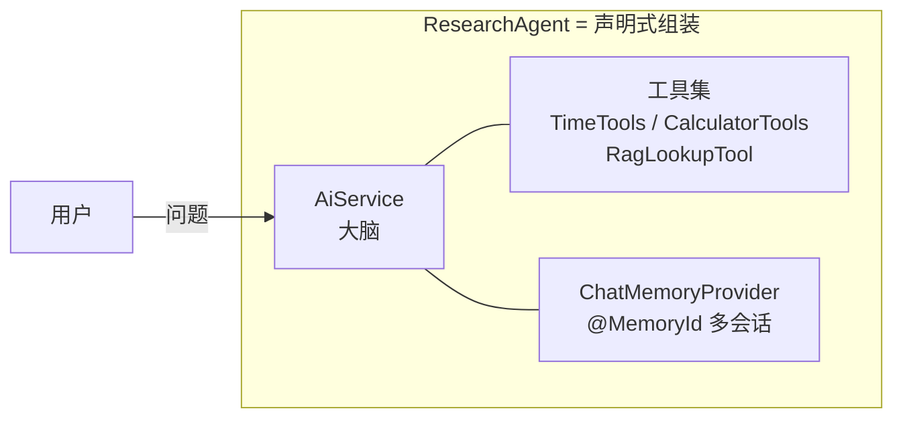
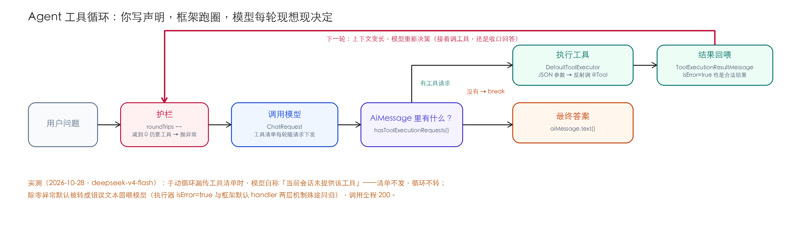

# Ch14 Agent 基础——让 LLM 会"干活"

> **本章基线**：项目 `smart-doc-assistant` ｜ 端口 `8090` ｜ LangChain4j `1.22.0` + 实验模块 `1.22.0-beta32` ｜ JDK `21` ｜ 最后验证 `2026-10-28`

> 本章目标：
> 1. 理解为什么"工具调用"还不够：Agent 需要**多步推理 + 自主决策**
> 2. 掌握本章最重要结论：**`AiServices` 这一层没有独立的 Agent 类型**——Agent 是一种**组装模式**（service + 工具集 + 记忆 + 框架替你跑的循环）；官方另有实验性的 `langchain4j-agentic` 模块提供声明式多 Agent 抽象（本项目 `agentic/` 包有实战代码，本系列不展开，见官方文档）
> 3. 掌握 **ReAct 范式**：工具循环 = ReAct 的产品化实现
> 4. 掌握**工具循环的源码级机制**：解包 `ToolService` 看 `while(true)` 真实代码，包括一个**常见误解的纠正**（防循环是抛异常，不是强行出答案）
> 5. 掌握**工具调用失败的三层处理机制**：执行器层、框架 handler 层、模式默认值——每一层都有实测
> 6. 实战声明式 Agent：`ResearchAgent`（计算器 + 时间 + 知识库三工具，带多轮记忆）
> 7. 实战手动循环：`ManualAgentService` 亲手复现框架黑盒——含一个**2026-10-28 修掉的真实 bug**（漏传工具清单，循环从未转过）
> 8. 记录一个诚实结论：手动循环是教学演示，生产用框架循环 + `Result` 审计

## 14.1 为什么需要 Agent

工具调用（Function Calling）解决的是"让模型**会调一次工具**"：模型看到问题 → 决定调一个工具 → 拿到结果 → 回答，一轮结束。局限很明显：

| 局限 | 例子 | 本质 |
|---|---|---|
| **只能调一次** | "查一下退款时效，再算成小时"——查和算各是一次工具调用 | 没有多步推理 |
| **不能根据结果决策** | 查知识库发现"48 小时"，要不要继续算 48×60 分钟？模型不知道 | 没有自主性 |
| **没有任务状态** | 多轮对话中"刚才那个数字"指什么？ | 没有跨步记忆 |

"会调一次工具"和"会干活"之间，差的正是**循环**：调完一个工具，把结果放回对话里，让模型决定下一步——直到任务完成。能跑这个循环的，就是 **Agent**。

## 14.2 什么是 Agent（LangChain4j 视角）

> **核实留痕（重要）**：解包 `langchain4j-core-1.22.0.jar` 确认：`dev.langchain4j.agent` 包下**只有 `tool/` 子包**（`Tool` / `P` / `ToolSpecification` / `ToolExecutionRequest` 等），**没有 `Agent` 接口或类**。全局搜索 `Agent.class` 同样为空（1.19 到 1.22 这一结论没变）。

也就是说：**在 LangChain4j 里，Agent 不是一个类，而是一种组装模式**。它由三样东西拼出来：

| 组件 | 对应物 | 作用 |
|---|---|---|
| **大脑** | `@AiService`（或 `AiServices.builder`） | 编排：调用模型、维护对话 |
| **手** | 一组 `@Tool` 工具 Bean | 模型能实际执行的动作（算数/查时间/查知识库…） |
| **记忆** | `ChatMemoryProvider`（@MemoryId 隔离） | 多轮对话、跨步上下文 |

框架在底层自动跑"模型 ↔ 工具"的循环，你要做的只是**声明**："这个助手能调这三样工具、记得每个会话的上下文"。对比 Python 的 LangChain 有 `Agent` 类，LangChain4j 选择了**更 Java 的方式：接口即声明**。



> **Spring AI 对比**：Spring AI 同样没有"Agent 类"，对应物是 `ChatClient` + `ToolCallback` + 自管理会话记忆，需要你自己写循环或用 `ChatClient.builder` 组合。两家的结论一致：**"Agent"是模式不是类型**。区别在 LangChain4j 把循环做进了 `AiServices`，声明式更省事。

## 14.3 ReAct 范式：Agent 的理论出身

在 Prompt 工程里模拟 ReAct 的老办法你大概见过：把 `Thought / Action / Observation` 三段格式写死在提示词里，让模型照着填。这个思路正是本章的主角——LangChain4j 把它从"提示词约定"升级成了"框架协议"。

### 14.3.1 ReAct 是什么

ReAct（Yao et al., 2022）提出的范式：让 LLM 交替进行**推理**（Thought）和**行动**（Action），每次行动后观察结果（Observation），再决定下一步——而不是一次性拍板答案：

```text
Question: 退款审核要多久？3 个工作日等于多少小时？
Thought 1: 我需要先查退款政策里审核时效的规定
Action 1:  searchKnowledgeBase("退款审核时限")
Observation 1: 审核时限 48 小时，通过后 3 个工作日内原路退回
Thought 2: 用户问的是"到账时间"，需要把 3 个工作日换算成小时
Action 2:  calculate("3 * 24")
Observation 2: 72
Thought 3: 两个信息都拿到了，可以回答了
Answer: 审核一般 48 小时，通过后 3 个工作日（72 小时）内到账
```

纯靠提示词约束的模拟是脆弱且不可控的——模型少写一个 Observation、格式跑偏一点，你的解析代码就崩了。

### 14.3.2 LangChain4j 的工具循环 = ReAct 的产品化

框架把这套范式做成了**协议级**的能力，映射关系：

| ReAct 概念 | LangChain4j 对应物 | 谁负责 |
|---|---|---|
| **Thought**（推理） | 模型决定"要不要调工具、调哪个、传什么参数" | LLM（隐式，不需要 Prompt 教） |
| **Action**（行动） | `AiMessage.toolExecutionRequests()` | LLM 产出，结构化 JSON |
| **Observation**（观察） | `ToolExecutionResultMessage` 回喂进消息列表 | 框架自动 |
| **循环控制** | `while` + `maxToolCallingRoundTrips`（见 14.4） | 框架 |
| **Answer**（终止） | 模型不再请求工具 → 输出文本 | LLM 自主判断 |

**三个关键升级**（相对上一节的 Prompt 模拟）：
1. **Thought 不再需要模板**：函数调用（Function Calling）让模型"想调工具"时输出结构化请求，而不是填 Thought 文本——推理隐含在"决定调什么工具、传什么参数"里；
2. **Observation 不靠解析**：工具结果是类型安全的 `ToolExecutionResultMessage`，不是从文本里抠 Observation；
3. **循环有护栏**：`maxToolCallingRoundTrips` 硬上限，模型抽风不会无限烧钱。

> **最佳实践**：虽然框架不要求写 Thought 模板，**Prompt 仍可以引导推理质量**——工具描述写清"什么场景用"、系统消息给决策规则（如"先查知识库再回答，不要凭记忆"），这些就是给模型的"ReAct 提示"。框架解决机械循环，Prompt 解决思考质量。

## 14.4 底层机制：工具循环源码级拆解（Agent 的心脏）

整章就这一张图的事，先看全貌再拆源码：



### 14.4.1 真实的 while 循环（解包 `ToolService.java`）

不管声明式还是手动，Agent 底层的循环都一样。

> **版本注（重要）**：本节循环骨架来自 `dev.langchain4j.service.tool.ToolService#executeInferenceAndToolsLoop`。在 **0.x** 版本这个方法签名短（约 5 参数，源码在 `langchain4j-core` 的 `dev.langchain4j.service.tool` 包，L564 起）；在 **1.19.0 及 1.22.0** 里方法签名是 9 个参数（新增 `InvocationContext`、`ToolServiceContext`、流式回调——1.22 原样保留，只多出 `...Async` 兄弟方法），且该类位于**聚合模块 `langchain4j-1.22.0.jar`**（不在 `langchain4j-core`，core 的 sources jar 也未含此文件，需反编译聚合 jar 才能看到）。**但"护栏→调模型→写记忆→判工具→跑工具→回喂→goto"的循环骨架完全一致**，下面用逻辑等价伪代码呈现，再补真实调用链与跑圈例子。

#### 1) 循环骨架（逻辑等价伪代码）

```java
// maxToolCallingRoundTrips 由你配置，默认 10
int roundTripsLeft = maxToolCallingRoundTrips;

while (true) {
    // ① 防循环护栏：每轮先减 1，减到 0 还没结束 → 直接抛异常
    //    （不是"强行出答案"，详见 14.4.2）
    if (roundTripsLeft-- == 0) {
        throw runtime("Something is wrong, exceeded %s tool calling round trips",
                maxToolCallingRoundTrips);
    }

    // ② 取当前轮模型回复的 AiMessage（含模型这轮的"想法"和"工具请求"）
    AiMessage aiMessage = chatResponse.aiMessage();

    // ③ 把模型的决策写进记忆 / 本地消息列表
    //    声明式 Agent 走 chatMemory（带 @MemoryId 隔离多会话）；
    //    手动循环因无真正 ChatMemory，退化为本地 List —— 这就是"教学版缺记忆写入"的差距
    if (chatMemory != null) {
        chatMemory.add(aiMessage);          // ReAct 的 Thought + Action 留痕
    } else {
        messages = new ArrayList<>(messages);
        messages.add(aiMessage);
    }

    // ④ 终止条件：模型这一轮不再要工具 → 这就是最终答案（ReAct 的 Answer）
    //    关键：框架不替模型判断"任务完成没"，而是问模型"你还要调工具吗？"
    if (!aiMessage.hasToolExecutionRequests()) {
        break;
    }

    // ⑤ 执行本轮全部工具请求（可能多个，ReAct 的 Action）
    List<ToolExecutionRequest> toolExecutionRequests = aiMessage.toolExecutionRequests();
    Map<ToolExecutionRequest, ToolExecutionResult> toolResults =
            execute(toolExecutionRequests, toolServiceContext.toolExecutors(), invocationContext);

    // ⑥ 结果转消息 + 逐个触发事件 + 补偿记录（ReAct 的 Observation）
    for (ToolExecutionRequest request : toolExecutionRequests) {
        ToolExecutionResult result = toolResults.get(request);
        ToolExecutionResultMessage toolExecMsg = toResultMessage(request, result);
        // fireToolExecutedEvent(...)      ← Ch16 审计回调的来源就在这里！
        // compensableExecutions           ← 工具补偿机制，出错时反向补偿
    }

    // ⑦ 把工具结果回喂进记忆，然后带着新上下文再调一次模型
    //    （1.22.0 字节码里对应 goto 跳回循环起点 ①，实现"多轮"）
}
```

**逐行对照 ReAct**：①④ 是循环控制（护栏 + Answer 终止）、③ 是 Thought/Action 留痕进记忆、⑤ 是 Action 执行、⑥ 是 Observation 回喂（顺带触发 Ch16 审计事件）。

#### 2) 真实调用链（反编译聚合 jar 核实，1.19.0 与 1.22.0 一致）

在 `1.22.0` 里，上面伪代码的每一步都对应真实字节码证据（与 1.19.0 逐条比对无差异）：

| 字节码行为 | 对应逻辑 | 说明 |
|---|---|---|
| 循环头 + `if (roundTripsLeft-- == 0) throw` | ① 护栏 | 在循环**第一行**先减后用；超限抛 `RuntimeException` |
| `chatMemory.add(aiMessage)` / `messages.add(...)` | ③ 写记忆 | 记忆优先，否则退化本地 List |
| `if (!aiMessage.hasToolExecutionRequests()) break` | ④ 终止 | `break` 由模型自己决定，框架不替它判断 |
| `execute(requests, ...)` 内部按 `request.name()` 查 executor | ⑤ 跑工具 | `DefaultToolExecutor` 解析 JSON 参数→反射调 `@Tool` 方法 |
| `compensatingExecutors` / `onToolExecutionError` | ⑥ 补偿 | 工具失败→补偿+重写记忆（详见 14.4.3） |
| 返回 `ToolServiceResult`（`intermediateResponses` + `finalResponse` + `toolExecutions` + `aggregateTokenUsage`） | 收尾 | 每轮中间响应与最终响应都打包，供可观测性使用 |
| `goto` 跳回循环起点 | ⑦ 多轮 | 模型每轮都基于"更长的 messages"重新决策 |

#### 3) 跑一圈例子：把抽象循环变成看得见的过程

假设你的 `ResearchAgent` 被问：**"查一下退款时效，再算 3 个工作日等于多少小时"**（已配 `RagLookupTool`、`CalculatorTools` 两个 `@Tool`）。

**第 1 轮**
- ② 模型看到：用户问题 + 2 个工具清单 → 输出 `toolExecutionRequests = [RagLookupTool.search("退款审核时限")]`
- ③ 这个 AiMessage（含"我决定先查知识库"的推理）进记忆
- ④ `hasToolExecutionRequests() == true` → 不 break
- ⑤ 执行 `RagLookupTool.search` → 返回 `"审核时限 48 小时，通过后 3 个工作日内原路退回"`
- ⑥/⑦ 结果作为 `ToolExecutionResultMessage` 回喂进 messages，`roundTripsLeft` 从 10 变 9，`goto` 回 ①

**第 2 轮**
- ② 模型看到：问题 + 第1轮思考 + "48小时/3个工作日" → 输出 `toolExecutionRequests = [CalculatorTools.calculate("3 * 24")]`
- ③ 进记忆
- ④ 有请求 → 不 break
- ⑤ 执行 `CalculatorTools.calculate` → 返回 `"72"`
- ⑥/⑦ 回喂，`roundTripsLeft` 变 8，`goto` 回 ①

**第 3 轮**
- ② 模型看到全部上下文 → 输出**没有** `toolExecutionRequests`，只有文本 `"审核一般 48 小时，通过后 3 个工作日（72 小时）内到账"`
- ④ `hasToolExecutionRequests() == false` → **break**
- 这个 AiMessage 的 `.text()` 就是最终答案，返回给调用方

**整个过程**：模型调了 2 次工具、框架跑了 3 轮 `chatModel.chat`、你只写了 1 行 `researchAgent.chat(...)`。这就是"Agent 自己干活"的真相——**你写的是声明，框架跑的是循环，模型做的是每轮的决策**。所谓"多步推理"= 多轮循环，每一步都是模型自己输出的 `toolExecutionRequests`。

#### 关键认知：框架不规划，模型每轮"现想现决定"

很多读者会误以为"开始就整理好工具顺序，框架按清单依次执行"。**错**。下面澄清 `hasToolExecutionRequests()` 到底在判什么、模型怎么知道该调哪个、什么时候停：

**（1）判断的不是框架，是模型当轮的输出**
`hasToolExecutionRequests()` 只是读取**上一轮模型返回的 `AiMessage`** 里有没有 `toolExecutionRequests` 字段。模型输出有两种形态：
- **要工具**：`AiMessage` 里带 `toolExecutionRequests = [{name:"searchKnowledgeBase", arguments:{...}}]`——模型自己说"我要调这个工具、传这些参数"；
- **不要工具**：`AiMessage` 里只有 `text = "..."`——模型自己说"信息够了，直接回答"。
框架完全不做推理，它只**读**模型给了哪个形态。

**（2）工具清单每轮都发，但顺序/是否调用从不由框架定**
工具清单（`ToolSpecification`：名称+描述+参数 Schema）每轮都随请求发给模型，但**框架从不告诉模型"先 A 后 B"**——调不调、调几次、什么顺序，全是模型临场决策。

**（3）模型靠"越来越长的上下文"推理下一步**
回看上面三轮：第 1 轮模型**并不知道**还要算数（因为还没拿到时效数据），所以它只输出"查知识库"；第 2 轮看到"3个工作日"后才推理出"还要算 3×24"；第 3 轮看到"72"后推理出"问题已闭环，不用再调"。每一步决策，原料都是**每轮变长的 messages**：
```
[用户问题] → [AiMessage:我要查] → [Tool结果:3个工作日]
          → [AiMessage:我要算] → [Tool结果:72] → [AiMessage:我答]
```
第 3 轮之所以"知道不用再调"，是因为它看见了前面所有 Observation，**自己判断问题已解决**。

**（4）一句话总结三类常见疑问**

| 疑问 | 真相 |
|---|---|
| 开始就识别出要用哪些工具整理好？ |  否。框架从不规划，只每轮把工具清单发给模型 |
| 执行中根据上下文推理还差什么？ |  是。模型每轮基于越来越长的上下文，自己推理"下一步调不调、调哪个" |
| 怎么知道哪一步没结果了？ | `hasToolExecutionRequests()` 读模型当轮输出：有→继续循环，没有→`break` 出答案。判断权在模型，不在框架 |

所以 Agent 的"智能"不在框架（框架只是 `while` 循环 + 反射调方法），而在 **LLM 每轮的 Function Calling 决策**。同一段代码换 Prompt 或换模型，工具调用路径可能完全不同——因为决策是模型现想的。

### 14.4.2 一个常见误解的纠正（作者踩过）

> **坑点（源码纠正）**：很多人（包括本书早期版本的作者）以为 `maxToolCallingRoundTrips` 超限后"框架会强行让模型出答案"。**错**——源码是直接 `throw runtime(...)` 抛异常，整次调用失败。所以：
> - 护栏值要设得**够宽**（业务里合理工具链需要 5-8 轮，就设 10）；
> - 真想"超限也能拿到部分结果"，得在业务层 try-catch + 降级（比如返回"任务过复杂，请分步提问"），框架不管这层。

### 14.4.3 工具清单怎么进模型请求

声明 `tools(...)` / `toolProvider(...)` 之后，框架在**每次** `chatModel.chat(...)` 前把工具规格（`ToolSpecification`：名称/描述/参数 JSON Schema）塞进 `ChatRequest`——模型每轮都"看得见"工具清单，据此决定 Action。`DefaultAiServices` 在调用 `ToolService` 前通过 `toolService.createContext(...)` 构建"工具规格→执行器"映射，并随请求下发（1.22.0 中该链路位于 `DefaultAiServices` 进入 `executeInferenceAndToolsLoop` 之前；具体行号随版本变动，不固定，建议以方法名定位）。这也是 Ch16 动态工具（`ToolProvider`）能生效的底层原因：**每次调用前重新构建工具上下文**。

### 14.4.4 循环里的两个消息类型（javap 核实签名）

- `AiMessage.toolExecutionRequests()` → `List<ToolExecutionRequest>`：模型"想调用哪些工具、参数是什么"；
- `ToolExecutionResultMessage.from(req, result)`：工具执行结果，**按 request id 回挂**给模型。

**防循环护栏**：`AiServices` 提供 `maxToolCallingRoundTrips(int)`（老 API 叫 `maxSequentialToolsInvocations`，1.19 两者都在），限制"模型↔工具"的最大轮次。

### 14.4.5 工具调用失败处理：三层机制，别只记"会抛异常"

工具执行会失败——参数除零、文件不存在、外部接口超时。1.22 里这件事有**三层机制**，各管一段（源码核实）：

| 层 | 谁负责 | 默认行为 | 源码位置 |
|---|---|---|---|
| ① 执行器层 | `DefaultToolExecutor` | `propagateToolExecutionExceptions=false`：异常**就地**转成 `isError=true` 的执行结果，错误文案当返回值 | `DefaultToolExecutor.java` L148-155 |
| ② 框架层 | `ToolService` 的 handler | 同步/TokenStream 模式默认 `sendExceptionMessageToLlm`——把异常消息**发给模型**，调用继续 | `ToolService.java` L104（`EXECUTION_ERROR_TO_LLM`） |
| ②' 框架层（显式） | `AiServices.toolExecutionErrorHandler(...)` | 你自己决定：回喂文本 / `failInvocation()` 抛出去（1.21+） | `ToolExecutionErrorHandler` 接口 |

关键在**模式默认值不对称**（`AiServices` javadoc 原话 "Defaults differ by mode"）：**同步与 TokenStream 模式默认把工具错误发给 LLM**（模型有机会换条路或向用户解释），**异步与响应式模式默认让调用失败**（宁可报错也不瞒着你）。框架建的执行器一律 `propagate=true`（`ToolService.java` L243），所以异常总能到达 ②；只有你**自己 `new DefaultToolExecutor`**（手动循环就是这么干的）才会落在 ① 的就地转换上。

本项目两组实测（除零，`calculate(5, DIVIDE, 0)` 抛 `IllegalArgumentException`，2026-10-28）：

- **声明式路径**：`/api/agent/chat` 问"5 除以 0"→ HTTP 200，回答先把工具的报错原样引出来（"计算器返回了错误：**除数不能为零**"）再给数学解释——② 的默认行为；
- **手动循环路径**：同样问题 → 同样 200，`ManualAgentService` 的执行日志里工具结果直接就是错误文案（`…执行工具[calculate] → 除数不能为零，请换个非零的第二个数字`）——① 的就地转换。

两条路殊途同归，但**机制不同**：前者异常真的抛了、被 handler 接住（日志留痕），后者压根没抛。什么时候有区别？当你配了自定义 handler（Ch16 的审计/熔断）或跑异步模式时——① 会把异常吞在执行器里，你的 handler 根本收不到。要在手动循环里复现框架语义，构造执行器时用 `DefaultToolExecutor.builder().propagateToolExecutionExceptions(true)`。

## 14.5 实战：声明式 Agent

### 14.5.1 接口：一句话声明"这个 Agent 能干嘛"

`ResearchAgent`（`assistant/` 包）：

```java
public interface ResearchAgent {
    Result<String> chat(@MemoryId Long sessionId, @UserMessage String question);
}
```

`@MemoryId` 做会话隔离（`ChatMemoryProvider` Bean 项目里已配好，`AgentConfig` 直接注入），返回 `Result<String>` 而非 `String`——为的是审计：能拿到 `tokenUsage()`（成本）和 `toolExecutions()`（这次调了哪些工具）。

### 14.5.2 新工具：知识库查询（让 Agent 会"查资料"）

Ch14 给 Agent 配了**第三个工具** `RagLookupTool`——直接复用 Ch12 的 `RetrievalAugmentor`，把 Ch12 的整条检索管线变成 Agent 的一只手：

```java
public class RagLookupTool {
    private final RetrievalAugmentor augmentor;

    @Tool("查询本地知识库，返回与问题最相关的文档片段，用于回答基于文档的问题")
    public String searchKnowledgeBase(@P("用户的问题") String question) {
        UserMessage um = UserMessage.from(question);
        AugmentationResult res = augmentor.augment(
                new AugmentationRequest(um, Metadata.from(um, "rag-tool", List.of())));
        StringBuilder sb = new StringBuilder();
        int i = 0;
        for (Content c : res.contents()) {
            sb.append("[片段 ").append(++i).append("] ").append(c.textSegment().text()).append("\n\n");
        }
        return sb.toString().isBlank() ? "未检索到相关内容。" : sb.toString().strip();
    }
}
```

于是 Agent 能做**跨工具多步推理**："查一下退款时效 → 再算 3 个工作日等于多少小时"——先调 `searchKnowledgeBase`，拿到"3 个工作日内原路退回"，再调 `calculate` 换算。**这就是 ReAct 的两步 Action**。

### 14.5.3 装配：AiServices.builder

`AgentConfig`（`config/` 包）——复用项目已有的 `TimeTools` / `CalculatorTools` 工具 Bean（`tools/` 包，普通 POJO），加上新工具：

```java
@Bean
public ResearchAgent researchAgent(@Qualifier("openAiChatModel") ChatModel chatModel) {
    return AiServices.builder(ResearchAgent.class)
            .chatModel(chatModel)
            .chatMemoryProvider(chatMemoryProvider)
            .tools(timeTools, calculatorTools, ragLookupTool())
            .maxToolCallingRoundTrips(10)   // ← 防循环护栏（超限抛异常，见 14.4.2）
            .build();
}
```

> **坑点：Agent 别用 `@AiService` 注解装配工具**。注解模式配工具受限（且 starter 会自动注册一个无工具 Bean 造成冲突，项目里踩过）。带工具 + 防循环的 Agent 一律 `AiServices.builder()` 手动装配——这也是 `ResearchAgent` 接口不写 `@AiService` 注解的原因。

### 14.5.4 端点

`AgentController` 暴露两个接口：

```java
@PostMapping("/chat")     // 声明式 Agent：/api/agent/chat
public Map<String, Object> chat(@RequestBody Map<String, String> body) {
    Long sessionId = parseSession(body.get("sessionId"));
    String answer = researchAgent.chat(sessionId, body.get("question")).content();
    return Map.of("success", true, "answer", answer);
}
```

## 14.6 实战：手动循环（揭开黑盒，含一个修复实录）

声明式只写一行接口，但底层循环长什么样？`ManualAgentService`（`service/` 包）用最基础的 API **亲手把循环写了一遍**——和 14.4 的源码逐行对应：

```java
public String run(Object sessionId, String question) {
    List<ChatMessage> messages = memory.computeIfAbsent(sessionId, k -> new ArrayList<>());
    messages.add(UserMessage.from(question));

    for (int round = 0; round < MAX_ROUNDS; round++) {          // ① 循环护栏（教学版返回提示而非抛异常）
        // ② 调模型——工具清单必须随请求下发，见下方修复实录
        ChatRequest request = ChatRequest.builder()
                .messages(messages)
                .toolSpecifications(toolSpecifications)
                .build();
        ChatResponse resp = chatModel.chat(request);
        AiMessage ai = resp.aiMessage();

        if (ai.toolExecutionRequests().isEmpty()) {             // ③ 不再要工具 → 出答案
            return ai.text();
        }

        messages.add(ai);                                       // ④ 模型请求进历史
        for (ToolExecutionRequest req : ai.toolExecutionRequests()) {
            DefaultToolExecutor ex = executors.get(req.name());
            String result = (ex == null) ? "未知工具：" + req.name()
                                         : ex.execute(req, sessionId);   // ⑤ 执行工具
            messages.add(ToolExecutionResultMessage.from(req, result));  // ⑥ 结果回喂
        }
    }
    return "（已达到最大工具轮次 " + MAX_ROUNDS + "，未产出最终答案）";
}
```

> **修复实录（2026-10-28，本章实测抓到的真 bug）**：上面 ② 那三行原本写的是 `chatModel.chat(messages)`——**不带工具清单**。后果很隐蔽：编译过、启动过、接口也返回 200，但模型从不知道自己有工具，永远一轮就"直接回答"。实测问它"请调用 calculate 工具计算 5 除以 0"，模型回了句大实话：**「当前会话没有提供 `calculate` 工具」**。这正是 14.4.3 说的"工具清单每轮随请求下发"——框架替你做了这件事，手动复刻时漏掉它，循环就只剩个壳。修复用 `ChatRequest.builder().toolSpecifications(...)`（1.22 的 `ChatRequest` 直接收 `List<ToolSpecification>`，javap 核实），修复后同一组问题，模型当轮并行请求了 `currentTime` 和 `calculate` 两个工具，日志里两行 `` 全出现。**如果你照任何教程手写工具循环，先检查这一条。**

**工具名 → 执行器映射**是手动循环另一个容易翻车的地方，构造时扫描每个工具对象的 `@Tool` 方法建立：

```java
for (Method m : tool.getClass().getDeclaredMethods()) {
    Tool t = m.getAnnotation(Tool.class);
    if (t != null) {
        String name = (t.name() == null || t.name().isBlank()) ? m.getName() : t.name();
        executors.put(name, new DefaultToolExecutor(tool, m));   // 用 (Object, Method) 精确绑定
    }
}
```

> **坑点（源码核实）**：`DefaultToolExecutor` 有个便利构造 `(Object, ToolExecutionRequest)`，但它内部 `findMethod` 是**按 Java 方法名**反射查找的；而模型返回的 `request.name()` 是**工具名**（`@Tool.name()` 或方法名）。当 `@Tool` 显式指定了 name 而方法和名字不同时，便利构造会 `IllegalArgumentException: Method not found`。所以手动循环**不要用它**，要自己按"工具名 = @Tool.name() || 方法名"建映射，再用 `(Object, Method)` 构造——本教程就是这么写的（读 `DefaultToolExecutor.java` 源码确认）。

对比 14.4.1 的框架源码：手动版少了**记忆写入**（教学版用本地 list）、**审计事件**、**补偿机制**、**自定义错误处理**（错误文案回喂那层框架默认能力，手动版靠 14.4.5 说的执行器层就地转换兜底；Ch16 会接自定义 handler）——这就是"教学演示 vs 生产框架"的差距清单。

## 14.7 端点验证（2026-10-28 实测）

本轮实测的 chat model 是 `deepseek-v4-flash`（`application.yml` 主配置的 qwen 模型当日 Key 不可用——工具循环的机制与具体模型无关，但下面这些"模型行为"换个模型会变，这正是本章想让你看到的）。声明式路径加 `--chat.memory.backend=memory` 启动（原因见本节末的环境坑）。

```bash
# ① 声明式 Agent：工具调用（后端日志同步打印 ToolExecution）
curl -X POST http://localhost:8090/api/agent/chat -H "Content-Type: application/json" \
  -d '{"sessionId":"901","question":"128 占 320 的百分比是多少？用工具算"}'
# → {"success":true,"answer":"128 占 320 的 **40%**。……"}
# 日志：ToolExecution{ name = "percentage", arguments = "{"part": 128, "total": 320}",
#                     result = 40.0, isError = false }   ← Result 审计拿到的一手证据

# ② 同一会话追问——记忆真的在工作：
curl -X POST http://localhost:8090/api/agent/chat -H "Content-Type: application/json" \
  -d '{"sessionId":"901","question":"刚才算的是哪个数字占哪个数字的百分比？"}'
# → {"success":true,"answer":"刚才计算的是 **128 占 320 的百分比**……"}   ← 没有再调工具，直接从记忆答
```

③ 是本章最有味道的一组——**跨工具多步推理 + 模型自己的口径选择**：

```bash
curl -X POST http://localhost:8090/api/agent/chat -H "Content-Type: application/json" \
  -d '{"sessionId":"902","question":"查一下退款时效，再算 3 个工作日等于多少小时"}'
# 日志两次工具调用：
#   searchKnowledgeBase("退款时效 多久到账 工作日")   ← 模型自己把问题改写成了检索关键词
#   calculate(a=3, op=MULTIPLY, b=8) → 24.0          ← 模型把"工作日"按 8 小时工时口径换算
```

两个值得盯住的细节。第一，模型没有把原话塞给检索工具，而是**改写成关键词**——它知道向量检索要什么形状的输入。第二，"3 个工作日"它算的是 **3×8=24 小时**（工时口径），不是你可能预期的 3×24=72（自然日口径）——两种口径都说得通，模型选了一个并在回答里明确声明了口径。**Agent 的答案质量不只取决于工具对不对，还取决于模型替你做的口径决定**；生产里把口径写进系统消息（14.3 的"ReAct 提示"）就能锁住它。顺带一提，这轮回答还主动指出了知识库里 48 小时（政策文）与 24 小时（FAQ）的冲突——Ch13 的语料冲突标注在 Agent 场景照样兜住了 LLM。

```bash
# ④ 手动循环（14.6 修复工具清单后）：同一轮并行调两个工具
curl -X POST http://localhost:8090/api/agent/manual -H "Content-Type: application/json" \
  -d '{"sessionId":"t1","question":"现在几点了？再帮我算 128 乘以 7 等于多少"}'
# → {"success":true,"answer":"现在是 **2026年10月28日 21:06:51**。128 × 7 = **896**"}
# 日志： 手动循环第1轮执行工具[currentTime] → 2026-10-28T21:06:51
# 手动循环第1轮执行工具[calculate] → 896.0 ← 同一轮，两次调用

# ⑤ 失败路径（声明式）：除零 → 异常消息回喂 → 体面回答（14.4.5 的 ② 层）
curl -X POST http://localhost:8090/api/agent/chat -H "Content-Type: application/json" \
  -d '{"sessionId":"903","question":"帮我算一下 5 除以 0"}'
# → HTTP 200，回答先引用工具报错原文「除数不能为零」再给数学解释

# ⑥ 失败路径（手动循环）：同一个除零，走的是 ① 层执行器就地转换
curl -X POST http://localhost:8090/api/agent/manual -H "Content-Type: application/json" \
  -d '{"sessionId":"t4","question":"请调用 calculate 工具计算 5 除以 0，把工具返回告诉我"}'
# → HTTP 200；日志： 手动循环第1轮执行工具[calculate] → 除数不能为零，请换个非零的第二个数字
```

早期版本这里还记录过一个"模型不调工具"的案例：手动循环里问"现在几点了"，模型声称"无法获取实时时间"、自己心算——修复工具清单 bug 之前，这**不是模型任性，是它真不知道自己有 `currentTime`**。工具清单修上之后同样的问法就正常调用了。但"问题里加'用工具算'"仍然是有效的引导手段（对比 ① 和 ④ 的问法），工具描述写清使用场景也依然是最佳实践。

> **环境坑（本机验证必踩）**：声明式 Agent 的记忆默认走 `RedisChatMemoryStore`，它依赖 **RedisJSON 模块**（`JSON.GET`）——没有 Redis 直接 `Failed to connect to localhost:6379`，普通 Redis 则报 `ERR unknown command 'JSON.GET'`（和 Ch11 的 RediSearch 缺模块同类）。本地验证用 `chat.memory.backend=memory` 切内存记忆绕过；生产需 redis-stack 镜像，或换 PostgreSQL 记忆存储。

## 14.8 坑点清单（高频坑专节）

| # | 坑 | 现象 | 对策 |
|---|---|---|---|
| 1 | **防循环误解** | 以为超 `maxToolCallingRoundTrips` 会强行出答案 | 源码是**抛异常**（14.4.2）；护栏设宽 + 业务层 try-catch 降级 |
| 2 | **Agent 用 @AiService 注解配工具** | starter 注册无工具 Bean 冲突/工具不生效 | 带工具一律 `AiServices.builder()`（14.5.3） |
| 3 | **DefaultToolExecutor 便利构造** | `@Tool` 显式 name 时 `Method not found` | 自建"工具名→执行器"映射 + `(Object, Method)` 构造（14.6） |
| 4 | **手动循环漏传工具清单** | 接口 200 但模型永远不调工具，自称"当前会话没有提供该工具" | `ChatRequest.builder().toolSpecifications(...)` 每轮带上（14.6 修复实录） |
| 5 | **以为工具异常一定炸调用** | 除零后接口照样 200，很多人以为没抛异常 | 同步模式默认错误文本回喂 LLM（14.4.5 三层机制）；要炸出去用 `failInvocation()` 或异步模式 |
| 6 | **模型不调工具 / 口径自选** | 心算绕过工具；"工作日"按 8 小时还是 24 小时自己定 | 问题里加"用工具"、工具描述写清场景、口径写进系统消息（14.3 / 14.7 ③） |
| 7 | **记忆后端缺模块** | `JSON.GET` unknown command / 连接拒绝 | redis-stack 或 `chat.memory.backend=memory`（14.7） |
| 8 | **工具循环无限烧钱** | 模型反复调同一工具 | 护栏必设（10 左右）+ Ch16 错误处理引导模型纠正 |

## 14.9 下一章预告

**Ch16 Agent 工程化**——本章是单 Agent（一个大脑 + 一组工具）的"能跑"版。下一章讲它到生产之间还差什么：多租户下的工具隔离（谁能看到哪些工具）、动态工具（`ToolProvider` 每次调用前重建工具上下文）、审计与自定义错误 handler（14.4.5 埋的 `toolExecutionErrorHandler` 在那里接上）、成本追踪。框架侧的多 Agent 声明式编排（`langchain4j-agentic` 模块：顺序/并行/循环/条件/Supervisor）本系列不展开，项目 `agentic/` 包里有可跑示例，配合官方文档阅读。

## 本章小结

### 概念速查表

| 概念 | 一句话 |
|---|---|
| **Agent** | `AiServices` 层**没有 Agent 类型**，Agent = `@AiService` + `@Tool` 工具集 + `ChatMemoryProvider` + 框架自动工具循环；多 Agent 声明式抽象在实验模块 `langchain4j-agentic`（本系列不展开） |
| **ReAct** | 推理与行动交替的范式（2022）；**工具循环 = ReAct 的产品化**：Thought=模型决策 / Action=toolExecutionRequests / Observation=结果回喂 |
| **工具循环源码** | `ToolService` 的 `while(true)`：护栏检查→AiMessage 进记忆→无工具请求则 break→执行工具→结果转消息回喂→下一轮 |
| **AiMessage / ToolExecutionResultMessage** | 前者带 `toolExecutionRequests()`（模型想调什么），后者 `from(req, result)` 把结果按 id 回挂 |
| **maxToolCallingRoundTrips** | 防循环护栏，超限**抛异常**（源码核实，不是强行出答案） |
| **工具失败三层机制** | 执行器层（`isError=true` 就地转换）/ 框架 handler 层（同步默认回喂 LLM、异步默认 fail）；`propagate=true` 才会走到 handler |
| **DefaultToolExecutor** | 框架的执行器：解析 JSON 参数、反射调用 `@Tool` 方法；裸构造 `propagate=false`，异常不外抛 |
| **RagLookupTool** | 把 Ch12 的 `RetrievalAugmentor` 变成 Agent 的一个工具——跨章复用的范本 |
| **Result\<String\>** | 返回它而非 String，拿到 `toolExecutions()` / `tokenUsage()` 做审计 |

### 项目代码状态表（v0.14）

| 模块 | 文件 | 说明 |
|---|---|---|
| 助手 | `assistant/ResearchAgent.java` | **新增**：Agent 接口（@MemoryId + @UserMessage，返回 Result\<String\>） |
| 工具 | `tools/RagLookupTool.java` | **新增**：知识库查询工具，复用 Ch12 RetrievalAugmentor |
| 配置 | `config/AgentConfig.java` | **新增**：AiServices.builder 装配 ResearchAgent（3 工具 + 防循环）+ ManualAgentService Bean |
| 服务 | `service/ManualAgentService.java` | **新增（2026-10-28 修复工具清单 bug）**：手动工具循环（教学，ChatRequest 每轮带 ToolSpecification + DefaultToolExecutor + 工具名映射） |
| 接口 | `controller/AgentController.java` | **新增**：`POST /api/agent/chat` / `POST /api/agent/manual` |
| 工具 | `tools/TimeTools.java` / `CalculatorTools.java` | **零改动**——复用已有工具 Bean |
| 管线 | `config/AdvancedRagConfig.java` | **零改动**——被 RagLookupTool 注入复用 |

### 练习题

1. 把 `maxToolCallingRoundTrips` 改成 1，问 Agent"查一下退款时效再换算成小时"，观察它只能完成一步——体会护栏与能力的关系（超限是**异常**，想想业务层怎么降级）。
2. **复现 14.6 的两个坑**：先把手动循环的 `ChatRequest.builder()...toolSpecifications(...)` 三行改回 `chatModel.chat(messages)`，问它"请调用 calculate 工具算 7 乘 8"——看模型怎么回答"没有工具"；再把映射构造改回 `new DefaultToolExecutor(tool, request)` 便利构造，给某个 `@Tool` 显式指定 name，触发 `Method not found`。两个坑都亲手踩一遍，比记住结论管用。
3. **除零实验**：按 14.4.5 把手动循环的执行器换成 `DefaultToolExecutor.builder().propagateToolExecutionExceptions(true).build()`，再问除零——观察异常冲出循环变成 500，对照修复前的 200，说出两层机制各自的边界。
4. 思考题：为什么说"函数调用让 Thought 不再需要模板"？模型"决定调 calculate 而不是 currentTime"这个决策，等价于 ReAct 里的什么？
5. 思考题：14.7 ③ 里模型把"3 个工作日"换算成 24 小时（工时口径）。如果你要锁成 72 小时（自然日口径），应该改哪里？有几种做法、各自的代价是什么？

## 本章参考

- 本地源码：`langchain4j-1.22.0.jar` → `dev/langchain4j/service/AiServices.java`、`dev/langchain4j/service/tool/ToolService.java`（`unzip -p` sources jar 可读）
- 实验模块：`dev.langchain4j:langchain4j-agentic:1.22.0-beta32`（`Agent` / `AgenticServices` / `declarative/*`）
- 论文：[ReAct: Synergizing Reasoning and Acting in Language Models](https://arxiv.org/abs/2210.03629)
- 仓库：https://github.com/langchain4j/langchain4j
