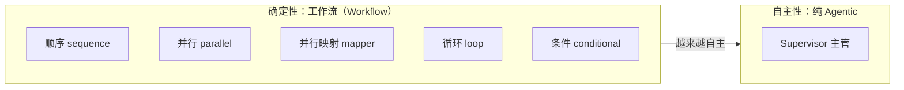

# Ch15 Agentic 编排模式——官方六种多 Agent 协作全解析

> 本章目标：
> 1. 理解为什么单 Agent 不够：复杂任务需要**分工与协作**，引出多 Agent 编排
> 2. 掌握编排谱系：**确定性工作流**（顺序/并行/循环/条件/并行映射）→ **自主编排**（Supervisor）
> 3. 掌握**机制总览**：所有编排底层都是同一个 **Planner 架构**（`firstAction`/`nextAction`），`AgenticScope` 是共享黑板——搞懂这两个，六种模式只是六种决策逻辑
> 4. 六种模式**每种拆到源码级**：内部怎么控制调用顺序、怎么传值、怎么退出
> 5. 掌握 typed 接口 vs UntypedAgent 的选型差异，踩透 parallelMapper 的 `argument type mismatch`
> 6. 掌握实验模块的边界：只发 beta 版本线（`1.22.0` 稳定版 404）、API 与官方文档存在出入
> 7. 记录诚实结论：自建 `AiServices` 组合与官方 agentic 模块的取舍

---

## 15.1 为什么需要多 Agent 编排

Ch14 的 ResearchAgent 是**单 Agent**：一个大脑 + 一组工具。它能做多步推理，但有个天花板——**所有能力揉在一个大脑里**：

| 单 Agent 的局限 | 例子 |
|---|---|
| **上下文互相污染** | 客服助手既要懂退款政策又要会算数，Prompt 越长越容易"串台" |
| **职责不清、难以扩展** | 加一个"物流专家"能力，要往同一个 Prompt 里继续塞 |
| **无法并行** | 一个大脑同一时刻只能想一件事 |

多 Agent 的思路：**把一个大任务拆给多个各司其职的小 Agent**，再用编排逻辑把它们串起来。编排方式从"完全确定"到"完全自主"是一条谱系：



- **工作流**：步骤、顺序、条件都是代码写死的，可预测、可测试——适合流程明确的任务；
- **Supervisor**：只给主管"有哪些专家可用"，由 LLM 自主决定调用谁、按什么顺序、何时完成——适合开放性任务。

> 💡 **Spring AI 对比**：Spring AI 没有官方多 Agent 编排模块，多 Agent 要靠自写编排（`ChatClient` + 判断逻辑组合）。LangChain4j 1.19 提供了实验性的 `langchain4j-agentic` 模块，把五种工作流 + Supervisor 做成了可配置的构建器——这是本章的主角。

---

## 15.2 机制总览：一切编排都是 Planner + AgenticScope

写代码之前，先建立两个**贯穿全章的底层认知**（都是解包源码核实的）。有了它们，六种模式就不是六个 API，而是**一个架构的六种决策逻辑**。

### 15.2.1 AgenticScope：所有 Agent 的共享黑板

> 🔍 **核实留痕**：解包 `DefaultAgenticScope.java`——内部就是一个 `ConcurrentHashMap` + `memoryId`：

```java
public class DefaultAgenticScope implements AgenticScope {
    private final Object memoryId;
    private final Map<String, Object> state = new ConcurrentHashMap<>();   // 共享变量的家
    private final Map<String, Object> agents = new ConcurrentHashMap<>();
    private final Map<String, Object> executionContexts = new ConcurrentHashMap<>();

    public void writeState(String key, Object value) { state.put(key, value); }
    public Object readState(String key) { return state.get(key); }
    // 还有 copy()：并行分支时复制 scope，避免分支间互相污染
}
```

**"Agent 间传值"的本质就是读写这张 HashMap**：`outputKey("draft")` 是 `writeState("draft", ...)`，`userMessage` 模板里 `{{draft}}` 的替换是 `readState("draft")`。搞懂这张表，六种模式的传值就全通了。

### 15.2.2 Planner 接口：编排模式的统一内核

> 🔍 **核实留痕**：所有编排模式（sequence/parallel/loop/conditional/mapper/supervisor）的底层都实现同一个 `Planner` 接口（`dev.langchain4j.agentic.planner.Planner`）：

```java
public interface Planner {
    default void init(InitPlanningContext initPlanningContext) { }
    default Action firstAction(PlanningContext planningContext) { return nextAction(planningContext); }
    Action nextAction(PlanningContext planningContext);
}
```

**编排 = "决策下一步调谁"，决策被抽象成 `Action`**——要么 `call(agentA, agentB, ...)`（调 Agent），要么 `done(...)`（结束返回）。六种模式的区别只是决策逻辑不同：

| 模式 | firstAction（第一步） | nextAction（之后每步） |
|---|---|---|
| **sequence** | 调第 1 个 Agent | 上一个完成后调下一个，最后一个后 `done` |
| **parallel** | **一次性 `call(所有 Agent)`** | `done`（无下一步） |
| **loop** | 调循环体 Agent 组 | 每轮结束检查 `exitCondition`，不满足且未超 `maxIterations` 就再调一轮 |
| **conditional** | 按谓词选中一个 Agent 调 | `done` |
| **parallelMapper** | 为集合每个元素生成一个 Agent 实例，全量 `call` | 收集各实例结果，全部完成 `done` |
| **supervisor** | **让 LLM 生成一个 AgentInvocation 计划**，按计划调 | 根据上一个 Agent 的结果，再让 LLM 决定下一步 |

**有了这张表，剩下的就是背构建器 API**。后面 15.3-15.8 每种模式都按"是什么 → 内部机制 → 代码 → 实测"展开。

---

## 15.3 模式一：顺序工作流（sequence）

### 15.3.1 内部机制

`SequentialPlanner` 的 `nextAction`：上一步调用的 Agent 完成（结果写入 `outputKey`）后，**按注册顺序调下一个**，`outputKey` 在 `AgenticScope` 里"接力"。**顺序由代码决定，与 LLM 无关**——这就是"确定性"的含义。

### 15.3.2 代码

`ContentPipelineService`（`agentic/` 包）：撰写员 → 精简员，`sequenceBuilder().subAgents(writer, editor).outputKey("final")`。

```java
UntypedAgent writer = AgenticServices.agentBuilder()
        .chatModel(chatModel)
        .name("writer")
        .description("根据主题撰写一段 3 句产品介绍初稿")
        .userMessage("你是文案撰写员。根据主题写一段不超过 3 句的产品介绍，只输出介绍本身。主题：{{topic}}")
        .inputKey(String.class, "topic")     // topic 取自 AgenticScope 同名变量
        .outputKey("draft")                   // 结果写入 draft 变量
        .build();

UntypedAgent editor = AgenticServices.agentBuilder()
        .chatModel(chatModel)
        .name("editor")
        .description("把初稿精简成一句卖点")
        .userMessage("你是文案编辑。把下面的初稿精简成一句话卖点，只输出结果。\n初稿：{{draft}}")
        .inputKey(String.class, "draft")
        .outputKey("final")
        .build();

pipeline = AgenticServices.sequenceBuilder()
        .subAgents(writer, editor)
        .outputKey("final")
        .build();
```

**数据流**：`invoke(Map.of("topic", ...))` 把 topic 写入 `AgenticScope` → writer 的 `{{topic}}` 被替换、产出初稿写回 `draft` → editor 的 `{{draft}}` 读到上游输出 → 流水线返回 `final`。

### 15.3.3 实测

**真实输出**（作者实测，主题"智能咖啡机"）：
> 一键萃取大师风味，从醇厚美式到丝滑拿铁，把咖啡馆搬进你的清晨。

---

## 15.4 模式二：并行工作流（parallel）

### 15.4.1 内部机制

`ParallelPlanner` 源码极简（解包核实）：`firstAction` 直接 `call(agents)`——**一次性把全部子 Agent 交给执行器**；`nextAction` 直接 `done()`。执行器（默认线程池/虚拟线程）并发跑所有子 Agent，各自把结果写进 `AgenticScope`；并行分支间靠 `scope.copy()` **各自持有 scope 副本**，互不污染，最后由 `output(scope -> ...)` 合并。

### 15.4.2 代码

```java
UntypedAgent faqAgent = AgenticServices.agentBuilder()
        .chatModel(chatModel).name("faq-agent").description("查知识库回答政策问题")
        .userMessage("查知识库回答下面的问题，只输出答案。问题：{{q}}")
        .inputKey(String.class, "q").outputKey("policy")
        .tools(ragLookupTool)
        .build();

UntypedAgent calcAgent = AgenticServices.agentBuilder()
        .chatModel(chatModel).name("calc-agent").description("执行数值计算")
        .userMessage("执行下面的计算，只输出结果。计算：{{q}}")
        .inputKey(String.class, "q").outputKey("price")
        .tools(calculatorTools)
        .build();

parallelWorkflow = AgenticServices.parallelBuilder()
        .subAgents(faqAgent, calcAgent)                     // 两个独立 Agent 并行
        .output(scope -> "【政策】" + scope.readState("policy")
                + "\n【价格】" + scope.readState("price"))   // 合并两个输出
        .build();
```

### 15.4.3 实测

**真实输出**（作者实测，q1="七天无理由退货的条件？" q2="500 元打 8 折是多少"）：
> 【政策】消费者自签收商品之日起七日内，可以无理由退货。退回商品应保持完好，不影响二次销售…
> 【价格】400

> ⚠️ **坑点**：并行分支**各自写各自的 key**，别让两个子 Agent 写同一个 `outputKey`——`scope.copy()` 隔离的是分支执行期，**同名 key 的最终写入仍然会互相覆盖（后写赢）**。合并逻辑（`output`）在全部完成后执行，读到的才是幸存值。

> ✅ **最佳实践**：并行只适用于**无依赖**的子任务。有依赖（先查再算）的任务放 sequence 或交给模型下一轮，别硬塞进 parallel。

---

## 15.5 模式三：循环工作流（loop）

### 15.5.1 内部机制

`LoopPlanner` 源码（解包核实字段）：`maxIterations` + `iterationsCounter` + `testExitAtLoopEnd` + `exitCondition(BiPredicate<AgenticScope, Integer>)`。控制逻辑：

```
每轮：执行 subAgents（循环体）→ iterationsCounter++
      → 若 testExitAtLoopEnd=true：本轮结束时检查 exitCondition(scope, 轮次)
      → 满足 → done；不满足且 counter < maxIterations → 再调一轮；否则 done
```

**两个退出出口**：`exitCondition`（业务达标，软出口）与 `maxIterations`（硬上限兜底）。`testExitAtLoopEnd` 决定"本轮跑完再检查"还是"下一轮开始前检查"——默认语义是循环体**至少跑一轮**再判断。

### 15.5.2 代码

```java
UntypedAgent reviewer = AgenticServices.agentBuilder()
        .chatModel(chatModel).name("reviewer").description("给文本打 0-10 分")
        .userMessage("给下面的文本打 0-10 分，只输出数字。文本：{{text}}")
        .inputKey(String.class, "text").outputKey("score")
        .build();

UntypedAgent editor = AgenticServices.agentBuilder()
        .chatModel(chatModel).name("editor").description("根据分数改进文本")
        .userMessage("你给文本打了 {{score}} 分。请改进下面文本使其更好，只输出改进后的文本。原文：{{text}}")
        .inputKeys(String.class, "text", String.class, "score")
        .outputKey("text")                                    // 覆盖 text，供下一轮评分
        .build();

loopWorkflow = AgenticServices.loopBuilder()
        .subAgents(reviewer, editor)                          // 每轮：先评分再修改
        .maxIterations(3)
        .testExitAtLoopEnd(true)                              // 本轮结束再检查退出条件
        .exitCondition(scope -> {                             // score ≥ 8 就退出
            Object s = scope.readState("score");
            try { return Integer.parseInt(String.valueOf(s)) >= 8; }
            catch (Exception e) { return false; }             // 解析失败 → 继续
        })
        .outputKey("text")
        .build();
```

### 15.5.3 实测

**真实输出**（作者实测，初稿"我们的咖啡机很厉害，很好用"）：
> 我们的咖啡机，远不止"好用"这么简单——它是清晨第一缕香醇的唤醒，是午后专注时光的温柔陪伴。从一键研磨到精准萃取，每一杯都稳定呈现理想风味；智能温控与细腻奶泡系统，让拉花创作变得轻松自如……

初稿被循环"评分→修改"加工得明显更精致——这就是 loop 的价值。

> ⚠️ **坑点**：`exitCondition` 读 scope 里的 `score`，但模型输出可能是 "8分" / "8.0" 等格式，**必须容错解析**（try-catch，解析失败当"未达标"继续循环），否则一个格式异常就死循环或提前退出。软出口永远要配 `maxIterations` 硬兜底。

---

## 15.6 模式四：条件工作流（conditional）

### 15.6.1 内部机制

`ConditionalPlanner`（解包核实）：按注册顺序对每个 `subAgents(谓词, agent...)` 的**谓词求值**，**第一个为 true 的分支被选中执行**，执行完 `done()`。路由逻辑 100% 是代码（Java 谓词），模型不参与决策——又快又稳又免费。

### 15.6.2 代码

```java
UntypedAgent refundExpert = AgenticServices.agentBuilder()
        .chatModel(chatModel).name("refund-expert").description("退款/退货政策专家")
        .userMessage("你是退款政策专家，查知识库回答：{{q}}")
        .inputKey(String.class, "q").outputKey("answer")
        .tools(ragLookupTool)
        .build();

UntypedAgent techExpert = AgenticServices.agentBuilder()
        .chatModel(chatModel).name("tech-expert").description("技术/计算专家")
        .userMessage("你是技术专家，用工具计算并回答：{{q}}")
        .inputKey(String.class, "q").outputKey("answer")
        .tools(calculatorTools)
        .build();

conditionalWorkflow = AgenticServices.conditionalBuilder()
        .subAgents(scope -> containsAny(scope, "退款", "退货", "运费"), refundExpert)
        .subAgents(scope -> containsAny(scope, "计算", "折扣", "多少", "几折"), techExpert)
        .outputKey("answer")
        .build();
```

### 15.6.3 实测

**真实输出**（作者实测）：
- q="退货运费谁出？" → 走退款专家，基于知识库作答（运费消费者承担、质量问题除外）；
- q="128 乘以 7 等于多少" → 走技术专家，回答 **896**。

> 💡 **conditional vs Supervisor 的分工**：条件路由是**代码写死**的（适合规则明确的分类）；Supervisor 是 **LLM 自主**的（适合分类边界模糊的开放问题）。能用 conditional 写死的就别让 LLM 猜——可控、便宜、可测试。

---

## 15.7 模式五：并行映射（parallelMapper）

### 15.7.1 内部机制（源码级，含踩坑根因）

`ParallelMapperPlanner`（解包源码核实）分三步：
1. `readState(itemsProvider)` 拿集合 → 为**每个元素**包一个 `MapperAgentInvoker`；
2. 每个实例执行后，结果写到 **`outputKey + "_" + i`**（每个元素独立输出槽，互不覆盖）；
3. 全部完成 → 按序收集各槽结果成 `List` → `writeState(outputKey, list)` → `done(list)`。

`MapperAgentInvoker` 的元素注入（**踩坑根因**，源码核实）：

```java
public MapperAgentInvoker(AgentInvoker delegate, Object item, int instanceIndex) {
    // injectionKey = 子 Agent 的第一个参数名
    this.injectionKey = delegate.arguments().isEmpty()
            ? null : delegate.arguments().get(0).name();
    this.instanceOutputKey = delegate.outputKey() + "_" + instanceIndex;
}
// 调用时：把当前元素作为 injectionKey 参数的值注入
public AgentInvocationArguments toInvocationArguments(AgenticScope scope) {
    return AgentUtil.agentInvocationArguments(scope, arguments(), Map.of(injectionKey, item));
}
```

**坑的根因**：元素是作为**位置参数**注入的。如果子 Agent 是 UntypedAgent（方法签名 `invoke(Map)`），框架把 String 元素塞给 Map 参数 → **`argument type mismatch` 必然发生**。

### 15.7.2 踩坑实录（本章最有价值的一段）

> ⚠️ **真实 bug（beta29 实验模块实测）**：parallelMapper 的**子 Agent 用 UntypedAgent 报 `argument type mismatch`**。
> 作者实测：`agentBuilder()` 建的 UntypedAgent 作为子 Agent 时报错（见上面源码根因）。升级到 `1.22.0-beta32` 后项目仍保留同样写法（未逐版本复测此 bug 是否修复，保守起见当它还在）。
> **解法：子 Agent 和顶层都用 typed 接口**（方法签名是具体参数类型，如 `String generate(String topic)`），元素才能正确注入。

typed 子 Agent：

```java
public interface TaglineAgent {
    @Agent("给单个主题生成一句卖点")
    @UserMessage("给主题生成一句 15 字以内的卖点，只输出卖点。主题：{{topic}}")
    String generate(@V("topic") String topic);
}
```

typed 顶层：

```java
public interface BatchTaglineAgent {
    @Agent("给一组主题并行生成一句卖点")
    @UserMessage("为下面的主题列表逐个生成一句 15 字以内的卖点，按顺序输出。主题：{{topics}}")
    List<String> generateTaglines(@V("topics") List<String> topics);
}
```

装配（`AgenticServices.agentBuilder(Class)` + `parallelMapperBuilder(Class)`）：

```java
TaglineAgent taglineAgent = AgenticServices.agentBuilder(TaglineAgent.class)
        .chatModel(chatModel).name("tagline-agent").description("给单个主题生成一句卖点")
        .outputKey("tagline")
        .build();

mapperWorkflow = AgenticServices.parallelMapperBuilder(BatchTaglineAgent.class)
        .subAgents(taglineAgent)
        .itemsProvider("topics")       // scope 里 topics 是待迭代集合（javap 核实：itemsProvider(String)）
        .build();
```

### 15.7.3 实测

**真实输出**（作者实测，topics=["智能咖啡机","空气炸锅","扫地机器人"]）：
> [1] 一键现磨，鲜享大师咖啡。
> [2] 无油烹饪，脆嫩不腻。
> [3] 解放双手，净享洁净。

三个主题并行生成，一次返回列表。

---

## 15.8 模式六：Supervisor 自主编排

### 15.8.1 内部机制

`SupervisorPlanner`（解包源码核实）：它也是 `Planner` 实现，但**决策不来自代码，来自 LLM**——内部用 `AiServices.builder(ResponseAgent.class).chatModel(chatModel).build()` 建了一个"规划 Agent"，把"有哪些子 Agent（名称+描述+参数）"和当前任务喂给它，让它产出 `AgentInvocation{agentName, arguments}` **计划**，框架按计划逐个调用；每个子 Agent 跑完后，`nextAction` 把**上一次的执行结果**也喂给规划 Agent，决定"继续调谁"还是 `done`（任务完成）。

**对比 conditional**：conditional 的"路由"是 Java 谓词（15.6），supervisor 的"路由"是 LLM——所以它能处理"问题描述模糊、路由规则写不出来"的场景，代价是每次决策多一轮 LLM 调用。

### 15.8.2 代码

`CustomerServiceSupervisor`：三个带工具的子 Agent + 一个主管。

```java
UntypedAgent refundAgent = AgenticServices.agentBuilder()
        .chatModel(chatModel).name("refund-expert")
        .description("处理退款/退货/赔付类问题，必须查知识库后回答")
        .userMessage("你是退款政策专家。只依据知识库中的退款政策回答，资料未提及就明说不知道。")
        .tools(ragLookupTool)
        .build();
// logisticsAgent（TimeTools）/ techAgent（CalculatorTools）同构，略

supervisor = AgenticServices.supervisorBuilder()
        .chatModel(chatModel)
        .chatMemoryProvider(chatMemoryProvider)
        .name("customer-service-supervisor")
        .description("客服主管：把问题分派给合适的专家，汇总后回答用户")
        .subAgents(refundAgent, logisticsAgent, techAgent)
        .responseStrategy(SupervisorResponseStrategy.SUMMARY)   // 主管汇总各专家结果
        .build();
```

### 15.8.3 实测

**真实输出**（作者实测，问题"七天无理由退货怎么退？运费谁出？"）：主管准确调用退款专家（查知识库），回答了退货条件、运费承担、退货流程、不适用商品、退款时效——内容全部基于知识库，无编造。

> ⚠️ **坑点**：`SupervisorAgent.invoke(String)` 收**字符串**而非 Map（javap 核实）；`responseStrategy` 枚举是 `SCORED / SUMMARY / LAST`。这些与官方文档示例的细微差异，只有核实真实签名才能避开。

---

## 15.9 接口验证（六种模式全实测）

`AgenticController` 暴露 6 个端点：

```bash
# ① 顺序 sequence
curl -X POST http://localhost:8090/api/agentic/workflow \
  -H "Content-Type: application/json" -d '{"topic":"智能咖啡机"}'
# ② 并行 parallel
curl -X POST http://localhost:8090/api/agentic/parallel \
  -H "Content-Type: application/json" -d '{"q1":"七天无理由退货的条件？","q2":"500 元打 8 折是多少"}'
# ③ 循环 loop
curl -X POST http://localhost:8090/api/agentic/loop \
  -H "Content-Type: application/json" -d '{"text":"我们的咖啡机很厉害"}'
# ④ 条件 conditional
curl -X POST http://localhost:8090/api/agentic/conditional \
  -H "Content-Type: application/json" -d '{"q":"退货运费谁出"}'
# ⑤ 并行映射 mapper
curl -X POST http://localhost:8090/api/agentic/mapper \
  -H "Content-Type: application/json" -d '{"topics":["智能咖啡机","空气炸锅","扫地机器人"]}'
# ⑥ Supervisor 自主编排
curl -X POST http://localhost:8090/api/agentic/supervisor \
  -H "Content-Type: application/json" -d '{"question":"七天无理由退货怎么退？运费谁出？"}'
```

作者实测：六种模式全部端到端跑通，输出见各节"实测"。

---

## 15.10 六种模式对比（选型速查）

| 模式 | 一句话 | 谁来定步骤 | 内部实现要点 | 适用场景 | 实测 |
|---|---|---|---|---|---|
| **sequence** | 前一个输出喂后一个 | 代码 | 顺序接力，outputKey 传递 | 流水线（写稿→精简→定稿） | ✅ |
| **parallel** | 多个独立 Agent 并行 | 代码 | 一次性全量 call + scope.copy 隔离 | 无依赖的多任务（查+算） | ✅ |
| **loop** | 反复执行直到达标 | 代码 + 退出条件 | 双出口：exitCondition + maxIterations | 质量闭环（评分→修改） | ✅ |
| **conditional** | 按谓词选一个 | 代码 | 谓词按序首中即选 | 规则明确的分类路由 | ✅ |
| **parallelMapper** | 集合逐项并行 map | 代码 | 每元素独立实例 + 输出槽_i + 元素作位置参数注入 | 批量任务（一批主题/订单） | ✅ |
| **supervisor** | 主管自主派活 | LLM | 内置规划 Agent 生成 AgentInvocation 计划 | 开放问题、边界模糊 | ✅ |

---

## 15.11 自建编排 vs 官方模块（诚实取舍）

| 维度 | 自建（AiServices 组合，Ch14 路线） | 官方 agentic 模块（本章） |
|---|---|---|
| **代码量** | 编排逻辑自己写（循环/条件/状态传递） | 构建器一行声明 |
| **状态传递** | 自己维护变量 | `AgenticScope` 内置（本质一张 ConcurrentHashMap） |
| **稳定性** | 依赖稳定 API（AiServices 是正式版） | **实验性**，只有 beta 版本线，API 可能变（parallelMapper 已踩坑） |
| **适用** | 生产可控、想少依赖 | 快速原型、官方路线跟随 |

**结论**：生产建议仍以自建/稳定 API 为主；agentic 模块适合尝鲜和教学（本章用它演示概念），真上生产前要锁版本、做回归。

> ✅ **最佳实践**：用实验模块的两个前提——① 锁定版本（项目在 pom 里写死 `1.22.0-beta32`）；② 每个新版本升级时重跑你的 golden set / 冒烟测试，因为实验 API 说变就变。

---

## 本章小结

### 概念速查表

| 概念 | 一句话 |
|---|---|
| **编排谱系** | 确定性工作流（顺序/并行/循环/条件/并行映射）→ 自主编排（Supervisor） |
| **langchain4j-agentic** | 官方实验模块：**只有 beta 版本线**（`1.22.0-beta32` 为当前最新，稳定版 404，curl 核实）；传递依赖仅 umbrella |
| **AgenticScope** | 共享黑板：内部 `ConcurrentHashMap`；`outputKey`=writeState、`{{}}`替换=readState、并行分支靠 copy 隔离 |
| **Planner 统一架构** | 所有模式实现同一 `Planner`（firstAction/nextAction → call/done），六模式=六种决策逻辑 |
| **UntypedAgent vs typed** | 前者 `invoke(Map)` 快速原型；后者 `@Agent` 接口类型安全；**parallelMapper 必须 typed** |
| **sequence / parallel / loop / conditional / parallelMapper** | 五种确定性工作流，步骤由代码定 |
| **supervisorBuilder** | 主管模式：内部 LLM 规划 Agent 生成 AgentInvocation 计划，自主决定调谁 |
| **API 必须核实** | 实验模块文档与实际 jar 有出入（userMessage 在基类、invoke(String) 等），javap 为准 |

### 项目代码状态表（v0.13）

| 模块 | 文件 | 说明 |
|---|---|---|
| 顺序工作流 | `agentic/ContentPipelineService.java` | **新增**：writer→editor（sequenceBuilder） |
| 四模式演示 | `agentic/WorkflowDemoService.java` | **新增**：parallel / loop / conditional / parallelMapper 四种工作流 |
| 并行映射 | `agentic/BatchTaglineAgent.java` / `agentic/TaglineAgent.java` | **新增**：typed 顶层 + typed 子 Agent 接口（避坑） |
| Supervisor | `agentic/CustomerServiceSupervisor.java` | **新增**：客服主管 + 3 个带工具子 Agent |
| 接口 | `controller/AgenticController.java` | **新增**：6 个端点（workflow/parallel/loop/conditional/mapper/supervisor） |
| 依赖 | `pom.xml` | **加**：`langchain4j-agentic:${langchain4j.beta.version}`（实验模块，当前 `1.22.0-beta32`） |
| 工具 | `tools/*.java` | **零改动**——子 Agent 复用 Ch06/Ch12 工具 |

### 练习题

1. 给 loop 的 `exitCondition` 改成"分数 ≥ 9"，并调低 `maxIterations` 到 2，观察循环何时退出——体会"达标退出"与"轮次上限"两个出口的关系。
2. 把 parallel 的两个子 Agent 写**同一个 outputKey**，各写各的值，观察最终 `output` 合并时读到谁的值——验证 15.4.1 的"后写赢"坑。
3. 复现 15.7 的坑：把 `TaglineAgent` 换回 `agentBuilder()` 的 UntypedAgent 重跑 mapper，观察 `argument type mismatch`，再改回 typed 验证修复。
4. 思考题：对照 15.2.2 的 Planner 决策表，六种模式里哪几种的 `nextAction` 会**不止一次被调用**？（提示：loop 每轮一次、supervisor 每步一次、sequence 每个节点一次——parallel/conditional/mapper 呢？）
5. 思考题：conditional 和 supervisor 都做"路由"，各自的适用边界在哪？举一个"该用 conditional"和"该用 supervisor"的业务例子。
