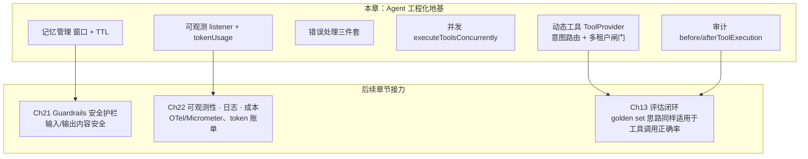

# Ch16 Agent 工程化——动态工具、审计、错误处理、并发与可观测性

> **本章基线**：项目 `smart-doc-assistant` ｜ 端口 `8090` ｜ LangChain4j `1.22.0` + 实验模块 `1.22.0-beta32` ｜ JDK `21` ｜ 最后验证 `2026-10-28`

> 本章目标：
> 1. 理解"Agent 能跑"与"Agent 能上线"之间差什么：**工程化六件套**——动态工具、审计、错误处理、并发、可观测、记忆管理
> 2. 掌握**动态工具注入** `ToolProvider`：按用户消息按需暴露工具，解决"工具越多模型越乱"的问题
> 3. 掌握**工具调用审计** `beforeToolExecution / afterToolExecution`：每次调用留痕（参数、结果、失败、耗时）
> 4. 掌握**错误处理三件套**：`toolExecutionErrorHandler` / `toolArgumentsErrorHandler` / `hallucinatedToolNameStrategy`——工具异常、参数失败、幻觉工具名都能兜底
> 5. 掌握**并发工具执行** `executeToolsConcurrently` 与**可观测性** `registerListener`（含 tokenUsage 成本）
> 6. 掌握**记忆管理**：窗口裁剪（`maxMessages`）+ 会话 TTL，理解 Agent 长跑的"记忆膨胀"问题
> 7. 建立**生产化全景**：Guardrails→Ch21、可观测/成本→Ch22、评估思维复用 ch13 的章节地图

## 16.1 能跑 ≠ 能上线

Ch14 那版 Agent 是能用 curl 打穿的：问退款政策它去查知识库，问 500 的 8 折它调计算器，多轮追问也接得住。真要往生产上挪，第一件事是加日志——加完才看清它每天在干什么，也才看清有三件事它根本没记。

一次工具调用跑完，日志里只有工具名：

```
[nio-8090-exec-2] 即将执行工具 [searchKnowledgeBase]
```

参数是什么、跑了多久、成功还是失败，一个字都没有。排障时问"刚才那次为什么答错了"，这行日志回答不了。成本同理：`AiServices` 上没注册 listener，一条请求烧多少 token 只能去模型控制台反推，而 Agent 的 token 大头恰恰在输入侧（工具结果和检索片段都要进上下文）。

第三件事是工具暴露。Ch14 把所有工具一次性全给模型，无关问题进来时十几个工具的 description 照样占着上下文；更要紧的是，"这个租户的用户能不能调到管理员专属工具"这句话，当时的代码里连判断的地方都没有。教学版常见的写法是 `text.contains("算")` 这类硬匹配，换个说法就漏——换成意图路由之后，漏的那一面会被日志老实打出来：

```
动态工具注入：消息[你好，在吗] 租户=default 角色=USER 域=[] → 暴露 0 个工具：[]
```

暴露 0 个工具时模型没有可选项，政策类问题只能凭训练语料答。这行日志在 16.2.1 还会再出现一次，因为它是"漏召回"唯一能被看见的证据。

这一章把这四件事补齐——工具按需暴露（`ToolProvider`）、调用留痕（审计回调）、异常兜底（三个 handler）、用量可算（listener + `tokenUsage`），再加上并发执行和记忆治理，凑成上线前的六件套。全部装在 `AiServices.builder()` 上，API 逐条对过 `1.22.0` 的 sources jar，项目编译通过。

## 16.2 动态工具注入：ToolProvider

### 16.2.1 问题

Ch14 用 `AiServices.tools(timeTools, calculatorTools, orderTools, ragLookupTool, ...)` 把工具**一次性全部**给模型。工具一多，问题就来了：

- **选错**：模型面对 10 个工具，把"查物流"的活派给"查知识库"的工具；
- **token 浪费**：每个工具的 description 都进上下文，工具越多 Prompt 越长；
- **攻击面**：无关工具也暴露给模型（如不该给用户的内部工具）；
- **多租户越权**：所有租户共用同一套工具，A 租户可能调到 B 租户/管理员专属工具——这是生产红线。

`ToolProvider` 是 langchain4j 的扩展点，接口只有一个方法 `ToolProviderResult provideTools(ToolProviderRequest)`。它在 AiServices 跑工具循环**之前**被调用，决定"这一轮把哪些工具的 spec 暴露给模型、模型又能执行哪些"。

### 16.2.2 生产化三段式：意图路由 → 域映射 → 租户闸门

教学版常写 `if (text.contains("算")) put(...)`，但 `contains` 硬匹配有两个绕不开的坑：

- **漏召回**：问"退款**规则**"——不包含"政策"，工具一个都不暴露，模型只能瞎编（我实测的日志：`暴露 0 个工具：[]` 之后模型胡说八道）；
- **误召回**：一句话同时提到"运费"和"发货"，三类工具全放出去，反而没收窄。

因此本项目把动态工具拆成四个角色、三段流水线（代码在 `smart-doc-assistant` 的 `com.example.assistant.engineering` 包；本章所有路径都以 `smart-doc-assistant/` 为根）：

```
provideTools(request)
      │
      ├─① 意图路由 IntentRouter  ：用户问题 → 候选业务域（refund/logistics/calc）
      │                             轻量 LLM 分类，关键词兜底（解决漏召回/误召回）
      │
      ├─② 域→工具映射 ToolCatalog ：业务域 → 该域下全部工具（spec + executor + 权限元数据）
      │
      └─③ 租户/角色闸门 TenantToolFilter：按 RequestContext 的 tenantId/role 过滤（安全红线）
```

**ToolCatalog（工具目录）——按"域"组织，而非扁平列表**

构造期扫描每个工具对象的 `@Tool` 方法，但额外按其所属业务域登记元数据。每条工具登记成 `ToolCatalog.Entry`（`ToolCatalog.java:31-35`）：

```java
public record Entry(ToolSpecification spec,
                    ToolExecutor executor,
                    String domain,
                    Set<String> requiredRoles,
                    Set<String> enabledTenants) {}
```

工具名到元数据的映射是 `DynamicToolProvider` 里的一张静态表（`DynamicToolProvider.java:172-178`，生产应外置到配置/DB）：

```java
private static final Map<String, DomainMeta> DOMAIN_META = Map.of(
        "searchKnowledgeBase", new DomainMeta("refund", Set.of(), Set.of()),
        "currentTime", new DomainMeta("logistics", Set.of(), Set.of()),
        "daysBetween", new DomainMeta("logistics", Set.of(), Set.of()),
        "calculate", new DomainMeta("calc", Set.of(), Set.of()),
        "percentage", new DomainMeta("calc", Set.of(), Set.of())
);
```

> 若某工具是**写操作/高成本**（如 admin 域的发短信、删数据），在此给它标上 `requiredRoles`，意图命中了但角色不够，就过不了租户/角色闸门。
>
> **坑点（已修复）**：角色值曾经是精确匹配，大小写对不上就静默全禁。`TenantToolFilter` 早先直接用 `requiredRoles.contains(role)`，而 `DynamicToolProvider` 的注释写 `Set.of("ADMIN")`、`RequestContext` 的缺省又是大写 `USER`——照注释原样填，结果是谁都不给用，且不报错。现在三个入口（`RequestContext.set`、`TenantToolFilter.filter`、`ToolGuard.checkRolePermission`）都统一 `toLowerCase(Locale.ROOT)` 后再匹配，闸门里还保留一层 `equalsIgnoreCase` 兜底；配置里的角色键保持小写。

**IntentRouter（意图路由）——替换 contains**

用轻量 LLM（生产建议小模型省成本，本教程复用主模型）把问题分类到已知业务域，输出稳定可控；LLM 不可用时回退关键词兜底，保证不退化成"0 工具导致模型瞎编"：

```java
/** 返回本次应启用的业务域列表（可能为空，但兜底逻辑会尽量给） */
public List<String> route(String userText) {
    List<String> llmDomains = classifyByLlm(userText);
    if (!llmDomains.isEmpty()) {
        return llmDomains;
    }
    // 兜底：LLM 失败/无法解析 → 关键词（比原版更全，仅作 safety net）
    return fallbackByKeyword(userText);
}
```

**TenantToolFilter（租户/角色闸门）——安全红线**

意图选出候选工具后，最终暴露前必过两道闸：租户白名单、角色授权。它与路由**正交**：路由决定"该用哪些"，闸门决定"这个用户能不能用"——两者不能混为一谈。

```java
public List<Entry> filter(List<Entry> candidates, String tenantId, String role) {
    final String t = (tenantId == null || tenantId.isBlank()) ? "default" : tenantId;
    final String r = (role == null || role.isBlank()) ? "user" : role.toLowerCase(Locale.ROOT);

    return candidates.stream()
            .filter(e -> tenantEnabled(e.enabledTenants(), t))
            .filter(e -> roleAllowed(e.requiredRoles(), r))
            .collect(Collectors.toList());
}
```

**编排（DynamicToolProvider.provideTools）**：

```java
@Override
public ToolProviderResult provideTools(ToolProviderRequest request) {
    String text = request.userMessage() == null ? "" : request.userMessage().singleText();

    // 本方法跑在请求线程上，ThreadLocal 上下文是准的——在此捕获快照，
    // 供虚拟线程上的工具执行（护栏）与审计回调使用（见 requestContexts 注释）
    String tenantId = RequestContext.tenantId();
    String role = RequestContext.role();
    String userId = RequestContext.userId();
    requestContexts.put(request.chatMemoryId(), new String[]{tenantId, userId, role});

    // 意图路由：问题 → 候选业务域
    List<String> domains = intentRouter.route(text);

    // 域 → 候选工具
    List<ToolCatalog.Entry> candidates = new ArrayList<>();
    for (String d : domains) {
        candidates.addAll(catalog.byDomain(d));
    }

    // 租户/角色闸门（暴露时筛选）
    List<ToolCatalog.Entry> allowed = tenantFilter.filter(candidates, tenantId, role);

    Map<ToolSpecification, ToolExecutor> selected = new HashMap<>();
    for (ToolCatalog.Entry e : allowed) {
        // 执行期护栏：用代理 executor 包裹真实执行器，
        // 在工具真正执行前先过 ToolGuard（黑名单/限流/角色白名单）。
        // 注意：此处只在「暴露时」按租户/角色筛选（TenantToolFilter），
        // ToolGuard 是「执行时」的兜底拦截——即使模型通过其他方式拿到了工具名，
        // 没有相应权限也会被拦死。授权用的是请求线程捕获的角色，不是执行线程的 ThreadLocal。
        ToolExecutor guarded = (toolExecutionRequest, memoryId) -> {
            String toolName = e.spec().name();
            String[] ctx = memoryId == null ? null : requestContexts.get(memoryId);
            String execRole = ctx != null ? ctx[2] : role;
            String execUser = ctx != null ? ctx[1] : String.valueOf(memoryId);
            try {
                toolGuard.authorize(toolName, execRole, execUser);
            } catch (GuardrailViolation ex) {
                log.warn("工具执行被护栏拦截 [{}] 角色={}：{}", toolName,
                        execRole, ex.getMessage());
                // 拦截后不执行真实工具，返回提示文本交由模型向用户解释
                return "操作被安全策略拦截：" + ex.getMessage();
            }
            return e.executor().execute(toolExecutionRequest, memoryId);
        };
        selected.put(e.spec(), guarded);
    }

    log.info("动态工具注入：消息[{}] 租户={} 角色={} 域={} → 暴露 {} 个工具：{}",
            text.length() > 20 ? text.substring(0, 20) + "…" : text,
            tenantId, role, domains,
            selected.size(), selected.keySet().stream().map(ToolSpecification::name).toList());
    return ToolProviderResult.builder().addAll(selected).build();
}
```

`requestContexts.put(...)` 这行不是设计出来的，是 16.9.1 那次修出来的；没有它，代理 executor 里的 `requestContexts.get(memoryId)` 永远拿到 null。租户/角色闸门那一步传的是 `tenantId`/`role` 两个局部变量而不是 `RequestContext.tenantId()`——`provideTools` 本身还在请求线程上，读 ThreadLocal 也不算错，但谁把它挪进异步分支它就立刻静默失效，捕获一次、往后全用快照，等于把坑堵在写法上。`selected.put(e.spec(), guarded)` 放出去的是代理而不是 `e.executor()`，这一步决定 ToolGuard 到底是"暴露时筛一次"还是"执行时真拦"。

> **坑点**：`ToolProviderResult.Builder` 的方法是 **`addAll(Map<ToolSpecification, ToolExecutor>)`** 或 `add(spec, executor)`，没有 `tools(...)`。`ToolExecutor` 在 `dev.langchain4j.service.tool` 包（不在 `agent.tool.execution`）。`ChatModel` 没有 `generate(String)`，轻量分类用 `chat(String)`（返回 `String`）。

**执行期护栏（ToolGuard 包裹）——"看得见"不等于"有权跑"**。上面那段 `guarded` 就是它：真正执行前再过一次 `ToolGuard`（黑名单 / 角色白名单 / 限流，Ch21 的组件在这里提前上岗），被拦就返回 `操作被安全策略拦截：…` 的提示文本，交由模型向用户解释。它和暴露那道闸门是**两层正交的闸门**：`TenantToolFilter` 管"模型看得见哪些工具"（暴露时），`ToolGuard` 管"这个角色跑了才算数"（执行时兜底）——即使模型通过提示注入点名叫工具，没有权限也执行不了。16.10 里角色边界那条用例有这组边界的实测。

**真实效果**（2026-10-28 实测）：问"退款政策里运费谁出？再算 500×8"（`tenantA/u1001/role=user`），注入日志 `域=[refund, calc] → 暴露 3 个工具`——检索工具正常执行并给出完整答案，`calculate` 被 ToolGuard 以 `角色 [user] 无权调用工具 [calculate]` 拦下，审计如实留痕。

> **取舍**：这套路由不是白拿的——`classifyByLlm` 每次请求都要多跑一次模型调用（`IntentRouter.java:60`），成本与延迟见 16.11。
>
> 工具量少、又全是只读低风险的时候，直接 `AiServices.tools(...)` 全量暴露更划算：我在 5 个工具的量级上没撞过"工具多选导致模型选错"，而"换个说法就漏召回"是撞过就有日志的（16.2.1 那行 `暴露 0 个工具：[]`）。
>
> 真要上到几十个工具，两条路可选：一是这套"先分类裁剪 + 二次权限校验"，二是框架自带的 `AiServices.toolSearchStrategy(...)`——`dev.langchain4j.service.tool.search` 包下有 `SimpleToolSearchStrategy` 和 `VectorToolSearchStrategy`（语义检索）两种现成实现。工具含写操作、高权限或高成本时，权限校验那一层不能省，因为它拦的是"模型点名要执行"这一刻，不是"模型看得见"那一刻。

## 16.3 工具调用审计：before/afterToolExecution + 多租户复合 key

`AiServices` 提供两个回调钩子：`beforeToolExecution(Consumer<BeforeToolExecution>)` 和 `afterToolExecution(Consumer<ToolExecution>)`。`ToolExecution` 有 `request()`（含工具名/参数）/ `result()` / `hasFailed()` / `startTime()` / `finishTime()` / `duration()` / `invocationContext()`（含 `chatMemoryId()`）。

> **坑点**：`InvocationContext` 的方法叫 **`chatMemoryId()`**（在 core 的 `dev.langchain4j.invocation` 包，不在 umbrella），不是 `memoryId()`——凭印象写会编译失败。

**复合审计 key（多租户必备）**：生产 SaaS 下，审计必须按 `tenantId:userId:sessionId` 三维聚合，才能"按租户查调用、按用户追责、按会话排障"。单用 `sessionId` 无法做租户级合规排查。`AgentAuditService` 里现在同时存在两个 `record`：六参数那个是给"同线程调用"留的兼容入口，它把 ThreadLocal 里的租户/用户补进去再转调八参数版本——

```java
public void record(Object memoryId, String toolName, String arguments, String result,
                   boolean failed, LocalDateTime startTime) {
    record(memoryId, RequestContext.tenantId(), RequestContext.userId(),
            toolName, arguments, result, failed, startTime);
}
```

真正写入的是八参数版本，租户/用户由调用方从请求线程捕获的快照传入（`AgentAuditService.java:59-69`）：

```java
/**
 * 显式租户/用户版本的记录入口——审计回调可能跑在虚拟线程上（executeToolsConcurrently），
 * ThreadLocal 里没有请求上下文，租户/用户必须由调用方从请求线程捕获的快照传入。
 */
public void record(Object memoryId, String tenantId, String userId, String toolName,
                   String arguments, String result, boolean failed, LocalDateTime startTime) {
    String key = tenantId + ":" + userId + ":" + memoryId;
    AuditEntry entry = new AuditEntry(toolName, arguments,
            result != null && result.length() > 200 ? result.substring(0, 200) + "…" : result,
            failed, startTime, LocalDateTime.now());
    auditLog.computeIfAbsent(key, k -> new ArrayList<>()).add(entry);
    log.info("[审计] 租户={} 用户={} 会话={} 工具[{}] failed={} 耗时{}ms",
            tenantId, userId, memoryId, toolName, failed,
            java.time.Duration.between(startTime, entry.endTime()).toMillis());
}
```

调用点在 `EngineeringAgentConfig` 的 `afterToolExecution` 里，快照取不到时才退回去读 ThreadLocal：

```java
.afterToolExecution(te -> {
    // 审计：回调可能跑在并发执行的虚拟线程上，ThreadLocal 无请求上下文，
    // 租户/用户从 provideTools 在请求线程捕获的快照里取（DynamicToolProvider.contextFor）
    Object memoryId = te.invocationContext().chatMemoryId();
    String[] ctx = dynamicToolProvider.contextFor(memoryId);
    if (ctx != null) {
        agentAuditService.record(memoryId, ctx[0], ctx[1],
                te.request().name(), te.request().arguments(),
                te.result(), te.hasFailed(), te.startTime());
    } else {
        agentAuditService.record(memoryId,
                te.request().name(), te.request().arguments(),
                te.result(), te.hasFailed(), te.startTime());
    }
})
```

留一个 `auditKey(Object sessionId)` 给旧用法，它读的是 ThreadLocal——这个方法是 16.9.1 那个坑的残留面，只在同线程调用时才可信：

```java
public String auditKey(Object sessionId) {
    String tenant = RequestContext.tenantId();
    String user = RequestContext.userId();
    return tenant + ":" + user + ":" + sessionId;
}
```

`AgentAuditService` 另提供两个合规查询方法：`getAuditByTenant(tenantId)`（按租户拉全部调用，做成本/合规分析）、`getAuditByUser(tenantId, userId)`（按"租户:用户"追责）。

> **修复实录（2026-10-28）：查询侧的同构坑**。写入侧 key 带了租户，查询侧却对不上：`GET /api/agent/audit?sessionId=17` 这个 HTTP 请求自己不在工具调用线程上，`RequestContext` 的 ThreadLocal 已被 POST 的 finally 清掉，`auditKey()` 拼出来的是 `default:anonymous:17`——**写入是 `tenantA:u1001:17`，查询永远空**。修复：查询接口加 `tenantId` / `userId` 请求参数，走显式三元组的 `getAudit(tenantId, userId, sessionId)`。规则只有一条：**复合 key 的每一个维度，读端和写端必须由同一条链路供给**——写端从请求上下文拿，读端就得显式传参，不能指望"反正 ThreadLocal 里应该还有"。

**同一把尺子的另一面：会话记忆没带租户**。审计 key 补成三维之后，我回头查了记忆那一侧，它还停在一维。`EngineeringAgent.chat(@MemoryId Long sessionId, ...)`（`engineering/EngineeringAgent.java:17`）把裸 `sessionId` 交给 `AiServiceConfig.java:31-35` 的 `.id(memoryId)`，Redis 侧前缀只有 `chat-memory:`（`config/ChatMemoryStoreConfig.java:48`），那行配置注释自己就写着"chat memory 会以裸 memoryId（如 "3"）作为 Redis key"。结果是 `tenantA/u1001` 的会话 17 和 `tenantB/u2002` 的会话 17 命中的是**同一条记忆**：后一个租户提问时，前一个租户的历史消息就在它的上下文里。

工具闸门管住了"谁能调什么"，审计记下了"谁调了"，对话内容本身却还是跨租户共享的。

它什么时候会真咬人，取决于上游怎么发 `sessionId`——只要号段不是全局唯一，两个租户就会在同一条会话上碰面，而这恰恰是多租户系统里最常被"假设掉"的一环。这一条本章没修，改法与代价写在 16.11。

**审计的价值**：排障（哪次调用参数错了）、安全（有没有越权调工具）、成本（工具调用频次 × 单次耗时）。生产版应写日志/DB（本教程内存版仅演示），`duration()` 已可用——做一个"哪个工具最慢"的统计是练习题。

## 16.4 并发工具执行：executeToolsConcurrently

模型一轮可能同时请求多个工具（如"算 A 和算 B"）。默认**串行**执行；`executeToolsConcurrently()` 改为**并行**，缩短整个 Agent 的响应时间。想指定线程池就用 `AiServices.java:686` 那个收 `Executor` 的重载。

```java
.executeToolsConcurrently()
```

**真实效果**（2026-10-28 实测）：一次请求里 `calculate` 和 `searchKnowledgeBase` 同时执行，两行审计日志的线程前缀分别是 `[virtual-76]` 和 `[virtual-78]`——并发生效。同一个开关还有个容易忽略的细节：**单工具的轮次不派发**，就在调用线程上内联执行（`AiServices` 的 javadoc 对这条写得很明白：*When the LLM calls a single tool, it is executed in the same (caller) thread, the Executor is not used*）。所以"这一轮只调了一个工具"的请求，审计日志的线程前缀又回到 `[nio-8090-exec-*]`。上下文会不会丢，取决于这一轮派没派发——16.9.1 那个 bug 因此是间歇的。

> **最佳实践**：工具之间**无依赖**时才适合并发。框架做的事只是把"模型同一轮请求的多个工具"并行提交、结果各自回填，不分析工具之间有没有依赖；若任务有依赖（如先查再算），靠的是模型在下一轮请求里等上一轮结果就绪后再调。并发 + 防循环（`maxToolCallingRoundTrips(10)`）一起上，才是一套完整护栏。**但并发和 ThreadLocal 请求上下文是死对头**——16.9.1 有完整的事故实录与修法。另外这个开关只解决"跑得快"，没解决"跑不完"：工具侧既没有超时也没有取消，细节在 16.11。

## 16.5 可观测性：registerListener + tokenUsage

`AiServices.registerListener(AiServiceListener<T>)` 注册事件监听。`AiServiceListener` 接口（在 core 的 `dev.langchain4j.observability.api.listener`）只有两个方法：`getEventClass()` + `onEvent(T)`。

`EngineeringAgentConfig` 里注册完成事件监听，**并从 `Result` 里取出 `tokenUsage()` 算成本**：

```java
/** 可观测性 listener：每次 AiService 调用完成打一条日志（含 token 用量 → 成本核算） */
private AiServiceListener<AiServiceCompletedEvent> completedListener() {
    return new AiServiceListener<>() {
        @Override
        public Class<AiServiceCompletedEvent> getEventClass() {
            return AiServiceCompletedEvent.class;
        }

        @Override
        public void onEvent(@NonNull AiServiceCompletedEvent event) {
            Object result = event.result().orElse(null);
            String tokenInfo = "";
            if (result instanceof Result<?> r && r.tokenUsage() != null) {
                TokenUsage tu = r.tokenUsage();
                tokenInfo = String.format(" tokens: in=%s out=%s total=%s",
                        tu.inputTokenCount(), tu.outputTokenCount(), tu.totalTokenCount());
            }
            log.info("[可观测] AiService 调用完成{} result={}",
                    tokenInfo,
                    result == null ? "null"
                            : result.toString().length() > 60
                                    ? result.toString().substring(0, 60) + "…"
                                    : result);
        }
    };
}
```

`tokenInfo` 那个前导空格是有用的：日志格式里 `调用完成{}` 紧跟着它，没有空格就拼成 `调用完成tokens:`。第三参数不是直接打 `result`——`Result` 的 `toString()` 会把整段答案拖进日志，所以超过 60 字符就截。这两处都是日志能读和不能读的分界。

**真实效果**（2026-10-28 实测节选，三行分别来自注入、审计、观测三个钩子，去掉了时间戳与 logger 名）：

```
[virtual-76] [审计] 租户=tenantA 用户=u1001 会话=17 工具[searchKnowledgeBase] failed=false 耗时107ms
[nio-8090-exec-2] 动态工具注入：消息[退款政策里运费谁出？再帮我算一下 500…] 租户=tenantA 角色=user 域=[refund, calc] → 暴露 3 个工具：[searchKnowledgeBase, calculate, percentage]
 [可观测] AiService 调用完成 tokens: in=1350 out=628 total=1978 result=dev.langchain4j.service.Result@…
```

（注入那行的消息文本是问题前半段，`substring(0, 20)` 截断；工具顺序按 `HashMap` 迭代，不保证与这里一致。）

三条日志三种价值：注入日志回答"模型这轮**被允许**用什么"（暴露≠执行，见执行期护栏那段），审计日志回答"实际用了什么、结果如何"，观测日志回答"这条请求花了多少"。三行拼在一起，一次 Agent 调用才算可解释。

`total=1978` 乘单价就是这一条请求的成本；把每日所有 `total` 累加就是 Agent 的 token 账单。

给一个当天实测的量级感。单轮带两工具的请求：`total` 在 1500～2000 之间，输入 1100～1350、输出 350～630。浮动取决于工具结果的长度，检索片段进上下文是大头。

`in` 远大于 `out` 是 Agent 的普遍形态，**成本治理优先盯输入侧**：工具结果裁剪、检索片段限量（Ch12 的 rerank 取 topK）、记忆窗口（16.7）都是输入侧的闸门。生产版接 OpenTelemetry/Micrometer 由 Ch22 展开。

有一笔账这行日志盖不住：16.2 的意图路由每次请求还要再跑一次模型（`IntentRouter.java:60` 直接调 `routerModel.chat(prompt)`），而 listener 挂在 AiService 的事件流上，裸 `ChatModel` 调用不产生 `AiServiceCompletedEvent`，所以路由那次的 token 和耗时**不在上面这个 `total` 里**。这条我没单独测（16.11 记了待办），但按公式摆在这儿：带路由的 Agent，一次用户提问的模型调用次数至少是 `1 次路由 + 1 次主调用 + 若干工具轮`。

## 16.6 错误处理三件套（生产必配）

Agent 跑在生产，**工具不可能永远成功**：参数格式错、服务挂了、模型调了个不存在的工具……每一样都不能让异常裸奔到用户面前。`AiServices` 提供三个兜底钩子：

- **`toolExecutionErrorHandler(ToolExecutionErrorHandler)`**：工具方法抛异常时触发，返回 `ToolErrorHandlerResult.text(给模型的友好文本)`，把友好文本交回模型
- **`toolArgumentsErrorHandler(ToolArgumentsErrorHandler)`**：模型给的参数解析失败时触发，返回值同上
- **`hallucinatedToolNameStrategy(Function<ToolExecutionRequest, ToolExecutionResultMessage>)`**：模型调用**不存在的工具**时触发，返回 `ToolExecutionResultMessage`，告诉模型"没这工具"

`EngineeringAgentConfig` 里的实现：

```java
// 错误处理三件套：工具异常 / 参数解析失败 / 幻觉工具名，都兜底成友好文本引导模型纠正
.toolExecutionErrorHandler((throwable, context) -> {
    String tool = context.toolExecutionRequest().name();
    log.warn("[错误处理] 工具[{}]执行异常: {}", tool, throwable.getMessage());
    return ToolErrorHandlerResult.text(
            "工具 [" + tool + "] 执行失败：" + throwable.getMessage()
                    + "。请修正参数后重试，或换一种方式回答。");
})
.toolArgumentsErrorHandler((throwable, context) -> {
    log.warn("[错误处理] 工具参数解析失败: {}", throwable.getMessage());
    return ToolErrorHandlerResult.text(
            "工具参数格式不正确：" + throwable.getMessage() + "。请重新生成参数。");
})
.hallucinatedToolNameStrategy(request ->
        ToolExecutionResultMessage.from(request,
                "工具 [" + request.name() + "] 不存在，请只使用系统提供的工具。"))
```

**实测"工具抛异常"场景**（2026-10-28，问"帮我算一下 5 除以 0 等于多少"）：

```
 [错误处理] 工具[calculate]执行异常: 除数不能为零，请换个非零的第二个数字 ← handler 接管，日志留痕
 [审计] 租户=tenantA 用户=u1001 会话=19 工具[calculate] failed=true 耗时3ms ← 审计标记失败
 [可观测] AiService 调用完成 tokens: in=1166 out=370 total=1536 … ← 一次失败调用的完整成本
→ 模型拿到友好文本后体面收场：
"计算器返回了错误，这个结果是符合数学定义的：5 ÷ 0 没有意义，即结果不存在……"   ← HTTP 200
```

> **修复实录（2026-10-28）：provider 供给的工具，handler 会静默失明**。修这条实测时抓到的：第一次跑，`[错误处理]` 日志没出现、审计 `failed=false`——handler 根本没收到异常。根因在**执行器是谁建的**：`AiServices.tools(...)` 路径下框架自建执行器，`propagateToolExecutionExceptions=true`（`ToolService.java:243`），异常上抛给 handler；而 **`ToolProvider` 路径下执行器是 provider 自己建的——`new DefaultToolExecutor(...)` 的裸构造默认 `propagate=false`（`DefaultToolExecutor.java:63/71/81/130` 四条构造路径全是 false），异常就地转成 `isError=true` 的文本**，走到模型的"工具异常三层机制"第一层就停了（Ch14 14.4.5）。修法与框架同款，`DynamicToolProvider.java:91-96` 现在这么建：
>
> ```java
> ToolExecutor executor = DefaultToolExecutor.builder()
>         .object(tool)
>         .originalMethod(m)
>         .methodToInvoke(m)
>         .propagateToolExecutionExceptions(true)
>         .build();
> ```
>
> 改完之后异常能上抛、handler 的 WARN 日志会打、审计的 `failed` 才是真的。**给 AiServices 配了错误处理三件套、工具却从 ToolProvider 来的读者，几乎必踩这一条**——它的表现不是报错，而是"兜底配置从未生效"的静默。

同时审计把这次调用标记为 **`failed=true`**（`ToolExecution.hasFailed()`）——错误既被兜底，又被留痕。对照 Ch14 的默认行为：不配 handler 时同步模式的默认（`sendExceptionMessageToLlm`）兜的是同样的底，自定义 handler 的增量价值在**文案可控**（带工具名、带下一步指引）和**审计/告警挂钩**（这里打了 WARN 日志、审计记了 failed）。

> **最佳实践**：错误处理的核心是**把异常翻译成模型听得懂的话**，让它自己纠正重试，而不是把 `IllegalArgumentException` 堆栈甩给用户。给模型的文本里要带工具名和具体原因，要给下一步指令（"修正参数重试 / 换一种方式"），但不要带堆栈、SQL 这类内部信息。框架自己在 javadoc 里把这个后果写得很直白：默认的 `Throwable#getMessage()` 进了模型，就会顺着回答、聊天记录、观测管道一路进到模型服务商的日志里（`AiServices.java:836-844`）——它甚至因此宣布下一版要把默认改成 `failInvocationUnlessVisibleToLlm()`。

> **坑点**：三个钩子的默认值并不一致，"先不配、以后补"在这件事上不成立。
>
> - `hallucinatedToolNameStrategy` 不配时默认是 `HallucinatedToolNameStrategy.THROW_EXCEPTION`（`ToolService.java:126`），模型编出一个不存在的工具名，整次调用直接抛异常——这个错在早期模型上很常见，我这轮实测（qwen、deepseek 各一版）没触发过，但没触发不等于没风险。
> - `toolArgumentsErrorHandler` 不配时默认同样是抛（`AiServices.java:786` 写的是 "this will stop the AI Service flow. This is the default behavior if no handler is configured"），javadoc 下一段还给了建议："the current default (throw) is rarely what you want"，并预告默认将改成 `sendExceptionMessageToLlm()`（`AiServices.java:791-797`）。
> - 真正默认兜底的只有 `toolExecutionErrorHandler`，而它兜的方式是把原始异常信息发给模型，且**分模式**：同步和 `TokenStream` 发给模型，异步与响应式（`CompletableFuture`、`Flow.Publisher`）直接失败整次调用（`AiServices.java:861-864`，原话 "Defaults differ by mode"）。
>
> 同一轮里从同步改成流式，错误行为跟着变——这是三个钩子里最容易在重构时被悄悄改掉的一条。

## 16.7 记忆管理：窗口裁剪 + 会话 TTL

Agent 是多轮长跑的，记忆是它的工作记忆，而记忆默认是只进不出的。两个方向的问题各不相同：一次对话太长，token 成本线性上涨直到上下文超限；会话太多不清理，存储和隐私风险一起涨。前者靠**窗口裁剪**，后者靠 **TTL**，本项目两条都配了，但都配得偏紧——先看清现状再谈取值。

```java
// AiServiceConfig.java:30-36
public ChatMemoryProvider chatMemoryProvider() {
    return memoryId -> MessageWindowChatMemory.builder()
            .id(memoryId)
            .maxMessages(6)
            .chatMemoryStore(chatMemoryStore)
            .build();
}
```

```yaml
# application.yml:90-93
chat:
  memory:
    backend: ${CHAT_MEMORY_BACKEND:redis}
    ttl-days: 30
```

`maxMessages(6)` 管**单会话长度**，`ttl-days: 30` 管**会话生命周期**，二者叠加才是完整的记忆治理。窗口这头的 6 条要说清它意味着什么：它数的是**消息条数**，一问一答占两条，带工具的一轮里还要再插 `ToolExecutionResultMessage`，所以实际记住的对话比"三轮"更少。这个值是 Ch05 按"够演示多轮追问"定的，不是按生产任务定的——本章的 16.10 用例没有跨窗口追问，也就没测出它窄；练习 4 就是让你自己去撞一次。

同文件里还留着一段注释掉的 `TokenWindowChatMemory`（`AiServiceConfig.java:41-47`），按 token 裁剪、`maxTokens(2000, estimator)`，代价是要挂一个 `TokenCountEstimator`。窗口按条数算的好处是便宜、可预测；按 token 算的好处是成本封顶准确。我的取舍是：工具结果长度稳定的场景用条数，长度抖得厉害（检索片段有时 200 字有时 2000 字）就该换 token 窗口。

> **进阶方向**：裁剪之外的第三条路是**摘要压缩**——窗口里的旧消息先让 LLM 压成一段摘要，再随窗口一起进上下文，这样"早期关键信息"不会被硬裁掉。这个方向 `1.22.0` 没有现成的 `ChatMemory` 实现，要自己包一层；Ch22 可观测会接着谈成本，Ch12 的 rerank topK 是同一侧的闸门。

## 16.8 生产化全景：这一章在教程里的位置

Agent 工程化不止本章六件套。**完整拼图**长这样——本章是地基，其余各章接力：



| 本章已做 | 留给后续章节 |
|---|---|
| 动态工具（意图路由 LLM 分类 + 租户/角色闸门） | Ch21 Guardrails：输入/输出护栏、内容安全；Ch22 工具选择监控 |
| 可观测（日志 + tokenUsage） | Ch22：OpenTelemetry/Micrometer 对接、成本账单 |
| 审计（内存版） | Ch22：审计持久化（日志/DB） |
| 防循环 / 错误兜底 | ch13 的评估闭环迁移到 Agent 场景（工具调用正确率、端到端回归）；框架级测试设施见官方 langchain4j-examples |

学完 Ch16 你手里是"能上线的 Agent 地基"，Ch21/Ch22 把它加固成"生产级"，评估的底在 Ch13 已经交过。这张地图只描述"计划由谁做"，不代表本章已经做完——`16.11` 列了这版代码里四处明确的欠账，其中一处（会话记忆不带租户）是本章自己论证过多租户红线之后留下的。

## 16.9 踩坑实录：ThreadLocal 请求上下文的三种死法

**现象**：多租户下，A 租户的会话偶尔查到 B 租户的审计记录，或工具被错误租户调用。

**根因**：`RequestContext` 用 `ThreadLocal` 承载租户/用户上下文，但**线程池里的线程会被复用**。若请求结束时没 `clear()`，下一个请求复用这条线程时会读到上一个请求的 `tenantId`——开头说的"A 租户查到 B 租户的审计"，就是这么来的。

**修复（本项目已落地）**：在 Controller 入口 `set(...)`、并在 `finally` 里 **必须 `clear()`**：

```java
RequestContext.set(
        body.getOrDefault("tenantId", "default"),
        body.getOrDefault("userId", "anonymous"),
        body.getOrDefault("role", "user"));

// 输入清洗：去 HTML / 控制字符 / 截断超长，清洗结果才是真正送进 Agent 的内容
String question = inputGuard.sanitize(body.get("question"));
try {
    String answer = engineeringAgent.chat(sessionId, question).content();
    // 输出清洗和安全校验
    String safeAnswer = outputGuard.guard(answer);
    return Map.of("success", true, "answer", safeAnswer);
} finally {
    // 请求结束必须清理 ThreadLocal，防止线程池复用串租户
    RequestContext.clear();
}
```

（`EngineeringAgentController.java:51-69`。生产里这三个默认值不该存在——`tenantId` 缺失时应该拒绝请求，而不是落到 `default`。`role` 的默认值早期是大写 `USER`，正是 16.9.1 那个幽灵角色的来源；2026-11-09 统一改成小写 `user`，并在 `RequestContext.set` 里做 `toLowerCase(Locale.ROOT)` 归一化。`inputGuard` / `outputGuard` 属于 Ch21 的范围，这里只标出它们在链路里的位置：清洗在 `RequestContext.set` 之后、Agent 调用前后各一道。）

> **坑点（通用教训）**：**凡是 `ThreadLocal` 传递请求级上下文（tenant / traceId / userId），必须在请求结束时 `remove()`**。Spring 的 `SecurityContextHolder`、日志的 `MDC` 都是同样道理——忘了清理就是并发下的定时炸弹。更规范的做法是做成 `HandlerInterceptor`，在 `afterCompletion` 里统一 `clear()`（本项目为演示清晰写在 Controller，生产建议收口到拦截器）。

**旧坑（已规避，记一笔）**：早期用 `Map<Object, List>` 以 `chatMemoryId()`（`Long`）做 key、查询用 `String`——`Long.equals("1")` 永远 false 查不到。本项目现已统一为 `tenantId:userId:sessionId` 的 **String 复合 key**，天然规避类型不一致。

### 16.9.1 核心案例：并发执行把 ThreadLocal 上下文吞了（2026-10-28 修复实录）

上面两节讲的是"忘了 clear"和"key 拼错"。这一节是更隐蔽的第三种死法：**上下文根本没到你以为它在的线程上**。

**现象**：多租户全链路配齐了——Controller `set` 了 tenantA、`TenantToolFilter` 按租户过滤、审计 key 三维复合——但实测发现：审计记录全落在 `default:anonymous`，ToolGuard 亲眼看到的角色是默认的 `USER` 而不是请求里的 `user`。**租户隔离和角色闸门在执行期静默失效**，而且没有任何报错。

**证据**（一次请求的三行日志，线程名说明一切）：

```
[nio-8090-exec-2] 动态工具注入：… 租户=tenantA 角色=user   ← provideTools 在请求线程，上下文正确
[virtual-88] [ToolGuard] role 'USER' has no allowed-tools entry ← 执行线程读到默认值
[virtual-88] [审计] 租户=default 用户=anonymous 会话=17 … ← 审计归属错乱
```

**根因**：`executeToolsConcurrently()` 把工具执行（和 `afterToolExecution` 回调）调度到虚拟线程。`RequestContext` 是 `ThreadLocal`——**它的作用域是"设值的那条线程"，不是"那次 HTTP 请求"**。请求线程上的 set，虚拟线程上看不见，`withInitial` 的默认值（default/anonymous，以及当时还是大写的 `USER`）全数接管。16.4 说过"单工具不派发"——所以这个 bug 的表现是**间歇**的：一轮只调一个工具时一切正常，模型哪轮并行要了两个工具，上下文就丢了。间歇性 + 无报错，是生产上最难缠的一类。

**修复**（三层各就各位）：

1. **捕获**：`provideTools` 跑在请求线程、上下文是准的——在它入口把 `[tenantId, userId, role]` 捕获进 `chatMemoryId → 上下文` 的映射；
2. **执行侧**：代理 executor 授权时用捕获的角色，不再摸 ThreadLocal；
3. **回调侧**：`afterToolExecution` 里审计走显式租户/用户的 `record` 重载，租户/用户从 `dynamicToolProvider.contextFor(memoryId)` 取快照。

修复后复测：审计正确落 `tenantA:u1001:17`，`role=user` 的用户检索放行、计算器被拦（文案里角色是 `user`，不再是幽灵 `USER`）。

> **通用教训**：**ThreadLocal 传的是"线程作用域"，HTTP 请求的边界是"逻辑作用域"，两者只在同步、单线程执行时重合**。凡是框架可能把工作挪到别的线程（并发工具执行、异步流、@Async、线程池回调），请求级上下文都要显式传递：要么在切进异步前捕获快照（本节做法），要么上 TaskDecorator / TransmittableThreadLocal 这类传递机制。审计、租户、链路追踪——在并发下"静默变成默认值"是它们的共同死法。

### 16.9.2 `ReturnBehavior.IMMEDIATE_IF_LAST` 在 1.19.0 抛 NPE

> **版本注**：这一节记录的是 **1.19.0** 上踩到的坑，保留原样作为现场证据。`1.22.0` 的 sources jar 里枚举和三个值都还在（`TO_LLM` / `IMMEDIATE` / `IMMEDIATE_IF_LAST`），**但项目仍然用 `TO_LLM`**——没有回归验证过的路径不进业务代码，想用的话请按本节末尾的"教训"先写最小用例复测。

`1.22.0` 里这个开关的真实边界也写在这里，免得下个读者以为"配置一下就省一轮"。`ReturnBehavior` 标了 `@Experimental`，且 `IMMEDIATE` / `IMMEDIATE_IF_LAST` **只允许用在返回 `dev.langchain4j.service.Result` 的 AiService 上**，返回类型不符会在第一次真要短路时抛 `IllegalConfigurationException`。

短路条件也不是"最后一个工具"这么简单，枚举 javadoc 给了一张 18 行的组合表（由框架自己的 `ReturnBehaviorCombinationsTest` 逐条断言过），规则是：本轮没有工具报错，且「最后一个是 `IMMEDIATE_IF_LAST`」或「全部是 `IMMEDIATE`/`IMMEDIATE_IF_LAST`」二者成立其一。于是 `[TO_LLM, IMMEDIATE_IF_LAST]` 会短路，`[IMMEDIATE_IF_LAST, TO_LLM]` 不会。

**顺序由模型决定，不由你决定**，这正是它在教学版里难验证的原因。

**想做什么**：工具只有一个、又是最后一个调用时，跳过"结果再回 LLM 组织语言"这一轮，把工具结果直接返回，省一次模型调用。

**怎么配**：`@Tool(returnBehavior = ReturnBehavior.IMMEDIATE_IF_LAST)`。

**实际结果**：1.19.0 稳定版在工具结果处理阶段抛 `NullPointerException`——框架构造 `ToolExecutionResult` 时有字段是 `null`。这不是你的代码写错，是框架路径没走通。

**本项目怎么处理**：去掉 `returnBehavior`，用默认的 `TO_LLM`（结果先回 LLM 再返回）。`CalculatorTools.calculate` 的注释里留了这段记录：

```java
// 注意：1.19.0 稳定版里 ReturnBehavior.IMMEDIATE_IF_LAST 在工具结果处理阶段会触发
// NullPointerException（框架构造 ToolExecutionResult 时某字段为 null）。
// 这里去掉 returnBehavior，使用默认的 TO_LLM：结果先回 LLM 组织语言再返回，行为稳定。
@Tool(value = "使用高精度计算器执行四则运算。当用户要求『计算』『算一下』时，" +
        "必须使用本工具，不要心算。支持 + - * / 和括号。")
public double calculate(
        @P("第一个数字") double a,
        @P("运算类型： + ADD  / - SUBTRACT  / * MULTIPLY  / / DIVIDE") Operation op,
        @P("第二个数字") double b
) {
    return switch (op) { ... };   // 四个 case 原样见 CalculatorTools.java:28-38
}
```

**教训**：这类"省一次调用"的优化，在框架还在 beta 的版本线上要**先写最小用例验证**再用到业务里。省下的那点 token，抵不上一次线上 NPE。

## 16.10 接口验证（2026-10-28 实测）

`EngineeringAgentController` 暴露两个端点。本轮实测跑在 `deepseek-v4-flash` 上（主配置 qwen 当日 Key 不可用），并加 `--chat.memory.backend=memory`（Ch14 的环境坑同款）。五组用例各验一件事：

```bash
# ① 全链路（动态注入 + 审计 + 观测，全租户工具）
curl -X POST http://localhost:8090/api/agent/engineering/chat \
  -H "Content-Type: application/json" \
  -d '{"sessionId":"17","question":"退款政策里运费谁出？再帮我算一下 500 乘以 8",
       "tenantId":"tenantA","userId":"u1001","role":"user"}'
# → 运费规则完整作答（searchKnowledgeBase 正常执行）
# 日志（去掉时间戳与 logger 名）：
#   [nio-8090-exec-2] 动态工具注入：… 租户=tenantA 角色=user 域=[refund, calc] → 暴露 3 个工具
#   [virtual-76] [审计] … 工具[searchKnowledgeBase] failed=false 耗时107ms
#   [可观测] AiService 调用完成 tokens: in=1350 out=628 total=1978

# ② 角色边界（执行期护栏）：user 角色调 calculate
#    同样的问题换个问法，让意图路由选中 calc 域：
curl -X POST http://localhost:8090/api/agent/engineering/chat \
  -H "Content-Type: application/json" \
  -d '{"sessionId":"18","question":"帮我算一下 128 乘以 7 等于多少","tenantId":"tenantA","userId":"u1001","role":"user"}'
# → calculate 被 ToolGuard 拦截："操作被安全策略拦截：角色 [user] 无权调用工具 [calculate]"
#    模型拿到拦截文本后向用户解释"没有计算权限"，而不是 500
# 审计：拦截文本如实入库（failed=false——拦截是正常返回，不是异常）

# ③ 审计查询：必须带显式租户/用户（16.3 修复实录）
curl "http://localhost:8090/api/agent/audit?sessionId=17&tenantId=tenantA&userId=u1001"
# → key=tenantA:u1001:17, entries=[calculate(拦截), searchKnowledgeBase(片段1…)]
curl "http://localhost:8090/api/agent/audit?sessionId=17"
# → key=default:anonymous:17, entries=[]   ← 不带参数就是查不到，复合 key 的教训活标本

# ④ 错误处理全链路（需先 --chat.guardrail.tool.enabled=false 关掉执行期护栏，让 calculate 真能跑）
curl -X POST http://localhost:8090/api/agent/engineering/chat \
  -H "Content-Type: application/json" \
  -d '{"sessionId":"19","question":"帮我算一下 5 除以 0 等于多少","tenantId":"tenantA","userId":"u1001","role":"admin"}'
# → HTTP 200，模型引着工具报错原文给出"5 ÷ 0 没有定义"的完整解释
#   [错误处理] 工具[calculate]执行异常: 除数不能为零…
#   [审计] … failed=true 耗时3ms
#   [可观测] AiService 调用完成 tokens: in=1166 out=370 total=1536

# ⑤ 上下文传播（16.9.1 修复验证）：多工具轮的审计归属
#    ① 的日志里审计已带 tenantA/u1001（修复前是 default/anonymous）
```

这五组覆盖的是"注入 → 执行 → 留痕 → 归属"这条主链路。另外三个钩子——`toolArgumentsErrorHandler`（参数解析失败）、`hallucinatedToolNameStrategy`（幻觉工具名）、`maxToolCallingRoundTrips` 超限——本轮没有构造出触发条件，所以 16.6 那张表只有第一行带了实测。欠账记在 16.11。

> 生产里 `tenantId/userId/role` 应从 **JWT/网关头** 提取（本项目简化放到请求体演示）。另外留意角色值的大小写：`ToolGuard` 的白名单键是小写 `user/admin/readonly`，传 `USER` 会落进"deny by default"分支——本项目实测踩过（第一个用例之前那轮）。配置里 `admin: []`（空列表）的语义是**全禁**而不是"不限制"：这套实现是"整表为空才全放、列了角色就按白名单、白名单没列的工具一律拒绝"（`ToolGuard.java:81-97`，`roleMap.isEmpty()` 才 return，空列表走到 `!allowed.contains(toolName)` 必拦）。想让 admin 真不受限，只能整段删掉 `role-allowed-tools` 配置。`application.yml:104` 那句注释写的是"空列表 → 该角色不限制"，和实现相反——注释和语义对不上的配置，本身就是坑。

## 16.11 这版还没做的事

前面写的都是"已经装上并且验证过"的。这一节列四处欠账，其中两条是我这次整理本章时回头核代码才发现的——先写进来，免得读者把教学版当成生产版照搬。

**会话记忆的 key 不带租户**（16.3 末尾有现场）。`@MemoryId` 本来就收 `Object`，所以补法不复杂：Controller 传给 Agent 的那个值从 `Long sessionId` 换成 `tenantId:userId:sessionId` 的复合串，`AiServiceConfig` 的 `.id(memoryId)` 不用动，Redis 侧的 key 自然分段。这一步我没做，是因为它牵动 Ch05 和 Ch14 里所有 `sessionId=1` 的 curl 例子，还要一并重排审计 key 的第三段（现在就等于 memoryId，改完会变成同一个串的两份表达）——这种跨六章的改动得一次改齐再回归，不该塞在本章的修订里。

**快照表 `requestContexts` 只进不出**。`DynamicToolProvider.java:60-61` 的注释自己承认「表随会话数增长（教学版可接受，生产应挂过期或随请求清理）」。

比内存增长更麻烦的是覆盖：key 是 memoryId，同一个会话上两个请求交错时，后到的 `put` 会把前一个的 `[tenant, user, role]` 盖掉，先到的那次请求在代理 executor 里 `requestContexts.get(memoryId)` 拿到的就是**别人的角色**——用户双击提交、前端超时重试都会撞。

这条是我按代码推的，**没有实测**，写在这里的正解是"先构造一个并发用例把它复现出来"，而不是"改"。方向有两个：快照 key 换成请求级标识（`InvocationContext` 里有）而不是会话级，或者放弃 ThreadLocal 改用显式传递（`TaskDecorator` / `ScopedValue`）。

**成本账里没有意图路由那一次调用**。`IntentRouter.java:60` 每次请求都要跑一遍 `routerModel.chat(prompt)`，而 listener 只挂在 AiService 的事件流上，这笔开销落在 16.5 那行日志之外。要么给路由单独包一层计时和 `ChatResponse.tokenUsage()` 统计，要么把分类降级成 embedding/关键词为主、只在低置信时才升级到 LLM。

**三个兜底钩子只实测了一个，且这套东西没有自动化回归**。16.10 覆盖的是主链路；`toolArgumentsErrorHandler` 要模型吐出非法 JSON 才触发，`hallucinatedToolNameStrategy` 我这轮没触发过，`maxToolCallingRoundTrips(10)` 超限之后抛什么异常、怎么收场也没有记录。

更基础的是 `src/test/` 下只有 `ToolGuardRoleMatrixTest` 这一个纯单测，`TenantToolFilter`、`IntentRouter`、`DynamicToolProvider`、`AgentAuditService` 都还没有测试，而 `TenantToolFilter` 是本章自己标的"安全红线"——改错一处角色大小写（16.2 那个坑）照样不会有任何人拦住你。

最小补法是一组不依赖模型的纯单测：角色 × 租户矩阵，断言"哪个工具在哪个 `(tenant, role)` 下被暴露"。

四件小事，够不上单独的坑点，但都会咬人。

- `DynamicToolProvider.java:98` 的 `DOMAIN_META.getOrDefault(name, new DomainMeta("calc", ...))` 意味着**忘了登记的新工具默认落进 `calc` 域**，一句带"算"的追问就能把它带出去——登记缺省该是"不给暴露"，不是某个具体域。
- 工具侧没有超时也没有取消（模型侧 `application.yml` 配了 `timeout: PT60S`，工具执行没有；客户端断开之后工具照样跑完）。
- 写操作类工具的幂等本章完全没碰：`submitReturnTicket` 在同一轮里被调两次就是提两张单，而并发执行让这件事更容易发生。
- `ToolGuard` 的 `checkRateLimit`（按会话每分钟 N 次）在 16.2 里被一句话带过；现在有边界单测锁住"第 31 次触发"，但多实例部署的全局限流还没做（各副本各算各的）。

## 本章小结

### 概念速查表

| 概念 | 一句话 |
|---|---|
| **动态工具注入** | `ToolProvider.provideTools(ToolProviderRequest)` 按消息内容按需暴露工具；`ToolProviderResult.builder().addAll(Map)` 返回 |
| **工具审计** | `beforeToolExecution / afterToolExecution` 回调；`ToolExecution` 有 request/result/**hasFailed**/startTime/duration/invocationContext |
| **错误处理三件套** | `toolExecutionErrorHandler`（工具异常）/ `toolArgumentsErrorHandler`（参数失败）/ `hallucinatedToolNameStrategy`（幻觉工具名），兜底成友好文本引导模型纠正 |
| **并发执行** | `executeToolsConcurrently()`：模型一次要多个工具时并行跑（工具间无依赖时）；无依赖分析 |
| **可观测性** | `registerListener(AiServiceListener<T>)`；`Result.tokenUsage()` 拿 in/out/total → 成本核算 |
| **记忆管理** | 窗口裁剪 `MessageWindowChatMemory.maxMessages(6)` + 会话 TTL `chat.memory.ttl-days: 30`；窗口数的是条数不是 token，带工具的一轮占不止两条 |
| **防循环** | `maxToolCallingRoundTrips(10)`：工具循环护栏，防模型无限调工具烧钱 |
| **两层工具闸门** | `TenantToolFilter`（暴露时，模型看得见什么）与 `ToolGuard`（执行时，跑了才算数）正交叠加 |
| **坑：并发吞上下文** | `executeToolsConcurrently` 把执行/回调挪到虚拟线程，ThreadLocal 请求上下文全丢——provideTools 时刻捕获快照（16.9.1） |
| **坑：provider 吞异常** | ToolProvider 自建执行器默认 `propagate=false`，AiServices 的错误 handler 收不到工具异常——builder 显式开（16.6） |
| **坑：ThreadLocal 清理** | 用 ThreadLocal 传租户/用户上下文，必须在请求结束调 `RequestContext.clear()`（内部是 `HOLDER.remove()`，`RequestContext.java:42-43`），否则线程池复用会串租户（16.9） |
| **坑：角色大小写** | 曾因精确匹配 + 默认大写 `USER` 导致静默全禁；现已统一 `toLowerCase(Locale.ROOT)`，闸门再兜一层 `equalsIgnoreCase`（16.2） |
| **没做完：记忆隔离** | 审计 key 已修成 `tenantId:userId:sessionId`，ChatMemory 的 key 还是裸 `sessionId`——同 ID 的两个租户共用会话上下文（16.3、16.11） |
| **没做完：路由不计费** | listener 只挂在 AiService 事件流上，`IntentRouter.java:60` 那次裸 `routerModel.chat` 落在 16.5 的成本账之外 |

### 项目代码状态（v0.20）

- **`engineering/DynamicToolProvider.java`**（动态工具-编排）：**新增/重写（2026-10-28 两处修复，2026-11-09 角色归一化）**，ToolProvider 实现，编排意图路由→域映射→租户闸门→ToolGuard 包裹；修复并发上下文丢失（provideTools 快照）与执行器吞异常（propagate=true）；执行期角色统一 `toLowerCase(Locale.ROOT)`
- **`engineering/ToolCatalog.java`**（动态工具-目录）：**新增**，工具按 domain/requiredRoles/enabledTenants 登记
- **`engineering/IntentRouter.java`**（动态工具-路由）：**新增**，轻量 LLM 意图分类（关键词兜底），替换 contains
- **`engineering/TenantToolFilter.java`**（动态工具-闸门）：**新增（2026-11-09 角色归一化）**，按 tenantId/role 过滤（安全红线）；入口统一小写，`roleAllowed` 用 `equalsIgnoreCase` 兜底
- **`engineering/RequestContext.java`**（租户上下文）：**新增（2026-11-09 角色归一化）**，ThreadLocal 承载 tenantId/userId/role，请求级隔离；`set` 里做 `toLowerCase(Locale.ROOT)`，缺省 `user`
- **`engineering/AgentAuditService.java`**（审计）：**新增/重写（2026-10-28 修复查询侧 key）**，afterToolExecution 留痕，复合 key `tenantId:userId:sessionId` + 显式租户/用户的 record 重载与 getAudit + 按租户/用户查询
- **`engineering/EngineeringAgent.java`**（助手）：**新增**，工程化 Agent 接口（@MemoryId + @UserMessage → Result）
- **`config/EngineeringAgentConfig.java`**（配置）：**新增（2026-10-28 审计改走上下文快照）**，六件套装配（toolProvider 含 routerModel + 审计 + 并发 + 错误处理三件套 + listener 含 tokenUsage）
- **`controller/EngineeringAgentController.java`**（接口）：**新增（2026-10-28 audit 加租户参数；2026-11-09 接入输入/输出护栏）**，`POST /api/agent/engineering/chat`（入参带 tenantId/userId/role）+ `GET /api/agent/audit?tenantId=&userId=`；`inputGuard.sanitize` 的返回值现在真正作为问题传入 Agent，不再丢弃
- **`guardrail/ToolGuard.java` + `ToolGuardRoleMatrixTest.java`**（工具护栏）：**v0.20 新增**，执行期黑名单/限流/角色白名单；角色键统一小写后再查表，矩阵测试覆盖 `USER`/`user`/未知角色
- **`config/AiServiceConfig.java` / `application.yml`**（记忆）：**零改动**——`maxMessages(6)` 窗口 + `ttl-days: 30` 本就是 Ch05 落地的配置（16.7 讲解）。欠账也在这里：memoryId 仍是裸 `sessionId`，没带租户
- **`assistant/ResearchAgent.java` / `config/AgentConfig.java`**（旧 Agent）：**零改动**——工程化 Agent 是独立新增，不破坏 Ch14

### 练习题

1. 删掉 `IntentRouter.fallbackByKeyword` 里某个域（比如 calc）的关键词，问一句"128 乘以 7"，看 LLM 分类还会不会命中 calc；再把 `classifyByLlm` 整段注释掉、只留关键词，问一句"你好"，数一下日志里暴露了几个工具。两组日志摆在一起，漏召回和误召回各罚多少就看得见了。
2. 把 `DynamicToolProvider.java:116` 附近的 `requestContexts.put(...)` 注释掉，用两个会话分别以 `tenantA/u1001`、`tenantB/u2002` 问需要两个工具的问题，再查 `GET /api/agent/audit?tenantId=tenantA`。`[审计]` 那两行会变成 `租户=default 用户=anonymous`：`contextFor` 返回 null，回调落到 `AgentAuditService.java:49-53` 那个读 ThreadLocal 的重载，而它此刻正在虚拟线程上。恢复注释重问一遍，对比两次的第一行。只发单工具的问题撞不出这个 bug——单工具不派发，ThreadLocal 还在。
3. 问"5 除以 0"让 `calculate` 抛一次异常，记下 `[错误处理]` 那行日志和审计里的 `failed=true`；再把 `DynamicToolProvider.java:91-96` 换回裸构造 `DefaultToolExecutor.builder().object(tool).methodToInvoke(m).build()`，重问一次。这回异常被就地包成 `isError` 文本喂回模型，`[错误处理]` 不打、`failed` 也不是 true，而最终答案看着还是对的——16.6 说的静默失明就是这个形状。
4. `AiServiceConfig.java:33` 的 `maxMessages(6)` 改成 `2`，连问四轮、每轮都带一个工具，第五轮追问"我第一句问的是什么"。窗口数的是消息条数，工具结果也占名额，带工具的轮次把窗口吃满得比想象中快。想知道裁掉的到底是哪几条，在 `chatMemoryProvider` 那行打断点，或者把 `memory.messages()` 的 size 和前一条消息打进日志。
5. `executeToolsConcurrently()` 对"先查知识库、再根据结果算数"这种有依赖的任务不产生并行：模型要拿到 `searchKnowledgeBase` 的结果填进下一轮请求，才知道该给 `calculate` 什么参数，这条链必然串行，而且每轮只有一个工具，连派发都不会发生（16.4）。被并行的是模型在同一轮里同时发出的多个请求，16.4 那两行 `[virtual-76]`、`[virtual-78]` 属于这一类。

## 本章参考

- 框架源码（本地 sources jar，`~/.m2/repository/dev/langchain4j/`）：
  - `langchain4j-1.22.0-sources.jar` → `dev/langchain4j/service/AiServices.java` 是六件套的落点：`executeToolsConcurrently` 662/686、`maxToolCallingRoundTrips` 706、`beforeToolExecution` 747、`afterToolExecution` 760、`hallucinatedToolNameStrategy` 774、`toolArgumentsErrorHandler` 822、`toolExecutionErrorHandler` 875、`toolSearchStrategy` 898、`registerListener` 953；同 jar 里还要看 `service/Result.java`
  - `service/tool/` → `ToolProvider.java`、`ToolProviderRequest.java`、`ToolProviderResult.java`、`ToolExecutor.java`、`DefaultToolExecutor.java`、`BeforeToolExecution.java`、`ToolExecution.java`、`ToolService.java` 和三个错误钩子的接口（`ToolExecutionErrorHandler`、`ToolArgumentsErrorHandler`、`HallucinatedToolNameStrategy`）
  - `service/tool/search/` → `ToolSearchStrategy`、`SimpleToolSearchStrategy`、`VectorToolSearchStrategy`（16.2 末尾「取舍」那段提到的另一条路）
  - `langchain4j-core-1.22.0-sources.jar` → `agent/tool/ReturnBehavior.java`（18 行组合表在那个文件的 javadoc 里）、`invocation/InvocationContext.java`
- 本项目代码：`smart-doc-assistant/src/main/java/com/example/assistant/engineering/`、`config/EngineeringAgentConfig.java`、`controller/EngineeringAgentController.java`
- 仓库：https://github.com/langchain4j/langchain4j
