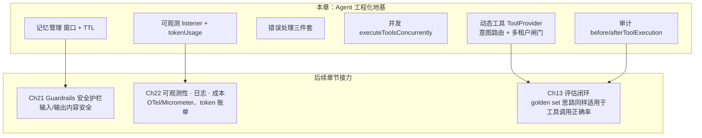

# Ch16 Agent 工程化——动态工具、审计、错误处理、并发与可观测性

> **本章基线**：项目 `smart-doc-assistant` ｜ 端口 `8090` ｜ LangChain4j `1.22.0` + 实验模块 `1.22.0-beta32` ｜ JDK `21` ｜ 最后验证 `2026-10-28`

> 本章目标：
> 1. 理解"Agent 能跑"与"Agent 能上线"之间差什么：**工程化六件套**——动态工具、审计、错误处理、并发、可观测、记忆管理
> 2. 掌握**动态工具注入** `ToolProvider`：按用户消息按需暴露工具，解决"工具越多模型越乱"的问题
> 3. 掌握**工具调用审计** `beforeToolExecution / afterToolExecution`：每次调用留痕（参数、结果、失败、耗时）
> 4. 掌握**错误处理三件套**：`toolExecutionErrorHandler` / `toolArgumentsErrorHandler` / `hallucinatedToolNameStrategy`——工具异常、参数失败、幻觉工具名都能兜底
> 5. 掌握**并发工具执行** `executeToolsConcurrently` 与**可观测性** `registerListener`（含 tokenUsage 成本）
> 6. 掌握**记忆管理**：窗口裁剪（`maxMessages`）+ 会话 TTL，理解 Agent 长跑的"记忆膨胀"问题
> 7. 建立**生产化全景**：Guardrails→Ch21、可观测/成本→Ch22、评估思维复用 ch13 的章节地图

---

## 16.1 为什么 Agent 需要"工程化"

Ch14 造出了会干活的 Agent。但**能跑 ≠ 能上线**。上线前工程团队会连环问：

| 问题 | 缺什么 | 对应能力（本章） |
|---|---|---|
| "模型会不会乱调工具？" | 工具越多，选错概率越大、token 越浪费、还可能越权 | **动态工具注入** ToolProvider + 多租户隔离 |
| "刚才那次回答调了哪些工具？" | 排障、审计、成本核算都需要留痕 | **工具调用审计** |
| "工具抛异常了会不会崩？" | 异常要兜底，让模型自己纠正，而不是把错误甩给用户 | **错误处理三件套** |
| "一次要算 3 个数字，能不能并行？" | 串行执行浪费 LLM 往返时间 | **并发工具执行** |
| "这个 Agent 一天烧多少 token？" | 成本与质量监控需要事件流 + 用量统计 | **可观测性 listener** |
| "聊了 100 轮记忆会不会爆？" | 记忆有窗口上限、有清理策略 | **记忆管理** |

本章用 `AiServices.builder()` 给 Agent 装上这六件能力（**API 全部在 `1.22.0` 上 javap 核实 + 项目编译通过**）。

---

## 16.2 动态工具注入：ToolProvider

### 16.2.1 问题

Ch14 用 `AiServices.tools(timeTools, calculatorTools, orderTools, ragLookupTool, ...)` 把工具**一次性全部**给模型。工具一多，问题就来了：

- **选错**：模型面对 10 个工具，把"查物流"的活派给"查知识库"的工具；
- **token 浪费**：每个工具的 description 都进上下文，工具越多 Prompt 越长；
- **攻击面**：无关工具也暴露给模型（如不该给用户的内部工具）；
- **多租户越权**：所有租户共用同一套工具，A 租户可能调到 B 租户/管理员专属工具——这是生产红线。

`ToolProvider`（javap 核实的接口：`ToolProviderResult provideTools(ToolProviderRequest)`）是 langchain4j 的扩展点，它在 AiServices 跑工具循环**之前**被调用，决定"本轮把哪些工具的 spec 暴露给模型、模型又能执行哪些"。

### 16.2.2 生产化三段式：意图路由 → 域映射 → 租户闸门

教学版常写 `if (text.contains("算")) put(...)`，但 `contains` 硬匹配有两个绕不开的坑：

- **漏召回**：问"退款**规则**"——不包含"政策"，工具一个都不暴露，模型只能瞎编（作者实测日志：`暴露 0 个工具：[]` 之后模型胡说八道）；
- **误召回**：一句话同时提到"运费"和"发货"，三类工具全放出去，反而没收窄。

因此本项目把动态工具拆成四个角色、三段流水线（代码在 `smart-doc-assistant` 的 `com.example.assistant.engineering` 包；本章所有路径都以 `smart-doc-assistant/` 为根）：

```
provideTools(request)
      │
      ├─① 意图路由 IntentRouter  ：用户问题 → 候选业务域（refund/logistics/calc）
      │                             轻量 LLM 分类，关键词兜底（解决漏召回/误召回）
      │
      ├─② 域→工具映射 ToolCatalog ：业务域 → 该域下全部工具（spec + executor + 权限元数据）
      │
      └─③ 租户/角色闸门 TenantToolFilter：按 RequestContext 的 tenantId/role 过滤（安全红线）
```

**① ToolCatalog（工具目录）——按"域"组织，而非扁平列表**

构造期扫描每个工具对象的 `@Tool` 方法，但额外按其所属业务域登记元数据（代码里 `DOMAIN_META` 注册表，生产应外置到配置/DB）：

```java
public record Entry(ToolSpecification spec, ToolExecutor executor,
                    String domain,                 // 业务域：refund / logistics / calc
                    Set<String> requiredRoles,      // 所需角色：空=任意角色
                    Set<String> enabledTenants) {}  // 开通租户白名单：空=全租户

// 工具名 → 元数据（演示用静态 Map，生产外置）
static final Map<String, DomainMeta> DOMAIN_META = Map.of(
    "searchKnowledgeBase", new DomainMeta("refund",    Set.of(), Set.of()),
    "currentTime",         new DomainMeta("logistics", Set.of(), Set.of()),
    "daysBetween",         new DomainMeta("logistics", Set.of(), Set.of()),
    "calculate",           new DomainMeta("calc",      Set.of(), Set.of()),
    "percentage",          new DomainMeta("calc",      Set.of(), Set.of())
);
```

> 若某工具是**写操作/高成本**（如 admin 域的发短信、删数据），在此标 `requiredRoles=Set.of("ADMIN")`，非 ADMIN 用户即使意图命中也会被第 ③ 步拦掉。

**② IntentRouter（意图路由）——替换 contains**

用轻量 LLM（生产建议小模型省成本，本教程复用主模型）把问题分类到已知业务域，输出稳定可控；LLM 不可用时回退关键词兜底，保证不退化成"0 工具导致模型瞎编"：

```java
public List<String> route(String userText) {
    List<String> llmDomains = classifyByLlm(userText);   // 轻量分类 → [refund]/[calc]/...
    return llmDomains.isEmpty() ? fallbackByKeyword(userText) : llmDomains;
}
```

**③ TenantToolFilter（租户/角色闸门）——安全红线**

意图选出候选工具后，最终暴露前必过两道闸：① 租户白名单 ② 角色授权。它与路由**正交**：路由决定"该用哪些"，闸门决定"这个用户能不能用"——两者不能混为一谈。

```java
public List<Entry> filter(List<Entry> candidates, String tenantId, String role) {
    return candidates.stream()
        .filter(e -> tenantEnabled(e.enabledTenants(), tenantId))  // 租户开通了吗
        .filter(e -> roleAllowed(e.requiredRoles(), role))         // 角色够吗
        .collect(toList());
}
```

**编排（DynamicToolProvider.provideTools）**：

```java
public ToolProviderResult provideTools(ToolProviderRequest request) {
    String text = request.userMessage() == null ? "" : request.userMessage().singleText();

    List<String> domains = intentRouter.route(text);                 // ① 意图 → 域
    List<Entry> candidates = domains.stream()
            .flatMap(d -> catalog.byDomain(d).stream()).toList();    // ② 域 → 工具
    List<Entry> allowed = tenantFilter.filter(                       // ③ 租户/角色闸门
            candidates, RequestContext.tenantId(), RequestContext.role());

    Map<ToolSpecification, ToolExecutor> selected = new HashMap<>();
    allowed.forEach(e -> selected.put(e.spec(), e.executor()));
    return ToolProviderResult.builder().addAll(selected).build();
}
```

> ⚠️ **坑点（源码核实）**：`ToolProviderResult.Builder` 的方法是 **`addAll(Map<ToolSpecification, ToolExecutor>)`** 或 `add(spec, executor)`，没有 `tools(...)`。`ToolExecutor` 在 `dev.langchain4j.service.tool` 包（不在 `agent.tool.execution`）。`ChatModel` 没有 `generate(String)`，轻量分类用 `chat(String)`（返回 `String`）。

**④ 执行期护栏（ToolGuard 包裹）——"看得见"不等于"有权跑"**。`DynamicToolProvider` 在返回前给每个选出的工具包了一层代理 executor：真正执行前再过一次 `ToolGuard`（黑名单 / 角色白名单 / 限流，Ch21 的组件在这里提前上岗），被拦就返回 `⛔ 操作被安全策略拦截：…` 的提示文本，交由模型向用户解释。它和 ③ 是**两层正交的闸门**：`TenantToolFilter` 管"模型看得见哪些工具"（暴露时），`ToolGuard` 管"这个角色跑了才算数"（执行时兜底）——即使模型通过提示注入点名叫工具，没有权限也执行不了。16.10 的 ② 有这组边界的实测。

**真实效果**（2026-10-28 实测）：问"退款政策里运费谁出？再算 500×8"（`tenantA/u1001/role=user`），注入日志 `域=[refund, calc] → 暴露 3 个工具`——检索工具正常执行并给出完整答案，`calculate` 被 ToolGuard 以 `角色 [user] 无权调用工具 [calculate]` 拦下，审计如实留痕。

> 💡 **生产方向**：纯只读低风险工具（<30 个）其实**直接全量给模型（`tools(...)`）更稳**——你之前担心"工具多模型选错"，但 1.19 的 function calling 对 30 个以内工具准确率很高，**漏召回比误召回更糟**。只有当工具含写操作/高权限/高成本时，才需要"先分类裁剪 + 二次权限校验"再暴露（本节的 TenantToolFilter 就是二次校验）。工具上百个时可用官方 **`ToolSearchStrategy`**（`AiServices.toolSearchStrategy(...)`）做语义检索。

---

## 16.3 工具调用审计：before/afterToolExecution + 多租户复合 key

`AiServices` 提供两个回调钩子（javap 核实）：`beforeToolExecution(Consumer<BeforeToolExecution>)` 和 `afterToolExecution(Consumer<ToolExecution>)`。`ToolExecution` 有 `request()`（含工具名/参数）/ `result()` / `hasFailed()` / `startTime()` / `duration()` / `invocationContext()`（含 `chatMemoryId()`）。

> ⚠️ **坑点（javap 核实）**：`InvocationContext` 的方法叫 **`chatMemoryId()`**（在 core 的 `dev.langchain4j.invocation` 包，不在 umbrella），不是 `memoryId()`——凭印象写会编译失败。

**复合审计 key（多租户必备）**：生产 SaaS 下，审计必须按 `tenantId:userId:sessionId` 三维聚合，才能"按租户查调用、按用户追责、按会话排障"。单用 `sessionId` 无法做租户级合规排查。复合 key 在 `record` 内部从 `RequestContext` 拼出——**但"tool 执行与主调用同线程"这个前提在并发执行下不成立**（16.9.1 的核心案例），所以现行代码留了一个显式传租户/用户的 `record` 重载，回调线程用 `provideTools` 在请求线程捕获的快照写入：

```java
public String auditKey(Object sessionId) {
    return RequestContext.tenantId() + ":" + RequestContext.userId() + ":" + sessionId;
}

public void record(Object memoryId, String toolName, String arguments, String result,
                   boolean failed, LocalDateTime startTime) {
    String key = auditKey(memoryId);
    AuditEntry entry = new AuditEntry(toolName, arguments,
            result != null && result.length() > 200 ? result.substring(0, 200) + "…" : result,
            failed, startTime, LocalDateTime.now());
    auditLog.computeIfAbsent(key, k -> new ArrayList<>()).add(entry);   // key 已含租户/用户
    log.info("[审计] 租户={} 用户={} 会话={} 工具[{}] failed={} 耗时{}ms",
            RequestContext.tenantId(), RequestContext.userId(), memoryId, toolName, failed, ...);
}
```

`AgentAuditService` 另提供两个合规查询方法：`getAuditByTenant(tenantId)`（按租户拉全部调用，做成本/合规分析）、`getAuditByUser(tenantId, userId)`（按"租户:用户"追责）。

> ⚠️ **修复实录（2026-10-28）：查询侧的同构坑**。写入侧 key 带了租户，查询侧却对不上：`GET /api/agent/audit?sessionId=17` 这个 HTTP 请求自己不在工具调用线程上，`RequestContext` 的 ThreadLocal 已被 POST 的 finally 清掉，`auditKey()` 拼出来的是 `default:anonymous:17`——**写入是 `tenantA:u1001:17`，查询永远空**。修复：查询接口加 `tenantId` / `userId` 请求参数，走显式三元组的 `getAudit(tenantId, userId, sessionId)`。教训和写入侧是同一句话的两半：**复合 key 的每一个维度，读端和写端必须由同一条链路供给**——写端从请求上下文拿，读端就得显式传参，不能指望"反正 ThreadLocal 里应该还有"。

**审计的价值**：排障（哪次调用参数错了）、安全（有没有越权调工具）、成本（工具调用频次 × 单次耗时）。生产版应写日志/DB（本教程内存版仅演示），`duration()` 已可用——做一个"哪个工具最慢"的统计是练习题。

---

## 16.4 并发工具执行：executeToolsConcurrently

模型一轮可能同时请求多个工具（如"算 A 和算 B"）。默认**串行**执行；`executeToolsConcurrently()` 改为**并行**，缩短整个 Agent 的响应时间。

```java
.executeToolsConcurrently()   // 也可传自定义 Executor
```

**真实效果**（2026-10-28 实测）：一次请求里 `calculate` 和 `searchKnowledgeBase` 同时执行，日志显示跑在虚拟线程（`virtual-76` / `virtual-78`）——并发生效。同一个开关还有个容易忽略的细节：**单工具的轮次不派发**，就在调用线程上内联执行——所以"上一轮只调了一个工具"的请求，审计日志又回到 `nio-8090-exec-*` 请求线程。上下文（ThreadLocal）会不会丢，取决于这一轮派没派发。

> ✅ **最佳实践**：工具之间**无依赖**时才适合并发。框架的并发只是把"模型同一轮请求的多个工具"并行执行、结果各自回填，**不做依赖分析**（源码核实：无工具依赖解析逻辑）；若任务有依赖（如先查再算），模型会在下一轮请求里等上一轮结果就绪后再调。并发 + 防循环（`maxToolCallingRoundTrips(10)`）一起上，才是一套完整护栏。**但并发和 ThreadLocal 请求上下文是死对头**——16.9.1 有完整的事故实录与修法。

---

## 16.5 可观测性：registerListener + tokenUsage

`AiServices.registerListener(AiServiceListener<T>)` 注册事件监听。`AiServiceListener` 接口（javap 核实，在 core 的 `dev.langchain4j.observability.api.listener`）只有两个方法：`getEventClass()` + `onEvent(T)`。

`EngineeringAgentConfig` 里注册完成事件监听，**并从 `Result` 里取出 `tokenUsage()` 算成本**：

```java
private AiServiceListener<AiServiceCompletedEvent> completedListener() {
    return new AiServiceListener<>() {
        @Override public Class<AiServiceCompletedEvent> getEventClass() { return AiServiceCompletedEvent.class; }
        @Override public void onEvent(AiServiceCompletedEvent event) {
            Object result = event.result().orElse(null);
            String tokenInfo = "";
            if (result instanceof Result<?> r && r.tokenUsage() != null) {   // javap 核实：Result.tokenUsage()
                TokenUsage tu = r.tokenUsage();
                tokenInfo = String.format("tokens: in=%s out=%s total=%s",
                        tu.inputTokenCount(), tu.outputTokenCount(), tu.totalTokenCount());
            }
            log.info("[可观测] AiService 调用完成{} result={}", tokenInfo, result);
        }
    };
}
```

**真实效果**（2026-10-28 实测，一轮"退款政策 + 计算"的完整请求）：
```
 动态工具注入：消息[帮我算一下 128 乘以 7 等于多少，…] 租户=tenantA 角色=user 域=[refund, calc] → 暴露 3 个工具：[calculate, percentage, searchKnowledgeBase]
 [审计] 租户=tenantA 用户=u1001 会话=17 工具[searchKnowledgeBase] failed=false 耗时107ms（virtual-76）
 [可观测] AiService 调用完成 tokens: in=1350 out=628 total=1978 result=dev.langchain4j.service.Result@…
```

三条日志三种价值：注入日志回答"模型这轮**被允许**用什么"（暴露≠执行，见 ②），审计日志回答"实际用了什么、结果如何"，观测日志回答"这条请求花了多少"。三行日志拼在一起，一次 Agent 调用就完全可解释了。

**成本闭环**：`total=1978` 乘单价就是这一条请求的成本；把每日所有 `total` 累加就是 Agent 的 token 账单。给一个当天实测的量级感：单轮带两工具的请求 `total` 在 1500~2000 之间（输入 1100~1350、输出 350~630，取决于工具结果的长度——检索片段进上下文是大头）。`in` 远大于 `out` 是 Agent 的普遍形态，**成本治理优先盯输入侧**：工具结果裁剪、检索片段限量（Ch12 的 rerank topK）、记忆窗口（16.7）都是输入侧的闸门。生产版接 OpenTelemetry/Micrometer 由 Ch22 展开。

---

## 16.6 错误处理三件套（生产必配）

Agent 跑在生产，**工具不可能永远成功**：参数格式错、服务挂了、模型调了个不存在的工具……每一样都不能让异常裸奔到用户面前。`AiServices` 提供三个兜底钩子（javap 核实）：

| 钩子 | 触发时机 | 返回 |
|---|---|---|
| `toolExecutionErrorHandler(ToolExecutionErrorHandler)` | 工具方法抛异常 | `ToolErrorHandlerResult.text(给模型的友好文本)` |
| `toolArgumentsErrorHandler(ToolArgumentsErrorHandler)` | 模型给的参数解析失败 | 同上 |
| `hallucinatedToolNameStrategy(Function<ToolExecutionRequest, ToolExecutionResultMessage>)` | 模型调用**不存在的工具** | `ToolExecutionResultMessage`（告诉模型"没这工具"） |

`EngineeringAgentConfig` 里的实现：

```java
// ⑤ 错误处理三件套：工具异常 / 参数解析失败 / 幻觉工具名，都兜底成友好文本引导模型纠正
.toolExecutionErrorHandler((throwable, context) -> {
    String tool = context.toolExecutionRequest().name();
    log.warn(" [错误处理] 工具[{}]执行异常: {}", tool, throwable.getMessage());
    return ToolErrorHandlerResult.text(
            "工具 [" + tool + "] 执行失败：" + throwable.getMessage()
                    + "。请修正参数后重试，或换一种方式回答。");
})
.toolArgumentsErrorHandler((throwable, context) -> {
 log.warn(" [错误处理] 工具参数解析失败: {}", throwable.getMessage());
    return ToolErrorHandlerResult.text(
            "工具参数格式不正确：" + throwable.getMessage() + "。请重新生成参数。");
})
.hallucinatedToolNameStrategy(request ->
        ToolExecutionResultMessage.from(request,
                "工具 [" + request.name() + "] 不存在，请只使用系统提供的工具。"))
```

**实测"工具抛异常"场景**（2026-10-28，问"帮我算一下 5 除以 0 等于多少"）：

```
 [错误处理] 工具[calculate]执行异常: 除数不能为零，请换个非零的第二个数字 ← handler 接管，日志留痕
 [审计] 租户=tenantA 用户=u1001 会话=19 工具[calculate] failed=true 耗时3ms ← 审计标记失败
 [可观测] AiService 调用完成 tokens: in=1166 out=370 total=1536 … ← 一次失败调用的完整成本
→ 模型拿到友好文本后体面收场：
"计算器返回了错误，这个结果是符合数学定义的：5 ÷ 0 没有意义，即结果不存在……"   ← HTTP 200
```

> ⚠️ **修复实录（2026-10-28）：provider 供给的工具，handler 会静默失明**。修这条实测时抓到的：第一次跑，`⚠️` 日志没出现、审计 `failed=false`——handler 根本没收到异常。根因在**执行器是谁建的**：`AiServices.tools(...)` 路径下框架自建执行器，`propagateToolExecutionExceptions=true`（`ToolService` 源码 L243），异常上抛给 handler；而 **`ToolProvider` 路径下执行器是 provider 自己 `new DefaultToolExecutor(tool, m)` 的——裸构造默认 `propagate=false`，异常就地转成 `isError=true` 的文本**，走到模型的"工具异常三层机制"第一层就停了（Ch14 14.4.5）。修法与框架同款：provider 里改用 `DefaultToolExecutor.builder()....propagateToolExecutionExceptions(true).build()`，上表的全链路立刻通。**给 AiServices 配了错误处理三件套、工具却从 ToolProvider 来的读者，几乎必踩这一条**——它的表现不是报错，而是"兜底配置从未生效"的静默。

同时审计把这次调用标记为 **`failed=true`**（`ToolExecution.hasFailed()`）——错误既被兜底，又被留痕。顺带对照 Ch14 的默认行为：不配 handler 时同步模式的默认（`sendExceptionMessageToLlm`）兜的是同样的底，自定义 handler 的增量价值在**文案可控**（带工具名、带下一步指引）和**审计/告警挂钩**（这里打了 WARN 日志、审计记了 failed）。

> ✅ **最佳实践**：错误处理的核心是**把异常翻译成模型听得懂的话**，让它自己纠正重试，而不是把 `IllegalArgumentException` 堆栈甩给用户。三条原则：① 消息里带工具名和具体原因；② 给模型明确的下一步指令（"修正参数重试 / 换一种方式"）；③ 别把敏感内部信息（堆栈、SQL）塞进给模型的文本——那等于把它喂给 Prompt 攻击面。

> ⚠️ **坑点**：`hallucinatedToolNameStrategy` 在早期模型时代会频繁触发（模型瞎编工具名），现在的主流模型很少犯——但它仍是**最后一层防线**：万一触发而没兜底，整个对话会卡死在"调用不存在的工具"，所以生产必须配。

---

## 16.7 记忆管理：窗口裁剪 + 会话 TTL

Agent 是**多轮长跑**的，记忆是它的"工作记忆"——但不加管理的记忆会膨胀失控：

| 记忆问题 | 后果 | 对策 |
|---|---|---|
| 消息无限累积 | token 成本线性上涨、上下文超限 | **窗口裁剪**：只保留最近 N 条 |
| 会话堆积不清理 | 存储膨胀、隐私风险 | **TTL 清理**：不活跃会话自动过期 |
| 窗口太窄丢关键上下文 | 多步任务答错 | 调窗口大小 / 用**摘要压缩**（summarization） |

**项目现状**（都是已落地的真实配置）：

```java
// AiServiceConfig：窗口裁剪——每个会话最多保留 20 条消息
public ChatMemoryProvider chatMemoryProvider() {
    return memoryId -> MessageWindowChatMemory.builder()
            .id(memoryId)
            .maxMessages(20)              // ← 窗口上限，防记忆无限膨胀
            .chatMemoryStore(chatMemoryStore)
            .build();
}
```

```yaml
# application.yml：会话 TTL——30 天不活跃自动清理（RedisChatMemoryStore）
chat:
  memory:
    ttl-days: 30
```

**两条策略各管一件事**：`maxMessages(20)` 管**单会话长度**（防止一次对话无限变长）；`ttl-days: 30` 管**会话生命周期**（防止千万个僵尸会话占存储）。二者叠加才是完整的记忆治理。

> 💡 **生产方向**：窗口裁剪是"简单粗暴"方案——它可能把早先的关键上下文也裁掉。进阶方案是**摘要压缩**（summarization）：窗口里的旧消息先让 LLM 压成一段摘要，再随窗口一起进上下文（LangChain4j 生态有此方向；Ch17 MCP / Ch22 可观测会继续谈）。经验：窗口 20 条对短任务够用，长任务（多工具多轮）建议 30-50 条或上摘要。

---

## 16.8 生产化全景：这一章在教程里的位置

Agent 工程化不止本章六件套。**完整拼图**长这样——本章是地基，其余各章接力：



| 本章已做 | 留给后续章节 |
|---|---|
| 动态工具（意图路由 LLM 分类 + 租户/角色闸门） | Ch21 Guardrails：输入/输出护栏、内容安全；Ch22 工具选择监控 |
| 可观测（日志 + tokenUsage） | Ch22：OpenTelemetry/Micrometer 对接、成本账单 |
| 审计（内存版） | Ch22：审计持久化（日志/DB） |
| 防循环 / 错误兜底 | ch13 的评估闭环迁移到 Agent 场景（工具调用正确率、端到端回归）；框架级测试设施见官方 langchain4j-examples |

读者地图：学完 Ch16，你就有了"能上线的 Agent 地基"；Ch21/Ch22 是把它加固成"生产级"的接力棒，评估思维则在 Ch13 已经交过底。

---

## 16.9 踩坑实录：ThreadLocal 请求上下文的三种死法

**现象**：多租户下，A 租户的会话偶尔查到 B 租户的审计记录，或工具被错误租户调用。

**根因**：`RequestContext` 用 `ThreadLocal` 承载租户/用户上下文，但**线程池里的线程会被复用**。若请求结束时没 `clear()`，下一个请求复用这条线程时会读到上一个请求的 `tenantId`——开头说的"A 租户查到 B 租户的审计"，就是这么来的。

**修复（本项目已落地）**：在 Controller 入口 `set(...)`、并在 `finally` 里 **必须 `clear()`**：

```java
RequestContext.set(body.getOrDefault("tenantId", "default"),
                   body.getOrDefault("userId", "anonymous"),
                   body.getOrDefault("role", "USER"));
try {
    String answer = engineeringAgent.chat(sessionId, body.get("question")).content();
    return Map.of("success", true, "answer", answer);
} finally {
    RequestContext.clear();   // ← 防线程池复用串租户
}
```

> ⚠️ **坑点（通用教训）**：**凡是 `ThreadLocal` 传递请求级上下文（tenant / traceId / userId），必须在请求结束时 `remove()`**。Spring 的 `SecurityContextHolder`、日志的 `MDC` 都是同样道理——忘了清理就是并发下的定时炸弹。更规范的做法是做成 `HandlerInterceptor`，在 `afterCompletion` 里统一 `clear()`（本项目为演示清晰写在 Controller，生产建议收口到拦截器）。

**旧坑（已规避，记一笔）**：早期用 `Map<Object, List>` 以 `chatMemoryId()`（`Long`）做 key、查询用 `String`——`Long.equals("1")` 永远 false 查不到。本项目现已统一为 `tenantId:userId:sessionId` 的 **String 复合 key**，天然规避类型不一致。

### 16.9.1 核心案例：并发执行把 ThreadLocal 上下文吞了（2026-10-28 修复实录）

上面两节讲的是"忘了 clear"和"key 拼错"。这一节是更隐蔽的第三种死法：**上下文根本没到你以为它在的线程上**。

**现象**：多租户全链路配齐了——Controller `set` 了 tenantA、`TenantToolFilter` 按租户过滤、审计 key 三维复合——但实测发现：审计记录全落在 `default:anonymous`，ToolGuard 亲眼看到的角色是默认的 `USER` 而不是请求里的 `user`。**租户隔离和角色闸门在执行期静默失效**，而且没有任何报错。

**证据**（一次请求的三行日志，线程名说明一切）：

```
[nio-8090-exec-2] 动态工具注入：… 租户=tenantA 角色=user   ← provideTools 在请求线程，上下文正确
[virtual-88] [ToolGuard] role 'USER' has no allowed-tools entry ← 执行线程读到默认值
[virtual-88] [审计] 租户=default 用户=anonymous 会话=17 … ← 审计归属错乱
```

**根因**：`executeToolsConcurrently()` 把工具执行（和 `afterToolExecution` 回调）调度到虚拟线程。`RequestContext` 是 `ThreadLocal`——**它的作用域是"设值的那条线程"，不是"那次 HTTP 请求"**。请求线程上的 set，虚拟线程上看不见，`withInitial` 的默认值（default/anonymous/USER）全数接管。16.4 说过"单工具不派发"——所以这个 bug 的表现是**间歇**的：一轮只调一个工具时一切正常，模型哪轮并行要了两个工具，上下文就丢了。间歇性 + 无报错，是生产上最难缠的一类。

**修复**（三层各就各位）：

1. **捕获**：`provideTools` 跑在请求线程、上下文是准的——在它入口把 `[tenantId, userId, role]` 捕获进 `chatMemoryId → 上下文` 的映射；
2. **执行侧**：代理 executor 授权时用捕获的角色，不再摸 ThreadLocal；
3. **回调侧**：`afterToolExecution` 里审计走显式租户/用户的 `record` 重载，租户/用户从 `dynamicToolProvider.contextFor(memoryId)` 取快照。

修复后复测：审计正确落 `tenantA:u1001:17`，`role=user` 的用户检索放行、计算器被拦（文案里角色是 `user`，不再是幽灵 `USER`）。

> ⚠️ **通用教训**：**ThreadLocal 传的是"线程作用域"，HTTP 请求的边界是"逻辑作用域"，两者只在同步、单线程执行时重合**。凡是框架可能把工作挪到别的线程（并发工具执行、异步流、@Async、线程池回调），请求级上下文都要显式传递：要么在切进异步前捕获快照（本节做法），要么上 TaskDecorator / TransmittableThreadLocal 这类传递机制。审计、租户、链路追踪——在并发下"静默变成默认值"是它们的共同死法。

### 16.9.2 踩坑实录：`ReturnBehavior.IMMEDIATE_IF_LAST` 在 1.19.0 抛 NPE

> **版本注**：这一节记录的是 **1.19.0** 上踩到的坑，保留原样作为现场证据。升到 `1.22.0` 后枚举和三个值都还在（`javap` 核实 `TO_LLM` / `IMMEDIATE` / `IMMEDIATE_IF_LAST` 全在），**但项目仍然用 `TO_LLM`**——没有回归验证过的路径不进业务代码，想用的话请按本节末尾的"教训"先写最小用例复测。

**想做什么**：工具只有一个、又是最后一个调用时，跳过"结果再回 LLM 组织语言"这一轮，把工具结果直接返回，省一次模型调用。

**怎么配**：`@Tool(returnBehavior = ReturnBehavior.IMMEDIATE_IF_LAST)`。

**实际结果**：1.19.0 稳定版在工具结果处理阶段抛 `NullPointerException`——框架构造 `ToolExecutionResult` 时有字段是 `null`。这不是你的代码写错，是框架路径没走通。

**本项目怎么处理**：去掉 `returnBehavior`，用默认的 `TO_LLM`（结果先回 LLM 再返回）。`CalculatorTools.calculate` 的注释里留了这段记录：

```java
// 注意：1.19.0 稳定版里 ReturnBehavior.IMMEDIATE_IF_LAST 在工具结果处理阶段会触发
// NullPointerException（框架构造 ToolExecutionResult 时某字段为 null）。
// 这里去掉 returnBehavior，使用默认的 TO_LLM：结果先回 LLM 组织语言再返回，行为稳定。
@Tool("使用高精度计算器执行四则运算。...")
public double calculate(...) { ... }
```

**教训**：这类"省一次调用"的优化，在框架还在 beta 的版本线上要**先写最小用例验证**再用到业务里。省下的那点 token，抵不上一次线上 NPE。

---

## 16.10 接口验证（2026-10-28 实测）

`EngineeringAgentController` 暴露两个端点。本轮实测跑在 `deepseek-v4-flash` 上（主配置 qwen 当日 Key 不可用），并加 `--chat.memory.backend=memory`（Ch14 的环境坑同款）。五组用例各验一件事：

```bash
# ① 全链路（动态注入 + 审计 + 观测，全租户工具）
curl -X POST http://localhost:8090/api/agent/engineering/chat \
  -H "Content-Type: application/json" \
  -d '{"sessionId":"17","question":"退款政策里运费谁出？再帮我算一下 500 乘以 8",
       "tenantId":"tenantA","userId":"u1001","role":"user"}'
# → 运费规则完整作答（searchKnowledgeBase 正常执行）
# 日志：🎯 … 租户=tenantA 角色=user 域=[refund, calc] → 暴露 3 个工具
# [审计] … 工具[searchKnowledgeBase] failed=false 耗时107ms（virtual-76）
#        tokens: in=1350 out=628 total=1978

# ② 角色边界（执行期护栏）：user 角色算计算器
#    同样的问题换个问法，让意图路由选中 calc 域：
curl -X POST http://localhost:8090/api/agent/engineering/chat \
  -H "Content-Type: application/json" \
  -d '{"sessionId":"18","question":"帮我算一下 128 乘以 7 等于多少","tenantId":"tenantA","userId":"u1001","role":"user"}'
# → calculate 被 ToolGuard 拦截："⛔ 操作被安全策略拦截：角色 [user] 无权调用工具 [calculate]"
#    模型拿到拦截文本后向用户解释"没有计算权限"，而不是 500
# 审计： 文本如实入库（failed=false——拦截是正常返回，不是异常）

# ③ 审计查询：必须带显式租户/用户（16.3 修复实录）
curl "http://localhost:8090/api/agent/audit?sessionId=17&tenantId=tenantA&userId=u1001"
# → key=tenantA:u1001:17, entries=[calculate(⛔拦截), searchKnowledgeBase(片段1…)]
curl "http://localhost:8090/api/agent/audit?sessionId=17"
# → key=default:anonymous:17, entries=[]   ← 不带参数就是查不到，复合 key 的教训活标本

# ④ 错误处理全链路（需先 --chat.guardrail.tool.enabled=false 关掉执行期护栏，让 calculate 真能跑）
curl -X POST http://localhost:8090/api/agent/engineering/chat \
  -H "Content-Type: application/json" \
  -d '{"sessionId":"19","question":"帮我算一下 5 除以 0 等于多少","tenantId":"tenantA","userId":"u1001","role":"admin"}'
# → HTTP 200，模型引着工具报错原文给出"5 ÷ 0 没有定义"的完整解释
# 日志： [错误处理] 工具[calculate]执行异常: 除数不能为零…
# [审计] … failed=true 耗时3ms tokens: in=1166 out=370 total=1536

# ⑤ 上下文传播（16.9.1 修复验证）：多工具轮的审计归属
#    ① 的日志里审计已带 tenantA/u1001（修复前是 default/anonymous）
```

> 💡 生产里 `tenantId/userId/role` 应从 **JWT/网关头** 提取（本项目简化放到请求体演示）。另外留意角色值的大小写：`ToolGuard` 的白名单键是小写 `user/admin/readonly`，传 `USER` 会落进"deny by default"分支——本项目实测踩过（① 之前那轮）。配置里 `admin: []`（空列表）的语义是**全禁**而不是"不限制"：这套实现是"整表为空才全放、列了角色就按白名单、白名单没列的工具一律拒绝"。想让 admin 真不受限，只能整段删掉 `role-allowed-tools` 配置——注释和语义对不上的配置，本身就是坑。

---

## 本章小结

### 概念速查表

| 概念 | 一句话 |
|---|---|
| **动态工具注入** | `ToolProvider.provideTools(ToolProviderRequest)` 按消息内容按需暴露工具；`ToolProviderResult.builder().addAll(Map)` 返回 |
| **工具审计** | `beforeToolExecution / afterToolExecution` 回调；`ToolExecution` 有 request/result/**hasFailed**/startTime/duration/invocationContext |
| **错误处理三件套** | `toolExecutionErrorHandler`（工具异常）/ `toolArgumentsErrorHandler`（参数失败）/ `hallucinatedToolNameStrategy`（幻觉工具名），兜底成友好文本引导模型纠正 |
| **并发执行** | `executeToolsConcurrently()`：模型一次要多个工具时并行跑（工具间无依赖时）；无依赖分析 |
| **可观测性** | `registerListener(AiServiceListener<T>)`；`Result.tokenUsage()` 拿 in/out/total → 成本核算 |
| **记忆管理** | 窗口裁剪 `MessageWindowChatMemory.maxMessages(20)` + 会话 TTL `chat.memory.ttl-days: 30`；进阶用摘要压缩 |
| **防循环** | `maxToolCallingRoundTrips(10)`：工具循环护栏，防模型无限调工具烧钱 |
| **两层工具闸门** | `TenantToolFilter`（暴露时，模型看得见什么）与 `ToolGuard`（执行时，跑了才算数）正交叠加 |
| **坑：并发吞上下文** | `executeToolsConcurrently` 把执行/回调挪到虚拟线程，ThreadLocal 请求上下文全丢——provideTools 时刻捕获快照（16.9.1） |
| **坑：provider 吞异常** | ToolProvider 自建执行器默认 `propagate=false`，AiServices 的错误 handler 收不到工具异常——builder 显式开（16.6） |
| **坑：ThreadLocal 清理** | 用 ThreadLocal 传租户/用户上下文，必须在请求结束 `remove()`，否则线程池复用会串租户 |

### 项目代码状态表（v0.14）

| 模块 | 文件 | 说明 |
|---|---|---|
| 动态工具-编排 | `engineering/DynamicToolProvider.java` | **新增/重写（2026-10-28 两处修复）**：ToolProvider 实现，编排意图路由→域映射→租户闸门→ToolGuard 包裹；修复并发上下文丢失（provideTools 快照）与执行器吞异常（propagate=true） |
| 动态工具-目录 | `engineering/ToolCatalog.java` | **新增**：工具按 domain/requiredRoles/enabledTenants 登记 |
| 动态工具-路由 | `engineering/IntentRouter.java` | **新增**：轻量 LLM 意图分类（关键词兜底），替换 contains |
| 动态工具-闸门 | `engineering/TenantToolFilter.java` | **新增**：按 tenantId/role 过滤（安全红线） |
| 租户上下文 | `engineering/RequestContext.java` | **新增**：ThreadLocal 承载 tenantId/userId/role，请求级隔离 |
| 审计 | `engineering/AgentAuditService.java` | **新增/重写（2026-10-28 修复查询侧 key）**：afterToolExecution 留痕，复合 key `tenantId:userId:sessionId` + 显式租户/用户的 record 重载与 getAudit + 按租户/用户查询 |
| 助手 | `engineering/EngineeringAgent.java` | **新增**：工程化 Agent 接口（@MemoryId + @UserMessage → Result） |
| 配置 | `config/EngineeringAgentConfig.java` | **新增（2026-10-28 审计改走上下文快照）**：六件套装配（toolProvider 含 routerModel + 审计 + 并发 + 错误处理三件套 + listener 含 tokenUsage） |
| 接口 | `controller/EngineeringAgentController.java` | **新增（2026-10-28 audit 加租户参数）**：`POST /api/agent/engineering/chat`（入参带 tenantId/userId/role）+ `GET /api/agent/audit?tenantId=&userId=` |
| 记忆 | `config/AiServiceConfig.java` / `application.yml` | **零改动**——`maxMessages(20)` 窗口 + `ttl-days: 30` 本就是已落地配置（§16.7 讲解） |
| 旧 Agent | `assistant/ResearchAgent.java` / `config/AgentConfig.java` | **零改动**——工程化 Agent 是独立新增，不破坏 Ch14 |

### 练习题

1. 在 `IntentRouter.fallbackByKeyword` 里把某域（如 calc）的关键词删光，问一个纯计算问题（如"128 乘以 7"），观察日志：LLM 分类仍可能命中 calc 域；若注释掉整个 `classifyByLlm` 让路由只走关键词，再问中性问题（如"你好"），观察日志暴露的工具数——体会动态注入对 token 的节省与"漏召回 vs 误召回"的权衡。
2. **并发上下文实验**：在 `DynamicToolProvider` 里把 `requestContexts` 的捕获逻辑注释掉，用两个会话分别以 `tenantA/u1001` 和 `tenantB/u2002` 发带双工具的问题，再查两个租户的审计——你会看到记录全混进 `default:anonymous`；恢复捕获后复测。亲手做一遍 16.9.1，比读十遍记得牢。
3. 给 `calculate` 工具问一个 `5 除以 0` 的问题触发异常，然后**把 `DynamicToolProvider` 里的 `propagateToolExecutionExceptions(true)` 改回裸构造**再问一次——对照 `⚠️ [错误处理]` 日志和审计 `failed` 标志的消失，体会 16.6 修复实录里的"静默失明"。
4. 把 `AiServiceConfig` 的 `maxMessages(20)` 改成 `5`，连问 6 轮问题后追问"我第一句说了什么"——观察记忆窗口裁掉了早期消息，理解窗口大小的取舍。
5. 思考题：`executeToolsConcurrently()` 对"先查知识库、再根据结果算数"这类有依赖的任务有效吗？为什么？（提示：依赖链会串行等待）

---

## 本章参考

- 本地源码：`langchain4j-1.22.0.jar` → `dev/langchain4j/service/tool/ToolProvider.java`、`ToolExecutor.java`、`dev/langchain4j/service/tool/execution/*`
- 本项目代码：`smart-doc-assistant/src/main/java/com/example/assistant/engineering/`
- 仓库：https://github.com/langchain4j/langchain4j
