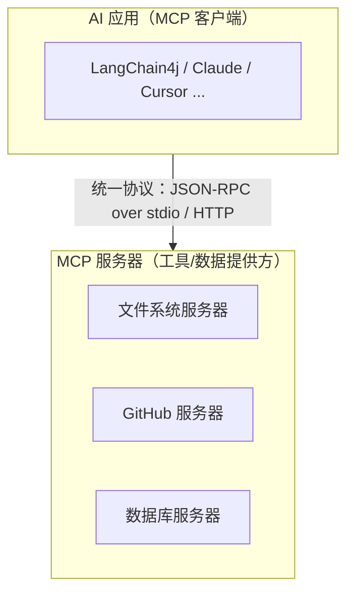
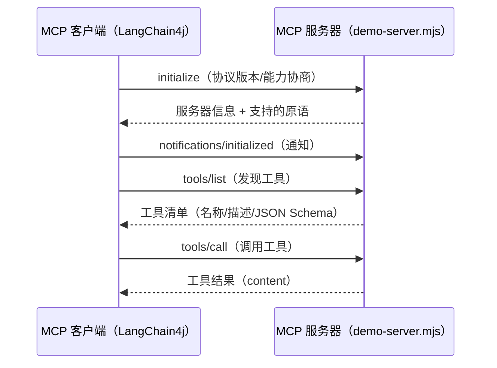

# Ch17 MCP 模型上下文协议——把 Agent 的工具能力标准化

> **本章基线**：项目 `smart-doc-assistant` ｜ 端口 `8090` ｜ LangChain4j `1.22.0` + 实验模块 `1.22.0-beta32` ｜ JDK `21` ｜ 最后验证 `2026-10-28`

> 本章目标：
> 1. 理解为什么需要 MCP：工具生态碎片化 → 需要"工具的 USB-C 接口"标准
> 2. 掌握协议原理：**三种原语**（工具/资源/提示）+ **两种传输**（stdio / Streamable HTTP）+ **生命周期**（握手/发现/调用）
> 3. 掌握**协议字段级**：JSON-RPC 消息逐字段、initialize 能力协商、工具结果结构——用一份 80 行手写服务器看懂
> 4. 实战 **stdio 客户端**：`StdioMcpTransport` → `DefaultMcpClient` → `McpToolProvider` → `@AiService(toolProvider=...)`，含**传输内部机制**（子进程管理、重连）
> 5. 实战 **resources 原语**：资源发现/读取端到端（含作者实测与一个多态序列化坑）
> 6. 掌握工具**过滤/重命名**等工程化细节，理解 MCP 与 `@Tool` / `ToolProvider` 的三角关系
> 7. 建立**安全边界**意识：不可信服务器、工具白名单、进程生命周期

## 17.1 为什么需要 MCP

`@Tool` 解决的是"把**项目里**的方法暴露给模型"。但现实世界的工具**不在你的项目里**：数据库、文件系统、GitHub、企业内部服务……每个工具都要自己写接入代码，一个工具一套协议：

| 接入方式 | 痛点 |
|---|---|
| 每个外部服务写一个 `@Tool` 封装 | 一个服务一套 HTTP/认证/参数约定，重复造轮子 |
| 项目内工具 | 无法分享给其他 AI 应用（换框架全重写） |
| 工具清单散落 | 模型不知道"这台机器上到底有哪些工具可用" |

**MCP（Model Context Protocol，模型上下文协议）** 是 Anthropic 在 2024 年底提出的**开放标准**：定义"AI 应用 ↔ 工具/数据源"的统一协议，让任何 MCP 服务器（文件系统、GitHub、数据库……）都能被任何 MCP 客户端（LangChain4j、Claude、Cursor……）即插即用。业界把它比作 **"工具的 USB-C 接口"**。



> **Spring AI 对比**：Spring AI 1.0 同样支持 MCP（`ToolCallback` 包装 MCP 工具），思路一致。MCP 是**生态标准**，两家都在朝它靠拢——学一次协议，两边通用。

## 17.2 协议原理：原语、传输、生命周期

### 17.2.1 三种原语（MCP 能给 AI 应用提供什么）

| 原语 | 作用 | 类比 | 本章状态 |
|---|---|---|---|
| **Tools 工具** | AI 应用可调用的函数（有名字、描述、输入 Schema） | 相当于 `@Tool` |  端到端实测 |
| **Resources 资源** | 可读取的只读数据（文件内容、文档、图片） | 相当于"知识库只读挂载" |  端到端实测（17.5） |
| **Prompts 提示** | 服务器预置的提示词模板 | 相当于"服务端 Prompt 模板" | 代码级（17.5.3） |

### 17.2.2 两种传输（协议怎么跑）

| 传输 | 场景 | 客户端类（javap 核实） |
|---|---|---|
| **stdio** | 本地子进程（`node server.mjs`），走 stdin/stdout | `StdioMcpTransport.builder().command(List<String>).environment(Map).build()` |
| **Streamable HTTP** | 远程服务器，POST JSON-RPC + 可选 SSE 流 | `StreamableHttpMcpTransport.builder().url(...).timeout(...).build()` |
| WebSocket / Docker | 特殊场景 | `WebSocketMcpTransport` / `DockerMcpTransport`（mcp-docker 模块） |

### 17.2.3 生命周期（一次完整交互）



## 17.3 协议字段级：看懂一个真实请求/响应

MCP 的**消息格式**是 JSON-RPC 2.0，**传输通道**是 stdin/stdout（每行一条）。拆一条真实消息：

```jsonc
// 客户端 → 服务器：tools/call（调用 add 工具）
{ "jsonrpc": "2.0",
  "id": 3,                              // 请求标识：响应用同一个 id 关联
  "method": "tools/call",               // 方法名：MCP 定义的 JSON-RPC 方法
  "params": {                           // 方法参数
    "name": "add",                      // 工具名（必须与 tools/list 返回一致）
    "arguments": { "a": 3, "b": 4 }     // 工具入参（JSON，按输入 Schema 填）
  }
}

// 服务器 → 客户端：响应
{ "jsonrpc": "2.0",
  "id": 3,                              // 与请求 id 一致
  "result": {
    "content": [ { "type": "text", "text": "7" } ]   // 工具结果：content 数组
  }
}

// 出错的响应（id 仍关联）
{ "jsonrpc": "2.0", "id": 3,
  "error": { "code": -32602, "message": "未知工具: foo" } }   // code：JSON-RPC 标准错误码
```

**字段要点**：
- `jsonrpc: "2.0"` 固定；`id` 关联请求/响应（通知类消息无 id、无响应）；
- `content` 是**数组**——一个工具可以返回多段内容（文本/图片/资源引用，`type` 区分），文本类是 `{type:"text", text:"..."}`；
- **错误码**：`-32600` 解析错误 / `-32601` 方法不存在 / `-32602` 参数无效，客户端据此决定是重试还是报告。

`initialize` 握手是 MCP 区别于普通 JSON-RPC 的地方（**能力协商**）：

```jsonc
{ "jsonrpc": "2.0", "id": 1, "method": "initialize",
  "params": { "protocolVersion": "2024-11-05",
              "capabilities": {},                       // 客户端能力
              "clientInfo": { "name": "...", "version": "..." } } }
// 响应：
{ "jsonrpc": "2.0", "id": 1, "result": {
    "protocolVersion": "2024-11-05",
    "capabilities": { "tools": {}, "resources": {} },   // 服务器声明支持哪些原语
    "serverInfo": { "name": "demo-server", "version": "0.1.0" } } }
```

**capabilities 是 MCP 的"能力发现"**：客户端读完响应才知道"这个服务器支持工具还是资源"，然后才决定调 `tools/list` 还是 `resources/list`。协议版本不匹配时，客户端应选双方都支持的最高版本。

## 17.4 看懂协议本体：手写一个 MCP 服务器（80 行）

官方 SDK 会封装协议细节，但教学上讲清楚 MCP 最快的方式是**手写 80 行**。配套项目 `mcp-server/demo-server.mjs`（零依赖、纯 Node），协议要点全在注释里（核心处理函数）：

```javascript
import readline from 'readline';

const TOOLS = [
  { name: 'echo', description: '原样返回输入的文本',
    inputSchema: { type: 'object', properties: { text: { type: 'string' } }, required: ['text'] } },
  { name: 'add', description: '两个数字相加',
    inputSchema: { type: 'object', properties: { a: { type: 'number' }, b: { type: 'number' } }, required: ['a', 'b'] } },
  { name: 'get_time', description: '返回当前时间（ISO 8601）',
    inputSchema: { type: 'object', properties: {} } },
];

function send(msg) { process.stdout.write(JSON.stringify(msg) + '\n'); }  // stdout = 协议通道

function handleRequest(req) {
  const { id, method, params } = req;
  if (method === 'initialize') {                    // ① 握手：能力协商
    return send({ jsonrpc: '2.0', id, result: {
      protocolVersion: '2024-11-05', capabilities: { tools: {}, resources: {} },
      serverInfo: { name: 'demo-server', version: '0.1.0' } } });
  }
  if (method === 'notifications/initialized') return; // ② 通知（无响应）
  if (method === 'ping') return send({ jsonrpc: '2.0', id, result: {} });
  if (method === 'tools/list') {                    // ③ 工具发现
    return send({ jsonrpc: '2.0', id, result: { tools: TOOLS } });
  }
  if (method === 'tools/call') {                    // ④ 工具调用
    const { name, arguments: args } = params;
    let text;
    switch (name) {
      case 'echo': text = 'echo: ' + args.text; break;
      case 'add': text = String(args.a + args.b); break;
      case 'get_time': text = new Date().toISOString(); break;
      default: return send({ jsonrpc: '2.0', id, error: { code: -32602, message: '未知工具: ' + name } });
    }
    return send({ jsonrpc: '2.0', id, result: { content: [{ type: 'text', text }] } });
  }
  send({ jsonrpc: '2.0', id, error: { code: -32601, message: '未支持的方法: ' + method } });
}

const rl = readline.createInterface({ input: process.stdin });
rl.on('line', (line) => {
  if (!line.trim()) return;
  try { handleRequest(JSON.parse(line)); } catch (e) { console.error('[demo-server] 解析失败:', e.message); } // 调试走 stderr
});
```

**协议要点**：
- **JSON-RPC over stdio**：每行一条 JSON-RPC 消息，`id` 关联请求/响应；
- **`initialize` 握手**：协商协议版本 + 双方能力（`capabilities`），这是 MCP 区别于普通 JSON-RPC 的地方；
- **`tools/list` → `tools/call`**：发现与调用分离，工具描述带 JSON Schema，模型据此决定怎么传参；
- **stdout 是协议通道**：`console.log` 会污染协议流（客户端解析失败），调试一律走 stderr。

> **最佳实践**：学 MCP 别只学客户端 API，先读一个最小服务器的实现——协议是你自己的知识，客户端 API 只是包装。看完这段，再去看官方 `@modelcontextprotocol/sdk` 就只是"熟悉 API"了。

## 17.5 实战：stdio 客户端接入

### 17.5.1 链路与装配

链路（全部 javap 核实 1.22.0-beta32 真实 API）：


`McpConfig`（`config/` 包，Ch17 新增，v0.17）：

```java
@Configuration
public class McpConfig {

    @Bean
    public McpTransport stdioMcpTransport(
            @Value("${chat.mcp.demo-server-command:node}") String nodeCommand,
            @Value("${chat.mcp.demo-server-script:mcp-server/demo-server.mjs}") String script) {
        String scriptPath = Path.of(script).toAbsolutePath().toString();
        return StdioMcpTransport.builder()          // javap 核实：command(List<String>)
                .command(List.of(nodeCommand, scriptPath))
                .logEvents(false)                    // true 可看协议流量
                .build();
    }

    @Bean
    public McpClient mcpClient(McpTransport stdioMcpTransport) {
        return DefaultMcpClient.builder()
                .key("demo-server")                  // 多客户端时靠 key 区分
                .transport(stdioMcpTransport)
                .build();
    }

    @Bean
    public McpToolProvider mcpToolProvider(McpClient mcpClient) {
        return McpToolProvider.builder()
                .mcpClients(mcpClient)
                // .filterToolNames("echo", "add", "get_time")  // 可只暴露部分工具
                .build();
    }
}
```

Agent 接口一行接入（`@AiService` 的 `toolProvider` 属性，javap 核实）：

```java
@AiService(
        wiringMode = AiServiceWiringMode.EXPLICIT,
        chatModel = "openAiChatModel",
        toolProvider = "mcpToolProvider")   // ← 接 MCP 工具提供者
public interface McpAgent {
    String ask(@UserMessage String question);
}
```

### 17.5.2 传输内部机制（解包 `StdioMcpTransport.java`）

> **核实留痕**：stdio 传输的"启动子进程"不是黑魔法，源码（解包 sources）就是标准 `ProcessBuilder`：

```java
// StdioMcpTransport.start(McpOperationHandler)（1.22.0-beta32，简化）：
ProcessBuilder processBuilder = new ProcessBuilder(command);
processBuilder.environment().putAll(environment);
if (workingDirectory != null) {
    processBuilder.directory(workingDirectory.toFile());   // 1.22 新增：钉死子进程 cwd
}
process = processBuilder.start();                          // ① 启动子进程（node server.mjs）

// ② 读写线程从 Transport 里拆了出来（1.20 起独立成类，UTF-8 固定）：
jsonRpcIoHandler = new JsonRpcIoHandler(
        process.getInputStream(), process.getOutputStream(),
        message -> messageHandler.handle(message), logEvents, logger);
executor.execute(jsonRpcIoHandler);
// ③ stderr 单独消费，绝不混进 stdout 的协议流：
stderrHandler = new ProcessStderrHandler(process.getErrorStream(), ...);
```

**1.22 的 Transport SPI 变了**（只有自己实现 Transport 才需要关心）：

| 旧写法（≤1.19） | 新写法（1.22） |
|---|---|
| `initialize(McpInitializeRequest)` | `sendInitializeRequest(...)` |
| `executeOperationWithResponse(McpClientMessage)` | `sendRequest(...)` |
| `executeOperationWithoutResponse(McpClientMessage)` | `sendMessage(...)` |

旧方法在 1.22 里降级成 `default` 适配器，所以走 `StdioMcpTransport.builder()` 的人**一行不用改**；自己写 Transport 时实现新方法即可。

三个生产要点：
1. **重连机制**：`start()` 可被健康检查线程再次调用——子进程挂了会重建（源码注释：`start() may be called again during reconnection`）；
2. **环境变量与编码**：`environment(Map)` 给子进程传 env（如 API key），不写死在 command 里；1.20 起 stdio 读写强制 UTF-8，中文工具结果不会乱码；
3. **进程清理**：`McpClient` 有 `close()`（javap 核实），应用关闭要调，否则 node 子进程残留；1.22 还可用 `workingDirectory(Path)` 指定子进程工作目录。

### 17.5.3 超时与重连：把生产参数落在配置里

超时不该写在代码里，本项目全部落在 `application.yml`（环境变量可覆盖）：

```yaml
chat:
  mcp:
    enabled: ${CHAT_MCP_ENABLED:false}     # 默认关：本机没有 node 时应用照常启动
    timeout:
      # initialization 框架默认约 30s——stdio 起不来时要干等半分钟才报错，收紧到 5s
      initialization: ${CHAT_MCP_TIMEOUT_INIT:5s}
      tool-execution: ${CHAT_MCP_TIMEOUT_TOOL:20s}   # 单次工具调用上限
```

三个参数各有讲究：

| 参数 | 本项目值 | 理由与建议 |
|---|---|---|
| `initialization` | **5s**（框架默认约 30s） | stdio 握手是本地子进程，5 秒起不来就是起不来——干等 30 秒只会把"环境坏了"伪装成"很慢"。远程 HTTP 服务器可放宽到 10~15s |
| `tool-execution` | **20s** | 上限 = 最慢工具的 P99 × 富余。检索类工具给 10~30s；有外部 I/O（GitHub API 等）按其 SLA 定，并让超时走 `failIfOneServerFails=false` 的降级而不是拖死整轮对话 |
| 重连 | `start()` 幂等可重入 | 子进程崩溃后由健康检查拉起；**客户端侧救不了的是协议级失败**（服务器 stdout 被污染），那会稳定复现，重连无用——靠 17.4 的 stderr 纪律预防 |

配套的两个工程习惯（本项目已落地，启动日志可查）：**客户端审计包装**——`McpConfig` 在 `tools/call` 前后打 `[MCP 审计] 即将执行 / 执行完成 → 结果`，把"外部服务器被调了什么、返回了什么"纳入可观测；**默认密钥告警**——`McpSecurityService` 检测到 `chat.mcp.api-key` 还是示例值时打 `Using default API key`，生产的启动脚本应把这条告警当失败处理。

### 17.5.4 真实输出（2026-10-28 实测，node v24）

- 问"3 加 4 等于多少？" → 模型调 MCP `add` 工具 → **"3 加 4 等于 7。"**
- 资源发现/读取 → 17.7.2 的两个端点原样返回（见下文实测输出）

> **坑点（编译/启动实测）**：`langchain4j-mcp` 传递依赖会引入 `langchain4j-http-client-jdk`，与 starter 自带的 `spring-restclient` **冲突**（同 SPI 双实现，启动报 `Conflict: multiple HTTP clients`）。解决：在 pom 里对 mcp 排除 `langchain4j-http-client-jdk`（runtime scope 实现，spring-restclient 已提供同一 SPI）。

## 17.6 实战：Streamable HTTP 传输（远程服务器）

生产接远程 MCP 服务器用 HTTP（javap 核实：`StreamableHttpMcpTransport.builder().url(...)`）。`McpConfig` 里已备好（默认注释，接远程时打开）：

```java
@Bean
public McpTransport streamableHttpMcpTransport() {
    return StreamableHttpMcpTransport.builder()
            .url("http://localhost:3001/mcp")     // 服务器 POST 端点
            .customHeaders(Map.of("Authorization", "Bearer xxx"))  // 鉴权头
            .timeout(Duration.ofSeconds(30))
            .logRequests(true)
            .logResponses(true)
            .build();
}
```

**与 stdio 的唯一区别在 Transport 层**——`DefaultMcpClient` / `McpToolProvider` / `@AiService` 全部不变。这就是 MCP 的"传输可插拔"：换远程服务器只换一个 Bean，业务代码零改动。

> **坑点**：HTTP 传输的鉴权、超时、重试都在 Transport 配置层解决；生产还可用 `.customHeaders(Supplier)` 动态生成 token（过期自动刷新）。

## 17.7 resources 原语：资源发现与读取（含实测）

### 17.7.1 服务器侧

给 demo-server 加了 `resources` 能力声明 + `resources/list` / `resources/read` 两个方法（17.4 的手写服务器里就有），暴露一份"协议学习笔记"资源：

```jsonc
// resources/list 响应
{ "resources": [ { "uri": "docs://demo/protocol-notes",
                   "name": "MCP 协议学习笔记", "mimeType": "text/markdown" } ] }
// resources/read 响应
{ "contents": [ { "uri": "docs://demo/protocol-notes",
                  "mimeType": "text/markdown",
                  "text": "# MCP 协议学习笔记\n- MCP = Model Context Protocol…" } ] }
```

### 17.7.2 客户端侧（javap 核实的完整资源 API）

`McpClient` 接口的资源能力比想象的完整——不止读，还有模板、订阅：

```java
List<McpResource> listResources();                        // 资源发现
McpReadResourceResult readResource(String uri);           // 资源读取
List<McpResourceTemplate> listResourceTemplates();        // 资源模板（参数化 URI）
void subscribeToResource(String uri);                     // 订阅变更通知
List<McpPrompt> listPrompts();                            // 提示原语
McpGetPromptResult getPrompt(String name, Map<String,Object> args);
```

`McpController` 暴露两个端点（`/api/mcp/resources` / `/api/mcp/resource?uri=...`），**作者实测**：

```bash
curl http://localhost:8090/api/mcp/resources
# → {"success":true,"resources":[{"uri":"docs://demo/protocol-notes","name":"MCP 协议学习笔记","mimeType":"text/markdown"}]}

curl "http://localhost:8090/api/mcp/resource?uri=docs://demo/protocol-notes"
# → {"success":true,"contents":[{"uri":"docs://demo/protocol-notes","mimeType":"text/markdown","text":"# MCP 协议学习笔记\n- MCP = Model Context Protocol…"}]}
```

> **坑点（作者实测踩到）**：`readResource()` 返回 `McpReadResourceResult.contents()` 的元素是**多态类型** `McpResourceContents`，`uri()/text()/mimeType()` 方法在**子类 `McpTextResourceContents`** 上——直接返回 `contents` 让 Jackson 序列化会得到 `[{}]`（字段全丢）。必须 `instanceof McpTextResourceContents` 判断后手动取字段（项目代码已这么做）。

## 17.8 工具过滤与重命名（多服务器场景）

生产常有多个 MCP 服务器（文件系统 + GitHub + 数据库），工具可能重名、可能不想全暴露。`McpToolProvider` 的 Builder 提供（javap 核实）：

| 方法 | 作用 | 场景 |
|---|---|---|
| `filterToolNames(String...)` | 只暴露指定工具名 | 白名单 |
| `filter(BiPredicate<McpClient, ToolSpecification>)` | 按条件过滤 | 处理重名、按服务器过滤 |
| `toolNameMapper((client, toolSpec) -> ...)` | 重命名工具 | 多服务器重名冲突加前缀 |
| `failIfOneServerFails(boolean)` | 某服务器失败是否整体失败 | 默认 false（忽略继续） |

```java
McpToolProvider.builder()
        .mcpClients(client1, client2)
        .filter((client, tool) -> !tool.name().startsWith("echoInteger")
                || client.key().equals("numeric-mcp"))   // 只留 numeric 客户端的 echoInteger
        .build();
```

## 17.9 MCP 与 @Tool / ToolProvider 的三角关系

| 机制 | 工具来源 | 适用 |
|---|---|---|
| **`@Tool`**（Ch14） | 项目内方法 | 自家业务逻辑（算数、查库） |
| **`ToolProvider`**（Ch16） | 动态决策给哪些工具 | 工具多、要按需暴露 |
| **MCP**（本章） | **协议外部**的工具服务器 | 复用生态：GitHub、文件系统、第三方服务 |

三者**可以组合**：MCP 工具本质是 `ToolProvider` 的一种实现（`McpToolProvider implements ToolProvider`），所以 `AiServices.toolProviders(mcpToolProvider, myDynamicToolProvider)` 可以并存。Ch18 的 Skills 也会用 `toolProvider` 挂技能——**ToolProvider 是 LangChain4j 工具生态的总开关**。

### 17.9.1 客户端还是服务端：本章与 Ch19 的分工

MCP 是双边协议，本项目两边都做了——本章做**客户端**（消费别人的服务器），Ch19 做**服务端**（把本项目的能力暴露给生态）。一张表分清：

| 维度 | 本章：客户端（消费方） | Ch19：服务端（提供方） |
|---|---|---|
| 角色 | `DefaultMcpClient` 连接外部 MCP 服务器 | 把知识库检索/文档能力包装成 MCP 工具暴露 |
| 传输 | stdio（本地 `node demo-server.mjs`） | Streamable HTTP（`/api/mcp` 端点，JSON-RPC） |
| 信任模型 | **不信任**：白名单 `filterToolNames`、审计每次调用、结果当不可信文本 | **设防**：API key 鉴权、工具白名单、审计（`McpAuditService`） |
| 核心类 | `StdioMcpTransport` / `McpToolProvider` / `McpAgent` | `McpServerFactory` / `McpHttpController` / `KnowledgeBaseMcpTools` |
| 典型问题 | 服务器挂了怎么办（重连/降级）、工具重名（17.8） | 谁能连、调什么要留痕、敏感数据别出域 |
| 一句话 | 接生态要像接不可信第三方 | 当生态的供货商，每个入口都要设卡 |

同一套协议知识两头用：17.3 的 JSON-RPC 字段级理解，在 Ch19 排查服务端问题时同样生效。

## 17.10 坑点清单（生产必读）

| # | 坑 | 现象 | 对策 |
|---|---|---|---|
| 1 | **HTTP client 双实现冲突** | `Conflict: multiple HTTP clients` | pom 对 mcp 排除 `langchain4j-http-client-jdk`（17.5.3） |
| 2 | **resources 多态序列化** | `contents` 返回 `[{}]` | instanceof `McpTextResourceContents` 手动取字段（17.7.2） |
| 3 | **子进程泄漏** | 应用关了 node 进程还在 | `mcpClient.close()`（@PreDestroy）；client 单例别每次新建 |
| 4 | **stdout 污染** | 协议解析失败 | 服务器侧调试走 stderr（17.4） |
| 5 | **不可信服务器** | 工具执行任意操作 | 只连可信服务器 + `filterToolNames` 白名单；公共注册表（`McpRegistryClient`）官方有安全警告 |
| 6 | **工具越权/提示注入** | 工具返回内容夹带恶意指令 | 最小权限设计 + 对工具返回 sanitize（Ch21 Guardrails 深化） |
| 7 | **默认 API key 上生产** | `Using default API key` 告警被无视 | 启动脚本把这条告警当失败处理；`chat.mcp.api-key` 用 ≥16 字符强密钥（Ch19 服务端同样要） |
| 8 | **initialization 超时用默认 30s** | 本地 stdio 起不来时启动干等半分钟 | 收紧到 5s，让"环境坏了"快点现形（17.5.3） |

## 17.11 接口验证（2026-10-28 实测）

MCP 模块默认关闭（`chat.mcp.enabled=false`，没有 node 的机器照常启动），验证前先带 `--chat.mcp.enabled=true` 启动：

```bash
# ① 工具原语：MCP Agent（模型会调用配套 demo-server 暴露的工具）
curl -X POST http://localhost:8090/api/mcp/ask \
  -H "Content-Type: application/json" -d '{"question":"3 加 4 等于多少？"}'
# → {"success":true,"answer":"3 加 4 等于 **7**。"}   ← 调了 MCP 的 add 工具
# 日志： [MCP 审计] 执行完成: …McpCallToolRequest@… → 7

# ② 资源原语：发现 + 读取
curl http://localhost:8090/api/mcp/resources
# → {"success":true,"resources":[{"uri":"docs://demo/protocol-notes","mimeType":"text/markdown","name":"MCP 协议学习笔记"}]}
curl "http://localhost:8090/api/mcp/resource?uri=docs://demo/protocol-notes"
# → {"success":true,"contents":[{…"text":"# MCP 协议学习笔记\n- MCP = Model Context Protocol…"}]}
```

## 本章小结

### 概念速查表

| 概念 | 一句话 |
|---|---|
| **MCP** | Anthropic 提出的"AI 应用 ↔ 工具/数据"开放协议，类比"工具的 USB-C" |
| **三种原语** | Tools（可调用）/ Resources（只读数据，支持模板/订阅）/ Prompts（提示模板） |
| **两种传输** | stdio（本地子进程）/ Streamable HTTP（远程）；WebSocket/Docker 特殊场景 |
| **JSON-RPC 结构** | `jsonrpc/id/method/params/result/error`；id 关联请求响应；content 是数组（text/image/resource） |
| **能力协商** | `initialize` 响应里的 `capabilities` 决定客户端接下来调 `tools/list` 还是 `resources/list` |
| **StdioMcpTransport 内部** | `ProcessBuilder` 启动子进程 + onExit 监听 + IO handler 接管 stdin/stdout + 健康检查重连 |
| **McpToolProvider** | `implements ToolProvider`，把 MCP 工具桥接给 AiServices |
| **McpClient 资源 API** | `listResources` / `readResource` / `listResourceTemplates` / `subscribeToResource` / `listPrompts` / `getPrompt` |
| **安全** | 白名单 + 最小权限 + close() 释放子进程 + 公共注册表慎用 |
| **超时/重连** | initialization 5s（默认约 30s 太钝）、tool-execution 20s、`start()` 幂等可重连；协议级失败重连救不了 |
| **客户端 vs 服务端** | 本章=消费不可信第三方（白名单+审计）；Ch19=当设防的供货商（鉴权+白名单+审计）——同套协议知识两头用 |

### 项目代码状态表（v0.17）

| 模块 | 文件 | 说明 |
|---|---|---|
| MCP 服务器 | `mcp-server/demo-server.mjs` | **新增**：零依赖手写 stdio MCP 服务器（工具 + 资源两种原语） |
| 配置 | `config/McpConfig.java` | **新增**：StdioMcpTransport + DefaultMcpClient + McpToolProvider 三件套 |
| 助手 | `assistant/McpAgent.java` | **新增**：`@AiService(toolProvider = "mcpToolProvider")` |
| 接口 | `controller/McpController.java` | **新增**：`/api/mcp/ask` + `/api/mcp/resources` + `/api/mcp/resource?uri=` |
| 依赖 | `pom.xml` | **加**：`langchain4j-mcp`（排除 jdk http client 防冲突） |

### 练习题

1. 给 demo-server 加一个 `multiply` 工具（复制 `add` 的写法），问 Agent"6 乘以 7"验证新工具被发现并调用——体会"服务器加工具 = 客户端自动可用"。
2. 给 demo-server 加第二个资源（如 `docs://demo/architecture`），用 `/api/mcp/resources` 验证被发现——体会资源清单的自动同步。
3. 把 `logEvents(true)` 打开，问一个问题后看协议流量日志——找出 initialize/tools/list/tools/call 四步的 JSON，对照 17.3 的字段讲解。
4. 在 `McpToolProvider` 加 `.filterToolNames("add")`，再问"现在几点"——观察模型找不到 get_time 工具时的行为。
5. 思考题：为什么 `McpToolProvider implements ToolProvider` 意味着 MCP 工具能和 Ch16 的动态工具 `toolProviders(...)` 并存？这对系统设计意味着什么？
6. 思考题：stdio 传输下，如果 MCP 服务器的 `stdout` 被 `console.log` 污染（如调试输出），会发生什么？（提示：协议解析失败）——为什么本章的 demo 服务器调试全部走 stderr？

## 本章参考

- 协议规范：https://modelcontextprotocol.io/specification
- Java SDK：https://github.com/modelcontextprotocol/java-sdk
- 本地源码：`langchain4j-mcp-1.22.0-beta32.jar`（客户端）与 `langchain4j-community-mcp-server-1.22.0-beta32.jar`（服务端）
- 本项目代码：`smart-doc-assistant/src/main/java/com/example/assistant/mcp/`
