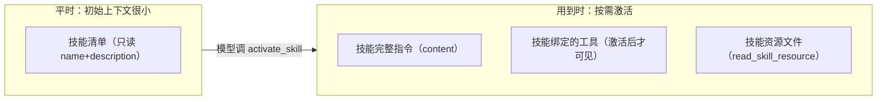
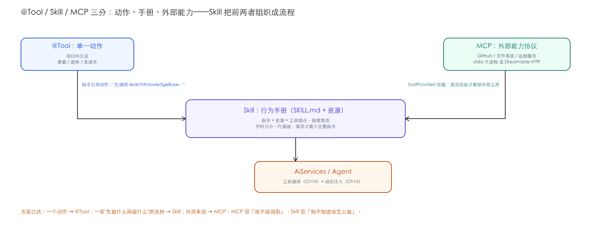

# Ch18 Skills 技能封装与复用——让 Agent 按需加载"操作手册"

> **本章基线**：项目 `smart-doc-assistant` ｜ 端口 `8090` ｜ LangChain4j `1.22.0` + 实验模块 `1.22.0-beta32` ｜ JDK `21` ｜ 最后验证 `2026-10-28`

> 本章目标：
>
> 1. 理解为什么需要 Skills：指令、知识、工具组合要**可复用、按需加载**，而不是全塞进初始 Prompt
> 2. 掌握 Skill 的文件格式：`SKILL.md` + YAML front matter + content + 资源目录规则，以及**框架怎么解析它**（源码级）
> 3. 掌握**三种创建方式**：FileSystem 加载 / Classpath 加载 / 编程式 Builder，各自的适用场景与取舍
> 4. 掌握**工具模式（推荐）**：`activate_skill` 的**内部机制**（激活 = 指令回喂 + 属性记录 + 工具解锁），不只停留在"会调用"
> 5. 掌握**资源机制**：`read_skill_resource` 按需读取，含作者实测
> 6. 理解 **Shell 模式**（实验性）及其安全边界；掌握 Skill 与 MCP / `@Tool` 的分工
> 7. 建立**踩坑清单**：SKILL.md 格式、激活名、资源目录、实验 API 版本等高频坑

## 18.1 为什么需要 Skills

前面几章攒了一堆"能力"：工具（`@Tool`）、技能指令（Prompt）、外部工具（MCP）。但问题是它们**都以"散件"形态存在**：

| 痛点          | 例子                                          |
| ----------- | ------------------------------------------- |
| **指令不可复用**  | "退款处理流程"这段 Prompt 每次都要复制粘贴，改一处要改 N 处        |
| **初始上下文臃肿** | 10 个能力的完整指令全塞进 system message，模型光读手册就占大半上下文 |
| **能力与工具脱节** | "退款流程"的指令和"查知识库"的工具没有绑定关系，模型可能查到一半忘了流程      |

**Skills**（LangChain4j 官方实验模块，遵循 [Agent Skills 规范](https://agentskills.io)）把"指令 + 资源 + 工具"打包成一个**自包含单元**，模型**按需激活**——平时只看到技能清单（名称+描述，极小上下文），用到时才把完整指令加载进上下文。



> **Spring AI 对比**：Spring AI 没有等价的"技能封装"机制，类似物是"Prompt 模板 + 工具回调"的组合，需要自己管理加载时机。LangChain4j 的 Skills 把"按需加载指令"做成了协议级的 `activate_skill` 工具——这是本章的价值点。

## 18.2 Skill 文件格式：SKILL.md（含解析机制）

### 18.2.1 目录结构与格式约定

每个技能是一个目录，核心是 `SKILL.md`（**必须**以 YAML front matter 开头）：

```text
src/main/resources/
└── skills/
    ├── refund-policy/
    │   └── SKILL.md
    └── troubleshooting/
        ├── SKILL.md
        └── references/
            └── faq-answers.md      ← 自动加载为 SkillResource（本章实测）
```

```markdown
---
name: refund-policy                          # 技能名（模型据此识别）
description: 处理退款、退货、运费赔付类客服问题   # 一句话描述（清单里展示）
---

你是退款政策专家。处理退款/退货/运费问题时的标准流程：

1. 先调用 searchKnowledgeBase 工具，查询知识库中退款政策原文；
2. 根据政策判断退货是否适用"七天无理由"（定制类、鲜活易腐、在线下载数字化商品不适用）；
3. 回答运费承担规则：无理由退货运费由消费者承担，质量问题退货运费由商家承担；
4. 给出下一步建议（先联系客服获取退货单号、退款审核时效 48 小时……）；
5. 知识库未提及的内容，明确说明"资料中未提及"，绝对不要编造。
```

**资源规则**（源码核实，`ClassPathSkillLoader` javadoc）：目录里除 `SKILL.md` 本身和 `scripts/` 子目录外，**其余文件全部自动加载为 `SkillResource`**——模型激活后用 `read_skill_resource` 工具按需读取。话术模板、参考文档放这里，不占初始上下文。

### 18.2.2 框架怎么解析 SKILL.md（源码级）

> **核实留痕**：解包 `langchain4j-skills` 源码确认，加载链是：  
> `ClassPathSkillLoader.loadSkill(dir)` → 找 `SKILL.md` → **`SkillLoaderCommon.parseFrontMatter(markdown)`** 解析 YAML front matter（取 `name` / `description`）→ front matter 以下全部内容作为 `content`（激活时给模型）→ 扫描目录除 `SKILL.md` / `scripts/` 外的文件为 `SkillResource`。

两个容易被忽略的实现细节：

| 细节                               | 说明                               | 坑                                 |
| -------------------------------- | -------------------------------- | --------------------------------- |
| **front matter 必须位于文件第一行**       | `parseFrontMatter` 按 `---` 分隔块解析 | 文件开头有空行/注释会解析失败（见 18.9 坑1）        |
| **`name` 与 `description` 是必填字段** | 缺一个都会加载异常                        | 少写 description，技能进不了清单（见 18.9 坑2） |

## 18.3 三种创建方式（javap 核实 API）

| 方式            | API                                                                      | 适用场景                      |
| ------------- | ------------------------------------------------------------------------ | ------------------------- |
| **文件系统**      | `FileSystemSkillLoader.loadSkills(Path)` / `loadSkill(Path)`             | 技能独立仓库，开发/运维维护，可 `git` 管理 |
| **Classpath** | `ClassPathSkillLoader.loadSkills("skills")` / `loadSkill("skills/docx")` | 随 jar 打包，开箱即用（**本项目用这个**） |
| **编程式**       | `Skill.builder().name().description().content().tools(...).build()`      | 技能来自数据库 / 远程 API / 运行时生成  |

```java
// 编程式：技能完全在代码里定义（可来自数据库、远程 API）
Skill skill = Skill.builder()
        .name("incident-response")
        .description("生产事故排查流程")
        .content("""
                当生产告警触发：
                1. 先查最近 5 分钟日志定位影响面；
                2. 按严重级别决定是否升级；
                3. 修复后回归验证。
                """)
        .build();
```

**三者的关系**（实测结论）：`FileSystemSkillLoader` / `ClassPathSkillLoader` 返回 `Skill` 接口（实际是 `FileSystemSkill` / `DefaultSkill`）；若要在**加载后增强**（绑工具、加资源），两条路：

- 已知具体类型可 `toBuilder()`（javap 确认 `DefaultSkill.toBuilder()` 存在）；
- **稳妥路线**（本章采用）：从接口取 `name()/description()/content()`，用 `Skill.builder()` 编程式重建——零损失、不依赖具体类型。

> **最佳实践**：技能内容建议**指令 + 工具调用**混合编写——"先调用 XX 工具，再按结果做 YY"比纯指令更能保证执行质量。指令描述步骤，工具负责动作。

## 18.4 工具模式（推荐）：activate_skill 的内部机制

### 18.4.1 内置工具三件套

`Skills` 类把技能集转成一个 `ToolProvider`，模型通过**内置工具**与技能交互（javap 核实）：

| 内置工具                   | 何时注册                   | 作用                  |
| ---------------------- | ---------------------- | ------------------- |
| `activate_skill`       | 始终注册（`ALWAYS_VISIBLE`） | 模型调用它，把技能完整指令加载进上下文 |
| `read_skill_resource`  | 有技能带资源时注册              | 读取技能的资源文件           |
| **skill-scoped tools** | 技能激活后                  | 只有激活的技能绑定的工具才暴露     |

### 18.4.2 激活机制源码拆解（激活 = 三件事）

> **核实留痕**：解包 `ActivateSkillToolExecutor.java`，激活不是"一个标志位"那么简单，`executeWithContext` 里做了三件事：

```java
// ① 解析参数拿技能名
String skillName = getRequiredArgument(config.parameterName, arguments);
Skill skill = skillsByName.get(skillName);
if (skill == null) {
    // ② 技能不存在 → 抛错并把可用清单给模型，让它纠正
    throwException("There is no skill with name '%s'. Available skills: [%s]".formatted(skillName, availableSkillNames));
}
// ③ 激活 = 返回三样东西：
return ToolExecutionResult.builder()
        .result(skill)                                    // (a) 技能对象本身
        .resultText(skill.content())                      // (b) 完整指令回喂给模型 ← 关键
        .attributes(Map.of(ACTIVATED_SKILL_ATTRIBUTE, skillName))  // (c) 记录"已激活"状态
        .build();
```

| 产物                                                      | 作用                                          |
| ------------------------------------------------------- | ------------------------------------------- |
| **`resultText = skill.content()`**                      | 技能指令**进入模型上下文**——"按需加载"的本质                  |
| **`attributes[ACTIVATED_SKILL_ATTRIBUTE] = skillName`** | 激活状态**记录在工具结果属性里**，供后续动态工具决策                |
| 异常路径                                                    | 技能名不存在 → 把"可用清单"喂回模型，让它自己纠正（类似 Ch16 错误处理思路） |

### 18.4.3 可见性切换：为什么"激活后工具才可见"

> **核实留痕**：`Skills.toolProvider()` 返回的是一个 **`isDynamic() = true` 的动态 ToolProvider**（`Skills.java` 源码确认）。动态 ToolProvider 的特点是**每次模型调用前都会被重新执行**（Ch16 讲过）。它的决策逻辑：

```
每次模型请求前：
  1. 永远返回 activate_skill（ALWAYS_VISIBLE，标记在 ToolSpecification metadata）
  2. 如果有技能激活记录（attributes 里有 ACTIVATED_SKILL_ATTRIBUTE）：
     → 把该技能绑定的 skill-scoped tools 也返回
  3. 否则：skill-scoped tools 不可见
```

**所以"激活 = 解锁工具"不是魔法**：是 `activate_skill` 的结果把激活状态写进了工具结果属性 → 同一轮对话里模型下一次请求时，动态 ToolProvider 重新执行发现激活属性 → 才把技能绑定的工具加进清单。**一次 `activate_skill` 调用触发两轮"模型→框架"往返**：第一轮拿指令，第二轮拿工具。

### 18.4.4 装配与实测

`SkillConfig`（`config/` 包，Ch18 新增，v0.18）：

```java
@Configuration
@Slf4j
public class SkillConfig {

    @Bean
    public Skills appSkills(RagLookupTool ragLookupTool) {
        List<Skill> loaded = ClassPathSkillLoader.loadSkills("skills");
        log.info(" 加载到 {} 个技能: {}", loaded.size(), loaded.stream().map(Skill::name).toList());

        // 给 refund-policy 绑定 skill-scoped 工具（编程式重建，javap 核实 Skill.builder()）
        List<Skill> enhanced = loaded.stream().map(s -> {
            if ("refund-policy".equals(s.name())) {
                return Skill.builder()
                        .name(s.name()).description(s.description()).content(s.content())
                        .tools(ragLookupTool)        // 激活 refund-policy 后才可见
                        .build();
            }
            return s;
        }).toList();

        return Skills.from(enhanced);
    }

    @Bean
    public SkillAgent skillAgent(@Qualifier("openAiChatModel") ChatModel chatModel,
                                 ChatMemoryProvider chatMemoryProvider,
                                 Skills appSkills) {
        return AiServices.builder(SkillAgent.class)
                .chatModel(chatModel)
                .chatMemoryProvider(chatMemoryProvider)
                .toolProvider(appSkills.toolProvider())        // activate_skill 等
                .systemMessage("你是一个客服助手。可用技能如下：\n"
                        + appSkills.formatAvailableSkills()     // 技能清单
                        + "\n当用户请求与某个技能相关时，先调用 activate_skill 工具激活它，"
                        + "再严格按该技能的指令执行。")
                .maxToolCallingRoundTrips(10)
                .build();
    }
}
```

`formatAvailableSkills()` 生成的清单（`Skills.java` 源码核实，XML 格式）——这就是模型"看到"的全部技能信息：

```xml
<available_skills>
    <skill>
        <name>refund-policy</name>
        <description>处理退款、退货、运费赔付类客服问题，先查知识库再按政策作答</description>
    </skill>
    <skill>
        <name>troubleshooting</name>
        <description>处理支付失败、发货异常、登录异常等订单技术问题排查</description>
    </skill>
</available_skills>
```

**真实输出**（2026-10-28 实测，`POST /api/skills/ask`，deepseek-v4-flash）：

- 问"我买的商品坏了想退货，运费谁出？" → 激活 refund-policy → 查知识库 → **"根据知识库中的退款政策，您的运费承担取决于退货原因：您的情况（商品坏了/破损）属于质量问题，运费由商家承担……《退款政策说明》第二条……"**（指令流程 + 工具 + 知识库三者协作）
- 问"付款一直失败，应该怎么排查？" → 激活 troubleshooting → **"为了更准确地定位问题，请问您付款时具体看到了什么报错信息？"**（严格按技能指令"一次只问一个问题"）

## 18.5 资源机制：read_skill_resource（含实测）

当技能目录带资源文件（`references/` 等）时，`Skills` 会额外注册 `read_skill_resource` 工具。**激活 + 读资源是两个动作**：激活拿"总指令"，读资源拿"详细素材"——避免把大段话术全塞进技能 content。

**实测**（作者实测）：给 troubleshooting 技能加了 `references/faq-answers.md`（支付失败/发货异常等标准话术），并在 content 里指示"回答前先读该文件"。问"用户付款一直失败，我该怎么回复他？"后：

> 好的，我已经获取了支付失败的话术模板。下面是我建议您回复用户的参考话术：  
> **"抱歉给您带来不便。请您先确认银行卡余额或额度是否充足；支付失败后 10 分钟内可重试，订单不会重复扣款。若仍失败，建议更换支付方式……"**

回答**逐字引用了资源文件里的话术**——证明链路完整：`activate_skill`（拿流程）→ `read_skill_resource`（拿话术素材）→ 按素材组织回答。

> **最佳实践**：**大素材放资源文件、小指令放 content**。content 保持精炼（模型激活成本低），话术/参考文档按需读取（`read_skill_resource` 有缓存，同轮对话只读一次）。

## 18.6 skill-scoped 工具：激活 = 解锁（深挖）

这是 Skills 最优雅的设计：**工具不全局可见，而是跟着技能走**。

| 阶段                 | 模型能看到什么                                         |
| ------------------ | ----------------------------------------------- |
| 技能激活前              | 只有 `activate_skill`（+ 可能 `read_skill_resource`） |
| 激活 refund-policy 后 | + `searchKnowledgeBase`（该技能绑定的工具）               |

**好处**：

- **工具列表精简**：几十个技能也不怕工具列表爆炸，模型只看到"当前语境"的工具；
- **权限边界**：某个技能的工具不会在别的语境误触发（比如 troubleshooting 技能绑定的工具不会在退款语境里冒出来）；
- **与 MCP 结合**：技能绑定的"工具"也可以是 `ToolProvider`——官方示例就是 `McpToolProvider`，即"**激活某个技能 = 临时挂载一组 MCP 工具**"。这打通了 Ch17 与 Ch18：一个"GitHub 操作技能"激活时，才挂上 GitHub MCP 的工具。

> **坑点（javap 核实）**：`Skill.builder()` 绑定工具用 `.tools(Object...)`；`DefaultSkill.toBuilder()` 存在（javap 确认），但 `ClassPathSkillLoader` 返回 `Skill` 接口（具体类型不可见），稳妥做法是像本章一样用 `Skill.builder()` 编程式重建（`name/description/content` 从接口取，零损失）。Builder 的完整方法在基类 `AbstractSkill$BaseBuilder`：`name/description/content/resources/tools(Object...)/toolProviders(ToolProvider...)`。

## 18.7 Shell 模式（实验性）：直接读文件系统

官方还有一个实验性变体 `ShellSkills`（模块 `langchain4j-experimental-skills-shell`）：

- 给模型 `run_shell_command` 工具，让它**像人一样用 shell 读 SKILL.md / 跑脚本**；
- 没有 `activate_skill` / `read_skill_resource`；
- 适合快速原型、直接复用 agentskills.io 社区的第三方技能（无需移植到 Java）。

> **安全警告（官方原文）**：**Shell 执行本质上不安全**。命令直接在宿主进程环境运行，**没有任何沙箱、容器化或权限限制**——被提示注入的 LLM 可在运行应用的机器上执行任意命令。**仅在完全信任输入并接受风险的受控环境使用**。生产默认用工具模式。

| 维度       | 工具模式（推荐）                                           | Shell 模式（实验）        |
| -------- | -------------------------------------------------- | ------------------- |
| 文件系统访问   | 无（预加载内存）                                           | 有（shell 直读）         |
| 任意代码执行风险 | 无                                                  | **高**               |
| 工具       | `activate_skill` / `read_skill_resource` / 技能作用域工具 | `run_shell_command` |
| 适用       | 生产                                                 | 实验/原型/社区技能尝鲜        |


## 18.8 Skill 与 @Tool / MCP 的分工（选型）

| 机制            | 解决什么                     | 用什么装          |
| ------------- | ------------------------ | ------------- |
| `@Tool`（Ch14） | 单一动作                     | 算数、查库、发请求     |
| **Skill**（本章） | **动作 + 指令 + 资源的组合**，按需加载 | 客服流程、操作手册、工作流 |
| **MCP**（Ch17） | 协议外部工具                   | 复用生态服务器       |

**经验法则**：一个动作 → `@Tool`；一套"先做 A 再做 B、符合某流程"的**行为手册** → **Skill**（指令装 Skill，动作装 Tool，Skill 里引用 Tool）；外部系统 → **MCP**。三者可组合：Skill 的指令里调用 MCP 工具（官方支持 `toolProviders(mcpToolProvider)`，基类 Builder 有该方法）。

### 18.8.1 三问决策法（拿到需求先问这三句）与开发走查

选型表背得再熟，落到具体需求上还是会犹豫。把经验法则变成三个问题，按顺序问：

**第一问：要解决的是"动作"还是"做法"？** 用户说"帮我查一下退款政策"——动作，`@Tool` 够了。用户说"按公司规范处理一个退款工单"——做法：先查什么、按什么标准判断、话术怎么说、何时转人工。**做法 = 指令 + 若干动作的组合**，这就是 Skill 的形状。

**第二问：能力在项目内还是外部系统？** 判断标准不是"谁写的代码"，而是"生命周期跟不跟着你的应用走"。查自家知识库——项目内，`@Tool`；接 GitHub、文件系统、第三方 CRM——外部系统，**MCP**，别把别人的 API 手工包成 `@Tool`（17.1 表里的重复造轮子就是这么来的）。

**第三问：这段知识谁维护、多久变一次？** 话术下个月就要改——放 Skill 的资源文件，运营改文档不动代码；流程逻辑稳定——content 写一次；接口地址/密钥会变——MCP 传输层配置管。

本项目客服场景是三问的标准答案：`searchKnowledgeBase` 是动作（`@Tool`），退款流程是做法（refund-policy 技能，content 引用那个动作），支付话术是"经常变的知识"（references/ 资源文件——18.5 实测改话术没动一行 Java）。

**完整开发走查**：以 troubleshooting 技能的真实文件为例，一个 Skill 从零到上线就五步。

① **起目录、写 front matter**（第一行必须是 `---`，name 小写连字符，description 一句话说清"什么场景用"——这三个约束对应 18.9 的坑 1/2/3）：

```markdown
---
name: troubleshooting
description: 处理支付失败、发货异常、登录异常等订单技术问题排查
---
```

② **content 写"做法"，不写"知识"**——指令序列 + 明确的工具调用点（注意第 3 步把资源读取写成了显式指令，模型才会去读）：

```markdown
你是售后技术支持。排查用户技术问题按以下标准流程：

1. 先请用户描述具体现象和报错信息（一次只问一个问题，不要一次抛多个）；
2. 按问题类型引导：
   - 支付失败 → 检查银行卡余额/额度，10 分钟内可重试，订单不会重复扣款；……
3. **回答用户前，先用 read_skill_resource 工具读取 references/faq-answers.md 中的对应话术模板**，
   按其语气和要点组织回答；
4. 每给出一个建议后，询问用户是否解决，未解决再进入下一步；
5. 三次尝试仍无法定位时，建议用户提供截图并转人工客服。
```

③ **大素材放 `references/`**（自动加载为 SkillResource，`SKILL.md` 本身和 `scripts/` 被排除）——`references/faq-answers.md` 里是可直接引用的话术模板，运营可以随时改：

```markdown
## 支付失败
"抱歉给您带来不便。请您先确认银行卡余额或额度是否充足；支付失败后 **10 分钟内可重试**，
订单不会重复扣款。若仍失败，建议更换支付方式（微信/支付宝/银行卡）后再试。"
```

④ **装配**（`SkillConfig`，Classpath 加载 + 按需绑工具）——启动日志一行确认：`加载到 3 个技能: [mcp-tools, troubleshooting, refund-policy]`；需要 skill-scoped 工具的技能用 `Skill.builder()` 编程式重建绑上（18.4.4）。

⑤ **验证**（18.10 的三连问）：触发场景问一句、无关场景问一句、看话术是否逐字来自资源文件——三关全过才算上线。

**"Skill 和 MCP 不是一回事吗？"** —— 最常被问的一句，正面回答：

| | MCP | Skill |
|---|---|---|
| 本质 | **协议**（JSON-RPC），把外部系统的能力搬进来 | **一组文件**（`SKILL.md` + 资源），把"该怎么干活"的说明按需塞进上下文 |
| 解决 | "我连不上 GitHub / 文件系统 / 远程服务" | "我知道有哪些工具，但不知道按什么顺序、按什么规范用" |
| 运行时发生什么 | 子进程/HTTP 握手，`tools/list` 拉工具清单 | 激活时把指令回喂给 LLM，并把 skill-scoped 工具解锁可见 |
| 谁来写 | 服务提供方（或你自己包一层） | 业务方（写流程、写规范、写话术） |
| 没有另一个会怎样 | Skill 照样能加载，只是没外部能力可调 | MCP 工具照样能调，但模型只能靠通用常识决定怎么组合 |

一句话：**MCP 管"能不能调到"，Skill 管"知不知道该怎么做"**。生产里常见组合是"MCP 提供发邮件/查 CRM 的能力，Skill 规定先查重再发、模板用哪套、什么情况必须转人工"。

三者关系一张图（手绘版，细节都在构图里）：



## 18.9 坑点清单（前三章同款的"高频坑"节）

| # | 坑                      | 现象                                        | 对策                                           |
| - | ---------------------- | ----------------------------------------- | -------------------------------------------- |
| 1 | **front matter 不在第一行** | `parseFrontMatter` 解析失败/字段拿不到             | SKILL.md 第一行必须是 `---`；前面别留空行/BOM             |
| 2 | **缺 `description`**    | 技能加载成功但进不了清单（模型看不到）                       | name/description 必填；description 一句话说清"什么场景用" |
| 3 | **激活名大小写/空格不一致**       | 模型调 `activate_skill("Refund-Policy")` 找不到 | 技能名用小写连字符；错误消息会把可用清单喂回模型，但别依赖                |
| 4 | **资源放错目录**             | 文件没被加载为 SkillResource                     | 资源必须在技能目录下；`scripts/` 和 `SKILL.md` 会被排除      |
| 5 | **实验 API 版本漂移**        | 升级 beta 版本后 API 变化                        | 锁版本 + 冒烟测试（实验模块通用策略）                       |
| 6 | **把大话术写进 content**     | 每次激活都吃一大段 token                           | 大素材放 resources，content 保持精炼指令                |
| 7 | **Shell 模式误用**         | 任意命令执行                                    | 生产只用工具模式；Shell 仅受控实验                         |

## 18.10 实战深化：多技能客服场景（2026-10-28 实测）

把本章能力串成完整业务场景——**一个 SkillAgent，多个技能，处理三类问题**：

```bash
# ① 退款类 → 激活 refund-policy → 查知识库 → 按政策答
curl -X POST http://localhost:8090/api/skills/ask \
  -H "Content-Type: application/json" \
  -d '{"sessionId":"s1","question":"我买的商品坏了想退货，运费谁出？"}'
# → "根据知识库中的退款政策……您的情况属于质量问题，运费由商家承担……《退款政策说明》第二条……"

# ② 技术类 → 激活 troubleshooting → 读话术资源 → 按流程排查
curl -X POST http://localhost:8090/api/skills/ask \
  -H "Content-Type: application/json" \
  -d '{"sessionId":"s2","question":"用户付款一直失败，我该怎么回复他？"}'
# → 逐字引用 faq-answers.md："……10 分钟内可重试，订单不会重复扣款。若仍失败，建议更换支付方式（微信/支付宝/银行卡）……"

# ③ 无关问题 → 不激活技能 → 普通对话（技能不影响非相关请求）
curl -X POST http://localhost:8090/api/skills/ask \
  -H "Content-Type: application/json" \
  -d '{"sessionId":"s3","question":"你好，介绍一下你自己"}'
# → 普通自我介绍（顺带把技能清单里的问题域报了一遍），没有误触发技能
```

② 是资源链路最有说服力的证据：回答里"10 分钟内可重试、订单不会重复扣款、微信/支付宝/银行卡"这些细节**只存在于资源文件里**——content 没写过，知识库检索也够不到（它查的是退款政策），唯一来源就是 `read_skill_resource` 读到的话术模板。

**扩展方向**（承接 Ch19/后续）：技能 + MCP 组合（激活技能时挂 MCP 工具）、技能的可观测（Ch22 统计 activate_skill 调用频率——哪个技能最常用）、技能评估（ch13 的 golden set 思路测技能触发准确性）。

## 本章小结

### 概念速查表

| 概念                      | 一句话                                                                                           |
| ----------------------- | --------------------------------------------------------------------------------------------- |
| **Skill**               | "指令 + 资源 + 工具"的自包含单元，按需激活                                                                     |
| **SKILL.md**            | YAML front matter（name/description，`parseFrontMatter` 解析）+ content 指令                         |
| **三种创建**                | `FileSystemSkillLoader` / `ClassPathSkillLoader` / `Skill.builder()` 编程式                      |
| **激活机制**                | `resultText = content` 回喂 + `attributes[ACTIVATED_SKILL_ATTRIBUTE]` 记录 + 动态 ToolProvider 解锁工具 |
| **动态可见性**               | `Skills.toolProvider()` 是 `isDynamic()=true`，每次请求前重评估                                         |
| **skill-scoped tools**  | 技能绑定的工具激活后才可见（工具列表精简 + 权限边界）                                                                  |
| **read_skill_resource** | 激活后按需读资源文件（大素材放资源、小指令放 content）                                                               |
| **Shell 模式**            | `run_shell_command` 直读文件系统——**不安全**，仅受控实验                                                     |
| **与 MCP 结合**            | Skill 的 `toolProviders(...)` 可挂 `McpToolProvider`（激活=挂载 MCP 工具）                               |

### 项目代码状态表（v0.18）

| 模块   | 文件                                                           | 说明                                                        |
| ---- | ------------------------------------------------------------ | --------------------------------------------------------- |
| 技能定义 | `resources/skills/refund-policy/SKILL.md`                    | **新增**：退款政策处理技能（绑 ragLookupTool）                          |
| 技能定义 | `resources/skills/troubleshooting/SKILL.md`                  | **新增**：技术故障排查技能（指令引用资源）                                   |
| 资源   | `resources/skills/troubleshooting/references/faq-answers.md` | **新增**：话术模板（read_skill_resource 实测）                       |
| 配置   | `config/SkillConfig.java`                                    | **新增**：ClassPathSkillLoader + Skills.from + AiServices 装配 |
| 助手   | `assistant/SkillAgent.java`                                  | **新增**：技能型 Agent（@MemoryId + @UserMessage）                |
| 接口   | `controller/SkillController.java`                            | **新增**：`POST /api/skills/ask`                             |
| 依赖   | `pom.xml`                                                    | **加**：`langchain4j-skills`（实验模块）                          |

### 练习题

1. 给 refund-policy 技能加一个 `references/returns-checklist.md`（退货清单），在 content 里写"回答前先读该文件"，问 Agent"退货要准备什么"——观察 `read_skill_resource` 是否被调用，对比 18.5 的实测。
2. 把 refund-policy 的 `Skill.builder()` 里 `.tools(ragLookupTool)` 去掉，再问"退货流程"——观察模型查不到知识库时的行为，体会 skill-scoped 工具的价值。
3. 用 `Skill.builder()` 编程式新建第三个技能（如"订单查询"），挂到 `Skills.from(...)` 里，验证三种创建方式并存。
4. 思考题：激活机制里"`attributes[ACTIVATED_SKILL_ATTRIBUTE]` 记录 + 动态 ToolProvider 重评估"为什么需要**两轮模型往返**？如果只靠 `resultText` 回喂指令而不记录属性，会怎样？（提示：工具可见性在下一轮才生效）
5. 思考题：Shell 模式为什么只适合受控实验？如果生产误用，最坏会发生什么？（提示：提示注入 + 任意命令执行）
