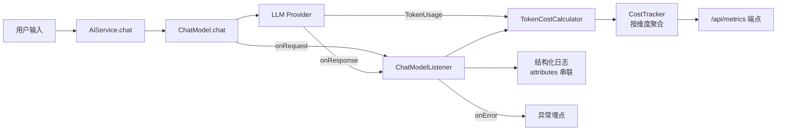

# Ch22 LangChain4j 可观测性 · 日志 · 成本——让 AI 应用的运行态"看得见、算得清"

> **本章基线**：项目 `smart-doc-assistant` ｜ 端口 `8090` ｜ LangChain4j `1.22.0` + 实验模块 `1.22.0-beta32` ｜ JDK `21` ｜ 最后验证 `2026-10-28`

> 本章目标：
>
> 1. 理解 AI 应用为什么需要可观测性（与传统应用的核心差异）
> 2. 掌握 LangChain4j 三大埋点入口（官方 API）：`ChatModelListener` / `AiServiceListener` / `ToolProvider`
> 3. 实战 **`ChatModelListener`**（本章核心）——onRequest / onResponse / onError 三方法
> 4. 掌握 `TokenUsage`（钱袋子）：input / output / total tokens + 子类 `OpenAiTokenUsage` 额外字段
> 5. 成本核算 + 按维度聚合：用户 / 工具 / 模型 三视角 top-N
> 6. 掌握 `attributes` 跨方法传数据（streaming 跨线程安全的唯一通道）
> 7. 自定义 `/api/metrics` Controller 暴露 token / cost 数据（LangChain4j 原生，零外部依赖）

## 22.1 为什么 AI 应用需要专门的可观测性

AI 应用与传统的 Web 应用有**三个本质差异**：

| 差异 | 传统 Web | AI 应用 |
|---|---|---|
| **调用成本** | CPU/内存（稳定） | **Token × 单价**（漂移，可能翻倍）|
| **响应时间** | 毫秒级可预测 | 秒级且方差大（10ms ~ 30s） |
| **失败模式** | HTTP 4xx/5xx | 模型漂移 / Token 超限 / 工具循环 / 幻觉 |
| **审计维度** | URL / 用户 | 模型 / Token / 工具 / 用户 / 时间 |

**直接后果**：传统"日志 + 监控"对 AI 应用不够用——你看不到每次调用花了多少钱（成本治理）、看不到工具循环（Ch14 警告）、看不到模型漂移（Ch13 评估要持续跑）。



## 22.2 关键事实：LangChain4j 1.22.0 的可观测性 API（实测验证）

写本章前**核实**（先核实，再写）：

```
$ javap ChatModelListener.class
public interface dev.langchain4j.model.chat.listener.ChatModelListener {
  public default void onRequest(ChatModelRequestContext);
  public default void onResponse(ChatModelResponseContext);
  public default void onError(ChatModelErrorContext);
}

$ javap TokenUsage.class
public class dev.langchain4j.model.output.TokenUsage {
  public java.lang.Integer inputTokenCount();
  public java.lang.Integer outputTokenCount();
  public java.lang.Integer totalTokenCount();
  public static TokenUsage sum(TokenUsage, TokenUsage);  // ← 关键
  public TokenUsage add(TokenUsage);                     // ← 关键
}

$ javap OpenAiTokenUsage.class
public class OpenAiTokenUsage extends TokenUsage {
  public InputTokensDetails inputTokensDetails();       // cachedTokens
  public OutputTokensDetails outputTokensDetails();     // reasoningTokens
}
```

**三大发现**：
1. **`ChatModelListener` 是主入口**——文档原文："某些 ChatLanguageModel 实现允许配置 ChatModelListener（多个）来监听事件"
2. **`TokenUsage.sum()` / `add()` 静态方法**——多调用汇总天然支持（呼应 Ch13 Result.totalTokenUsage()）
3. **`OpenAiTokenUsage` 子类**——提供 cached_tokens（缓存命中）/ reasoning_tokens（推理模型专用）

> **类名提示**：下面官方原文里的 `ChatLanguageModel` / `StreamingChatLanguageModel` 是 0.x 的旧名。1.22 的 jar 里只有 `ChatModel` / `StreamingChatModel`（`javap -cp ... dev.langchain4j.model.chat.ChatModel` 可验证），按新名去搜源码/文档才搜得到。

> **官方原文约束**：
>
> 对于 StreamingChatLanguageModel，ChatModelListener.onResponse() 和 onError() 在与 onRequest() **不同的线程**上调用。线程上下文目前**不会自动传播**，因此您可能希望使用 `attributes` 映射从 onRequest() 传播任何必要的数据到 onResponse() 或 onError()。

这是本章用 `attributes` 跨方法传 `startNanos` 的根因。

## 22.3 三大埋点入口（官方确认）

| Listener | 触发粒度 | 适用场景 |
|---|---|---|
| **`ChatModelListener`**（本章重点）| 每次 `chatModel.chat()` 调用 | Token 计量 / 模型成本 / LLM Provider 错误 |
| `AiServiceListener`（Ch16 已用）| 每次 AiService 接口方法 | 业务方法级审计（如 ChatAssistant.chat）|
| `ToolProvider` 钩子（Ch16 已用）| 每次工具调用 | 工具调用频次 / 失败率 |

**为什么主入口是 `ChatModelListener`**——这是**最底层**的拦截器：
- 一次 AiService 调用可能触发多次 LLM 调用（Agent 多步、Tool 调用循环）
- `ChatModelListener` 能看到**每一次**模型调用，而 `AiServiceListener` 只看到业务方法

**两者叠加使用**（生产建议）：
1. `ChatModelListener` → 全量 Token 计量
2. `AiServiceListener` → 业务方法级 audit（user_id 注入）

## 22.4 核心：ChatModelListener 三方法实战

`com/example/assistant/observability/ObservabilityChatModelListener.java`：

```java
@Slf4j
@Component
public class ObservabilityChatModelListener implements ChatModelListener {

    private static final String ATTR_START_NANOS = "ch22.startNanos";
    private static final String ATTR_USER_ID = "ch22.userId";
    private static final String ATTR_TOOL_NAME = "ch22.toolName";

    private final TokenCostCalculator costCalculator;
    private final CostTracker costTracker;

    public ObservabilityChatModelListener(TokenCostCalculator costCalculator,
                                          CostTracker costTracker) {
        this.costCalculator = costCalculator;
        this.costTracker = costTracker;
    }

    @Override
    public void onRequest(ChatModelRequestContext ctx) {
        // 记录开始时间——attributes 跨方法传递（streaming 跨线程安全）
        ctx.attributes().put(ATTR_START_NANOS, System.nanoTime());
        ChatRequest req = ctx.chatRequest();
        log.info("[ChatModel] → onRequest model={} messages={} tools={}",
                ctx.modelProvider(),
                req.messages() != null ? req.messages().size() : 0,
                req.parameters() != null && req.parameters().toolSpecifications() != null
                        ? req.parameters().toolSpecifications().size() : 0);
    }

    @Override
    public void onResponse(ChatModelResponseContext ctx) {
        Long startNanos = (Long) ctx.attributes().get(ATTR_START_NANOS);
        long elapsedMs = startNanos != null
                ? (System.nanoTime() - startNanos) / 1_000_000 : -1;

        ChatResponse resp = ctx.chatResponse();
        String modelName = resp.metadata() != null ? resp.metadata().modelName() : null;
        TokenUsage usage = resp.metadata() != null ? resp.metadata().tokenUsage() : null;

        TokenCostCalculator.CostSnapshot cost = costCalculator.fromResponse(modelName, usage);

        String userId = (String) ctx.attributes().get(ATTR_USER_ID);
        String toolName = (String) ctx.attributes().get(ATTR_TOOL_NAME);
        costTracker.record(cost, userId, toolName);

        log.info("[ChatModel] ← onResponse model={} elapsedMs={} in={} out={} cost={}{}",
                modelName, elapsedMs,
                cost.inputTokens(), cost.outputTokens(),
                String.format("%.6f", cost.totalCost()), cost.currency());
    }

    @Override
    public void onError(ChatModelErrorContext ctx) {
        Long startNanos = (Long) ctx.attributes().get(ATTR_START_NANOS);
        long elapsedMs = startNanos != null
                ? (System.nanoTime() - startNanos) / 1_000_000 : -1;
                log.warn("[ChatModel] onError model={} elapsedMs={} error={}",
                ctx.modelProvider(), elapsedMs,
                ctx.error().getClass().getSimpleName() + ": " + ctx.error().getMessage());
    }
}
```

**两个核心约束**（官方文档）：

1. **attributes 跨方法传数据**——streaming 跨线程，ThreadLocal 失效
2. **多个 listener 按 List 迭代顺序执行**——本类应该放在第一个（先把 cost 算出来，后续 listener 可消费）

## 22.5 TokenUsage 详解——AI 应用的"钱袋子"

### 22.5.1 官方 TokenUsage API

```java
TokenUsage usage = resp.metadata().tokenUsage();
int input = usage.inputTokenCount();      // 输入 token 数
int output = usage.outputTokenCount();    // 输出 token 数
int total = usage.totalTokenCount();      // 总 token 数

// 多调用汇总——Ch13 Result.tokenUsage() 内部就是这样
TokenUsage combined = TokenUsage.sum(call1, call2);
TokenUsage accumulated = combined.add(call3);
```

### 22.5.2 子类 `OpenAiTokenUsage`——更细维度

```java
if (usage instanceof OpenAiTokenUsage openAi) {
    int cachedTokens = openAi.inputTokensDetails().cachedTokens();      // 提示缓存命中
    int reasoningTokens = openAi.outputTokensDetails().reasoningTokens(); // 推理模型
    // cachedTokens 不计入实际计费（OpenAI 缓存价格 1/10）
}
```

### 22.5.3 TokenCostCalculator：成本核算

`com/example/assistant/observability/TokenCostCalculator.java`：

```java
public CostSnapshot calculate(String modelName, TokenUsage usage) {
    if (usage == null) return zero(modelName);
    ModelPricing pricing = ModelPricing.of(modelName);
    int inTok = usage.inputTokenCount() != null ? usage.inputTokenCount() : 0;
    int outTok = usage.outputTokenCount() != null ? usage.outputTokenCount() : 0;
    double inputCost = inTok * pricing.getInputPerMTokens() / 1_000_000.0;
    double outputCost = outTok * pricing.getOutputPerMTokens() / 1_000_000.0;
    return new CostSnapshot(modelName, inTok, outTok, inTok + outTok,
            inputCost, outputCost, inputCost + outputCost, pricing.getCurrency());
}
```

**公式**：`(inputTokens × inputPerMTokens + outputTokens × outputPerMTokens) / 1_000_000`

### 22.5.4 ModelPricing 单价表（4 个模型 + 服务端别名 + 未知）

```java
public enum ModelPricing {
    DEEPSEEK_V3("deepseek-chat", 1.0, 2.0, "CNY"),
    QWEN_FLASH("qwen3.7-flash-2026-07-15", 0.003, 0.006, "CNY"),
    GPT_4O_MINI("gpt-4o-mini", 0.15, 0.60, "USD"),
    DEEPSEEK_V4_FLASH("deepseek-v4-flash", 1.0, 2.0, "CNY"),
    // 2026-10-28 实测：请求 model-name=deepseek-v4-flash，服务端在响应的
    // model 字段里归一化回传 "deepseek-flash"——listener 读的是响应名，
    // 这个别名不进表，成本就永远是 0（见 22.6.1 修复实录）
    DEEPSEEK_V4_FLASH_ALIAS("deepseek-flash", 1.0, 2.0, "CNY"),
    UNKNOWN("unknown", 0.0, 0.0, "CNY");
    // ...
}
```

价格随时变动——演示用，请到厂商官网核对最新。

## 22.6 CostTracker：按维度聚合成本

`com/example/assistant/observability/CostTracker.java`：

```java
@Slf4j
@Component
public class CostTracker {

    private final ConcurrentHashMap<String, LongAdder> byModel = new ConcurrentHashMap<>();
    private final ConcurrentHashMap<String, LongAdder> byUser = new ConcurrentHashMap<>();
    private final ConcurrentHashMap<String, LongAdder> byTool = new ConcurrentHashMap<>();
    private final LongAdder totalTokens = new LongAdder();
    private final LongAdder totalCostMicro = new LongAdder();  // 微元累计避免浮点精度

    public void record(CostSnapshot cost, String userId, String toolName) {
        byModel.computeIfAbsent(cost.modelName(), k -> new LongAdder())
                .add(cost.totalTokens());
        if (userId != null) {
            byUser.computeIfAbsent(userId, k -> new LongAdder())
                    .add(cost.totalTokens());
        }
        if (toolName != null) {
            byTool.computeIfAbsent(toolName, k -> new LongAdder())
                    .add(cost.totalTokens());
        }
        totalTokens.add(cost.totalTokens());
        totalCostMicro.add((long) (cost.totalCost() * 1_000_000));
    }

    public Snapshot snapshot() { /* 不可变快照 */ }
    public List<Map.Entry<String, Long>> topUsers(int n) { /* top-N */ }
    // ...
}
```

**为什么用 `LongAdder`**——高并发下 `AtomicLong` 会有伪共享（false sharing）性能问题；`LongAdder` 在多写少读场景下性能更好。

**为什么 `totalCostMicro × 1_000_000`**——避免 `double` 累计精度损失（`0.1 + 0.2 != 0.3` 这种老问题）。

### 22.6.1 修复实录：token 翻倍与成本恒零（2026-10-28）

把本章的代码真正跑起来验收成本数字时，连抓到两个 bug。它们都不报错——
**可观测性系统自己的 bug，恰恰要用"可观测性"的手段才能看见**。

**Bug ①：token 被记录两次。** 第一次实测：一次聊天响应报 `total=121`，
`/api/metrics/tokens` 却显示 `totalTokens=242`——恰好 2 倍。翻日志发现
`onRequest` / `onResponse` 每个事件都打印两遍。根因是**注册通道叠加**：
`ObservabilityChatModelListener` 类上标了 `@Component`（组件扫描注册一次），
`ObservabilityConfig` 里又有一个 `@Bean` 方法把它包成 `ChatModelListener` 返回
（再注册一次）。starter 收集容器里**所有** `ChatModelListener` 类型的 bean——
同一个实例以两个 bean 定义存在，就被收进 listener 列表两次。

先删掉 yml 里的 `listeners:` 属性没用（第二个通道还在）；删掉 `@Bean` 方法、
只留 `@Component` 才修复。修复后：响应 168 + 585 = 753，metrics 恰好 753，分毫不差。

**Bug ②：成本永远是 0。** 修完 ① 之后 `totalCost` 还是 `0.0`。看响应日志：
`model=deepseek-flash`——请求发的是 `model-name=deepseek-v4-flash`，
但 **DeepSeek 服务端在响应的 `model` 字段里把名字归一化回传**了
（去掉版本号段）。listener 从 `resp.metadata().modelName()` 读的是响应名，
定价表里只有 `deepseek-v4-flash`，`of("deepseek-flash")` 落到 `UNKNOWN`，
单价 0 → 成本 0。修复：给定价表加服务端别名。

两个 bug 合起来是一条生产教训：

> **成本数字要先"对账"再上线。** 拿一次调用的响应 token 数（chat 接口原样返回的）
> 和 `/api/metrics/tokens` 的增量做差——差值不是 1 倍，就是注册叠加或事件丢失；
> 成本恒零但 token 在涨，就是**定价表的 key 和服务端回传的模型名没对上**。
> 这两个 bug 在 demo 里都"看起来正常"，数字对不上账才暴露。

| 检查项 | 修复前 | 修复后（2026-10-28 实测） |
|---|---|---|
| 单次响应 totalTokens | 121 | 168 |
| metrics totalTokens | **242（×2）** | **753 = 168+585（对账一致）** |
| onResponse 日志 | 每事件 2 行 | 每事件 1 行 |
| tokensByModel key | `deepseek-flash`（无定价 → 0） | `deepseek-flash`（别名已入表） |
| totalCost | 0.0 | **¥0.001365**（两次累计） |

## 22.7 自定义 /api/metrics Controller（LangChain4j 原生）

`com/example/assistant/controller/ObservabilityController.java`（注意在 `controller` 包，不在 `observability` 包）：

```java
@RestController
@RequestMapping("/api/metrics")
public class ObservabilityController {

    @GetMapping("/tokens")
    public Map<String, Object> tokensSnapshot() {
        CostTracker.Snapshot snap = costTracker.snapshot();
        return Map.of(
                "totalTokens", snap.totalTokens(),
                "totalCost", snap.totalCost(),
                "tokensByModel", snap.tokensByModel(),
                "tokensByUser", snap.tokensByUser(),
                "tokensByTool", snap.tokensByTool()
        );
    }

    @GetMapping("/tokens/top")
    public Map<String, Object> topN(
            @RequestParam(defaultValue = "user") String dim,
            @RequestParam(defaultValue = "10") int n) {
        // dim=user|tool|model
    }

    @GetMapping("/pricing")
    public Map<String, Object> pricingTable() { /* 4 个模型的单价 */ }
}
```

**为什么不依赖 Spring Boot Actuator / Prometheus**：本教程定位是 LangChain4j 教学，不是 DevOps 基建——3 个端点把 LangChain4j 埋点数据原样吐出；想接 Prometheus / Grafana 时直接读 `costTracker.snapshot()`。

## 22.8 端点验证

以下全部为 2026-10-28 实测输出（`deepseek-v4-flash`，¥1.0/M 输入 + ¥2.0/M 输出）：

```bash
# 1. 发起聊天（注意请求体要带 sessionId——@MemoryId 参数为 null 会 400/500）
curl -s -X POST http://localhost:8090/api/chat \
  -H "Content-Type: application/json" \
  -d '{"sessionId":"m1","message":"用一句话介绍什么是向量数据库"}'
# → 响应里直接带本次调用的 token 账单：
#   {"answer":"向量数据库是...","inputTokens":51,"outputTokens":117,"totalTokens":168,...}

# 2. 响应日志（监听器算出的单次成本，恰好 = 51×1.0 + 117×2.0 = 285 微元 = ¥0.000285）
# [ChatModel] → onRequest model=OPEN_AI messages=1 tools=0
# [ChatModel] ← onResponse model=deepseek-flash elapsedMs=1261 in=51 out=117 cost=0.000285CNY

# 3. 再来一轮（多轮对话把历史带进上下文：输入 51→90，输出 117→495）
# [ChatModel] ← onResponse model=deepseek-flash elapsedMs=3814 in=90 out=495 cost=0.001080CNY

# 4. 查看累计 token 与费用（对账：168+585=753，分毫不差——见 22.6.1 修复实录）
curl http://localhost:8090/api/metrics/tokens
```
```json
{"tokensByModel":{"deepseek-flash":753},"totalCost":0.001365,"tokensByUser":{},"tokensByTool":{},"totalTokens":753}
```

```bash
# 5. top-N（user/tool 维度需要 attributes 写入 ch22.userId / ch22.toolName，纯聊天为空是正常态）
curl "http://localhost:8090/api/metrics/tokens/top?dim=model&n=5"
```
```json
{"top":[{"deepseek-flash":753}],"n":5,"dim":"model"}
```

```bash
# 6. 定价表（含服务端别名 deepseek-flash）
curl http://localhost:8090/api/metrics/pricing
```
```json
{"models":[{"currency":"CNY","model":"deepseek-chat","inputPerMTokens":1.0,"outputPerMTokens":2.0},{"currency":"CNY","model":"qwen3.7-flash-2026-07-15","inputPerMTokens":0.003,"outputPerMTokens":0.006},{"currency":"USD","model":"gpt-4o-mini","inputPerMTokens":0.15,"outputPerMTokens":0.6},{"currency":"CNY","model":"deepseek-v4-flash","inputPerMTokens":1.0,"outputPerMTokens":2.0},{"currency":"CNY","model":"deepseek-flash","inputPerMTokens":1.0,"outputPerMTokens":2.0}]}
```

### 22.8.1 成本换算实测与告警阈值

上面两次实测给了一组可以外推的成本画像（`deepseek-v4-flash`）：

| 场景（本项目实测） | 输入 | 输出 | 单次成本 | 占比 |
|---|---|---|---|---|
| 单轮问答 | 51 | 117 | **¥0.000285** | 输出占 82% |
| 多轮追问（上下文+长答） | 90 | 495 | **¥0.001080** | 输出占 92% |
| Agent 带 RAG 工具一轮（Ch16 实测） | 1166 | 370 | ¥0.0019 | **输入占 76%** |

成本结构跟着场景变：**纯聊天是输出侧大头**（答案越长越贵），
**挂了 RAG/工具的 Agent 是输入侧大头**（知识库片段灌进 prompt）。
两章合起来看，治理手段也不同——纯聊天管"回答多长"（max-tokens、
"控制在一句话内"这类提示词约束），Agent 管"灌进去多少"（topK、
rerank 后截断、上下文压缩）。

按 ¥1.0/M 输入 + ¥2.0/M 输出换算到运营尺度（取实测均值：单轮 ¥0.0007）：

| 规模 | 日调用量 | 月成本 |
|---|---|---|
| Demo / 内测 | 100 次/天 | **≈ ¥2/月** |
| 小型产品 | 1 万次/天 | **≈ ¥210/月** |
| Agent 场景（×10 tokens，Ch16 口径） | 1 万次/天 | **≈ ¥2100/月** |

**告警阈值建议**（阈值不是拍的，是拿实测基线乘安全系数得出的）：

| 指标 | 阈值 | 依据 |
|---|---|---|
| 单次调用成本 | **> ¥0.01** | 实测单轮均值的 14 倍——只有上下文泄漏或循环失控才会到 |
| 单会话 5 分钟成本 | **> ¥0.05** | ≈ 70 次均值调用；正常用户达不到，脚本/刷子会到 |
| 单用户日成本 | **> ¥1.0** | ≈ 1400 次均值问答；超过即人工复核 |
| 全站日成本 | **预算的 80%** | 预算按业务定（如 ¥50/天 ≈ 7 万次问答），到 80% 预警、100% 熔断降级 |
| 模型单价 miss | **UNKNOWN 出现即告警** | 22.6.1 Bug ② 的制度化——定价表没覆盖的模型名直接报，而不是默默计 0 |

> 最后一条最容易被忽略：**"计 0"是最危险的静默失败**——token 照跑、钱照花，
> 报表上却是 0。给 `ModelPricing.of()` 返回 UNKNOWN 的路径加一个告警计数器，
> 比把阈值调得再精细都值。

## 22.9 与其他章节的衔接

| 章节 | 衔接点 |
|---|---|
| **Ch02 Result&lt;T&gt;** | `Result.tokenUsage()` 已能拿总 token；本章把它"按维度拆"（每调用分别算） |
| **Ch03 ChatRequestParameters** | 监听器可读 `parameters()`（modelName/temperature/toolSpecifications） |
| **Ch06 @Tool** | 工具调用通过 `attributes(ATTR_TOOL_NAME)` 串到 CostTracker |
| **Ch14 Agent** | 一次 agent 调用 = 多次 chat 调用；`TokenUsage.sum()` 自动汇总 |
| **Ch16 Audit** | AiServiceListener 记业务级 audit；本章 ChatModelListener 记 Token/cost——可叠加 |
| **Ch17/19 MCP** | McpClientListener 是 MCP 自己的回调，**与 ChatModelListener 平行**（不在 ChatModelListener 范围内）|
| **Ch21 Guardrail** | GuardrailMetrics 记 PII/Key/限流；本章 CostTracker 记 token/cost——**两个 metrics 体系并存** |

## 22.10 高频坑点清单

| # | 坑 | 现象 | 对策 |
|---|---|---|---|
| 1 | **streaming 跨线程丢数据** | onRequest 在 A 线程，onResponse 在 B 线程，ThreadLocal 失效 | **attributes map**（唯一可靠通道）|
| 2 | **double 累计精度损失** | 0.1+0.2+0.3 ≠ 0.6 | **微元累计**（×1_000_000 存 long）|
| 3 | **多 listener 顺序未控制** | cost listener 在 audit listener 之后，audit 拿不到 cost | 在 `@Bean` 装配时按顺序 put（List 迭代序）|
| 4 | **TokenUsage 为 null** | 部分 Provider 不返回 token 计数（如本地模型）| `costCalculator.calculate()` 内置 null 检查 |
| 5 | **onError 抛出新异常** | listener 内异常会 WARN 但继续后续 listener——业务异常被吞 | **不要**在 onError 里抛业务异常，外部用 `Result<T>` 传递 |
| 6 | **Top-N 排序性能** | `ConcurrentHashMap` 直接 `entrySet().stream().sorted()` 是 O(N log N) | 数据量 < 10K 时 OK；> 100K 用堆排序 |
| 7 | **用户维度空着** | 没设置 `attributes(ATTR_USER_ID)` → userId=null → 不记录用户维度 | Controller / Agent 层在 attributes 里写入 |
| 8 | **货币混算** | 不同模型货币不同（CNY vs USD）不能简单相加 | CostSnapshot 保留 currency，aggregate 时分别展示 |
| 9 | **listener 双注册** | 每事件日志 2 行，CostTracker token 精确 ×2（实测 121→242） | **只留一个注册通道**：`@Component` 或 yml `listeners:` 或 `@Bean`，三选一（22.6.1 修复实录） |
| 10 | **响应模型名 ≠ 请求模型名** | 请求 `deepseek-v4-flash`，响应 metadata 回传 `deepseek-flash` → 定价 miss → 成本恒 0 | 定价表收录服务端归一化名；UNKNOWN 路径加告警（22.8.1 阈值表最后一条） |
| 11 | **/api/chat 漏传 sessionId** | `@MemoryId` 参数为 null 直接 500（IllegalArgumentException） | 前端约定会话 ID 必填；服务端给默认值兜底 |

## 22.11 本章小结

### 概念速查表

| 概念 | 一句话 |
|---|---|
| **`ChatModelListener`** | LangChain4j 主埋点入口，3 个 default 方法：onRequest/Response/Error |
| **`ChatModelRequestContext`** | onRequest 上下文：chatRequest + modelProvider + attributes |
| **`ChatModelResponseContext`** | onResponse 上下文：chatResponse（含 metadata.tokenUsage）+ chatRequest + attributes |
| **`ChatModelErrorContext`** | onError 上下文：error + chatRequest + attributes |
| **`attributes` map** | **跨方法 / 跨线程传数据的唯一可靠通道**（streaming 必须用）|
| **`TokenUsage`** | 钱袋子：inputTokenCount / outputTokenCount / totalTokenCount + sum/add |
| **`OpenAiTokenUsage`** | 子类：cachedTokens（缓存）/ reasoningTokens（推理）|
| **`TokenUsage.sum()` / `add()`** | 多调用汇总天然支持——`Result<T>.tokenUsage()` 内部就是用 sum |
| **ModelPricing** | 模型单价 enum（input/output per MTokens + currency）|
| **CostTracker** | 按维度（user/tool/model）聚合 token 与费用 |
| **LongAdder** | 高并发写场景的计数器（比 AtomicLong 性能更好）|
| **微元累计** | double × 1_000_000 存 long，避免浮点累计精度损失 |
| **成本对账** | 响应 token 数与 metrics 增量做差——不等即注册叠加/事件丢失 |
| **响应模型名归一化** | 服务端回传的 model 名可能去掉版本段；定价表要按"响应名"建 |
| **成本结构随场景变** | 纯聊天输出侧大头（82–92%），Agent+RAG 输入侧大头（76%）——治理手段不同 |

### 项目代码状态表（v0.21）

| 模块 | 文件 | 说明 |
|---|---|---|
| 配置 | `observability/ModelPricing.java` | **新增**：4 个模型 + 服务端别名 + UNKNOWN 单价表（2026-10-28 补 `deepseek-flash` 别名）|
| 工具 | `observability/TokenCostCalculator.java` | **新增**：TokenUsage → CostSnapshot 转换 |
| 聚合 | `observability/CostTracker.java` | **新增**：按维度聚合 + top-N（LongAdder 高并发）|
| 埋点 | `observability/ObservabilityChatModelListener.java` | **新增**：**本章核心**——ChatModelListener 实现（`@Component` 单通道注册）|
| 配置 | `observability/ObservabilityConfig.java` | **简化**：2026-10-28 删掉重复的 `@Bean`（双注册修复，见 22.6.1）|
| 端点 | `controller/ObservabilityController.java` | **新增**：3 个 /api/metrics 端点（在 controller 包）|
| 文档 | `chapters/ch22-observability.md` | **新增**：本章 |

### 下一章预告

**Ch24 企业级项目工程化实战**——本章的 ChatModelListener 埋点在 Ch24 会升级为按 Agent 维度的成本核算：每个招聘 Agent 的每次调用单独记 token / 耗时 / 状态，配合 Bandit 结算与合规审计——可观测性从"看得见"走到"算得清、追得到"。

### 练习题

1. 给 `CostTracker` 加"按小时聚合"方法 —— `Map<LocalDateTime, Long>` 累计每小时 token 数，配合 Ch22 `/api/metrics/tokens/hourly` 端点。
2. 让 `ObservabilityChatModelListener` 同时实现 `StreamingChatModelListener`（继承 ChatModelListener）—— 验证 streaming 场景下 attributes 跨线程数据正确性。
3. 把 `OpenAiTokenUsage` 的 `cachedTokens` 纳入成本核算 —— 缓存命中按 1/10 价格计费；写一个测试验证。
4. 实现一个 `JsonChatModelListener`（继承 ObservabilityChatModelListener）—— 把日志输出改为 JSON 格式（用 Jackson），便于 ELK / Loki 收集。
5. 在 Agent 层（Ch14 `ResearchAgent`）调 LLM 前，把 `userId` 写到 `attributes("ch22.userId", sessionId)` —— 这样 CostTracker 能按用户聚合成本。
6. 思考题：为什么 `ChatModelListener` 在 streaming 时必须用 `attributes` 而不是 `ThreadLocal`？提示：考虑一个请求被异步处理时（如 SSE 推送），模型返回结果可能由 Netty/CompletableFuture 调度到工作线程。
7. 思考题：本章所有 metrics 都在内存（`LongAdder`），重启即丢。生产如何接入持久层？提示：考虑 Prometheus pull 模型 vs OpenTelemetry OTLP push 模型。

**下一章预告**：Ch24 综合实战（上）——AI 招聘官：候选人全流程的 FSM 编排。

## 本章参考

- 本地源码：`langchain4j-core-1.22.0.jar` → `dev/langchain4j/model/chat/listener/*`（`ChatModelListener` / `ChatModelRequestContext` / `ChatModelResponseContext`）
- Micrometer 文档：https://docs.micrometer.io/micrometer/reference/
- 本项目代码：`smart-doc-assistant/src/main/java/com/example/assistant/observability/`
- 仓库：https://github.com/langchain4j/langchain4j
