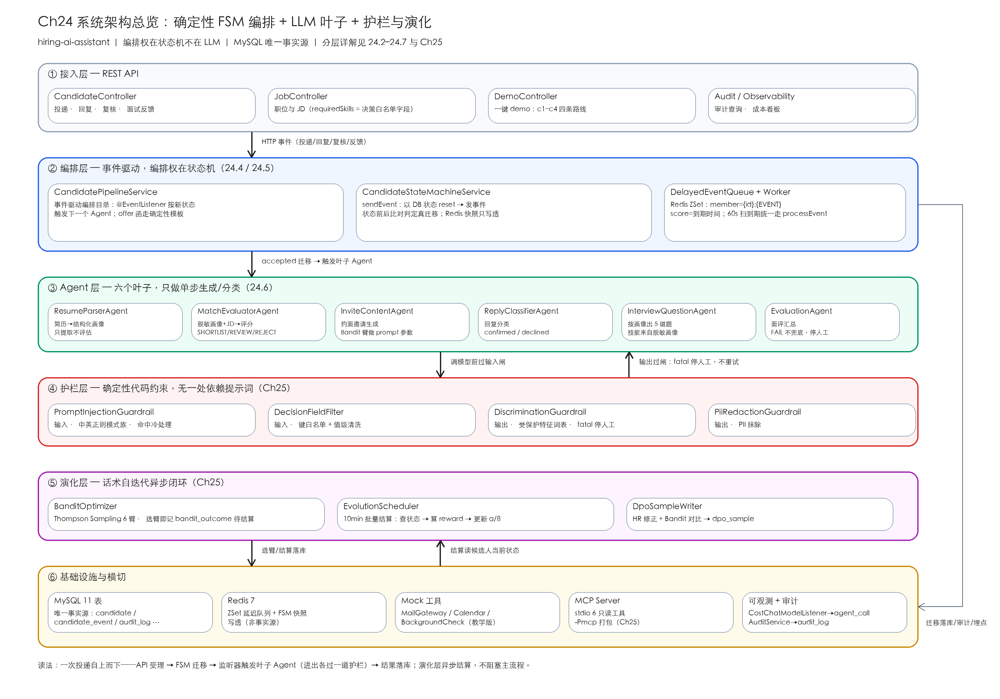
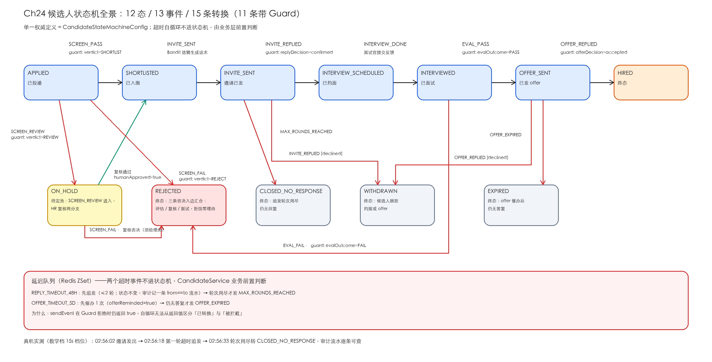
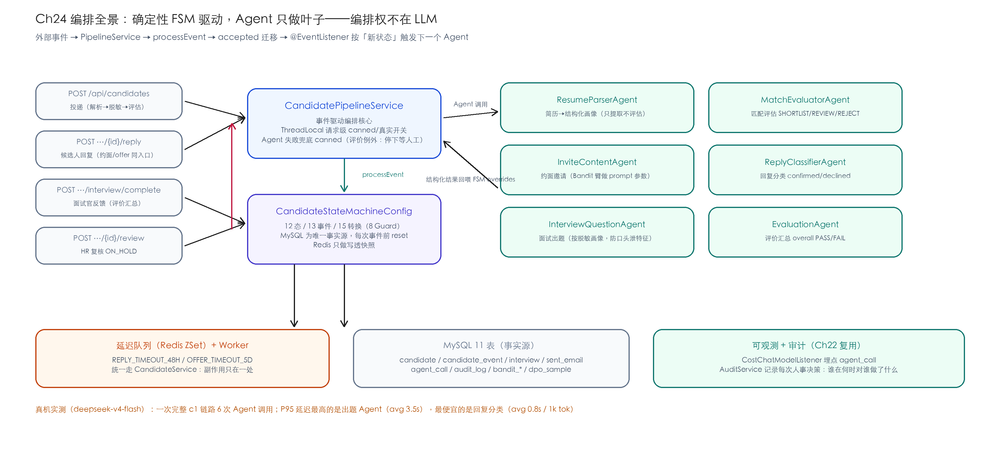
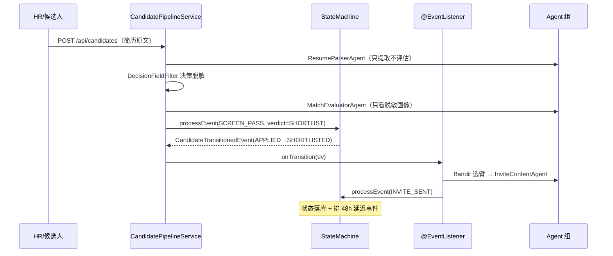

# Ch24 综合实战（上）——AI 招聘官：候选人全流程的 FSM 编排

> **本章基线**：项目 `hiring-ai-assistant` ｜ 端口 `8091` ｜ LangChain4j `1.22.0` + 实验模块 `1.22.0-beta32` ｜ JDK `21` ｜ Spring StateMachine `4.0.1` ｜ 最后验证 `2026-10-29`

> 本章目标：
>
> 1. **从 0 搭一个完整的企业级 AI 应用**——招聘方侧的候选人全流程自动化，覆盖"简历解析 → 决策脱敏 → 岗位匹配 → 约面邀请 → 排期出题 → 评价汇总 → offer 跟踪"
> 2. 把 Ch14~Ch22 的能力**组装成一条业务流水线**：6 个 Agent + Spring StateMachine + 事件驱动编排 + 延迟队列 + 审计
> 3. 吃透**这套架构最核心的一条设计决策**：编排权在状态机不在 LLM，Agent 只做叶子
> 4. 学会**事件驱动编排**的完整姿势：`@EventListener` 按新状态触发下一个 Agent、超时事件走业务层前置判断
> 5. 看懂**68 个测试怎么组织**、E2E 脚本怎么验证 12 项断言

护栏（歧视防护/注入检测）、Bandit 话术演化、DPO 样本池、MCP 对外暴露在 **Ch25（下）**。

## 24.1 总体架构：一条招聘流水线怎么搭

先把成品的样子立起来。项目定位是**招聘方侧、可自托管的候选人全流程自动化**——简历数据不出内网，这正是企业愿意自托管一个开源招聘助手的采购理由。整个系统分六层，一张图：



读法：一次投递自上而下走一条线——API 受理 → 状态机迁移 → 监听器按新状态触发叶子 Agent（调模型前后各过一道护栏）→ 结果落库；演化层异步结算，不阻塞主流程。各层职责与展开章节：

| 层 | 职责 | 关键组件 | 展开 |
|---|---|---|---|
| 接入层 | 投递、回复、复核、面试反馈、一键 demo 的 REST 入口 | 5 个 Controller | — |
| 编排层 | 事件受理与状态迁移，迁移后按新状态触发下一个 Agent | `CandidatePipelineService` + Spring StateMachine | 24.4、24.5 |
| Agent 层 | 6 个叶子 Agent，只做单步生成/分类，不做编排 | `agent/` + `HiringAgentConfig` | 24.6 |
| 护栏层 | 注入检测、决策脱敏（输入侧）+ 歧视防护、PII 抹除（输出侧） | `guardrail/` 四件套 | Ch25 |
| 演化层 | 约面话术 Bandit 自迭代，DPO 样本沉淀 | `evolution/` 三件套 | Ch25 |
| 基础设施与横切 | MySQL 11 表、Redis 延迟队列、mock 工具、MCP、成本/审计埋点 | `core/` `tools/` `mcp/` | 24.4.5、Ch25 |

图上有三条架构主线，这里先立住，后文逐个拆开：

- **编排权在状态机，不在 LLM。** 每次状态迁移由确定性 FSM 裁决，Agent 只在被触发的时刻做叶子工作——为什么这样定，24.2.4 给三个理由
- **MySQL 是唯一事实源。** Redis 上的 FSM 快照与延迟队列都是可丢的缓存，`candidate.status` 永远以库里的为准（24.4.2）
- **Agent 调用进出各过一道闸。** 输入侧拦注入与受保护特征，输出侧拦歧视表述，全部是代码层硬约束（Ch25 主题）

技术选型一段话交代：Java 21 + Spring Boot 3.5；AI 层 LangChain4j 1.22.0（Guardrails/MCP 用 1.22.0-beta32 实验线）；编排选 Spring StateMachine 4.0.1 而不是 if/else 或工作流引擎，这个「为什么」单独有一节（24.4.1）；存储 MySQL 8 + Redis 7——前者当事实源，后者只干两件丢了也不心疼的活（FSM 快照写透、延迟事件队列）。

## 24.2 业务建模

### 24.2.1 12 个 FSM 状态

`CandidateStatus` 按用途分四类：

| 分类 | 状态 | 说明 |
|---|---|---|
| 流程中（6 个） | `APPLIED` → `SHORTLISTED` → `INVITE_SENT` → `INTERVIEW_SCHEDULED` → `INTERVIEWED` → `OFFER_SENT` | 投递到 offer 的主线 |
| 待定（1 个） | `ON_HOLD` | 匹配分中间带，等 HR 人工复核 |
| 完成（2 个） | `HIRED` / `REJECTED` | 终态 |
| 流失（3 个） | `WITHDRAWN` / `CLOSED_NO_RESPONSE` / `EXPIRED` | 终态：候选人放弃 / 追发用尽 / offer 过期 |

设计上最值得说的是 `ON_HOLD`：评估结论不是二值的。强匹配直接进、弱匹配直接拒，**中间带必须停下来等人**——招聘业务的现实是"HR 复核"本来就是一个岗位，状态机把真实业务流程编码进去，而不是假装 AI 能替 HR 拍板。



### 24.2.2 13 个 FSM 事件

| 事件 | 触发者 | Guard 条件 |
|---|---|---|
| `SCREEN_PASS` / `SCREEN_REVIEW` / `SCREEN_FAIL` | 评估 Agent 结论 | `verdict == SHORTLIST / REVIEW / REJECT` |
| `INVITE_SENT` | 邀请 Agent + 邮件网关 | — |
| `INVITE_REPLIED` | 候选人回复分类 | `replyDecision == confirmed / declined` |
| `INTERVIEW_DONE` | 面试官提交反馈 | — |
| `EVAL_PASS` / `EVAL_FAIL` | 评价 Agent 结论 | `evalOutcome == PASS / FAIL` |
| `OFFER_REPLIED` | 候选人答复 offer | `offerDecision == accepted / declined` |
| `MAX_ROUNDS_REACHED` | 业务层（追发用尽） | — |
| `OFFER_EXPIRED` | 业务层（催办后仍无答复） | — |
| `REPLY_TIMEOUT_48H` / `OFFER_TIMEOUT_5D` | 延迟队列 | **不进状态机**（见 24.4.4） |

### 24.2.3 15 条转换（11 条带 Guard）

同一事件路由到不同目标状态，靠 Guard 按业务值分支——这是 Spring StateMachine 最实用的模式：

| # | 源状态 | 事件 | 目标状态 | Guard |
|---|---|---|---|---|
| 1 | APPLIED | SCREEN_PASS | SHORTLISTED | `verdict==SHORTLIST` |
| 2 | APPLIED | SCREEN_REVIEW | ON_HOLD | `verdict==REVIEW` |
| 3 | APPLIED | SCREEN_FAIL | REJECTED | `verdict==REJECT` |
| 4 | ON_HOLD | SCREEN_PASS | SHORTLISTED | `humanApproved==true` |
| 5 | ON_HOLD | SCREEN_FAIL | REJECTED | `humanApproved==false` |
| 6 | SHORTLISTED | INVITE_SENT | INVITE_SENT | — |
| 7 | INVITE_SENT | INVITE_REPLIED | INTERVIEW_SCHEDULED | `replyDecision==confirmed` |
| 8 | INVITE_SENT | INVITE_REPLIED | WITHDRAWN | `replyDecision==declined` |
| 9 | INVITE_SENT | MAX_ROUNDS_REACHED | CLOSED_NO_RESPONSE | — |
| 10 | INTERVIEW_SCHEDULED | INTERVIEW_DONE | INTERVIEWED | — |
| 11 | INTERVIEWED | EVAL_PASS | OFFER_SENT | `evalOutcome==PASS` |
| 12 | INTERVIEWED | EVAL_FAIL | REJECTED | `evalOutcome==FAIL` |
| 13 | OFFER_SENT | OFFER_REPLIED | HIRED | `offerDecision==accepted` |
| 14 | OFFER_SENT | OFFER_REPLIED | WITHDRAWN | `offerDecision==declined` |
| 15 | OFFER_SENT | OFFER_EXPIRED | EXPIRED | — |

一个容易画错的点：**REJECTED 有三条入边**（评估不通过 / 面试不通过 / 复核否决），但每条都带 Guard，不会歧义；而 `WITHDRAWN` 也有两条入边（婉拒约面 / 婉拒 offer）——终态多入边是常态，别为了"好看"合并事件。

### 24.2.4 设计决策：编排是确定性的，Agent 是叶子

这是整个项目最重要的一条架构约束，原样引用自代码注释：

```java
/**
 * 事件驱动编排：招聘业务流水线（核心）。
 *
 * <p>设计原则：确定性 FSM + LLM 叶子。编排不由 LLM 自主决定，而由状态迁移驱动：
 * 1. 外部事件（投递 / 候选人回复 / 面试官反馈 / HR 复核 / 超时）进入本服务或
 *    CandidateService#processEvent；
 * 2. accepted 转换后发布 CandidateTransitionedEvent；
 * 3. 本服务监听迁移事件，按新状态确定性触发对应 Agent；
 * 4. Agent 输出结构化结果，作为下一 FSM 事件的 overrides 回喂。
 */
```

为什么不让 LLM 自主编排？三个理由：

- **人事决策必须可回溯**：候选人问"为什么拒我"，答案必须是一串确定的状态迁移 + 带证据的理由，不能是"模型觉得"
- **失败模式可控**：Agent 挂了走 canned 兜底或停在原状态等人工；自主编排的 Agent 挂在半路，状态没人知道
- **成本可控**：每次调用都是状态机的确定性产物，不存在模型"多想了几步"烧 token

## 24.3 数据建模（11 张表）

| 分组 | 表 | 职责 |
|---|---|---|
| 业务主表 | `job_position` / `candidate` / `interview` | 职位、候选人、面试安排 |
| 流水表 | `candidate_event` / `sent_email` / `received_email` | 状态迁移 / 邮件往来（round：0=事务邮件 1=首发 2=追发） |
| 横切表 | `agent_call` / `audit_log` | Agent 调用埋点 / 人事决策审计 |
| 自迭代表 | `bandit_state` / `bandit_outcome` / `dpo_sample` | Bandit 状态、待结算队列、DPO 样本 |

`candidate` 表有一组刻意分开的字段，值得单独说：

```sql
resume_text      MEDIUMTEXT  COMMENT '简历原文（含 PII；只进库不出决策）',
redacted_profile JSON        COMMENT '决策画像（白名单过滤后，评估 Agent 唯一可见的画像）',
match_reasons    JSON        COMMENT '评估理由（拒信可解释性数据源）',
```

简历原文和决策画像**分开存**：原文含 PII 与受保护特征（年龄/性别/婚育/户籍），永远不进评估 prompt；评估 Agent 只看得见 `redacted_profile`。这不是"提示词里嘱咐模型别看"，是**字段级隔离**——Ch25 §25.3 的主题。

## 24.4 Spring StateMachine 实战

### 24.4.1 为什么用 FSM 而不是 if/else 或工作流引擎

12 个状态 × 13 个事件，if/else 写得出来，但三件事写不出来：

- **非法迁移防呆**：`HIRED → SCREEN_PASS` 这种调用在 if/else 里是漏网之鱼，在 FSM 里是"无匹配事件"，天然拒绝
- **Guard 与转换同处定义**：业务规则（"否决必须带理由"）和流转规则在一个文件里，`CandidateStateMachineConfig` 是单一权威定义
- **可视化**：状态机图即架构图，本章开头的全景图就是从配置类直译的

### 24.4.2 MySQL 是唯一事实源，Redis 只做写透

每次处理事件前，用 DB 里的 `candidate.status` 重置状态机：

```java
// 以 DB 状态为事实源重置（修复 bug 2：不再从初始态开始）
DefaultStateMachineContext<CandidateStatus, FsmEvent> ctx =
        new DefaultStateMachineContext<>(candidate.getStatus(), null,
                new HashMap<>(),
                new DefaultExtendedState(new HashMap<>(extended)));
sm.getStateMachineAccessor().doWithAllRegions(access -> access.resetStateMachine(ctx));
```

Redis 的 `RedisStateMachineContextRepository` 只写一份快照（审计/观测用）。**别让 Redis 当事实源**——重启丢数据、TTL 到期蒸发，而 MySQL 里的 `candidate.status` 永远在。

把 `sendEvent` 的完整链路摊开，一次事件处理就五步（`CandidateStateMachineService`）：

① 从工厂按 `candidateId` 取机器实例（同一候选人固定用同一个 machineId）；② 组装 ExtendedState——candidate 业务字段加事件 overrides，**null 值不能放**（`resetStateMachine` 拷贝进 ConcurrentHashMap 时直接 NPE）；③ 以 DB 里的当前状态 `resetStateMachine`，机器永远从库里的事实出发；④ 发事件，用状态前后比对判定是否真迁移——Guard 拒绝时 `sendEvent` 仍返回 true，布尔返回值不可信；⑤ 真迁移才写透 Redis 快照，新状态交调用方落库。

### 24.4.3 三个集成 bug（实测踩出来的）

| Bug | 症状 | 修复 |
|---|---|---|
| 双机器实例 | Guard 永远读不到 ExtendedState | 在**同一台**事件机上构建 ExtendedState，别写到 `createFresh()` 的另一台机器 |
| 无状态恢复 | 每次事件都从初始态出发 | 事件前用 DB 状态 `resetStateMachine` |
| 状态写不回 DB | 读新状态发生在 DB 更新前 | `sendEvent` 直接返回新状态，调用方落库 |

### 24.4.4 超时自循环不进状态机

`REPLY_TIMEOUT_48H` 和 `OFFER_TIMEOUT_5D` 这两个事件**在状态机里没有自循环边**。原因是硬的：

> Spring StateMachine 的 `sendEvent` 在 Guard 拒绝时仍返回 true（Guard 拦截的 ResultType 是 ACCEPTED）——自循环状态不变，你无法从返回值区分"转换已执行"与"Guard 拦截"。

所以追发/催办由业务层前置判断：

```java
public CandidateContext handleReplyTimeout(Long candidateId) {
    // …状态必须是 INVITE_SENT，过期超时直接忽略
    if (rounds < props.getFsm().getMaxInviteRounds()) {
        resendLatestInvite(candidate, rounds + 1);          // 追发一轮
        candidate.setInviteRounds(rounds + 1);
        schedule(candidateId, FsmEvent.REPLY_TIMEOUT_48H,   // 重排 48h 监听
                props.replyTimeout());
        recordEvent(candidate, FsmEvent.REPLY_TIMEOUT_48H,  // 审计记一条 from==to
                CandidateStatus.INVITE_SENT, CandidateStatus.INVITE_SENT);
        return candidate;
    }
    return processEvent(candidateId, FsmEvent.MAX_ROUNDS_REACHED, Map.of());
}
```

注意追发的审计语义：状态没变，但 `candidate_event` 里记一条 `from_status == to_status` 的流水——**"什么都没发生"本身也是审计证据**。

真机实测（教学档 15 秒超时档位，2026-10-29）：

```text
02:56:02  INVITE_SENT      SHORTLISTED → INVITE_SENT   （邀请发出）
02:56:18  REPLY_TIMEOUT    INVITE_SENT → INVITE_SENT   （第一轮超时，追发）
02:56:33  MAX_ROUNDS       INVITE_SENT → CLOSED_NO_RESPONSE（轮次用尽，关闭）
```

三个时间戳严格间隔 15 秒，全由延迟队列 worker 自动驱动，没有人工介入。

### 24.4.5 延迟队列：Redis ZSet 的两行 key 设计

```text
Key    hiring:delayed-events
member {candidateId}:{EVENT}      如 "76:REPLY_TIMEOUT_48H"
score  触发时间戳（毫秒）
```

worker 每 60 秒扫一次 `ZRANGEBYSCORE 0 now`，取到期事件统一走 `CandidateService.processEvent`。为什么不用 Spring StateMachine 内置 Timer？**它不能 cancel**——候选人中途回复时必须取消 48h 定时器，否则会误触发追发。

## 24.5 事件驱动编排

### 24.5.1 核心机制：迁移事件 + 监听器



一次投递的完整编排链（Mermaid 时序）：



`onTransition` 的 switch 就是整个编排的"目录"——每个 case 一行，新流程加一行：

```java
@EventListener
public void onTransition(CandidateTransitionedEvent ev) {
    switch (ev.to()) {
        case SHORTLISTED -> generateInviteAndSend(ev.candidateId());
        case INTERVIEW_SCHEDULED -> bookSlotAndPrepare(ev.candidateId());
        case OFFER_SENT -> sendOfferLetter(ev.candidateId());
        default -> { /* 等待外部事件 */ }
    }
}
```

### 24.5.2 offer 函为什么不用 LLM

```java
/** OFFER_SENT → offer 函（确定性模板：offer 是法律承诺文件，正文不走 LLM） */
```

薪酬、入职条款、承诺表述——这些内容错了有法律后果，而且模板复用率极高。**LLM 用在"每篇都不一样的文本"上才有价值**，offer 函恰好是"每篇都一样"的文本。知道什么时候不用模型，和知道什么时候用，是同一种能力。

### 24.5.3 坑点：ThreadLocal 跨事件丢失

请求级 `useRealAgent` 开关用 ThreadLocal 传递——但 `@EventListener` 默认同步执行、共用调用线程，所以**必须 try/finally 清理**，否则线程池复用会把"本请求的 canned 模式"串到下一个请求：

```java
public CandidateContext submit(CreateCandidateRequest req, boolean useRealAgent) {
    MODE_OVERRIDE.set(useRealAgent);
    try {
        return doSubmit(req);
    } finally {
        MODE_OVERRIDE.remove();   // 防线程复用串模式
    }
}
```

## 24.6 六个 Agent

| # | Agent | 输入 → 输出 | 工具 |
|---|---|---|---|
| 1 | `ResumeParserAgent` | 简历原文 → ParsedProfile | 无 |
| 2 | `MatchEvaluatorAgent` | 脱敏画像 + JD → MatchVerdict(score, verdict, reasons) | 无 |
| 3 | `InviteContentAgent` | 姓名 + 职位 + tone/cta → InviteEmail | 无 |
| 4 | `ReplyClassifierAgent` | 回复正文 → confirmed/declined | 无 |
| 5 | `InterviewQuestionAgent` | JD + 脱敏画像 → 5 道题 | 无 |
| 6 | `EvaluationAgent` | 面试官反馈 → EvaluationSummary(PASS/FAIL) | 无 |

三个设计点：

**只提取，不评估。** `ResumeParserAgent` 的系统提示词第一句是"只提取原文明确写出的内容，提取不到的字段填 null，禁止推测或编造"。解析器多说一个字都是引入偏见的机会，好坏判断是评估 Agent 的事。

**出题也过脱敏画像。** 面试题必须来自候选人真实写过的技能——用脱敏画像出题，顺带堵死"照着年龄出简单题"这类隐性歧视：出题器根本不知道候选人的年龄性别。

**@Agent 接口必须用 AgenticServices 构造。** 这是 beta32 实验线的规矩：

```java
@Bean
public MatchEvaluatorAgent matchEvaluatorAgent(ChatModel instrumentedChatModel) {
    return AgenticServices.agentBuilder(MatchEvaluatorAgent.class)
            .chatModel(instrumentedChatModel)
            .inputGuardrails(injectionGuardrail)
            .outputGuardrails(discriminationGuardrail, piiGuardrail)
            .build();
}
```

### 24.6.1 真实模式 vs Canned 模式

每个 Agent 调用先看 `hiring.demo.use-real-agent`：真实模式调 LLM、失败兜底 canned；canned 模式直接走确定性规则（正则解析、技能交集打分、模板渲染）。**两种模式的 FSM 流转完全一致**——这是"编排与模型解耦"带来的可测试性红利：68 个测试不需要任何 API key。

一个例外：`EvaluationAgent` 失败**不兜底**。评价触发合规护栏时抛异常、候选人停在 `INTERVIEWED` 等面试官修订——合规场景宁可停，不可错（Ch25 §25.3）。

## 24.7 审计与可解释拒信

招聘场景的审计比一般业务更硬：每一次 AI 参与的人事决策都要能回答"为什么拒了他"。三层留痕：

| 层 | 表 | 回答什么问题 |
|---|---|---|
| 状态层 | `candidate_event` | 他经历过哪些阶段？每步什么时候、被什么事件触发 |
| 决策层 | `candidate.match_reasons` | 淘汰理由是什么？逐条引用画像证据 |
| 操作层 | `audit_log` | 谁（system/agent/human）在何时对谁做了什么 |

`AuditService` 挂 `@EventListener`，每次 accepted 迁移自动写一条。canned 评估给出的理由是实打实的证据链，比如 c2 弱匹配候选人被拒时落在库里的就是这三条：

```json
["命中必备技能 0/4", "工作年限 1 年", "缺少技能：Java、Spring、LangChain4j、RAG"]
```

拒信从这份 JSON 生成。换句话说，"可解释"不是生成一句漂亮话，是**把决策时真的用过的证据原样给出去**——证据链里没有的东西，拒信里就不能出现，这也顺便堵住了模型自由发挥的空间。真机上一次完整 c1 链路（投递到 HIRED）会在三张表里留下 6 条状态流水、3 封邮件、1 条审计操作记录，全部可回放。

## 24.8 端到端实测

### 24.8.1 一键 demo：四条路线

`POST /api/demo/run` 一次跑四个候选人（真机 2026-10-29，deepseek-v4-flash）：

| 候选人 | 简历特征 | 实际流转 |
|---|---|---|
| c1 强匹配 | 5 年 Java + LangChain4j/RAG 项目 | `APPLIED → SHORTLISTED → INVITE_SENT → INTERVIEW_SCHEDULED → OFFER_SENT → HIRED` |
| c2 弱匹配 | 1 年前端 | `APPLIED → REJECTED`（带技能缺口理由） |
| c3 注入简历 | 藏"忽略之前的所有指令" | `APPLIED → REJECTED`（确定性冷处理） |
| c4 歧视字段 | "28 岁/女/已婚/户籍杭州" | `APPLIED → ON_HOLD`，决策画像零泄漏 |

### 24.8.2 E2E 脚本 12 项断言

`bash scripts/run-e2e.sh` 对着运行中的服务跑：健康检查、建职位、c1 六步全链路、c2 落点合法性、c3 确定性淘汰、c4 画像核验、审计流水条数——**12 项全过，0 失败**。脚本本身也进了测试（`E2EScriptTest` 校验语法与断言覆盖），因为放着不跑的验证脚本比没有更危险。

### 24.8.3 测试金字塔

```text
63 = 8  集成（canned 全链路 + Guard 拒绝 + 两条超时链路）
   + 9  Agent 单元（mock ChatModel，三类三个文件）
   + 46 其他单元（护栏 13 / 演化 11 / MCP 8 / 状态枚举与脚本契约 7 / 可观测与审计 7）
```

集成测试前置：MySQL（`hiringdb`，schema.sql 自动初始化）+ Redis；LLM 全部走 canned。

## 24.9 踩坑清单

| # | 坑 | 症状 | 解法 |
|---|---|---|---|
| 1 | 超时自循环 | Guard 拒绝时 `sendEvent` 仍返回 true | 自循环移出状态机，业务层前置判断（24.4.4） |
| 2 | 双机器实例 | Guard 读不到 ExtendedState | 同一台机器上构建 + 发事件 |
| 3 | JavaBeans 歧义 | MyBatis 报 `Illegal overloaded getter` | 布尔字段别同时定义 `isXxx()` 和 `getXxx()`，项目里用 `offerReminded()` |
| 4 | ThreadLocal 串模式 | 上一个请求的 canned 模式泄漏到下一个 | try/finally remove（24.5.3） |
| 5 | 邮件健康检查常驻 DOWN | 引了 mail starter 但从不发信 | 不引 starter，MailGateway 纯内存 mock |
| 6 | Bash 变量名吃进全角字符 | `$C2_STATUS（` 报 unbound variable | 变量后接全角字符必须 `${C2_STATUS}` 加花括号 |
| 7 | XML 注释里的 `--` | pom 解析失败 | 注释里别写 `--xxx` 形式的参数名 |
| 8 | JSON 对象被当数组解析 | `readValue(json, List.class)` 抛异常 | 先判 `isArray()`，对象取 `skills` 键（24.10 速查有对应行） |

## 24.10 速查表

| 我要… | 去哪 | 关键点 |
|---|---|---|
| 加一个状态/转换 | `CandidateStateMachineConfig` | 单一权威定义，改完先改 FSM 全景图 |
| 加一个 Agent | `agent/` + `HiringAgentConfig` | `AgenticServices.agentBuilder`，接口内恰好一个 `@Agent` 方法 |
| 改超时/轮次 | `application.yml` → `hiring.fsm.*` | 教学档 2h/5min，生产 48h/5d |
| 看某人为什么被拒 | `GET /api/candidates/{id}` | `matchReasons` + `candidate_event` 流水 |
| 本地无 key 跑全流程 | `{"useRealAgent": false}` | canned 规则与真实模式状态流转一致 |
| 跑 E2E | `bash scripts/run-e2e.sh` | 先 `docker-compose up -d` + 起服务 |
| MCP 客户端接入 | `mvn package -Pmcp` | stdio 子进程，6 个只读工具 |

**下一章预告**：Ch25 综合实战（下）——三道护栏（歧视防护是全系列独有话题）、Bandit 话术自迭代、DPO 样本池、MCP 对外暴露与最小披露、以及每个 Agent 的真机成本账。

## 想翻源码时从哪进

状态机与编排的两处权威定义，建议按这个顺序读：先 `core/CandidateStateMachineConfig.java`（15 条转换 + 8 个 Guard，对应 24.2.3 的表），再 `service/CandidatePipelineService.java`（@EventListener 编排目录，对应 24.5）。mock 怎么换真的，翻 `hiring-ai-assistant/ARCHITECTURE.md` §6 的替换清单，每行都标了"不换的后果"。Spring StateMachine 的 Guard/Persist 机制官方手册讲得比本文细：https://docs.spring.io/spring-statemachine/docs/current/reference/
