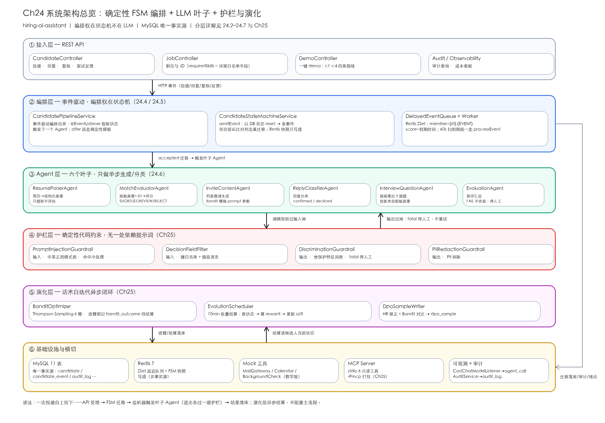
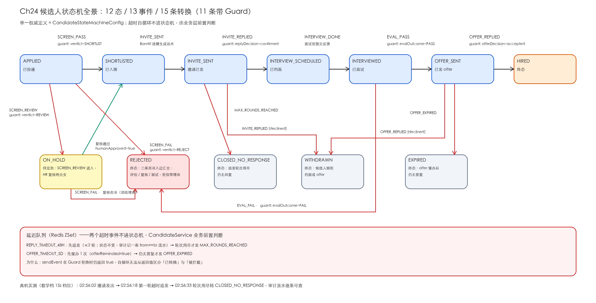

# hiring-ai-assistant —— AI 招聘官（Ch24/25 综合实战项目）

招聘方侧的候选人全流程自动化：**简历解析 → 决策脱敏 → 岗位匹配评估 →
约面邀请 → 排期出题 → 评价汇总 → offer 跟踪**。

核心设计三件事：

1. **确定性 FSM + LLM 叶子**：12 状态 / 13 事件 / 15 条转换（Spring StateMachine），
   编排权在状态机不在 LLM——Agent 只在叶子节点出结构化结果；
2. **三道护栏**：决策白名单（受保护特征进不了评估 prompt）、注入检测（简历是不可信
   第三方文本）、输出合规护栏（评估理由出现年龄/性别等词直接拦截停人工）；
3. **Bandit 演化 + DPO 样本**：约面话术 6 臂 Thompson Sampling 按回复率自迭代，
   HR 修正 AI 产出沉淀为偏好样本。



详细设计见 [ARCHITECTURE.md](ARCHITECTURE.md)，配套章节 Ch24（编排）、Ch25（护栏与演化）。

## 业务流程

全部编排由状态机驱动（12 状态 / 13 事件 / 15 条转换，其中 11 条带 Guard 闸门），
Agent 只在叶子节点产出结构化结果：



主线是 APPLIED → SHORTLISTED → INVITE_SENT → INTERVIEW_SCHEDULED → INTERVIEWED
→ OFFER_SENT → HIRED；弱匹配与注入简历在入口被拒，歧义风险进 ON_HOLD 池等 HR 复核，
邀请 48 小时无回复自动追发、offer 5 天未响应自动催办（教学档压缩为 2h / 5min，可配）。

## 快速开始

```bash
# 1. 基础设施（MySQL 自动执行 schema.sql；Redis）
cd docker && docker-compose up -d && cd ..

# 2. 模型 key（任选其一）
cp src/main/resources/application-local.yml.example src/main/resources/application-local.yml
# 编辑 application-local.yml 填入真实 key（已 gitignore，不会入库）

# 3. 启动（JDK 21）
mvn spring-boot:run

# 4. 一键 demo：四个候选人跑四条路线
curl -X POST http://localhost:8091/api/demo/run \
     -H "Content-Type: application/json" -d '{}'
# 无 key 环境（canned 确定性规则，流程完全一致）：
curl -X POST http://localhost:8091/api/demo/run \
     -H "Content-Type: application/json" -d '{"useRealAgent": false}'
```

本地已有 MySQL 8+ 和 Redis 的话可以不依赖 Docker，手动初始化一次（账号密码与
`application.yml` 中的数据源一致）：

```bash
mysql -uroot -e "CREATE DATABASE IF NOT EXISTS hiringdb CHARACTER SET utf8mb4;
CREATE USER IF NOT EXISTS 'hiring'@'localhost' IDENTIFIED BY 'hiring_pass';
GRANT ALL ON hiringdb.* TO 'hiring'@'localhost';"
mysql -uhiring -phiring_pass hiringdb < src/main/resources/db/schema.sql
redis-server --daemonize yes   # 或 brew services start redis
```

## 预期输出（canned 模式实测）

demo 创建 1 个职位、4 个候选人，四条路线一次看全（响应中的 id 每次运行递增）：

```json
{
  "jobId": 41, "strongId": 157, "weakId": 158, "injectionId": 159, "piiId": 160,
  "steps": [
    "job: id=41 title=资深 Java 后端工程师（AI 方向）",
    "c1(强匹配): APPLIED → INVITE_SENT",
    "c1: 回复确认 → INTERVIEW_SCHEDULED",
    "c1: 面试通过 → OFFER_SENT",
    "c1: 接受 offer → HIRED",
    "c2(弱匹配): APPLIED → REJECTED",
    "c3(注入): APPLIED → REJECTED",
    "c4(歧视字段): APPLIED → INVITE_SENT | 决策画像含受保护字段? false"
  ],
  "useRealAgent": false
}
```

分别验证四件事：强匹配走完全流程直到入职；弱匹配被评估拦在门口；注入简历被护栏
识别拒绝；简历里埋了性别/年龄，但决策画像里查无此物（最后那个 `false`）。

后续查看两条路径（id 以你的响应为准）：

```bash
curl -s http://localhost:8091/api/candidates/157        # 状态/匹配分/脱敏后的决策画像
curl -s http://localhost:8091/api/candidates/157/events # 逐次状态变更流水（事件+角色+时间）
```

## API 一览

| 方法 | 路径 | 说明 |
|---|---|---|
| POST | `/api/jobs` | 创建职位 |
| POST | `/api/candidates` | 投递简历（自动解析→脱敏→评估→FSM） |
| GET | `/api/candidates/{id}` | 状态/匹配分/决策画像 |
| GET | `/api/candidates/{id}/events` | 状态变更流水 |
| GET | `/api/candidates/{id}/interview` | 排期与出题 |
| POST | `/api/candidates/{id}/reply` | 候选人回复（约面/offer 同入口） |
| POST | `/api/candidates/{id}/interview/complete` | 面试官提交反馈 |
| POST | `/api/candidates/{id}/review` | HR 复核 ON_HOLD |
| POST | `/api/candidates/{id}/correction` | HR 修正 AI 产出（DPO） |
| POST | `/api/demo/run` | 一键全链路 demo |

## 测试

```bash
mvn test          # 离线测试：状态机模拟器 + 护栏 + 演化 + MCP，无需 key
bash scripts/run-e2e.sh   # 全链路 E2E（需先起服务）
```

## MCP 接入（stdio）

```bash
mvn clean package -Pmcp
java -jar target/hiring-ai-assistant-0.30.0-SNAPSHOT-mcp.jar
```

Claude Desktop / Cursor 配置：

```json
{
  "mcpServers": {
    "hiring-ai-assistant": {
      "command": "java",
      "args": ["-jar", "/绝对路径/hiring-ai-assistant-0.30.0-SNAPSHOT-mcp.jar"]
    }
  }
}
```

暴露 6 个只读查询工具（候选人状态/在招职位/面试安排/邮件列表），最小披露原则：
联系方式与简历原文不出 MCP 边界。

## 注意事项

- **JDK 21 硬约束**：enforcer 锁 `[21,22)`，更高版本 Lombok 失效；
- 真实 key 只放 `application-local.yml`（已 gitignore）；
- 48h/5d 超时在教学版是 2h/5min（`hiring.fsm.*` 可调），
  本地联调可改成秒级观察追发与催办。
