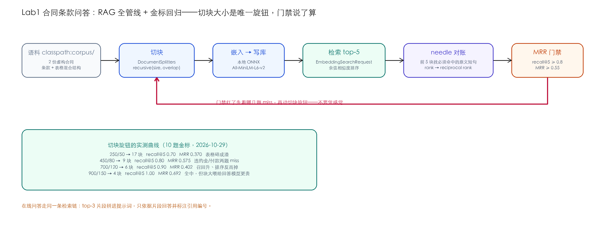

# Lab1 · 合同条款问答——RAG 全管线 + 金标集回归门禁

> **基线**：LangChain4j `1.22.0` ｜ JDK 21 ｜ 2026-10-29 实测 ｜ 离线测试零 key 可跑

## 场景

你是法务助理的技术搭档：两份合同（一份房屋租赁、一份设备采购）进了知识库，
业务同事随口问"房东提前收房赔多少""卖方逾期交货怎么罚"，系统要答得准、还要给出处。
合同是**条款 + 表格混合结构**——和主教程的客服文档语料结构完全不同，
"分块策略"这个在教程里被告知的决策，在这里要你自己做。



## 知识映射

| Lab1 里做的事 | 来自 | 在这里的新意 |
|---|---|---|
| 文档加载 / 切块 / 嵌入 / 入库 | Ch10 | 手写三步而不是包 Ingestor，每步可见可改 |
| 本地嵌入模型（384 维 ONNX） | Ch08/Ch11 | 检索与评估**完全离线**，不花一分钱 |
| 检索 top-k | Ch11 | EmbeddingSearchRequest 直接用 |
| 金标集 + MRR | Ch13 | 检索侧评估不需要 LLM——needle 对账即可，这是它适合进 CI 的原因 |
| 在线问答 | Ch12 | top-3 片段拼提示词，只依据片段回答并标注引用 |

## 快速开始

```bash
cd labs/lab1-contract-qa
mvn test                                    # 离线：金标回归 4 个测试（含门禁）
mvn compile exec:java -Dexec.mainClass=com.example.lab.ContractQaApp -Dexec.args="eval"
mvn compile exec:java -Dexec.mainClass=com.example.lab.ContractQaApp \
    -Dexec.args="eval 900 150"              # 换切块策略重测
export DEEPSEEK_API_KEY=sk-xxx
mvn compile exec:java -Dexec.mainClass=com.example.lab.ContractQaApp \
    -Dexec.args="ask 房东提前收房要赔多少"
```

## 核心实现

入库三步手写（`src/main/java/com/example/lab/ContractKnowledge.java`），读者改任何一步都看得见：

```java
DocumentSplitter splitter = DocumentSplitters.recursive(chunkSize, overlap);
List<TextSegment> segments = splitter.splitAll(documents);
for (TextSegment segment : segments) {
    Embedding embedding = embeddingModel.embed(segment).content();
    store.add(embedding, segment);
}
```

评估器（`RetrievalEvaluator.java`）只做检索侧对账：金标集每题带一个 **needle**
（必须被检回的原文短句，如 `"0.03%"`、`"不得转租、转借"`），在前 5 个块里找它的名次，
算 recall@k 和 MRR。**没有 LLM 参与**——所以它能进 CI 当回归门禁。

## 实测：切块旋钮的完整曲线

同一个金标集（10 题），四档切块策略的真实结果（2026-10-29）：

| 切块 | 块数 | recall@5 | MRR | 发生了什么 |
|---|---|---|---|---|
| 250/50 | 17 | 0.70 | 0.370 | 表格碎成渣，付款计划行离开表头失去语义 |
| **450/80（默认）** | 9 | **0.80** | **0.575** | 违约金条款、3-6-1 付款两题 miss |
| 700/120 | 6 | 0.90 | **0.402** | **召回回升、排序反而掉**——反例 |
| 900/150 | 4 | 1.00 | 0.692 | 全中，但块越大喂给回答模型越贵 |

两个读数必须带走：**"块越大越好"是谣言**——700/120 的 recall 提高了，
MRR 却从 0.575 掉到 0.402，因为大块稀释了每块的主题，第 1 名命中率反而降；
以及 **900/150 不是普适答案**——它赢是因为这两份合同总共只有 4-6 块的内容量，
换成几万页语料，这个块大小会让上下文成本爆炸。结论依赖语料规模，别外推。

在线问答实测（`ask 房东提前收房要赔多少`，deepseek-v4-flash）：

```
根据【片段2】第八条违约责任（一）甲方违约：房东提前收回房屋的，应向租客支付
相当于两个月租金的违约金，即 13,600 元，并退还剩余租期租金及全部押金。
引用片段：【片段2】
```

## 验收清单（三件套）

- [x] **金标集**：10 题 needle 全部取自语料原文（`src/main/resources/golden-set.json`），门禁写进测试
- [x] **成本报表**：离线评估 0 次调用；在线问答每次 1 次模型调用，按 Ch22 实测单价约 ¥0.0003–0.001/次
- [x] **踩坑记录**：见下
- [ ] 你的部分：换一份你自己领域的语料（keep 表格），复现四档曲线，把你的数字写进本表

## 踩坑记录（2026-10-29 当天）

1. **`InMemoryEmbeddingStore` 不在 core 包**——它在 `langchain4j` 主 artifact；只依赖 core 会编译失败。同理 `ClassPathDocumentLoader` 也在主包。
2. **`EmbeddingSearchResult` 的方法叫 `matches()`** 不是 `hits()`；块计数没有现成 API（`IngestionResult` 只吐 tokenUsage），所以 `ContractKnowledge` 自己记 `chunkCount`。
3. **第一次写测试把门禁设成 recall@5 = 1.0**，当场被默认配置打脸（0.80）——门禁应该钉在**当前基线**上，改策略改出更好数字后再抬门禁。这不是测试写松了，是"门禁 = 当前验收水平"的正确语义。

## 练习

1. 给 `TextSegment` 加元数据（docId/category），用 `EmbeddingSearchRequest` 的 `filter` 实现"只在采购合同里搜"——金标集里两份合同的题分开测。
2. 把 needle 评估和 LLM judge（Ch13 的 `includeAnswer`）接起来：检索对了但答案错的情况，你的语料里有多少？
3. 思考题：700/120 的 MRR 倒退，如果加 rerank（Ch12）能救回来吗？动手验证你的判断。
