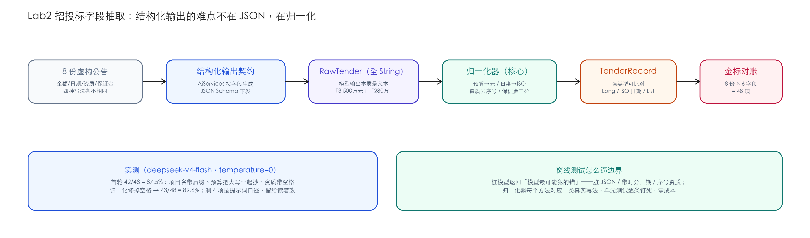

# Lab2 · 招投标公告字段抽取——结构化输出的难点在归一化

> **基线**：LangChain4j `1.22.0` ｜ JDK 21 ｜ 2026-10-29 实测 ｜ 离线测试零 key 可跑

## 场景

销售团队每天扫几百条招投标公告，人肉抄"预算多少、截止哪天、要什么资质、保证金交不交"
到 CRM。公告文本极其不规范：预算一会儿"3,500万元"一会儿"280万"一会儿"12000000元"，
日期带不带时分全看发布人心情。任务：8 份公告进、48 个字段出，字段级可对账。



## 知识映射

| Lab2 里做的事 | 来自 | 在这里的新意 |
|---|---|---|
| AiServices 结构化输出 | Ch07 | 返回类型是"全 String 的 RawTender"——故意弱类型，原因见下 |
| 提示词约束 | Ch03 | 保留原文写法，翻译成强类型的事归代码不归模型 |
| 归一化 + 校验 | Ch13 口径 | 结构化抽取的真正难点：模型吐的值没法直接入库 |

**为什么不让模型直接返回 `Long budgetYuan`**——模型输出本质是文本，强类型字段
要么靠 json_schema 硬约束（换模型就失效），要么被 Jackson 强转吞掉精度。
`RawTender` 全 String + `TenderNormalizer` 逐字段清洗，是"信文本、验代码"的路线。

## 快速开始

```bash
cd labs/lab2-tender-extract
mvn test                        # 离线：5 个归一化测试（脏 JSON 全覆盖）
export DEEPSEEK_API_KEY=sk-xxx
mvn compile exec:java -Dexec.mainClass=com.example.lab.TenderExtractionApp
```

## 核心实现

声明式契约（`TenderExtractionService.java`）：

```java
interface Assistant {
    @UserMessage("""
            你是招投标助理。从下面的公告原文里抽取字段，严格按 JSON 输出：
            ...
            budgetYuan（预算金额，保留原文写法原样抄出，如"3,500万元"）、
            """)
    RawTender extract(@V("announcement") String announcement);
}
```

归一化器（`TenderNormalizer.java`）是本 lab 的主角，四个方法各钉一类真实写法：

```java
// 预算："3,500万元" / "280万" / "12000000元" / "450 万元" → 元（Long）
// 截止日期：统一成 ISO yyyy-MM-dd（时分丢弃）
// 资质列表：去序号、按 ；再切一刀、去空格、丢弃空项
// 保证金三分：固定金额 → 元；"不收取" → 0；按比例（"合同金额的 5%"）→ null
```

## 实测：48 项字段级对账

两轮实测（deepseek-v4-flash，temperature=0，8 份公告 × 6 字段）：

| 轮次 | 准确率 | 错在哪 |
|---|---|---|
| 第一轮 | 42/48 = **87.5%** | 项目名把括号后缀一起抄进、预算"12000000元（大写：…）"整串抄出解析失败、资质串带空格 |
| 第二轮（归一化加去空格） | 43/48 = **89.6%** | 剩 4 项全是"模型措辞 vs 金标口径"的差：如模型答"高校实验实训设备"金标要求"…采购" |

**剩余 4 项是练习题不是 bug**：改提示词（"项目名去掉公告标题后缀"）能救回一部分，
另一部分要在金标里明确口径（模糊匹配或别名表）——这正是真实项目里
"准确率从 90% 磨到 98%"的那段路，留给读者走完。

离线测试最值钱的一条（`Lab2NormalizationTest`）：桩模型返回"模型最可能犯的错"，
归一化必须兜住——

```java
StubChatModel stub = new StubChatModel("""
        {"projectName":"数据中心 UPS 系统更新改造项目",...,
         "budgetYuan":"450 万元","submissionDeadline":"2026年11月28日14:00", ...}
        """);
```

## 验收清单（三件套）

- [x] **金标集**：`gold.json` 8 份公告 × 6 字段含期望值，评分逻辑在 `TenderExtractionApp`
- [x] **成本报表**：一次全量运行 8 次模型调用，按 Ch22 单价约 ¥0.003–0.009/轮
- [x] **踩坑记录**：见下
- [ ] 你的部分：把剩下 4 项错收掉，金标准确率做到 ≥ 96%

## 踩坑记录（2026-10-29 当天）

1. **保证金算术错被自己的测试抓住**："50万元"我先写成 5,000,000——50 万是 500,000。
   单测逐条钉写法的做法当场回本。
2. **JSON 字段名约定要写进提示词**：第一版提示词没说"保留原文写法"，模型自作主张
   换算成数字，归一化反而没得洗——约束模型和清洗代码的分工要在提示词里讲明白。
3. **金标和输出比资质时用了整串相等**，模型把"；"分隔拆成数组、把空格去掉都算错——
   对账代码自己也要归一化（先 `Set` 再比），否则错账的是评估器不是模型。

## 练习

1. 把剩余 4 项错收掉：改提示词与金标口径，目标 ≥ 96%，把你改前改后的数字都记下来。
2. 加"金额合理性校验"：预算 > 1 亿或 < 1 万的公告标记人工复核（业务规则不归模型管）。
3. 思考题：为什么保证金要设计成"金额 / 0 / null"三态而不是两态？哪种真实公告会长出第三种？
