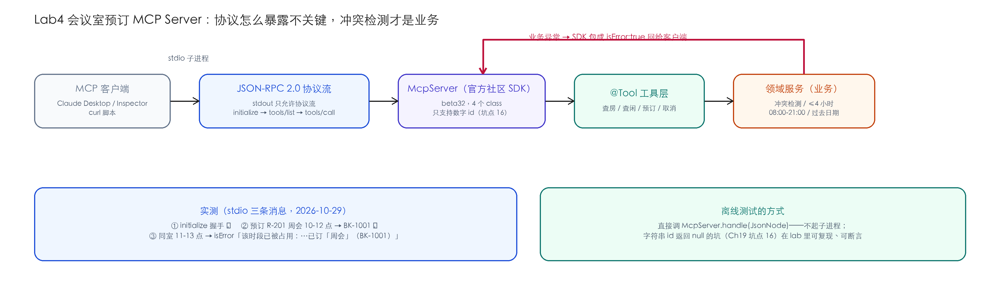

# Lab4 · 会议室预订 MCP Server——写操作的护栏与协议行为

> **基线**：LangChain4j `1.22.0` + `langchain4j-community-mcp-server:1.22.0-beta32` ｜ JDK 21 ｜ 2026-10-29 实测 ｜ **全程零 LLM、零 key**

## 场景

公司有三间会议室，行政想让所有 AI 客户端（Claude Desktop / 内部助手）都能查空闲、
订会议室、取消预订。这是 MCP 服务端最真实的入门场景：**有写操作**（预订/取消），
所以白名单、冲突检测、异常回传全都有了业务动机——不是 CRUD 演示。



## 知识映射

| Lab4 里做的事 | 来自 | 在这里的新意 |
|---|---|---|
| 官方社区 Server SDK（`McpServer`） | Ch19 | 只暴露 4 个 @Tool，重点在"暴露什么、不暴露什么" |
| stdio 传输 | Ch19 | stdout 只允许协议流；本 lab 零日志依赖，天然不污染 |
| 业务异常 → isError | Ch19 | SDK 自动包装，客户端拿到的是可读文案不是堆栈 |
| 协议行为断言 | Ch19 | `McpServer.handle(JsonNode)` 可以直接驱动——测试不起子进程 |

## 快速开始

```bash
cd labs/lab4-meeting-mcp
mvn test                        # 离线：5 个测试（协议 + 业务护栏 + 坑点复现）
# stdio 实测：打一个可执行 jar 或直接用 classpath 起子进程（见下）
mvn compile dependency:build-classpath -Dmdep.outputFile=cp.txt
{ printf '%s\n' '{"jsonrpc":"2.0","id":1,"method":"initialize","params":{...}}'
  sleep 2
  printf '%s\n' '{"jsonrpc":"2.0","id":2,"method":"tools/call","params":{"name":"bookRoom","arguments":{...}}}'
  sleep 2; } | java -cp "target/classes:$(cat cp.txt)" com.example.lab.McpServerMain
```

## 核心实现

分层只有两层：`MeetingRoomMcpTools`（@Tool 薄适配）+ `MeetingRoomService`（业务）。
三条业务规则全在领域层（`MeetingRoomService.java`）：

```java
if (endHour - startHour > MAX_HOURS)          // ① 单次 ≤ 4 小时
    throw new BookingException("booking.too_long", ...);
if (conflict)                                  // ② 同室同时段冲突拒绝（附占用明细）
    throw new BookingException("booking.conflict", "该时段已被占用：" + busy);
if (d.isBefore(LocalDate.now()))               // ③ 过去日期不可订
    throw new BookingException("booking.past_date", ...);
```

业务异常直接往上抛——SDK 把它包成 `isError:true` 给客户端。实测 stdio 三条消息：

```
{"id":2,"result":{"content":[{"type":"text","text":"预订成功：R-201（中会议室（12 人））2026-11-02 10:00-12:00 主题[周会] 预订号 BK-1001"}]},"jsonrpc":"2.0"}
{"id":3,"result":{"content":[{"type":"text","text":"该时段已被占用：10:00-12:00 已订「周会」（BK-1001）"}],"isError":true},"jsonrpc":"2.0"}
```

第二条客户端能直接把"已被占用 + 谁占的"念给用户听——**异常文案就是产品文案**。

## 实测与测试

- **协议**：`initialize` 返回 protocolVersion；`tools/list` 恰好 4 个工具（`Lab4McpServerTest`）。
- **业务**：预订成功 → 冲突被拒 → 换时段成功三连；超 4 小时/时段越界/过去日期全部 isError。
- **坑点复现**：字符串 id 的请求让 `handle()` 返回 **null**（Ch19 坑点 16 的根源）——
  在 lab 里可复现、可断言：

```java
@Test
void stringIdSilentlyDropped() {
    assertThat(call("{\"jsonrpc\":\"2.0\",\"id\":\"req-1\",\"method\":\"tools/list\",\"params\":{}}")).isNull();
}
```

## 验收清单（三件套）

- [x] **金标集**：5 个测试断言 = 协议 2 条 + 业务护栏 4 条规则 + 坑点 1 条
- [x] **成本报表**：**零 LLM 调用**——MCP 服务端本来就不该有模型成本；这也是"成本报表"要按 lab 分开算的原因
- [x] **踩坑记录**：见下
- [ ] 你的部分：加"取消需验证预订人"（`bookedBy` 对不上拒绝取消），补 2 个测试

## 踩坑记录（2026-10-29 当天）

1. **`handle()` 返回的是 `McpJsonRpcMessage` 子类，不是 JsonNode**——测试里用 Jackson
   序列化一次再转树来断言（SDK 的 `@JsonAnyGetter` 让子类字段都能被序列化出来）。
2. **预订号是进程内自增**：重启就重置——教学版内存态的边界要写清楚，生产换 DB 派发。
3. **Claude Desktop 直连时**，普通 jar 的 Main-Class 是 Spring 的 JarLauncher（Ch19 坑点 13）；
   本 lab 是纯 Maven 无 Spring，`java -cp` 直跑 main 反而是最简路径——**坑点是否成立取决于项目形态**，不要背结论。

## 练习

1. 加"每周固定例会批量预订"工具，想清楚它和冲突检测的执行顺序。
2. 把 `MeetingRoomService` 换成 SQLite 文件持久化，测试语义不变（这是"领域层隔离"的验收）。
3. 思考题：如果要把"取消别人的预订"变成高危操作，你会在哪一层拦——@Tool、领域服务、还是 MCP 白名单？三层各拦什么？
