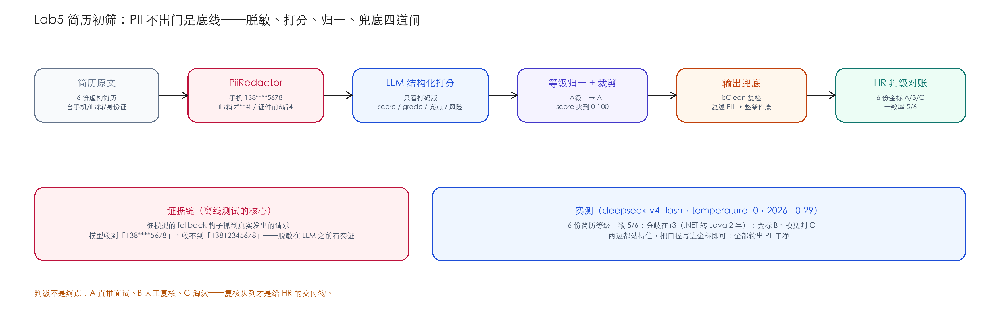

# Lab5 · 简历初筛 Agent——PII 不出门是底线

> **基线**：LangChain4j `1.22.0` ｜ JDK 21 ｜ 2026-10-29 实测 ｜ 离线测试零 key 可跑

## 场景

HR 每天收几百份简历，初筛要回答的只有三件事：匹配几分、要不要约面、有什么风险。
简历是**PII 重灾区**（手机号、邮箱、身份证号全在上面）——模型只该看到"这个人行不行"，
不该看到"这个人是谁"。本 lab 是全书能力的总装：脱敏（Ch21）+ 结构化输出（Ch07）+
口径归一（Ch13 精神）+ 输出兜底。



## 知识映射

| Lab5 里做的事 | 来自 | 在这里的新意 |
|---|---|---|
| PII 脱敏（正则三件套） | Ch21 OutputGuard | 从"输出打码"变成"输入侧就不给"——模型只见打码版 |
| 结构化输出 | Ch07 | 字段即决策依据：score/grade/亮点/风险/是否约面 |
| 口径归一 | Ch13 | "A级"/"a"/"A（高度匹配）" → 枚举；认不出进 UNKNOWN 不猜 |
| 输出兜底 | Ch21 | 模型复述 PII → 整条结果作废，宁可错杀不外泄 |

## 快速开始

```bash
cd labs/lab5-resume-screen
mvn test                        # 离线：5 个测试（脱敏/归一/证据链/兜底/裁剪）
export DEEPSEEK_API_KEY=sk-xxx
mvn compile exec:java -Dexec.mainClass=com.example.lab.ResumeScreeningApp
```

## 核心实现

三步串联在 `ResumeScreeningService.screen()`：

```java
String masked = PiiRedactor.redact(resumeText);        // ① 模型只见打码版
ScreeningResult raw = assistant.screen(jd, masked);    // ② 结构化打分
raw.normalizedGrade = normalizeGrade(raw.grade);       // ③ 口径归一
if (!PiiRedactor.isClean(raw.strengthsSummary + raw.risksSummary)) {
    throw new IllegalStateException("筛选结果里检测到未脱敏 PII，已拦截");   // ④ 输出兜底
}
```

**证据链是离线测试最值钱的部分**（`Lab5ResumeScreenTest`）：桩模型的 fallback 钩子
抓到真实发出去的请求，断言——

```java
String sentToModel = seen.get().messages().toString();
assertThat(sentToModel).contains("138****5678");
assertThat(sentToModel).doesNotContain("13812345678");
```

模型收到的文本含打码版、不含原文——"脱敏在 LLM 之前"不是注释里的一句话，是可断言的事实。

## 实测：6 份简历 × 1 个 JD（deepseek-v4-flash，temperature=0）

| 简历 | 金标 | 模型 | 得分 | 判定 |
|---|---|---|---|---|
| r1（8 年头部电商微服务） | A | A | 92 | ✅ |
| r2（3 年 CRUD 外包） | C | C | 30 | ✅ |
| r3（.NET 4 年 + Java 2 年） | **B** | **C** | 35 | ❌ 分歧 |
| r4（7 年但 6 家公司） | B | B | 62 | ✅ |
| r5（应届两段实习） | C | C | 20 | ✅ |
| r6（10 年支付中台架构） | A | A | 88 | ✅ |

**等级一致率 5/6，全部输出 PII 干净。** 唯一分歧 r3：金标按"总年限 6 年"给 B，
模型按"Java 经验仅 2 年不满足 JD 的 5 年"给 C——**两边都站得住**。这类分歧的正确
处理不是改模型，是把口径写进金标（"跨栈转型的年限怎么算"），评估才有裁判权。

## 验收清单（三件套）

- [x] **金标集**：`gold.json` 6 份简历期望等级 + 期望行为表（上表）
- [x] **成本报表**：一次全量 6 次模型调用，约 ¥0.002–0.007；脱敏/归一/兜底全在离线侧零成本
- [x] **踩坑记录**：见下
- [ ] 你的部分：加"复核队列"导出（B 级简历 + 理由），并对 r3 类分歧写出你的口径

## 踩坑记录（2026-10-29 当天）

1. **结构化输出对象里放了枚举字段**（`Grade normalizedGrade`）一开始想直接当模型契约——
   模型写不出枚举，改成"模型给 String、代码归一成枚举"，两个字段分开：`grade` 存原始、
   `normalizedGrade` 存结论。模型契约与业务结论分离。
2. **私有字段在测试里直接点号访问**编译失败——lab 代码从简没上 Lombok，getter 老老实实写。
3. **身份证正则 `\b\d{17}[\dXx]\b` 会咬 18 位业务编号**（Ch21 21.6.1 的老坑）——本 lab 语料
   里身份证都是真格式所以没触发；换真实数据先跑 21.6.1 的长度轴测试再上线。

## 练习

1. 把 JD 做成可配置（不同岗位不同 JD），金标集扩到 3 个岗位 × 6 份简历，看一致率变化。
2. 加"学历/年限硬门槛预筛"（正则层），被硬筛掉的简历不再调模型——算一算省了多少钱。
3. 思考题：初筛拒掉了优秀候选人，责任在模型还是在口径设计？用 r3 的分歧写一段你的判断依据。
